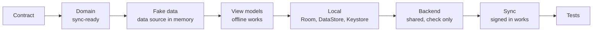
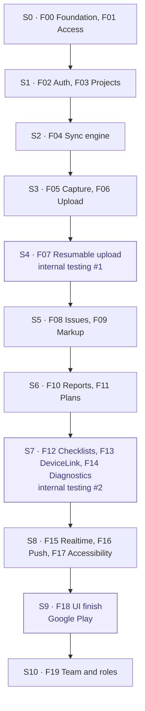

# Roadmap (Android)

<dl><dd>

- Work runs **by sprint**: 2 weeks each, 1 developer, ~50h. Same sprints and feature numbers as iOS.
- The backend is shared and built in [site-log-be](https://github.com/DAMHONGDUC/site-log-be); Android rows only check it.
- Specs: [feature-docs](feature-docs/); guides: [feature-guide](feature-guide/README.md). This file owns the ticks.

</dd></dl>

## Contents

<dl><dd>

1. [How work is split](#how-work-is-split)
2. [Summary](#summary)
3. [S0 — Foundation and access](#s0--foundation-and-access--58h)
4. [S1 — Auth and projects](#s1--auth-and-projects--50h)
5. [S2 — Sync engine](#s2--sync-engine--37h)
6. [S3 — Capture and upload](#s3--capture-and-upload--50h)
7. [S4 — Resumable upload · internal testing #1](#s4--resumable-upload--internal-testing-1--39h)
8. [S5 — Issues and markup](#s5--issues-and-markup--45h)
9. [S6 — Reports and floor plans](#s6--reports-and-floor-plans--52h)
10. [S7 — Checklists, DeviceLink, diagnostics · internal testing #2](#s7--checklists-devicelink-diagnostics--internal-testing-2--47h)
11. [S8 — Realtime, push, accessibility](#s8--realtime-push-accessibility--38h)
12. [S9 — UI finish and Google Play](#s9--ui-finish-and-google-play--48h)
13. [Rules](#rules)

</dd></dl>

## How work is split

<dl><dd>

- **No fake repository.** Fake data lives only in data source `Impl`s; the local and sync steps replace data source insides, never a type or its binding in `di/`.
- **Offline first inside every feature:** Continue offline works before the sync step.
- The UI skeleton (~30% of Figma, every screen on `FakeData`) is built in S0 (F00.7); the other ~70% is F18.
- Step format: `FXX.n - [layer] - [est hours] - description`.
- Estimates: dev-hours for one developer new to Kotlin and Compose, learning included.

</dd></dl>

## Summary

<dl><dd>

| | |
|---|---|
| Total | 10 sprints, 19 features ≈ 464 hours (backend excluded: shared) |
| Releases | Play internal testing #1 end of S4, #2 end of S7, Google Play production end of S9 |
| Goal | Google Play release with the full scope, feature parity with iOS |

</dd></dl>

## S0 — Foundation and access · 58h

<dl><dd>

- Demo: zero warnings, CI green; biometric / passcode lock with Continue offline; every screen as a skeleton.
- Overview: [S0](feature-guide/S0-foundation-access/README.md)

**F00 — Foundation · 41h** · [guide](feature-guide/S0-foundation-access/F00-foundation.md)

- [ ] **F00.0** - [Tooling] - [8h] - Gradle project, version catalog, `build-logic`, Spotless/ktlint, detekt, entry point
- [ ] **F00.1** - [Architecture] - [6h] - Modules, Hilt, `AppClock`, `AppLogger`, `Outcome`, test libraries
- [ ] **F00.2** - [CI] - [4h] - GitHub Actions PR checks, Gradle test task
- [ ] **F00.3** - [CI] - [4h] - CI guards: layer imports, zero warnings, no `println`, secret scan
- [ ] **F00.4** - [Design system] - [6h] - `DSColor`, `DSSpacing`, `DSTextStyle`, `SiteLogTheme`, `DSGallery`, hex test
- [ ] **F00.5** - [Backend] - [0h] - Shared: [site-log-be S0](https://github.com/DAMHONGDUC/site-log-be/blob/main/docs/feature-guide/S0-foundation/README.md); check `GET /health` from the emulator
- [ ] **F00.6** - [Config] - [1h] - `API_BASE_URL` per build type, debug network security config
- [ ] **F00.7** - [UI] - [12h] - Skeleton screens (~30% of mockups), `FakeData`, Navigation 3 tabs and coordinators, dev menu

**F01 — Access and app lock · 17h** · [guide](feature-guide/S0-foundation-access/F01-access.md)

- [ ] **F01.1** - [Domain] - [1h] - `AccessSetting`, `PasscodeCheck`, `AccessError`, `AccessRepository`, use cases
- [ ] **F01.2** - [Fake data] - [2h] - Real `AccessRepositoryImpl` over in-memory data sources, bindings, dev menu
- [ ] **F01.3** - [View models] - [6h] - `RootViewModel`, A1–A3, S4, S5 view models
- [ ] **F01.4** - [Local] - [8h] - DataStore, Keystore secure store, `BiometricPrompt` inside the data sources
- [ ] Tests written and green

</dd></dl>

## S1 — Auth and projects · 50h

<dl><dd>

- Overview: [S1](feature-guide/S1-auth-projects/README.md)

**F02 — Auth · 18h** · [guide](feature-guide/S1-auth-projects/F02-auth.md)

- [ ] **F02.1** - [Contract] - [1h] - Bearer token, `DELETE /account` DTO
- [ ] **F02.2** - [Domain] - [1h] - `AuthUser`, `AuthError`, `AuthRepository`, use cases
- [ ] **F02.3** - [Fake data] - [1h] - Real `AuthRepositoryImpl` over in-memory data sources
- [ ] **F02.4** - [View models] - [4h] - Sign in, account, sign out, delete account
- [ ] **F02.5** - [Local] - [10h] - Firebase Auth (Google · Apple · email), `HttpClient` with token and 401 refresh
- [ ] **F02.6** - [Backend] - [1h] - Android app in both Firebase projects, SHA fingerprints; `401` without a token
- [ ] Tests written and green

**F03 — Projects, sessions, locations · 32h** · [guide](feature-guide/S1-auth-projects/F03-projects.md)

- [ ] **F03.1** - [Contract] - [1h] - `ProjectDTO`, `LocationDTO`, `SessionDTO`
- [ ] **F03.2** - [Domain] - [4h] - Sync-ready entities, interfaces, use cases
- [ ] **F03.3** - [Fake data] - [2h] - Repositories + data sources in memory
- [ ] **F03.4** - [View models] - [10h] - Projects screens (list · detail · survey · bulk)
- [ ] **F03.5** - [Local] - [15h] - Room entities, DAOs, database v1, exported schema, fixture
- [ ] **F03.6** - [Backend] - [0h] - Shared: `0001_projects.sql` on staging
- [ ] Tests written and green

</dd></dl>

## S2 — Sync engine · 37h

<dl><dd>

- Overview: [S2](feature-guide/S2-sync-engine/README.md)

**F04 — Sync engine · 37h** · [guide](feature-guide/S2-sync-engine/F04-sync-engine.md)

- [ ] **F04.1** - [Contract] - [2h] - Pull and push DTOs
- [ ] **F04.2** - [Domain] - [1h] - `SyncStatus`, `SyncRepository`, use cases
- [ ] **F04.3** - [Fake data] - [18h] - Engine over an in-memory outbox and server (queue · push · pull · conflicts · deletes)
- [ ] **F04.4** - [View models] - [3h] - Sync tab status, account
- [ ] **F04.5** - [Local] - [6h] - Outbox and cursor in Room; F03 data sources write outbox rows
- [ ] **F04.6** - [Backend] - [0h] - Shared: `/sync/pull`, `/sync/push` on staging
- [ ] **F04.7** - [Sync] - [7h] - Remote data source on `HttpClient`, triggers, WorkManager periodic sync, Android ↔ iOS convergence
- [ ] Tests written and green

</dd></dl>

## S3 — Capture and upload · 50h

<dl><dd>

- Overview: [S3](feature-guide/S3-capture-upload/README.md)

**F05 — Capture · 22h** · [guide](feature-guide/S3-capture-upload/F05-capture.md)

- [ ] **F05.1** - [Contract] - [1h] - `CaptureDTO`
- [ ] **F05.2** - [Domain] - [1h] - `CameraRepository`, `RecordCaptureUseCase`
- [ ] **F05.3** - [Fake data] - [2h] - Repository + capture data source on a bundled photo
- [ ] **F05.4** - [View models] - [3h] - Camera and review view models
- [ ] **F05.5** - [Local] - [14h] - CameraX, files on disk, streamed SHA-256, location
- [ ] **F05.6** - [Backend] - [0h] - Shared: `0003_captures.sql`
- [ ] **F05.7** - [Sync] - [1h] - Captures join sync
- [ ] Tests written and green

**F06 — Upload (single PUT) · 28h** · [guide](feature-guide/S3-capture-upload/F06-upload.md)

- [ ] **F06.1** - [Contract] - [1h] - Begin / complete DTOs
- [ ] **F06.2** - [Domain] - [1h] - `uploadkit` API and job types
- [ ] **F06.3** - [Fake data] - [2h] - `UploadStoreImpl` in memory
- [ ] **F06.4** - [View models] - [6h] - Sync tab view models
- [ ] **F06.5** - [Local] - [4h] - Upload store on Room
- [ ] **F06.6** - [Backend] - [0h] - Shared: begin, idempotent `complete`, abort, media URLs
- [ ] **F06.7** - [Sync] - [14h] - `UploadWorker`, foreground info, single PUT, state machine, backoff
- [ ] Tests written and green

</dd></dl>

## S4 — Resumable upload · internal testing #1 · 39h

<dl><dd>

- Overview: [S4](feature-guide/S4-resumable-upload/README.md)

**F07 — Resumable upload · 39h** · [guide](feature-guide/S4-resumable-upload/F07-resumable-upload.md)

- [ ] **F07.1** - [Contract] - [1h] - Multipart plan, refresh, abort DTOs
- [ ] **F07.2** - [Backend] - [0h] - Shared: multipart begin, `/parts/refresh`, abort
- [ ] **F07.3** - [Sync] - [14h] - Chunk planner, ranged part upload, complete
- [ ] **F07.4** - [Sync] - [8h] - Launch reconciliation: WorkManager ↔ store
- [ ] **F07.5** - [Sync] - [5h] - Wi-Fi only, dedupe by hash, URL refresh
- [ ] **F07.6** - [Sync] - [3h] - 200-file demo behind the screens
- [ ] **F07.7** - [Release] - [8h] - Upload key, Play App Signing, Fastlane `internal` lane, internal testing #1
- [ ] Tests written and green

</dd></dl>

## S5 — Issues and markup · 45h

<dl><dd>

- Overview: [S5](feature-guide/S5-issues-markup/README.md)

**F08 — Issues and before/after · 24h** · [guide](feature-guide/S5-issues-markup/F08-issues.md)

- [ ] **F08.1** - [Contract] - [1h] - `IssueDTO`, `IssueCaptureDTO`, `PhraseDTO`
- [ ] **F08.2** - [Domain] - [3h] - Entities, pairing, close, carry-over
- [ ] **F08.3** - [Fake data] - [3h] - Repositories + data sources in memory
- [ ] **F08.4** - [View models] - [7h] - Sheet, list, detail, verification camera
- [ ] **F08.5** - [Local] - [8h] - Room, on-device `SpeechRecognizer`
- [ ] **F08.6** - [Backend] - [0h] - Shared: `0005_issues.sql`
- [ ] **F08.7** - [Sync] - [2h] - Issues, issue captures, phrases join sync
- [ ] Tests written and green

**F09 — Markup and stamps · 21h** · [guide](feature-guide/S5-issues-markup/F09-markup.md)

- [ ] **F09.1** - [Contract] - [1h] - `AnnotationDTO` (shapes JSON shared with iOS)
- [ ] **F09.2** - [Domain] - [1h] - `AnnotationShape`, `NormalizedPoint`, `TrustedTimestamp`
- [ ] **F09.3** - [Fake data] - [1h] - Repository + data sources in memory
- [ ] **F09.4** - [View models] - [4h] - Markup editor, stamp preview
- [ ] **F09.5** - [Local] - [7h] - Compose canvas layer, stamped derivative
- [ ] **F09.6** - [Backend] - [0h] - Shared: `0006_annotations.sql`
- [ ] **F09.7** - [Sync] - [7h] - Annotations sync; trusted time from the server clock
- [ ] Tests written and green

</dd></dl>

## S6 — Reports and floor plans · 52h

<dl><dd>

- Overview: [S6](feature-guide/S6-reports-plans/README.md)

**F10 — Reports and audit log · 33h** · [guide](feature-guide/S6-reports-plans/F10-reports.md)

- [ ] **F10.1** - [Contract] - [1h] - `VerifyDTO`, `ReportBrandingDTO`
- [ ] **F10.2** - [Domain] - [3h] - Report types, audit entry, pure pagination
- [ ] **F10.3** - [Fake data] - [2h] - Repositories + data sources in memory
- [ ] **F10.4** - [View models] - [4h] - Report flow screens
- [ ] **F10.5** - [Local] - [21h] - CSV, `PdfDocument` renderer, integrity footer, Keystore HMAC audit chain
- [ ] **F10.6** - [Backend] - [0h] - Shared: branding table, `GET /verify/:code`
- [ ] **F10.7** - [Sync] - [2h] - Branding syncs
- [ ] Tests written and green

**F11 — Floor plans and pins · 19h** · [guide](feature-guide/S6-reports-plans/F11-plans.md)

- [ ] **F11.1** - [Contract] - [1h] - `PlanSheetDTO`, plan file key
- [ ] **F11.2** - [Domain] - [1h] - Plan types and pin use cases
- [ ] **F11.3** - [Fake data] - [1h] - Repository + data sources in memory
- [ ] **F11.4** - [View models] - [5h] - Plans screens
- [ ] **F11.5** - [Local] - [9h] - SAF import, `PdfRenderer` tiles, pins
- [ ] **F11.6** - [Backend] - [0h] - Shared: `0008_plan_sheets.sql`
- [ ] **F11.7** - [Sync] - [2h] - Plan sheets sync, plan files upload
- [ ] Tests written and green

</dd></dl>

## S7 — Checklists, DeviceLink, diagnostics · internal testing #2 · 47h

<dl><dd>

- Overview: [S7](feature-guide/S7-checklists-devices-diagnostics/README.md)

**F12 — Checklists · 12h** · [guide](feature-guide/S7-checklists-devices-diagnostics/F12-checklists.md)

- [ ] **F12.1** - [Contract] - [1h] - Template, item, run, result DTOs
- [ ] **F12.2** - [Domain] - [1h] - Checklist types, Fail → issue use case
- [ ] **F12.3** - [Fake data] - [1h] - Repository + data sources in memory
- [ ] **F12.4** - [View models] - [4h] - Checklists screens
- [ ] **F12.5** - [Local] - [4h] - Built-in templates and results on Room
- [ ] **F12.6** - [Backend] - [0h] - Shared: `0009_checklists.sql`
- [ ] **F12.7** - [Sync] - [1h] - Checklist tables join sync
- [ ] Tests written and green

**F13 — DeviceLink · 18h** · [guide](feature-guide/S7-checklists-devices-diagnostics/F13-devicelink.md)

- [ ] **F13.1** - [Contract] - [1h] - Mock meter profile: service, characteristic, bytes (same as iOS)
- [ ] **F13.2** - [Domain] - [1h] - DeviceLink types
- [ ] **F13.3** - [Fake data] - [1h] - Repository + data source on scripted readings
- [ ] **F13.4** - [View models] - [3h] - Pairing and camera overlay
- [ ] **F13.5** - [Local] - [8h] - BLE central inside the data source (manager · profiles · data source)
- [ ] **F13.6** - [Mock] - [3h] - Mock meter (GATT server) on a second Android phone
- [ ] **F13.7** - [Release] - [1h] - Feature flag, off for users
- [ ] Tests written and green

**F14 — Diagnostics · 17h** · [guide](feature-guide/S7-checklists-devices-diagnostics/F14-diagnostics.md)

- [ ] **F14.1** - [Domain] - [1h] - Diagnostics snapshot
- [ ] **F14.2** - [Fake data] - [1h] - Repository + data source with fixed values
- [ ] **F14.3** - [View models] - [2h] - Diagnostics and cleanup screens
- [ ] **F14.4** - [Local] - [8h] - Storage checks, cleanup, bundle, standby bucket, Crashlytics
- [ ] **F14.5** - [Release] - [5h] - Profiling pass and internal testing #2
- [ ] Tests written and green

</dd></dl>

## S8 — Realtime, push, accessibility · 38h

<dl><dd>

- Overview: [S8](feature-guide/S8-realtime-push-quality/README.md)

**F15 — Realtime · 13h** · [guide](feature-guide/S8-realtime-push-quality/F15-realtime.md)

- [ ] **F15.1** - [Contract] - [1h] - WebSocket messages
- [ ] **F15.2** - [Domain] - [1h] - Upload events, realtime repository
- [ ] **F15.3** - [Fake data] - [1h] - Repository + data source on a timer
- [ ] **F15.4** - [View models] - [2h] - Live state on the Sync tab
- [ ] **F15.5** - [Backend] - [0h] - Shared: `/ws`, verify worker
- [ ] **F15.6** - [Sync] - [8h] - OkHttp WebSocket inside the data source (client · reconnect)
- [ ] Tests written and green

**F16 — Push and deep links · 11h** · [guide](feature-guide/S8-realtime-push-quality/F16-push-deeplinks.md)

- [ ] **F16.1** - [Contract] - [1h] - FCM data payload, `POST /devices` with `platform: "android"`
- [ ] **F16.2** - [Domain] - [1h] - Deep link parser
- [ ] **F16.3** - [Fake data] - [1h] - Repository + token data source in memory
- [ ] **F16.4** - [View models] - [2h] - Notification permission moment, settings row
- [ ] **F16.5** - [Local] - [4h] - FCM service, channels, `sitelog://` intent filter, router
- [ ] **F16.6** - [Backend] - [0h] - Shared [site-log-be F16](https://github.com/DAMHONGDUC/site-log-be/blob/main/docs/feature-guide/S8-realtime-push/F16-push.md): check an Android token gets a data message
- [ ] **F16.7** - [Sync] - [2h] - Token sent through `HttpClient`
- [ ] Tests written and green

**F17 — Accessibility and performance · 14h** · [guide](feature-guide/S8-realtime-push-quality/F17-accessibility-performance.md)

- [ ] **F17.1** - [Polish] - [8h] - TalkBack, font scale 200%, contrast, 48 dp targets
- [ ] **F17.2** - [Release] - [6h] - Budgets with traces, Baseline Profile, Data safety draft, feedback

</dd></dl>

## S9 — UI finish and Google Play · 48h

<dl><dd>

- Overview: [S9](feature-guide/S9-release/README.md)

**F18 — UI finish and Google Play · 48h** · [guide](feature-guide/S9-release/F18-ui-finish.md)

- [ ] **F18.1** - [UI] - [6h] - Components to Figma
- [ ] **F18.2** - [UI] - [3h] - Figma S1: access screens
- [ ] **F18.3** - [UI] - [6h] - Figma S2–S3: projects, sessions, rooms
- [ ] **F18.4** - [UI] - [6h] - Figma S4–S5: camera, capture review, issues
- [ ] **F18.5** - [UI] - [5h] - Figma S6–S7: markup, stamp, plans
- [ ] **F18.6** - [UI] - [6h] - Figma S8–S9: checklists, reports
- [ ] **F18.7** - [UI] - [5h] - Figma S10–S11: sync, diagnostics, settings
- [ ] **F18.8** - [UI] - [5h] - Dark theme, empty / error / offline states, imagery
- [ ] **F18.9** - [Release] - [6h] - Accessibility re-check, store listing, Data safety, production rollout
- [ ] **F18.10** - [Tests] - [6h] - Optional: Roborazzi screenshots (not counted)
- [ ] **F18.11** - [Backend] - [0h] - Shared: production backend already live

</dd></dl>

## S10 — Team and roles · 30h

<dl><dd>

- Demo: an Admin invites an Inspector; the Inspector joins from the link and sees only their projects; a Viewer reads but cannot change anything.
- Overview: [S10](feature-guide/S10-team-roles/README.md)

**F19 — Team and roles · 30h** · [guide](feature-guide/S10-team-roles/F19-team-roles.md)

- [ ] **F19.1** - [Contract] - [2h] - `/me`, members, invitations, `createdBy`
- [ ] **F19.2** - [Domain] - [4h] - Roles and permissions
- [ ] **F19.3** - [Data] - [4h] - Team repository, role cache
- [ ] **F19.4** - [UI] - [6h] - Gate every screen by role (T7, T8)
- [ ] **F19.5** - [UI] - [8h] - Team screens T1–T4
- [ ] **F19.6** - [Platform] - [4h] - Invite App Link, T5 Join, T6 Not a member
- [ ] **F19.7** - [Data] - [2h] - `403 forbidden`, rejected `forbidden:<action>`, resync
- [ ] **F19.8** - [Backend] - [16h] - [site-log-be F19](https://github.com/DAMHONGDUC/site-log-be/blob/main/docs/feature-guide/S10-team-roles/F19-team-roles.md): shared sync, roles, invites

</dd></dl>

## Rules

<dl><dd>

1. **Offline first, inside every feature.**
2. **No fake repositories:** fake data only in data source `Impl`s.
3. **Continue offline is a product mode:** test it every sprint.
4. **Task size 2–6h:** split a bigger step when it starts.
5. **Tests after the feature works** end to end.
6. **Visual finish waits for F18.**
7. **Tick the box** here in the commit that finishes the step.

</dd></dl>
