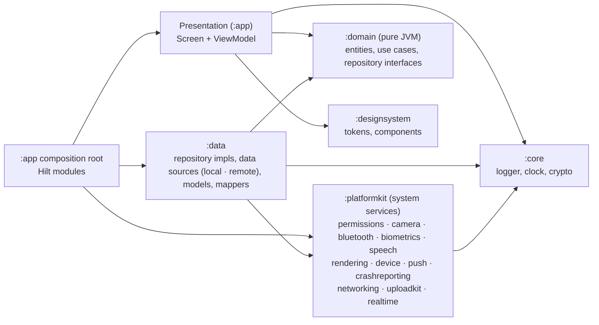

# 00 — Overview (Android)

<dl><dd>

- Product, data model, architecture, data flows, infrastructure, conventions and decisions for the Android app.
- Same product and feature specs as iOS; spec numbers `01`–`19` are stable and used by [ROADMAP.md](../ROADMAP.md).
- This is the approved target design for `site-log-android`; nothing here is implemented yet.
- **Reading order:** this overview → the feature spec → its guide in [feature-guide/](../feature-guide/README.md).
- iOS original: [docs/feature-docs/00-overview.md](https://github.com/DAMHONGDUC/site_log_swift_ui/blob/main/docs/feature-docs/00-overview.md).

</dd></dl>

## Contents

<dl><dd>

1. [Product](#1-product) — positioning, core rule, stack, non-goals
2. [Market](#2-market)
3. [Data model](#3-data-model)
4. [Architecture](#4-architecture) — layout, modules, MVVM, Hilt, startup, errors
5. [Data flows](#5-data-flows)
6. [Infrastructure](#6-infrastructure)
7. [Conventions](#7-conventions)
8. [Feature specs](#8-feature-specs)
9. [Decisions](#9-decisions) — A01–A22
10. [Beginner glossary](#beginner-glossary)

</dd></dl>

## Beginner glossary

<dl><dd>

| Term | Meaning | Short example |
|---|---|---|
| Composable | A Kotlin function annotated `@Composable` that describes UI | `Text(stringResource(R.string.projects_list_title))` |
| ViewModel | An `androidx.lifecycle.ViewModel` that survives rotation, holds screen state and handles actions | `ProjectListViewModel` loads rows |
| `StateFlow` | A stream that always has a current value; the screen collects it | `val state: StateFlow<ProjectListState>` |
| Coroutine | A function that can pause without blocking a thread | `viewModelScope.launch { load() }` |
| Gradle module | A separately compiled part of the app with its own dependencies | `:domain`, `:data` |
| Hilt | Google's DI library on Dagger; generates the wiring at compile time | `@Provides fun projectRepository(...)` |
| Room | Google's SQLite library: `@Entity` tables, `@Dao` queries, migrations | `ProjectModel`, `ProjectDao` |
| WorkManager | Runs deferrable work that survives app kill and reboot | The upload worker |
| Use case | One named action the app can perform | `CreateProjectUseCase` |
| Repository | A boundary for reading and writing app data | `ProjectRepository` |
| Entity | A business concept with no storage or UI types | `Project` |
| DTO | A data-transfer object at a system boundary | JSON from the server |
| String resource | A key in `strings.xml` whose text is translated | `R.string.access_sign_in_title` → “Sign in” |

</dd></dl>

## 1. Product

<dl><dd>

| | |
|---|---|
| What | Offline-first Android app for recording construction site conditions |
| Deliverable | Signed PDF inspection report |
| Users | Site supervisors, subcontractors, apartment handover teams |

```
Create project → start session → walk floors/rooms, capture + log issues
→ reach WiFi, background upload → export signed PDF report
```

### 1.1 Positioning and constraints

<dl><dd>

- Competitors lose evidence three ways: stalled or incomplete uploads, photos vanishing on reload, sync failing with no reason.
- SiteLog assumes the network is bad.

| Constraint | Consequence |
|---|---|
| Sites, basements, alleys have weak or no signal | Every write path completes offline |
| 150–250 files and several GB per session | Upload survives process death, Doze, network loss and reboot |
| User swipes the app away and keeps walking | No state lives only in RAM |
| Many mid-range Android phones on site (3–4 GB RAM) | Downsampled bitmaps, streamed hashing, one bitmap per PDF page |
| The PDF is the paid deliverable | Never truncate, never silently drop images |

</dd></dl>

### 1.2 Core rule

<dl><dd>

- `Capture` is immutable after creation; only descriptive metadata is editable.
- Each carries a `sha256` computed after the file closes, before the DB write.
- Annotations are a separate vector layer, so markup never invalidates a hash.

</dd></dl>

### 1.3 Stack

<dl><dd>

| Area | Choice |
|---|---|
| UI | Jetpack Compose (BOM 2026.09), Material 3; `minSdk` 29, `targetSdk` 36, `compileSdk` 37 ([A22](#a22--minimum-sdk-29)) |
| Language | Kotlin 2.4, code targets Java 21; coroutines + Flow; AGP 9 with built-in Kotlin, Gradle 9.6 (its daemon runs on JDK 25) |
| Architecture | Clean Architecture (Presentation · Domain · Data), MVVM; `:domain`, `:data`, `:platformkit`, `:core`, `:designsystem` are Gradle modules, Presentation lives in `:app` ([A09](#a09--layers-as-gradle-modules)) |
| Dependency injection | [Hilt](https://dagger.dev/hilt/) ([A01](#a01--hilt-for-dependency-injection)) |
| Navigation | [Navigation 3](https://developer.android.com/guide/navigation/navigation-3) (`androidx.navigation3`) ([A17](#a17--navigation-3)) |
| Local store | Room with KSP, exported schemas ([A10](#a10--room-for-the-local-store)) |
| Settings | DataStore Preferences |
| Secrets | Android Keystore (AES-GCM key, HMAC key) |
| Media | CameraX (`camera-core`, `camera-video`, `camera-view`), `MediaRecorder` for audio, Media3 Transformer to join pre-record segments |
| Plans | `PdfRenderer` + `BitmapRegionDecoder`, Compose tiles |
| Crypto | `MessageDigest`, `Mac`, `SecretKeyFactory` (PBKDF2), Keystore |
| External devices | `android.bluetooth.le` (BLE central; GATT server for the mock) |
| Transport | Hand-written WorkManager + OkHttp engine ([A02](#a02--hand-written-upload-engine)) |
| Object storage | Amazon S3, multipart + presigned URLs (same backend) |
| Realtime | OkHttp `WebSocket` ([A04](#a04--websocket-realtime-channel)) |
| Remote images | [Coil](https://coil-kt.github.io/coil/) 3 ([A05](#a05--coil-for-remote-images)) |
| Auth / crash / push | Firebase Android BoM: Auth, Crashlytics, Cloud Messaging — **no Firestore** ([A07](#a07--firebase-crashlytics)) |
| Sign-in | Credential Manager (Google), Firebase `OAuthProvider("apple.com")` (Apple), email |
| Location | Fused Location Provider (`play-services-location`) |
| JSON | kotlinx.serialization |
| Tests | JUnit 4, kotlinx-coroutines-test, Turbine, Truth, Robolectric, Room `MigrationTestHelper`, Compose UI test; Roborazzi optional, last (F18) ([A06](#a06--test-libraries)) |
| Tooling | Gradle Kotlin DSL, version catalog, convention plugins, detekt 1.23, ktlint 1.8 (`android_studio` style) via Spotless, Android Lint, Fastlane `supply`, GitHub Actions |
| Dev only | Compose Live Edit, `@Preview`, LeakCanary (debug) |
| Backend | Shared with iOS: [site-log-be](https://github.com/DAMHONGDUC/site-log-be) — Node 24 + Fastify, PostgreSQL 16 on AWS ([03 API](03-backend.md)) |

- A dependency is part of the app only after it appears in `gradle/libs.versions.toml`.

</dd></dl>

### 1.4 Non-goals

<dl><dd>

| Excluded | Reason |
|---|---|
| Firebase Storage, third-party upload libraries | The transfer engine is the core of the product |
| Photo picker / `ACTION_IMAGE_CAPTURE` intents | A hash only means something for a file the app produced |
| Firebase touching file bytes or data | Identity, crash reporting and push only |
| Burning annotations into original pixels | Destroys the hash |
| RFIs, scheduling, budgets, CAD, real-time co-editing, cloud AI defect detection | Different product, or indefensible in a dispute |
| Tablets-first layouts, Wear OS, Android Auto | One phone layout first; large screens only scale |

</dd></dl>

</dd></dl>

## 2. Market

<dl><dd>

- Same research as iOS (September 2026): [iOS §2 Market](https://github.com/DAMHONGDUC/site_log_swift_ui/blob/main/docs/feature-docs/00-overview.md#2-market).
- Android adds one fact: site crews often carry mid-range Android phones (Samsung A-series, Xiaomi, Oppo), so memory and battery budgets are set on a 4 GB device ([05 §19](05-platform.md#19-performance-profiling)).
- OEM battery savers (Xiaomi, Oppo, Samsung) kill background work harder than stock Android; Diagnostics shows the fix per maker ([09](05-platform.md#09-diagnostics-and-observability)).

</dd></dl>

## 3. Data model

<dl><dd>

### 3.1 Hierarchy

<dl><dd>

```
Project
 ├ PlanSheet                                → 11
 ├ ChecklistTemplate                        → 13
 └ Session (survey run)
    └ Location (floor / unit / room)
       ├ ChecklistRun → ChecklistResult     → 13
       └ Capture (photo | video | audio)
          ├ Annotation (vector overlay)     → 12
          └ Issue → PlanPin                 → 03, 11
```

- `Location` belongs to `Project`, not `Session`: cross-session before/after pairing needs it.

</dd></dl>

### 3.2 Entities

<dl><dd>

| Entity | Fields | Rules |
|---|---|---|
| `Project` | `id`, `name`, `address`, `clientName`, `createdAt` | Cascade-deletes sessions, locations, plans |
| `Session` | `id`, `startedAt`, `endedAt?`, `surveyorName`, `note`, `state` | `DRAFT → ACTIVE → CLOSED → EXPORTED`; `CLOSED` blocks captures, `EXPORTED` is read-only |
| `Location` | `id` (stable across renames), `code` (`"A-12.05"`), `kind` (`FLOOR/UNIT/ROOM`), `parentId?`, `sortIndex` | Max depth 3 |
| `Capture` | `id`, `kind`, `filePath` (**relative**), `sha256`, `byteSize`, `capturedAt`, `trustedTime`, `verificationCode?`, `latitude?`/`longitude?`/`horizontalAccuracy?`, `deviceModel`, `durationMs?`, `deviceReading?`, `uploadState`, `remoteKey?`, `isExcludedFromReport` | GPS nullable — basements have none |
| `Issue` | `id`, `title`, `detail`, `severity` (`CRITICAL/MAJOR/MINOR`), `status` (`OPEN → IN_PROGRESS → RESOLVED → VERIFIED`), `dueDate?`, `locationId`, `assigneeName?`, `trade?`, `planPin?`, `sourceChecklistResultId?`, `captureIds`, `resolvedByIssueId?` | Anchored to `Location`; `severity` drives upload priority |

- Entities are Kotlin `data class`es with `val` fields; ids are `java.util.UUID`, times `java.time.Instant`.
- **Frozen after creation:** `id`, `filePath`, `sha256`, `capturedAt`, `trustedTime`, GPS, `deviceModel`, `byteSize`, `kind`.
- No API deletes a `Capture` from an exported session; hiding sets `isExcludedFromReport` + audit entry.
- Store paths relative to `filesDir`: absolute paths break after a restore to a new device.

</dd></dl>

### 3.3 UploadState

<dl><dd>

- `PENDING → UPLOADING → SYNCED`; `FAILED` reachable from `UPLOADING`.
- `FAILED` is not terminal and never deletes local files.
- Full job state machine: [04](02-upload-sync.md#04-upload-engine).

</dd></dl>

### 3.4 Schema versioning

<dl><dd>

- Room `@Database(version = n, exportSchema = true)`; schemas exported to `data/schemas/` and committed.
- Unique indices mirror the Postgres rules: `@Index(value = ["projectId", "code"], unique = true)` on locations, `["projectId", "sha256"]` on captures.
- Per change: bump `version`, add an `@AutoMigration` or a hand-written `Migration(n-1, n)`; never `fallbackToDestructiveMigration()`.
- Test migrations with `MigrationTestHelper` against an old-version fixture database, never an empty one.

</dd></dl>

</dd></dl>

## 4. Architecture

<dl><dd>

- Clean Architecture: dependencies point inward to `:domain`.
- Layers are Gradle modules; `:app` holds the composition root (`di/`, `startup/`) and `presentation/`.
- `:app` is the only module that wires layers together.
- Data sources (Room, DataStore, Keystore-backed storage, files, backend calls, Firebase Auth) live in `:data` under `datasources/local/` and `remote/`: interface + `Impl` only.
- System services (permissions, camera, Bluetooth, biometrics, speech, rendering, device, push, crash reporting) and standalone engines on system APIs (`HttpClient`, `uploadkit`, `realtime`) live in `:platformkit`, which knows nothing about Domain.
- Presentation uses MVVM.



