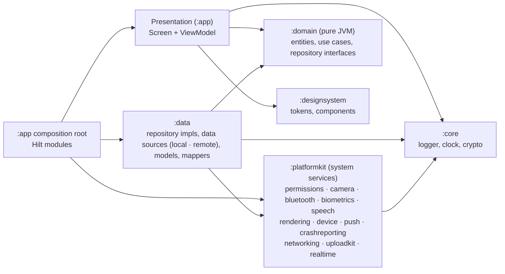

# 00 — Overview (Android)

<dl><dd>

- Product, data model, architecture, data flows, infrastructure, conventions and decisions for the Android app.
- Same product and feature specs as iOS; spec numbers `01`–`19` are stable and used by [ROADMAP.md](../ROADMAP.md).
- This is the approved target design for `site-log-android`; nothing here is implemented yet.
- **Reading order:** this overview → the feature spec → its guide in [feature-guide/](../feature-guide/README.md).
- iOS original: [docs/feature-docs/00-overview.md](https://github.com/DAMHONGDUC/site_log_swift_ui/blob/main/docs/feature-docs/00-overview.md).

</dd></dl>

## Contents

<dl><dd>

1. [Product](#1-product) — positioning, core rule, stack, non-goals
2. [Market](#2-market)
3. [Data model](#3-data-model)
4. [Architecture](#4-architecture) — layout, modules, MVVM, Hilt, startup, errors
5. [Data flows](#5-data-flows)
6. [Infrastructure](#6-infrastructure)
7. [Conventions](#7-conventions)
8. [Feature specs](#8-feature-specs)
9. [Decisions](#9-decisions) — A01–A22
10. [Beginner glossary](#beginner-glossary)

</dd></dl>

## Beginner glossary

<dl><dd>

| Term | Meaning | Short example |
|---|---|---|
| Composable | A Kotlin function annotated `@Composable` that describes UI | `Text(stringResource(R.string.projects_list_title))` |
| ViewModel | An `androidx.lifecycle.ViewModel` that survives rotation, holds screen state and handles actions | `ProjectListViewModel` loads rows |
| `StateFlow` | A stream that always has a current value; the screen collects it | `val state: StateFlow<ProjectListState>` |
| Coroutine | A function that can pause without blocking a thread | `viewModelScope.launch { load() }` |
| Gradle module | A separately compiled part of the app with its own dependencies | `:domain`, `:data` |
| Hilt | Google's DI library on Dagger; generates the wiring at compile time | `@Provides fun projectRepository(...)` |
| Room | Google's SQLite library: `@Entity` tables, `@Dao` queries, migrations | `ProjectModel`, `ProjectDao` |
| WorkManager | Runs deferrable work that survives app kill and reboot | The upload worker |
| Use case | One named action the app can perform | `CreateProjectUseCase` |
| Repository | A boundary for reading and writing app data | `ProjectRepository` |
| Entity | A business concept with no storage or UI types | `Project` |
| DTO | A data-transfer object at a system boundary | JSON from the server |
| String resource | A key in `strings.xml` whose text is translated | `R.string.access_sign_in_title` → “Sign in” |

</dd></dl>

## 1. Product

<dl><dd>

| | |
|---|---|
| What | Offline-first Android app for recording construction site conditions |
| Deliverable | Signed PDF inspection report |
| Users | Site supervisors, subcontractors, apartment handover teams |

```text
Create project → start session → walk floors/rooms, capture + log issues
→ reach WiFi, background upload → export signed PDF report
```

### 1.1 Positioning and constraints

<dl><dd>

- Competitors lose evidence three ways: stalled or incomplete uploads, photos vanishing on reload, sync failing with no reason.
- SiteLog assumes the network is bad.

| Constraint | Consequence |
|---|---|
| Sites, basements, alleys have weak or no signal | Every write path completes offline |
| 150–250 files and several GB per session | Upload survives process death, Doze, network loss and reboot |
| User swipes the app away and keeps walking | No state lives only in RAM |
| Many mid-range Android phones on site (3–4 GB RAM) | Downsampled bitmaps, streamed hashing, one bitmap per PDF page |
| The PDF is the paid deliverable | Never truncate, never silently drop images |

</dd></dl>

### 1.2 Core rule

<dl><dd>

- `Capture` is immutable after creation; only descriptive metadata is editable.
- Each carries a `sha256` computed after the file closes, before the DB write.
- Annotations are a separate vector layer, so markup never invalidates a hash.

</dd></dl>

### 1.3 Stack

<dl><dd>

| Area | Choice |
|---|---|
| UI | Jetpack Compose (BOM 2026.09), Material 3; `minSdk` 29, `targetSdk` 36, `compileSdk` 37 ([A22](#a22--minimum-sdk-29)) |
| Language | Kotlin 2.4, code targets Java 21; coroutines + Flow; AGP 9 with built-in Kotlin, Gradle 9.6 (its daemon runs on JDK 25) |
| Architecture | Clean Architecture (Presentation · Domain · Data), MVVM; `:domain`, `:data`, `:platformkit`, `:core`, `:designsystem` are Gradle modules, Presentation lives in `:app` ([A09](#a09--layers-as-gradle-modules)) |
| Dependency injection | [Hilt](https://dagger.dev/hilt/) ([A01](#a01--hilt-for-dependency-injection)) |
| Navigation | [Navigation 3](https://developer.android.com/guide/navigation/navigation-3) (`androidx.navigation3`) ([A17](#a17--navigation-3)) |
| Local store | Room with KSP, exported schemas ([A10](#a10--room-for-the-local-store)) |
| Settings | DataStore Preferences |
| Secrets | Android Keystore (AES-GCM key, HMAC key) |
| Media | CameraX (`camera-core`, `camera-video`, `camera-view`), `MediaRecorder` for audio, Media3 Transformer to join pre-record segments |
| Plans | `PdfRenderer` + `BitmapRegionDecoder`, Compose tiles |
| Crypto | `MessageDigest`, `Mac`, `SecretKeyFactory` (PBKDF2), Keystore |
| External devices | `android.bluetooth.le` (BLE central; GATT server for the mock) |
| Transport | Hand-written WorkManager + OkHttp engine ([A02](#a02--hand-written-upload-engine)) |
| Object storage | Amazon S3, multipart + presigned URLs (same backend) |
| Realtime | OkHttp `WebSocket` ([A04](#a04--websocket-realtime-channel)) |
| Remote images | [Coil](https://coil-kt.github.io/coil/) 3 ([A05](#a05--coil-for-remote-images)) |
| Auth / crash / push | Firebase Android BoM: Auth, Crashlytics, Cloud Messaging — **no Firestore** ([A07](#a07--firebase-crashlytics)) |
| Sign-in | Credential Manager (Google), Firebase `OAuthProvider("apple.com")` (Apple), email |
| Location | Fused Location Provider (`play-services-location`) |
| JSON | kotlinx.serialization |
| Tests | JUnit 4, kotlinx-coroutines-test, Turbine, Truth, Robolectric, Room `MigrationTestHelper`, Compose UI test; Roborazzi optional, last (F18) ([A06](#a06--test-libraries)) |
| Tooling | Gradle Kotlin DSL, version catalog, convention plugins, detekt 1.23, ktlint 1.8 (`android_studio` style) via Spotless, Android Lint, Fastlane `supply`, GitHub Actions |
| Dev only | Compose Live Edit, `@Preview`, LeakCanary (debug) |
| Backend | Shared with iOS: [site-log-be](https://github.com/DAMHONGDUC/site-log-be) — Node 24 + Fastify, PostgreSQL 16 on AWS ([03 API](03-backend.md)) |

- A dependency is part of the app only after it appears in `gradle/libs.versions.toml`.

</dd></dl>

### 1.4 Non-goals

<dl><dd>

| Excluded | Reason |
|---|---|
| Firebase Storage, third-party upload libraries | The transfer engine is the core of the product |
| Photo picker / `ACTION_IMAGE_CAPTURE` intents | A hash only means something for a file the app produced |
| Firebase touching file bytes or data | Identity, crash reporting and push only |
| Burning annotations into original pixels | Destroys the hash |
| RFIs, scheduling, budgets, CAD, real-time co-editing, cloud AI defect detection | Different product, or indefensible in a dispute |
| Tablets-first layouts, Wear OS, Android Auto | One phone layout first; large screens only scale |

</dd></dl>

</dd></dl>

## 2. Market

<dl><dd>

- Same research as iOS (September 2026): [iOS §2 Market](https://github.com/DAMHONGDUC/site_log_swift_ui/blob/main/docs/feature-docs/00-overview.md#2-market).
- Android adds one fact: site crews often carry mid-range Android phones (Samsung A-series, Xiaomi, Oppo), so memory and battery budgets are set on a 4 GB device ([05 §19](05-platform.md#19-performance-profiling)).
- OEM battery savers (Xiaomi, Oppo, Samsung) kill background work harder than stock Android; Diagnostics shows the fix per maker ([09](05-platform.md#09-diagnostics-and-observability)).

</dd></dl>

## 3. Data model

<dl><dd>

### 3.1 Hierarchy

<dl><dd>

```text
Project
 ├ PlanSheet                                → 11
 ├ ChecklistTemplate                        → 13
 └ Session (survey run)
    └ Location (floor / unit / room)
       ├ ChecklistRun → ChecklistResult     → 13
       └ Capture (photo | video | audio)
          ├ Annotation (vector overlay)     → 12
          └ Issue → PlanPin                 → 03, 11
```

- `Location` belongs to `Project`, not `Session`: cross-session before/after pairing needs it.

</dd></dl>

### 3.2 Entities

<dl><dd>

| Entity | Fields | Rules |
|---|---|---|
| `Project` | `id`, `name`, `address`, `clientName`, `createdAt` | Cascade-deletes sessions, locations, plans |
| `Session` | `id`, `startedAt`, `endedAt?`, `surveyorName`, `note`, `state` | `DRAFT → ACTIVE → CLOSED → EXPORTED`; `CLOSED` blocks captures, `EXPORTED` is read-only |
| `Location` | `id` (stable across renames), `code` (`"A-12.05"`), `kind` (`FLOOR/UNIT/ROOM`), `parentId?`, `sortIndex` | Max depth 3 |
| `Capture` | `id`, `kind`, `filePath` (**relative**), `sha256`, `byteSize`, `capturedAt`, `trustedTime`, `verificationCode?`, `latitude?`/`longitude?`/`horizontalAccuracy?`, `deviceModel`, `durationMs?`, `deviceReading?`, `uploadState`, `remoteKey?`, `isExcludedFromReport` | GPS nullable — basements have none |
| `Issue` | `id`, `title`, `detail`, `severity` (`CRITICAL/MAJOR/MINOR`), `status` (`OPEN → IN_PROGRESS → RESOLVED → VERIFIED`), `dueDate?`, `locationId`, `assigneeName?`, `trade?`, `planPin?`, `sourceChecklistResultId?`, `captureIds`, `resolvedByIssueId?` | Anchored to `Location`; `severity` drives upload priority |

- Entities are Kotlin `data class`es with `val` fields; ids are `java.util.UUID`, times `java.time.Instant`.
- **Frozen after creation:** `id`, `filePath`, `sha256`, `capturedAt`, `trustedTime`, GPS, `deviceModel`, `byteSize`, `kind`.
- No API deletes a `Capture` from an exported session; hiding sets `isExcludedFromReport` + audit entry.
- Store paths relative to `filesDir`: absolute paths break after a restore to a new device.

</dd></dl>

### 3.3 UploadState

<dl><dd>

- `PENDING → UPLOADING → SYNCED`; `FAILED` reachable from `UPLOADING`.
- `FAILED` is not terminal and never deletes local files.
- Full job state machine: [04](02-upload-sync.md#04-upload-engine).

</dd></dl>

### 3.4 Schema versioning

<dl><dd>

- Room `@Database(version = n, exportSchema = true)`; schemas exported to `data/schemas/` and committed.
- Unique indices mirror the Postgres rules: `@Index(value = ["projectId", "code"], unique = true)` on locations, `["projectId", "sha256"]` on captures.
- Per change: bump `version`, add an `@AutoMigration` or a hand-written `Migration(n-1, n)`; never `fallbackToDestructiveMigration()`.
- Test migrations with `MigrationTestHelper` against an old-version fixture database, never an empty one.

</dd></dl>

</dd></dl>

## 4. Architecture

<dl><dd>

- Clean Architecture: dependencies point inward to `:domain`.
- Layers are Gradle modules; `:app` holds the composition root (`di/`, `startup/`) and `presentation/`.
- `:app` is the only module that wires layers together.
- Data sources (Room, DataStore, Keystore-backed storage, files, backend calls, Firebase Auth) live in `:data` under `datasources/local/` and `remote/`: interface + `Impl` only.
- System services (permissions, camera, Bluetooth, biometrics, speech, rendering, device, push, crash reporting) and standalone engines on system APIs (`HttpClient`, `uploadkit`, `realtime`) live in `:platformkit`, which knows nothing about Domain.
- Presentation uses MVVM.



### 4.1 Repo layout

<dl><dd>

```text
site-log-android/
├── app/
│   └── src/main/java/com/dd/sitelog/
│       ├── SiteLogApplication.kt          # @HiltAndroidApp; Crashlytics, logger
│       ├── MainActivity.kt                # @AndroidEntryPoint; edge-to-edge, setContent
│       ├── di/                            # CoreModule, PlatformModule, DataSourcesModule,
│       │                                  # RepositoriesModule, UseCasesModule, SyncTablesModule
│       ├── startup/                       # StartupSequence, StartupStep, steps/
│       ├── fakes/                         # FakeData.kt: skeleton sample data
│       └── presentation/
│           ├── navigation/                # NavigationCoordinator, CoordinatedStack, appEntries()
│           ├── root/                      # RootScreen + RootViewModel: startup → access → main tabs
│           ├── access/                    # splash/ signin/ biometriclock/ passcodeunlock/ privacy/
│           ├── maintab/
│           └── <feature>/                 # <Feature>Route.kt + one folder per screen
│   └── src/main/res/                      # values/strings.xml, values-vi/strings.xml, drawable/, xml/
│   └── src/debug/java/…/devmenu/          # dev menu, DevDataModule (debug builds only)
├── domain/src/main/kotlin/com/dd/sitelog/domain/
│   ├── entities/<feature>/                # data classes, enums, <Feature>Error
│   ├── repositories/                      # every boundary interface, flat
│   ├── usecases/<feature>/                # one use case per file; devdata/
│   └── Outcome.kt
├── data/src/main/kotlin/com/dd/sitelog/data/
│   ├── repositories/                      # <Noun>RepositoryImpl
│   ├── datasources/local/                 # persistence/ (Room DAOs) securestore/ filestorage/ — interface + Impl
│   ├── datasources/remote/                # <Noun>RemoteDataSource + Impl over platformkit engines; auth/
│   ├── models/local/                      # Room @Entity <Noun>Model, schema/ (SiteLogDatabase, migrations)
│   ├── models/remote/                     # @Serializable <Noun>DTO
│   └── mappers/
├── data/schemas/                          # Room exported JSON schemas (committed)
├── platformkit/src/main/kotlin/com/dd/sitelog/platformkit/
│   ├── permissions/ camera/ bluetooth/ biometrics/ speech/ securestore/
│   ├── rendering/ (pdf, csv, tiles, stamps) device/ push/ crashreporting/
│   └── networking/ (HttpClient) uploadkit/ realtime/
├── core/src/main/kotlin/com/dd/sitelog/core/  # logger/ clock/ crypto/
├── designsystem/src/main/kotlin/com/dd/sitelog/designsystem/  # tokens/ components/ theme/
├── build-logic/convention/                # sitelog.android.library, sitelog.jvm.library, sitelog.compose …
├── gradle/libs.versions.toml
├── config/detekt/detekt.yml  .editorconfig
├── tools/ci/                              # check-no-println.sh, check-imports.sh
├── fastlane/  .github/workflows/  Gemfile
└── docs/
```

- Kotlin source folders follow the package: `com.dd.sitelog.<module>.<folder>`.
- Why modules: [A09](#a09--layers-as-gradle-modules); data sources vs PlatformKit: [A11](#a11--data-sources-in-data-platformkit-for-system-services).

</dd></dl>

### 4.2 Layers and dependency rules

<dl><dd>

| Layer | Where | May use |
|---|---|---|
| Presentation | `:app` `presentation/` | `:domain`, `:core`, `:designsystem`, Compose, Hilt (`hiltViewModel()`); never `:data` or `:platformkit` |
| Domain | `:domain` (Kotlin JVM module) | Kotlin stdlib, `java.time`, `java.util.UUID`, `kotlinx-coroutines-core` (for `Flow`) only |
| Data | `:data` | `:domain`, `:platformkit`, `:core`, Room, DataStore, kotlinx.serialization |
| PlatformKit | `:platformkit` | `:core`, Android SDK, Jetpack, Firebase, OkHttp; never `:domain`, `:data` or `:app` |
| DesignSystem | `:designsystem` | Compose, Material 3; nothing from the app |
| Core | `:core` (Android library) | Android SDK only; used by every layer except `:domain` and `:designsystem` |
| Composition root | `:app` `di/`, `startup/`, `fakes/` | Everything |

| Rule | Enforcement |
|---|---|
| `:domain` has no Android, no Room, no Hilt | Compiler: it is a `kotlin("jvm")` module with no Android plugin |
| `:domain` never uses `:data`, `:platformkit`, `:core`; `:platformkit` uses only `:core` | Compiler (module dependencies) |
| Presentation never imports `com.dd.sitelog.data` or `.platformkit` (`:app` depends on them for `di/` only) | CI `check-imports.sh` |
| Presentation never touches Room, DataStore, OkHttp, `WorkManager` | CI `check-imports.sh` |
| View models call use cases only — never a repository | Review |
| Domain folders: `entities/<feature>/`, `usecases/<feature>/`; `repositories/` flat | Review |
| DTOs and Room models never cross into `:domain` or Presentation | Compiler for `:domain`; CI for Presentation |
| Data sources and PlatformKit return their own records and throw their own exceptions; repositories map | Compiler for PlatformKit; review for data sources |
| Each data source and each PlatformKit folder ships an interface next to its real class; repositories hold the interface | Review |
| Data sources and PlatformKit take configuration (base URL, bucket) through the constructor; never read `BuildConfig` | Review |
| Data sources never use repositories or each other; a store may implement a PlatformKit interface (`UploadStoreImpl` → `uploadkit.UploadStore`) | Review |
| PlatformKit is a library ([A16](#a16--platformkit-is-a-library-not-a-ring)): no Domain or Data types, no business rules | CI + review |
| `uploadkit` and `realtime` use nothing from the rest of the app, and not each other | Review |
| Types other modules use are `public` (Kotlin default); everything else `internal` | Compiler + detekt |

</dd></dl>

### 4.3 MVVM, use cases, repositories

<dl><dd>

| Type | Rules |
|---|---|
| Screen | `@Composable fun <Name>Screen(viewModel: <Name>ViewModel = hiltViewModel(), …)`: collects state, calls view model functions; a stateless `<Name>Content(state, onAction)` holds the layout and the previews |
| ViewModel | `@HiltViewModel class … @Inject constructor(use cases)`; exposes `StateFlow<<Name>State>`; work in `viewModelScope` |
| State | `sealed interface <Name>State` (`Loading`, `Loaded(rows)`, `Failed(messageRes)`) or one `data class` with an enum status |
| Row | `data class LocationRow(...)`, `IssueSnapshot`; never an entity or a Room model |
| Route | `@Serializable sealed interface <Feature>Route : NavKey`, cases carry ids only; `<feature>Entries()` turns a route into its screen ([A19](#a19--feature-routes-and-a-coordinator-per-back-stack)) |
| Coordinator | `NavigationCoordinator`, one per back stack (`CoordinatedStack`); screens call `coordinator.push(route)`; dialogs and bottom sheets stay local state |
| Use case | One per user action, a class with one `suspend operator fun invoke`, one file each in `:domain` `usecases/<feature>/`; depends on repository interfaces only |
| Repository | One per aggregate: `ProjectRepository`, `CaptureRepository`, `IssueRepository`, … |

</dd></dl>

### 4.4 Composition root (Hilt)

<dl><dd>

- All bindings live in `:app` `di/`, one `@Module @InstallIn(SingletonComponent::class)` file per layer ([A20](#a20--di-modules-split-by-layer)):

| File | Provides |
|---|---|
| `CoreModule.kt` | `AppClock`, `AppLogger`, dispatchers |
| `PlatformModule.kt` | PlatformKit services and engines |
| `DataSourcesModule.kt` | Data sources, `SiteLogDatabase`, DAOs, DataStore |
| `RepositoriesModule.kt` | Repositories (`<Noun>RepositoryImpl` as `<Noun>Repository`) |
| `UseCasesModule.kt` | Use cases, one `// region <Feature>` per feature |
| `StartupModule.kt` | `StartupSequence` and its steps |
| `SyncTablesModule.kt` | The map of syncable tables for the sync engine (F04) |
| `debug/…/DevDataModule.kt` | `usecases/devdata/` use cases — debug source set only |

- Bindings use `@Provides` functions in `:app`, so `:domain`, `:data` and `:platformkit` never import Hilt or `javax.inject`.
- A view model is the only Presentation class Hilt builds; it imports `HiltViewModel` and `Inject`, nothing else from DI.

```kotlin
@HiltViewModel
class SplashViewModel @Inject constructor(
    private val startupSequence: StartupSequence,
) : ViewModel() {

    private val _state = MutableStateFlow<SplashState>(SplashState.Running)
    val state: StateFlow<SplashState> = _state.asStateFlow()

    fun onAppear() {
        viewModelScope.launch {
            _state.value = SplashState.Running
            val ready = startupSequence.run()
            if (ready) {
                _state.value = SplashState.Ready
            } else {
                _state.value = SplashState.Failed
            }
        }
    }
}
```

```kotlin
@Composable
fun SplashScreen(viewModel: SplashViewModel = hiltViewModel()) {
    val state by viewModel.state.collectAsStateWithLifecycle()

    LaunchedEffect(Unit) {
        viewModel.onAppear()
    }

    SplashContent(
        state = state,
        onTryAgain = viewModel::onAppear,
    )
}
```

| Rule | Detail |
|---|---|
| Scope | PlatformKit services, databases, stateful services `@Singleton`; use cases unscoped |
| Resolution | View models take use cases through the constructor ([A14](#a14--view-models-take-use-cases-through-the-constructor)); route ids arrive through `@AssistedInject` |
| Previews | `<Name>Content` previews take a hand-built state; no Hilt in previews |
| Tests | View models: built directly on test doubles, no Hilt; bindings: `@HiltAndroidTest` + `@TestInstallIn` only where a wiring test needs it |
| Injected seams | Repositories, `AppClock`, `UploadStore`, `UploadTransport`, `CaptureSessionControlling`, `kotlin.random.Random`, `CoroutineDispatcher` |

</dd></dl>

### 4.5 Startup sequence

<dl><dd>

- Each step guarded and logged separately — never one `try` around init.
- `SiteLogApplication.onCreate` runs steps 1–2; `SplashViewModel` runs the rest through `StartupSequence`.

| # | Step | On failure |
|---|---|---|
| 1 | Crashlytics (`Application.onCreate`) | Continue — never blocks launch |
| 2 | Logger | Continue with a no-op logger |
| 3 | Keystore: audit HMAC key, encrypted secrets file | Block, show recovery screen |
| 4 | Room database open + migration | Block, offer diagnostic export |
| 5 | Reconcile WorkManager upload work ↔ upload store | Continue, mark jobs `PENDING` |
| 6 | Audit chain verify (async) | Flag in Diagnostics |
| 7 | Sweep orphan files, stale derived images, old tiles | Log only |
| 8 | App lock gate in `RootScreen` (when Lock app is on) | Biometrics → app passcode → forgot-passcode flow |

</dd></dl>

### 4.6 Error handling

<dl><dd>

| Layer | Returns / throws | Catches to |
|---|---|---|
| Data source / PlatformKit | Its own exceptions (`SecureStoreException`, `NetworkException`, `CameraException`) | Map platform exceptions (`IOException`, `SQLiteException`, `KeyPermanentlyInvalidatedException`) to its own; retry transient ones |
| Data (repository impl) | Never throws: `Outcome<Entity, <Feature>Error>` | Every data source / PlatformKit call: map to `Outcome.Failure`; a case that is not a failure (nothing stored on first launch) returns `Outcome.Success` |
| Domain (use case) | Returns the `Outcome` as is, or chains it (`map`, `flatMap`) | Nothing to catch; a business rule returns `Outcome.Failure` |
| ViewModel | — | No catch: `when (outcome)`, `Failure` → state `Failed(messageRes)` |
| Screen | — | Never; shows the state |

```kotlin
sealed interface Outcome<out T, out E> {
    data class Success<out T>(val value: T) : Outcome<T, Nothing>
    data class Failure<out E>(val error: E) : Outcome<Nothing, E>
}
```

- Own type, not `kotlin.Result` (its failure is always a `Throwable`) and not Arrow ([A21](#a21--own-outcome-type)).
  - Interface: `suspend fun loadAccessSetting(): Outcome<AccessSetting, AccessError>`.
  - Domain errors: one `sealed interface <Feature>Error` per feature in `entities/<feature>/`.
  - Exceptions stop at the repository impl; Domain and Presentation never `try`.
- A result that is a business answer stays a type, not an error (`PasscodeCheck`).
- **Never swallow `CancellationException`:** catch `Exception`, then rethrow if it is a `CancellationException`, or the coroutine never cancels.
- Every catch logs the exception (`logger.error(message, throwable)`); data source / PlatformKit log the technical detail (status, path), the repository the meaning (“Load access settings failed → StorageUnavailable”).
- Errors never skip a layer.

</dd></dl>

</dd></dl>

## 5. Data flows

<dl><dd>

### 5.1 Capture → stored evidence

<dl><dd>

| # | Step | Dispatcher | Failure |
|---|---|---|---|
| 1 | Write file to `filesDir/media/…` | CameraX executor / `Dispatchers.IO` | Abort, surface error |
| 2 | Stream SHA-256 in 1 MiB chunks | `Dispatchers.IO` | Abort, delete file |
| 3 | Build `TrustedTimestamp` + GPS | `Dispatchers.Default` | Degrade confidence, never abort |
| 4 | Insert `Capture` through the Room DAO (`withTransaction`) | Room's IO executor | Retry once, then orphan sweep |
| 5 | Enqueue upload with `priority` | `UploadCoordinator` | Stays `PENDING` |
| 6 | Thumbnail to UI | `Dispatchers.Main` | — |

- **Invariant:** no DB row without a hash; no file without a row for longer than one launch.

</dd></dl>

### 5.2 Concurrency map

<dl><dd>

| Context | Type | Holds |
|---|---|---|
| UI | `Dispatchers.Main`, `viewModelScope` | View model state |
| DB | Room suspend DAOs (own executor) | Transactions |
| Upload | `UploadCoordinator` (one `Mutex`, `CoroutineWorker`) | Job table, effects |
| Capture | CameraX executors, `Dispatchers.IO` for hashing | Camera use cases, recorder |
| BLE | `DeviceLinkManager` (single-thread dispatcher) | `BluetoothGatt` |
| WebSocket | `RealtimeChannel` (`Mutex` + `CoroutineScope`) | Socket, ping job |

- Pass ids across layers, never Room objects.
- Never block `Dispatchers.Main`; inject dispatchers so tests use `StandardTestDispatcher`.
- `GlobalScope` is banned (detekt rule); long-lived work uses an injected `@ApplicationScope CoroutineScope`.

</dd></dl>

</dd></dl>

## 6. Infrastructure

<dl><dd>

### 6.1 Filesystem

<dl><dd>

| Path | Storage | Evidence |
|---|---|---|
| `filesDir/media/<project>/<session>/<capture>.<ext>` | Credential-encrypted internal storage | **Yes** |
| `filesDir/plans/<project>/<sheet>.<ext>` | Internal | Yes |
| `filesDir/derived/<…>-stamped.jpg` | Internal | No — regenerable |
| `cacheDir/plans/<sheet>/tiles/`, `cacheDir/prebuffer/` | Cache (OS may clear) | No |
| Room database `sitelog.db` | Internal, `databases/` | Metadata |
| `filesDir/datastore/secrets.preferences_pb` | DataStore, values sealed with a Keystore AES-GCM key | Secrets |

- File-based encryption keeps internal storage unreadable until the first unlock after boot; after that files stay readable while locked, which background upload needs (iOS `.completeUnlessOpen` equivalent).
- No part temp files: OkHttp streams each part straight from the original file ([04.3](02-upload-sync.md#043-android-background-constraints)).
- `res/xml/data_extraction_rules.xml` excludes `media/`, `plans/`, `derived/`, `datastore/` and the database from cloud backup and device transfer. S3 holds the remote copy.
- The DB stores paths relative to `filesDir`.

</dd></dl>

### 6.2 Configuration

<dl><dd>

| Item | Where | Committed |
|---|---|---|
| `gradle/libs.versions.toml`, `build-logic/` | Repository | Yes; source of truth for the build |
| `google-services.json` per Firebase project | `app/src/debug/`, `app/src/release/` | No: written by CI from secrets; `.example` committed |
| `API_BASE_URL` | `buildConfigField` per build type, read only in `:app` `di/` | Yes (URLs are not secrets) |
| Upload signing key, Play service account | CI secrets | Never |
| AWS credentials, bucket names | Backend configuration | Never in the app |

- Build types `debug` and `release`; a `staging` build type (`initWith(release)`, debug-signed) points at staging. No product flavors until a second app id is needed.

</dd></dl>

</dd></dl>

## 7. Conventions

<dl><dd>

| Rule | Detail |
|---|---|
| Layers | Dependencies point inward; `:domain` imports no Android |
| Dependencies | Only well-known, maintained libraries (Jetpack, Google, Square, JetBrains, Coil); add through `libs.versions.toml`; record the choice in [§9](#9-decisions) |
| Constants | In `object <Area>Constants`; spacing via `DSSpacing`, typography via `DSTextStyle`, color via `DSColor` |
| User-facing text | Only in `app/src/main/res/values/strings.xml` (+ `values-vi/`); fixed values (names, dates, ids, counts, file names) stay direct. Never in `:domain` or `:data` |
| String keys | `snake_case`, named by UI role: `access_sign_in_title`; plurals in `<plurals>`; placeholders `%1$s`, never concatenation |
| Logging | Every action logs with data, successes included: `"Upload failed — {captureId, part: 3/12, status: 503}"` |
| Errors | Log the throwable; no `println`, no `Log.*` outside `AppLogger`; which layer catches: [§4.6](#46-error-handling) |
| Startup | Each step guarded; Crashlytics first |
| Compose size | Extract a composable when one exceeds ~50 lines; see [compose rules](../compose-rules.md) |
| Screens | No business logic; view models orchestrate |
| Style | Explicit types on public API, `val` by default, no `!!` |
| Format | ktlint `android_studio` style via Spotless, max line 100; wrapped calls put one argument per line with a trailing comma; `class X @Inject constructor(` and explicit `return` kept ([F00 step 0](../feature-guide/S0-foundation-access/F00-foundation.md#0-gradle-project-and-entry-point)) |

| Kind | Pattern | Example |
|---|---|---|
| Screen | `<Name>Screen` + stateless `<Name>Content` | `CameraScreen`, `CameraContent` |
| Other composable | `<Name>View` or a noun | `RootView`, `PrivacyOverlay`, `BottomDock` |
| ViewModel | `<Name>ViewModel` | `CameraViewModel` |
| UI state | `<Name>State` | `CameraState` |
| Route / entries | `<Feature>Route` / `<feature>Entries()` in `<Feature>Route.kt` | `ProjectsRoute`, `projectsEntries()` |
| Use case | `<Verb><Noun>UseCase.kt`, one per file | `CreateProjectUseCase.kt` |
| Repository interface / impl | `<Noun>Repository` / `<Noun>RepositoryImpl` | `ProjectRepository` / `ProjectRepositoryImpl` |
| Room entity / DAO | `<Noun>Model` / `<Noun>Dao` in `models/local/` | `ProjectModel`, `ProjectDao` |
| DTO / mapper | `<Noun>DTO` / `<Noun>Mapper` | `ProjectDTO` / `ProjectMapper` |
| Data source interface / impl | `<Noun>LocalDataSource` · `<Noun>RemoteDataSource` / + `Impl` | `AccessLocalDataSourceImpl` |
| Other interface implemented in `:data` | `<Interface>Impl` | `CaptureSourceImpl`, `UploadStoreImpl` |
| PlatformKit engine | Its own noun | `HttpClient`, `UploadCoordinator`, `RealtimeChannel` |
| PlatformKit interface | `<Noun>ing` / `<Noun>Providing` | `PlanRendering`, `BiometricAuthenticating` |
| Constants | `object <Area>Constants` | `UploadConstants` |
| Dependency names | End with the role: `...UseCase`, `...Repository`, `...DataSource` | `loadSettingsUseCase`, `accessRepository` |
| Hilt module | `<Layer>Module.kt` in `di/` | `RepositoriesModule.kt` |
| Test file | `<Type>Test.kt` | `UploadStateMachineTest.kt` |

**Definition of done (every change)**

- `./gradlew assembleDebug` with zero warnings (`allWarningsAsErrors`, Lint `warningsAsErrors`); detekt and ktlint clean; scoped tests pass.
- Diff reviewed for literals, hard-coded user strings, unlogged `catch`, cross-layer imports.
- No secret in the diff or logs.
- Every user-facing string comes from `strings.xml`.

**Adding a feature**

- Steps and sprint order: [feature-guide/README.md](../feature-guide/README.md#how-every-feature-runs).

1. Contract: `@Serializable` DTOs that match the backend tables and endpoints.
2. Domain: sync-ready entities (`UUID` id, `updatedAt`, `deletedAt`, `syncState`), repository interface, use cases.
3. Fake data: the real `<Noun>RepositoryImpl` over data source `Impl`s that hold in-memory values. Each type bound once in `di/`; the dev menu resets / seeds through `resetAllData()` / `seedSampleData()` and `usecases/devdata/` use cases bound only in the debug source set.
4. View models wired into the screens; the feature runs end to end with Continue offline.
5. Local: replace the data source `Impl`s' insides with Room, DataStore, Keystore, files and PlatformKit; same types, same bindings, repository unchanged.
6. Backend: already built in site-log-be by the iOS track (or the same sprint); the app only checks it.
7. Sync: the local data source becomes syncable (or a remote data source switches to `HttpClient`); signed in, a second device (iOS or Android) sees the change.
8. Tests once the feature works end to end; schema change → version bump + migration test. Test doubles live only in `src/test/`.

</dd></dl>

## 8. Feature specs

<dl><dd>

| File | Specs |
|---|---|
| [01-field-work.md](01-field-work.md) | 01 Projects, sessions, locations · 02 Capture · 03 Issues · 06 DeviceLink · 11 Floor plans · 12 Annotation and trusted time · 13 Checklists |
| [02-upload-sync.md](02-upload-sync.md) | 04 Upload engine · 08 Auth and sync · 10 Realtime channel |
| [03-backend.md](03-backend.md) | 14 Backend API (Android client guide) |
| [04-reporting-security.md](04-reporting-security.md) | 05 PDF and spreadsheet export · 07 Security and audit log |
| [05-platform.md](05-platform.md) | Dev setup · 09 Diagnostics · Testing · 17 CI/CD · 18 Push and deep links · 19 Profiling |

</dd></dl>

## 9. Decisions

<dl><dd>

- Choices that are expensive to reverse: context, decision, rejected options, consequences.
- Numbers mirror the iOS decisions (`A01` ↔ `D01`) where one exists; A10, A17, A21, A22 are Android-only.

| # | Decision | iOS twin |
|---|---|---|
| [A01](#a01--hilt-for-dependency-injection) | Hilt for dependency injection | D01 |
| [A02](#a02--hand-written-upload-engine) | Hand-written upload engine on WorkManager + OkHttp | D02 |
| [A03](#a03--shared-backend) | Shared Node + PostgreSQL backend, hand-written sync | D03 |
| [A04](#a04--websocket-realtime-channel) | OkHttp WebSocket realtime channel | D04 |
| [A05](#a05--coil-for-remote-images) | Coil for remote images | D05 |
| [A06](#a06--test-libraries) | JUnit 4 + coroutines-test + Turbine + Truth + Robolectric; snapshots optional, last | D06 |
| [A07](#a07--firebase-crashlytics) | Firebase Crashlytics | D07 |
| [A08](#a08--gradle-owns-the-build) | Gradle version catalog + convention plugins own the build | D08 |
| [A09](#a09--layers-as-gradle-modules) | Layers as Gradle modules | D09 |
| [A10](#a10--room-for-the-local-store) | Room for the local store | — |
| [A11](#a11--data-sources-in-data-platformkit-for-system-services) | Data sources in `:data`, PlatformKit for system services | D11 |
| [A12](#a12--mvvm-with-viewmodel-and-stateflow) | MVVM with `ViewModel` and `StateFlow` | D12 |
| [A13](#a13--presentation-stays-in-app) | Presentation stays in `:app` | D13 |
| [A14](#a14--view-models-take-use-cases-through-the-constructor) | View models take use cases through the constructor | D14 |
| [A15](#a15--use-cases-return-entities) | Use cases return entities | D15 |
| [A16](#a16--platformkit-is-a-library-not-a-ring) | PlatformKit is a library, not a ring | D16 |
| [A17](#a17--navigation-3) | Navigation 3 | — |
| [A18](#a18--dev-menu-data-through-use-cases) | Dev menu data through use cases, debug source set | D18 |
| [A19](#a19--feature-routes-and-a-coordinator-per-back-stack) | Feature routes and a coordinator per back stack | D19 |
| [A20](#a20--di-modules-split-by-layer) | DI modules split by layer | D20 |
| [A21](#a21--own-outcome-type) | Own `Outcome` type | — |
| [A22](#a22--minimum-sdk-29) | Minimum SDK 29 | — |

- All accepted 2026-11-13. New decision: copy a section, keep its four parts, add a row above.

---

### A01 — Hilt for dependency injection

<dl><dd>

- **Context:** one place must bind `:data` implementations to `:domain` interfaces and let tests swap them.
- **Decision:** Hilt. All bindings are `@Provides` in `:app` `di/`; view models use `@HiltViewModel` + `@Inject constructor`; screens get them with `hiltViewModel()`.

| Rejected | Why not |
|---|---|
| Koin | Runtime resolution: a missing binding crashes at runtime, not at build |
| Manual DI (`AppContainer`) | Boilerplate per use case; view model factories by hand |
| Dagger without Hilt | Same engine, more setup for Android components |

- **Consequences:**
  - A missing binding fails the build (KSP).
  - `:domain`, `:data`, `:platformkit` stay free of Hilt because bindings are `@Provides` in `:app`.
  - Replacing the library touches `di/` and the view model annotations.

</dd></dl>

### A02 — Hand-written upload engine

<dl><dd>

- Spec: [04](02-upload-sync.md#04-upload-engine)
- **Context:** 150–250 files and several GB must reach S3 through network loss, Doze, process death, reboot and URL expiry. Android has no background `URLSession`: a transfer dies with the process.
- **Decision:** `uploadkit` in `:platformkit`, in-house: a `CoroutineWorker` scheduled by WorkManager (unique work, constraints, backoff, survives reboot) runs `UploadCoordinator`; OkHttp streams parts straight from the file; a long run is promoted to a foreground service of type `dataSync` with a progress notification. Own store interface, pure state machine, S3 multipart with per-part resume, jittered backoff, launch reconciliation.

| Rejected | Why not |
|---|---|
| Firebase Storage | Cannot resume per part after process death; no priority control |
| AWS Amplify / S3 SDK | Heavy; hides scheduling and resume |
| Plain `DownloadManager`-style service | No upload support; no constraints |
| User-initiated data transfer jobs (`JobScheduler`, API 34+) only | Not on API 29–33; revisit as an extra path once `minSdk` ≥ 34 |

- **Consequences:**
  - After a kill, the part in flight restarts; finished parts are never re-sent.
  - Android 15+ limits `dataSync` foreground services to 6 h per 24 h: the worker stops cleanly and WorkManager continues later.
  - A user's **Force stop** cancels all work until the app opens again: Diagnostics explains it.

</dd></dl>

### A03 — Shared backend

<dl><dd>

- **Decision:** the Android app uses the same [site-log-be](https://github.com/DAMHONGDUC/site-log-be) API, sync protocol and Firebase projects as iOS ([iOS D03](https://github.com/DAMHONGDUC/site_log_swift_ui/blob/main/docs/feature-docs/00-overview.md#d03--node--postgresql-backend-hand-written-sync)). One account works on both platforms.
- **Consequences:** a contract change is made in site-log-be first, then on both apps; push is shared too: both apps use FCM ([03 §10](03-backend.md#10-push-registration)).

</dd></dl>

### A04 — WebSocket realtime channel

<dl><dd>

- Spec: [10](02-upload-sync.md#10-realtime-progress-channel)
- **Decision:** observation-only channel on OkHttp `WebSocket` in `platformkit/realtime`: connect, `auth` message, app-level ping, reconnect with backoff, events reconciled into the upload store. Never controls `uploadkit`.

| Rejected | Why not |
|---|---|
| Polling | 243 jobs every 10 s drains battery and data |
| FCM data messages as the channel | Not guaranteed, delayed in Doze, rate-limited |
| Scarlet / Socket.IO | OkHttp covers it; no extra dependency |

</dd></dl>

### A05 — Coil for remote images

<dl><dd>

- **Decision:** Coil 3 (`coil-compose`, `coil-network-okhttp`) with size-bound requests and a bounded disk cache; memory cache key and disk cache key = the S3 object key, not the presigned URL. Local originals are decoded from disk with `ImageDecoder` / `BitmapFactory` `inSampleSize`, never through the network loader.

| Rejected | Why not |
|---|---|
| Glide | Mature, but View-first; Coil is Compose- and coroutine-first |
| Hand-written cache | Commodity, no product value |

</dd></dl>

### A06 — Test libraries

<dl><dd>

| Need | Library |
|---|---|
| Unit tests | JUnit 4 + Google Truth |
| Coroutines and Flow | `kotlinx-coroutines-test`, Turbine |
| Android classes on the JVM (Room, DataStore) | Robolectric |
| Room migrations | `room-testing` `MigrationTestHelper` |
| UI flows | Compose UI test (`createAndroidComposeRule`) — smoke paths only |
| Screenshots (optional, F18) | Roborazzi |

| Rejected | Why not |
|---|---|
| Mockito / MockK for repositories | Hand-written test doubles are clearer; MockK allowed only for Android framework classes |
| Espresso for Compose screens | Compose UI test is the Compose API |

</dd></dl>

### A07 — Firebase Crashlytics

<dl><dd>

- **Decision:** Crashlytics from the Firebase Android BoM, initialized first in `Application.onCreate`; mapping files uploaded by the release build; non-fatals carry the same structured data as the log line.
- **Consequences:** no user content or PII in custom keys; startup never blocks on it.

</dd></dl>

### A08 — Gradle owns the build

<dl><dd>

- **Context:** iOS uses XcodeGen so the project is reviewable text; Gradle already is text, but five modules repeating the same setup drift apart.
- **Decision:** `gradle/libs.versions.toml` holds every library and version; `build-logic/convention` holds plugins (`sitelog.android.application`, `sitelog.android.library`, `sitelog.jvm.library`, `sitelog.compose`, `sitelog.hilt`, `sitelog.room`); a module's `build.gradle.kts` is a few lines.

| Rejected | Why not |
|---|---|
| Versions inline in each `build.gradle.kts` | Five places to bump |
| `buildSrc` | Any change invalidates the whole build cache |

- **Consequences:** changes to SDK levels, Kotlin options, lint and Compose flags happen once, in `build-logic`; never through Android Studio's Project Structure dialog.

</dd></dl>

### A09 — Layers as Gradle modules

<dl><dd>

- **Decision:** `:domain` (Kotlin JVM), `:data`, `:platformkit`, `:core`, `:designsystem` (Android libraries) and `:app`. The module graph is the dependency rule: `:data` → `:domain` + `:platformkit` + `:core`; `:platformkit` → `:core`; `:domain` depends on nothing.

| Rejected | Why not |
|---|---|
| Packages inside one module | Only a grep script could stop a wrong import |
| One module per feature | ~30 modules, built for many teams |

- **Consequences:** `:domain` cannot see Android at all; JVM unit tests run fast; non-API code is `internal`.

</dd></dl>

### A10 — Room for the local store

<dl><dd>

- **Decision:** Room (KSP) with suspend DAOs and `Flow` queries, exported schemas, unique indices, `withTransaction` for multi-table writes.

| Rejected | Why not |
|---|---|
| SQLDelight | Good, but Room is the Jetpack default with migration testing built in |
| Realm / ObjectBox | Object stores; harder to mirror Postgres rules |
| Raw SQLite | No compile-time query checks |

</dd></dl>

### A11 — Data sources in :data, PlatformKit for system services

<dl><dd>

- **Decision:**
  - `:data` `datasources/local/`: `persistence/` (Room DAOs behind interfaces), `securestore/`, `filestorage/`, `preferences/` (DataStore).
  - `:data` `datasources/remote/`: `<Noun>RemoteDataSource` + `Impl` over PlatformKit engines; `auth/` (Firebase Auth).
  - `:platformkit`: system services and engines on system APIs (`HttpClient`, `uploadkit`, `realtime`).
  - They return records and throw their own exceptions; repositories map.
- **Consequences:** "never return entities" is a review rule for data sources (same module as repositories); a compiler rule for PlatformKit.

</dd></dl>

### A12 — MVVM with ViewModel and StateFlow

<dl><dd>

- **Decision:** an `androidx.lifecycle.ViewModel` calls a use case, gets its `Outcome` and updates one `MutableStateFlow`; one-off events (navigate, snackbar) are fields in state that the screen consumes, not a `Channel`.

| Rejected | Why not |
|---|---|
| MVI with reducers and side-effect channels | More types per screen for the same result |
| Presenter + output port per use case | Compose already redraws from state |

</dd></dl>

### A13 — Presentation stays in :app

<dl><dd>

- **Decision:** screens and view models live in `:app` `presentation/`; `tools/ci/check-imports.sh` stops them importing `:data` or `:platformkit`.
- **Consequences:** revisit with a `:presentation` module when a second app (Wear, tablet-only) needs the screens.

</dd></dl>

### A14 — View models take use cases through the constructor

<dl><dd>

- **Decision:** `@HiltViewModel class X @Inject constructor(useCases…)`. A route id comes in with `@AssistedInject` + `@Assisted`, and the screen calls `hiltViewModel<X, X.Factory> { factory -> factory.create(id) }`.

| Rejected | Why not |
|---|---|
| `SavedStateHandle` lookups by key | Stringly typed; Navigation 3 passes the route object |
| Field injection | Dependencies hidden from the constructor |

- **Consequences:** view model tests call the constructor with test doubles, no Hilt.

</dd></dl>

### A15 — Use cases return entities

<dl><dd>

- **Decision:** use cases take and return Domain entities (`Outcome<AccessSetting, AccessError>`); no request / response types. View models map entities to rows.

</dd></dl>

### A16 — PlatformKit is a library, not a ring

<dl><dd>

- **Decision:** `:platformkit` is treated as an external library: generic, no Domain or Data types, no app names (`Passcode`, `Project`). It offers capabilities (“authenticate with biometrics”, “store a secret”, “send a request”) and may know external formats (backend messages, BLE profiles, PDF layout). Only `:data` wraps it.

</dd></dl>

### A17 — Navigation 3

<dl><dd>

- **Context:** the iOS app owns a `NavigationPath` per tab (D19). Navigation Compose 2 owns its back stack inside a `NavController`; deep links and tab stacks fight it.
- **Decision:** `androidx.navigation3`: the back stack is a list the app owns (`rememberNavBackStack`), `NavDisplay` renders it, routes are `@Serializable` `NavKey`s; `lifecycle-viewmodel-navigation3` scopes a view model to its entry.

| Rejected | Why not |
|---|---|
| Navigation Compose 2 (type-safe routes) | Back stack hidden in `NavController`; one per tab is awkward |
| Voyager / Decompose | Third-party; Navigation 3 is the Jetpack answer |

</dd></dl>

### A18 — Dev menu data through use cases

<dl><dd>

- **Decision:** each repository interface has `resetAllData()` / `seedSampleData()`; `usecases/devdata/` holds `ResetAll<Feature>DataUseCase` / `Seed<Feature>DataUseCase`; they are bound only in `app/src/debug/…/DevDataModule.kt`, and the dev menu lives in `app/src/debug/`.
- **Consequences:** Kotlin has no `#if DEBUG`: the interface methods exist in release, but nothing binds or calls them, and R8 removes them.

</dd></dl>

### A19 — Feature routes and a coordinator per back stack

<dl><dd>

- **Decision:** each feature owns `<Feature>Route` (ids only) and `<feature>Entries()` (route → screen) in `presentation/<feature>/<Feature>Route.kt`. One `NavigationCoordinator` per tab back stack; `CoordinatedStack` creates it and provides it through `LocalNavigationCoordinator`.
- **Consequences:** deep links (F16) map a URI to a tab and a route, then push on that tab's coordinator; a bottom sheet that opens a full screen dismisses itself first.

</dd></dl>

### A20 — DI modules split by layer

<dl><dd>

- **Decision:** `di/` holds one Hilt module per layer: `CoreModule`, `PlatformModule`, `DataSourcesModule`, `RepositoriesModule`, `UseCasesModule`, `SyncTablesModule` (F04); past ~300 lines `UseCasesModule` splits into `di/usecases/<Feature>UseCasesModule.kt`.

</dd></dl>

### A21 — Own Outcome type

<dl><dd>

- **Context:** iOS uses Swift's `Result<Success, Failure>` with a typed failure. Kotlin's `Result<T>` only carries a `Throwable` and is meant for `runCatching`.
- **Decision:** `sealed interface Outcome<out T, out E>` in `:domain` with `Success`, `Failure`, and `map`, `flatMap`, `onSuccess`, `onFailure` extensions (~40 lines).

| Rejected | Why not |
|---|---|
| `kotlin.Result` | Failure is a `Throwable`, not a Domain error enum |
| Arrow `Either` | A large library for one type |

</dd></dl>

### A22 — Minimum SDK 29

<dl><dd>

- **Decision:** `minSdk = 29` (Android 10).
- **Why:** scoped storage, `PowerManager.thermalStatus`, `BiometricPrompt` with stable `DEVICE_CREDENTIAL` behavior from 30 (29 uses `KeyguardManager` fallback), and CameraX/Media3 fully supported; covers almost all phones still in use on sites.
- **Consequences:** on-device speech needs API 31; on 29–30 dictation falls back to the phrase library ([12.3](01-field-work.md#123-dictation-and-voice-notes)).

</dd></dl>

</dd></dl>
