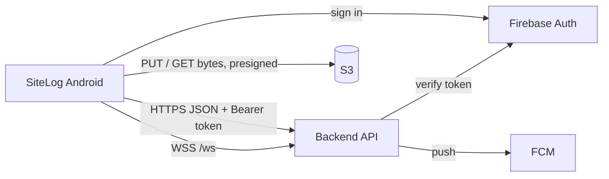

# Backend API (Android client guide)

<dl><dd>

- What the Android app calls on the backend, what it sends and gets back, and what it must do with the answer.
- The backend is shared with iOS: [site-log-be](https://github.com/DAMHONGDUC/site-log-be). Full contract: [site-log-be · 01-api](https://github.com/DAMHONGDUC/site-log-be/blob/main/docs/feature-docs/01-api.md). iOS client guide: [iOS 03-backend](https://github.com/DAMHONGDUC/site_log_swift_ui/blob/main/docs/feature-docs/03-backend.md).
- Client side of uploads, sync and realtime: [02-upload-sync.md](02-upload-sync.md).

</dd></dl>

## Contents

<dl><dd>

1. [Where it lives](#1-where-it-lives)
2. [Calling the API](#2-calling-the-api)
3. [Errors and retries](#3-errors-and-retries)
4. [Endpoints by feature](#4-endpoints-by-feature)
5. [Auth and account](#5-auth-and-account)
6. [Sync](#6-sync)
7. [Uploads](#7-uploads)
8. [Verify](#8-verify)
9. [Realtime channel](#9-realtime-channel)
10. [Push registration](#10-push-registration)
11. [Shared constants](#11-shared-constants)
12. [Testing against a local backend](#12-testing-against-a-local-backend)
13. [Team and roles](#13-team-and-roles)

</dd></dl>

## 1. Where it lives

<dl><dd>

| Env | Base URL | Used by | Firebase project |
|---|---|---|---|
| Local | `http://10.0.2.2:3000` (emulator → the Mac), `http://<mac-ip>:3000` (phone on the same Wi-Fi) | `debug` build type | `sitelog-dev` |
| Staging | `https://api-staging.<domain>` | `debug`, `staging` | `sitelog-dev` |
| Production | `https://api.<domain>` | `release` (Google Play) | `sitelog-prod` |

- The emulator's `localhost` is the emulator itself: always `10.0.2.2` for the host machine.
- Files live in S3; the app uploads and downloads them **directly** with presigned URLs.



</dd></dl>

## 2. Calling the API

<dl><dd>

| Rule | Detail |
|---|---|
| Auth header | `Authorization: Bearer <Firebase ID token>`; `getIdToken(false)` on every request in an OkHttp `Interceptor`; never cache it yourself |
| Body | JSON, `Content-Type: application/json`, ≤ 1 MiB |
| Names | `camelCase` fields — kotlinx.serialization property names match, no `@SerialName` needed |
| JSON config | `Json { ignoreUnknownKeys = true; explicitNulls = true; encodeDefaults = true }` — the server needs full rows with `null` |
| Ids | App-made UUIDs; the server returns them **lowercase** — compare as `UUID.fromString(...)`, not strings |
| Timestamps | ISO 8601 UTC with milliseconds `2026-11-05T09:00:00.000Z`: a serializer over `Instant` with `DateTimeFormatter.ISO_INSTANT` and millisecond truncation |
| Dates | `YYYY-MM-DD` (`LocalDate`) |
| Hashes | SHA-256, 64 lowercase hex |
| Clock | The `Date` header of any response is the trusted time for the clock offset |

- Built in `:platformkit` `networking/` (`HttpClient` over OkHttp: base URL and token provider through the constructor); each feature's remote data source in `:data` `datasources/remote/` maps DTOs.

</dd></dl>

## 3. Errors and retries

<dl><dd>

- Every error body is `{ "error": { "code": "<snake_case>", "message": "…" } }`. Log `code`, never show `message` raw.

| Status | Means | The app |
|---|---|---|
| `200` | Done (also a repeated `complete` or `DELETE`) | Continue |
| `400` | Permanent | Stop; an upload job → `PERMANENT`, abort |
| `401` | Token missing, expired or revoked | One shared refresh (`getIdToken(true)`) in the OkHttp `Authenticator`, retry once |
| `404` | Unknown or aborted upload, unknown code | Permanent |
| `409` | On `complete`: another upload of the same key won; body has `remoteKey` and `verificationCode` | Treat as success |
| `413` | Too large | Permanent |
| `429` | Rate limit | Wait (`Retry-After`), retry |
| `5xx` | Server fault, `503 auth_unavailable` | Retry with backoff |
| S3 `403` on a presigned URL | URL expired | `URL_EXPIRED`: refresh URLs, no budget used |

</dd></dl>

## 4. Endpoints by feature

<dl><dd>

| Feature | Call | Section |
|---|---|---|
| F00 | `GET /health` | [§1](#1-where-it-lives) |
| F02 Auth | `DELETE /account` | [§5](#5-auth-and-account) |
| F04 Sync | `POST /sync/pull`, `POST /sync/push` | [§6](#6-sync) |
| F06 Upload | `POST /uploads`, `POST /uploads/:id/complete`, `DELETE /uploads/:id`, `POST /media/urls` | [§7](#7-uploads) |
| F07 Resumable upload | Multipart answer, `POST /uploads/:id/parts/refresh` | [§7](#7-uploads) |
| F10 Reports | `GET /verify/:code` | [§8](#8-verify) |
| F15 Realtime | `WS /ws` | [§9](#9-realtime-channel) |
| F16 Push | `POST /devices`, `DELETE /devices/:token` | [§10](#10-push-registration) |
| F03, F05, F08–F12 | Their tables ride on `/sync` | [§6.3](#63-synced-tables) |

</dd></dl>

## 5. Auth and account

<dl><dd>

- Every route except `/health` and `/verify` checks the ID token (`checkRevoked: true`) → the caller's `uid`, or `401`.
- Every key and row is scoped to that `uid`; the app never sends a uid in a body.
- Android sign-in providers are set up in the Firebase console: add the Android app (`com.dd.sitelog`) to `sitelog-dev` and `sitelog-prod`, with the debug, CI upload and Play app-signing SHA-1/SHA-256 fingerprints (Google sign-in fails without them).

```text
DELETE /account
→ 200 { "deletedObjects": 214, "abortedUploads": 1, "deletedRows": 932 }
```

| Server does | Client rule |
|---|---|
| Aborts the caller's uploads, deletes their phrases, devices and the Firebase user; company records stay | Reauthenticate first; say that company records stay; then wipe Room, secure store, media, Coil cache |
| Safe to repeat | After success any call is `401`: sign out locally |

</dd></dl>

## 6. Sync

<dl><dd>

### 6.1 Pull

<dl><dd>

```text
POST /sync/pull { "since": <nextRev of last pull, 0 at first>, "limit": 500 }
→ { "changes": { "<table>": [rows] }, "nextRev": 41, "hasMore": false }
→ { "resyncRequired": true }
```

| Server | Client rule |
|---|---|
| Per-user `rev`, gap-free | Store `nextRev` only after the page is applied (same Room transaction) |
| Rows with `rev > since`, tombstones included | Delete tombstoned rows locally |
| `hasMore: true` when capped | Pull again at once |
| `resyncRequired` | Wipe synced data, pull from `0` |

- `changes` is a map of table → rows of different shapes: decode it as `Map<String, List<JsonObject>>`, then each table's `SyncableLocalDataSource` decodes its own DTO.

</dd></dl>

### 6.2 Push

<dl><dd>

```text
POST /sync/push { "mutations": [ { "table", "id", "op": "upsert" | "delete", "clientUpdatedAt", "fields": { full row } } ] }
→ { "results": [ { "id", "status": "applied" | "superseded" | "rejected", "serverRow"?, "reason"? } ], "serverRev": 44 }
```

| Server | Client rule |
|---|---|
| One transaction per batch (≤ 200) | Queue in dependency order |
| LWW on `clientUpdatedAt` | Send the time of the edit, not of the push |
| `upsert` needs the **full row** | Never send partial `fields` (`explicitNulls = true`) |
| `superseded` + `serverRow` | Adopt `serverRow` |
| `rejected` + `reason` | Drop that mutation, log the reason, keep the rest |

</dd></dl>

### 6.3 Synced tables

<dl><dd>

| Table | Since | DTO notes |
|---|---|---|
| `projects`, `locations`, `sessions` | F03 | `kind` ∈ floor · unit · room; `state` ∈ draft · active · closed · exported (lowercase in JSON, `@SerialName` on enum entries) |
| `captures` | F05 | Evidence fields frozen after the first push; `latitude`/`longitude` both or neither |
| `issues`, `issue_captures`, `phrases` | F08 | `severity` ∈ critical · major · minor; `status` ∈ open · inProgress · resolved · verified (`@SerialName("inProgress")` on `IN_PROGRESS`); pin = `planSheetId` + `pinX` + `pinY` or all `null` |
| `annotations` | F09 | `id` = capture id; `shapes` is a JSON array (same JSON as iOS) |
| `report_branding` | F10 | One per user; `accentHex` = `#RRGGBB` |
| `plan_sheets` | F11 | |
| `checklist_templates`, `checklist_template_items`, `checklist_runs`, `checklist_results` | F12 | One live result per `(runId, templateItemId)` |

- Exact fields: [site-log-be · 01-api §6.3](https://github.com/DAMHONGDUC/site-log-be/blob/main/docs/feature-docs/01-api.md#63-synced-tables). DTOs in `:data` `models/remote/` mirror them one to one.
- Content types from Android: photos `image/jpeg` (`.jpg`), video `video/mp4` (`.mp4`), audio `audio/mp4` (`.m4a`); all already allowed by the key rules.

</dd></dl>

</dd></dl>

## 7. Uploads

<dl><dd>

### 7.1 Keys

<dl><dd>

| File | Key |
|---|---|
| Capture | `projects/{projectId}/{sessionId}/{captureId}.{jpg·heic·png·mov·mp4·m4a}` |
| Plan sheet | `projects/{projectId}/plans/{sheetId}.{pdf·jpg·png·heic}` |
| Branding logo | `company/branding/{logoId}.{png·jpg}` |

</dd></dl>

### 7.2 Begin and PUT

<dl><dd>

```text
POST /uploads { "key", "byteSize", "contentType", "sha256" }
→ { "mode": "single", "uploadId", "url", "expiresAt" }
→ { "mode": "multipart", "uploadId", "partSizeBytes": 8388608, "parts": [ { "number", "url" } ], "expiresAt" }
```

| Server | Client rule |
|---|---|
| Picks the mode | Plan byte ranges from `partSizeBytes` |
| URLs signed for 1 h, include `Content-Type` | PUT with the same `Content-Type` and an exact `Content-Length`; keep each `ETag` (OkHttp: `response.header("ETag")`, quotes kept) |
| 600 begins / minute / user | `429` → back off |

- Presigned PUTs go through a **separate** `OkHttpClient` without the auth interceptor (S3 rejects an extra `Authorization` header).

</dd></dl>

### 7.3 Complete

<dl><dd>

```text
POST /uploads/:id/complete {}                                     (single)
POST /uploads/:id/complete { "parts": [ { "number", "etag" } ] }  (multipart)
→ { "uploadId", "remoteKey", "sha256", "verificationCode", "verified": false, "receivedAt" }
```

- Idempotent: retry freely. `404 object_not_found` / `400 size_mismatch` → restart the job from the file.

</dd></dl>

### 7.4 Refresh, abort, media

<dl><dd>

| Call | Client |
|---|---|
| `POST /uploads/:id/parts/refresh { "numbers": [13, 14] }` | Mandatory after a long stop or any S3 `403` |
| `DELETE /uploads/:id` | User cancel, account switch |
| `POST /media/urls { "keys": [...] }` (≤ 200) | Coil cache key = the object key, not the URL |

</dd></dl>

</dd></dl>

## 8. Verify

<dl><dd>

```text
GET /verify/K7M2QX9HTP      (no token)
→ { "code", "sha256", "byteSize", "receivedAt", "verifyState": "registered" | "verified" | "mismatch", "verified", "verifiedAt", "projectRef" }
```

- App: print `projectRef` in the report header and the code under each photo ([01-field-work §12.5](01-field-work.md#125-verification-code)).

</dd></dl>

## 9. Realtime channel

<dl><dd>

| App → server | Server → app |
|---|---|
| `{"type":"auth","token":"…"}` first, within 5 s | `{"type":"snapshot","sessionID","completed":[…],"failed":[…]}` |
| `{"type":"subscribe","sessionID":"…"}` | `{"type":"jobCompleted","jobID","remoteKey","sha256","verified"}` |
| `{"type":"ping","at":n}` | `{"type":"jobFailed","jobID","reason"}` · `{"type":"pong","at":n}` |

- Decode with a `JsonContentPolymorphicSerializer` (or `classDiscriminator = "type"`) into a sealed `RealtimeMessage`.
- Close `4000` no auth · `4001` token (refresh, reconnect) · `4003` foreign session · `4008` too many sockets.

</dd></dl>

## 10. Push registration

<dl><dd>

- Shared contract: both apps push through Firebase Cloud Messaging ([site-log-be · 01-api §10](https://github.com/DAMHONGDUC/site-log-be/blob/main/docs/feature-docs/01-api.md#10-devices), [B09](https://github.com/DAMHONGDUC/site-log-be/blob/main/docs/feature-docs/00-overview.md#b09--firebase-cloud-messaging-for-push)); no Android-only server work.

```text
POST /devices { "token": "<FCM registration token>", "platform": "android" }   → { "registered": true }
DELETE /devices/:token                                                       → { "removed": true }
```

| Rule | Detail |
|---|---|
| `platform` | `"android"` (iOS sends `"ios"`); the server picks the message shape from it |
| When | After sign-in, on every `onNewToken`, and remove on sign-out |
| Payload | FCM **data** message `{ "deepLink": "sitelog://session/<id>", "account": "<uid hash>", "title", "body" }`; the app builds the notification itself so it can drop pushes for another account |

</dd></dl>

## 11. Shared constants

<dl><dd>

| Constant | Value | Android |
|---|---|---|
| Single-PUT threshold | 5 MiB | `UploadConstants.SINGLE_PUT_THRESHOLD_BYTES` |
| Part size | 8 MiB | `UploadConstants.PART_SIZE_BYTES` |
| Presigned URL lifetime | 1 h | proactive refresh before `expiresAt` |
| Pull page | ≤ 500 | `SyncConstants.PULL_PAGE_SIZE` |
| Push batch | ≤ 200 | `SyncConstants.PUSH_BATCH_SIZE` |
| Tombstone retention | 90 days | `SyncConstants.TOMBSTONE_RETENTION_DAYS` |
| WS auth timeout · max message | 5 s · 64 KiB | `RealtimeConstants.AUTH_TIMEOUT_MS` · `MAX_MESSAGE_BYTES` |

</dd></dl>

## 12. Testing against a local backend

<dl><dd>

- Run the backend on the Mac: [site-log-be · local testing](https://github.com/DAMHONGDUC/site-log-be/blob/main/docs/feature-guide/local-testing-with-ios.md) (same server; only the client address differs).
- Debug builds allow cleartext HTTP only to `10.0.2.2`, `localhost` and (when used) the Mac's LAN address through `app/src/debug/res/xml/network_security_config.xml`; release builds allow none.
- A real phone: same Wi-Fi as the Mac, or `adb reverse tcp:3000 tcp:3000` and use `http://localhost:3000`.

</dd></dl>

## 13. Team and roles

<dl><dd>

- One company, four roles (Admin · Manager · Inspector · Viewer), projects shared by their members. Rules: [site-log-be · 05-team-and-roles](https://github.com/DAMHONGDUC/site-log-be/blob/main/docs/feature-docs/05-team-and-roles.md); calls: [site-log-be · 01-api §13](https://github.com/DAMHONGDUC/site-log-be/blob/main/docs/feature-docs/01-api.md#13-team).

| Client rule | Detail |
|---|---|
| Who am I | `GET /me` after sign-in, on every app start and after every `resyncRequired`; keep `role` and `projectIds` in the local store |
| Hide what the role cannot do | Buttons, menus and swipe actions follow the permission table; a Viewer gets a read-only Home, Issues and plan |
| Never trust only the UI | A `403 forbidden` from the API, or a push result `rejected` with `forbidden:<action>`, drops the action, shows "Not allowed for your role" and logs the code |
| Sign-in only by invite | `403 not_invited` after sign-in → "Ask an Admin to invite you" screen; sign out locally |
| Invite link | `https://app.<domain>/invite/<token>` opens the app (Android App Link); `GET /invitations/:token` (no sign-in) fills the join screen; sign in, then `POST /invitations/accept { token }`; on success pull from `0` |
| Team calls (Admin) | Resend `POST /invitations/:id/resend`, cancel `DELETE /invitations/:id`; change role and / or projects `PATCH /members/:uid`; activity `GET /member-events?before=&limit=` (paged, read live, never cached) |
| Access changed | `resyncRequired` after a role or project change: wipe synced data, pull from `0`; projects no longer reachable disappear from the switcher |
| Who made it | Rows carry `createdBy`; names come from `GET /members` (Admins and Managers) or `GET /me` for yourself; others show "Team member" |

</dd></dl>
