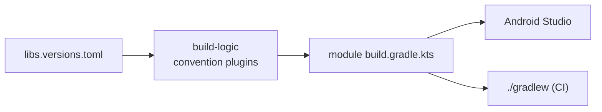

# Platform (Android)

<dl><dd>

- Everything around the features: dev tooling, diagnostics, testing, release pipeline, push and deep links, profiling.
- iOS original: [iOS 05-platform](https://github.com/DAMHONGDUC/site_log_swift_ui/blob/main/docs/feature-docs/05-platform.md).

</dd></dl>

## Contents

<dl><dd>

| Section | Topic |
|---|---|
| [Dev setup](#dev-setup) | Android Studio, Gradle, format on save, Live Edit, previews |
| [09](#09-diagnostics-and-observability) | Diagnostics — upload status, integrity and cleanup, bundle, logging |
| [Testing](#testing-strategy) | Test layers, rules, coverage |
| [17](#17-cicd-and-play-internal-testing) | CI/CD and Play internal testing |
| [18](#18-push-notifications-and-deep-links) | Push notifications and deep links |
| [19](#19-performance-profiling) | Profiling with Android Studio, Perfetto, Macrobenchmark |

- [Beginner terms](#beginner-terms)

---

</dd></dl>

## Beginner terms

<dl><dd>

- **Gradle:** the build tool; `./gradlew <task>` runs it from the repo root.
- **Version catalog:** `gradle/libs.versions.toml`, one list of every library and version.
- **detekt / ktlint:** a Kotlin code-smell checker / a Kotlin formatter.
- **Android Lint:** Google's checker for Android problems (missing permissions, API levels, resources).
- **App Bundle (`.aab`):** what Google Play takes; it builds per-device APKs.
- **Play internal testing:** Google's TestFlight: up to 100 testers install from the Play Store.

</dd></dl>

## Dev setup

<dl><dd>

1. [First-time setup](#1-first-time-setup)
2. [Gradle and the version catalog](#2-gradle-and-the-version-catalog)
3. [detekt, ktlint, Lint](#3-detekt-ktlint-lint)
4. [Format on save](#4-format-on-save)
5. [Live Edit and previews](#5-live-edit-and-previews)
6. [Live templates](#6-live-templates)
7. [Emulators and devices](#7-emulators-and-devices)
8. [Troubleshooting](#8-troubleshooting)



### 1. First-time setup

<dl><dd>

| Step | Action |
|---|---|
| 1 | Install the latest stable Android Studio; SDK Manager → API 36 and API 37 platforms + build tools |
| 2 | Nothing to install for Java: `gradle/gradle-daemon-jvm.properties` makes Gradle download and use JDK 25 once; the code compiles for Java 21 |
| 3 | Open the repo root; wait for Gradle sync |
| 4 | From F02 on: copy `app/src/debug/google-services.json.example` → `google-services.json` and fill it from the Firebase console (`sitelog-dev`) |
| 5 | Device Manager → create **Pixel 9, API 36, Google Play** image |
| 6 | Run `app` (Shift+F10); first build downloads dependencies |

- `local.properties` (SDK path) and `google-services.json` are git-ignored.

</dd></dl>

### 2. Gradle and the version catalog

<dl><dd>

- Why: [A08](00-overview.md#a08--gradle-owns-the-build).

| When | Action |
|---|---|
| Add a library | Add it to `[versions]` + `[libraries]` in `libs.versions.toml`, then `implementation(libs.<name>)` in the module |
| Change SDK levels, Kotlin options, Compose flags | `build-logic/convention/` only |
| Add a module | `settings.gradle.kts` `include(":name")` + a 5-line `build.gradle.kts` applying a convention plugin |
| Check for updates | `./gradlew dependencyUpdates` (ben-manes plugin), bump in one PR |

- Never change settings through **Project Structure**; it writes into module files and drifts from `build-logic`.

| `build-logic` plugin | Applies |
|---|---|
| `sitelog.android.application` | `compileSdk` 37, `targetSdk` 36, `minSdk` 29, Java 21, `allWarningsAsErrors`, strict Lint, `buildConfig`, R8 in release; no `kotlin-android` plugin (AGP 9 has Kotlin built in) |
| `sitelog.android.library` | Same SDK levels, Java 21, strict Lint |
| `sitelog.jvm.library` | Kotlin JVM 21 (`:domain`) |
| `sitelog.compose` | Compose compiler plugin, BOM, `ui-tooling` in debug |
| `sitelog.hilt` | Hilt + KSP |
| `sitelog.room` | KSP + `androidx.room` Gradle plugin, `room { schemaDirectory("$projectDir/schemas") }`, `room-runtime` + `ksp(room-compiler)` |

</dd></dl>

### 3. detekt, ktlint, Lint

<dl><dd>

| Tool | Owns | Config |
|---|---|---|
| ktlint 1.8 (through Spotless) | Formatting: indentation, wrapping, import order, trailing commas | `editorConfigOverride` in the root `build.gradle.kts` (Spotless does not read ktlint rules from `.editorconfig`) |
| detekt 1.23 | Code smells, complexity, banned calls (`println`) | `config/detekt/detekt.yml`: Composable names, broad `catch`, tokens and previews allowed |
| Android Lint | Android-specific issues | `warningsAsErrors`, `abortOnError`; `ObsoleteLintCustomCheck`, `AndroidGradlePluginVersion`, `GradleDependency`, `NewerVersionAvailable` disabled, in `build-logic` |

| `.editorconfig` key | Value | Why |
|---|---|---|
| `max_line_length` | `100` | Same limit as iOS |
| `ktlint_code_style` | `android_studio` | Same as Android Studio's formatter, so Format on Save and CI agree |
| `ij_kotlin_allow_trailing_comma` | `true` | Cleaner diffs |
| `ktlint_standard_class-signature`, `ktlint_standard_function-expression-body` | `disabled` | Keep `class X @Inject constructor(` on one line and explicit `return` |

- Run: `./gradlew spotlessApply detekt lint`.

</dd></dl>

### 4. Format on save

<dl><dd>

- Android Studio → Settings → Tools → **Actions on Save**: Reformat code, Optimize imports.
- Install the **ktlint** plugin (Settings → Plugins) and set it to *Distract free* so the IDE formats like Spotless.

</dd></dl>

### 5. Live Edit and previews

<dl><dd>

- Compose **Live Edit** (Settings → Editor → Live Edit → *Automatically*): edit a composable, the running app updates without a rebuild; structural changes (new class, new parameter) still need a run.
- Every `<Name>Content` composable has `@Preview` functions for light, dark and a large font (`fontScale = 2f`); previews use hand-built state, no Hilt.
- **Apply Changes** (⌃⌘R) for non-Compose code that does not change signatures.

</dd></dl>

### 6. Live templates

<dl><dd>

| Abbreviation | Inserts |
|---|---|
| `screen` | `<Name>Screen` + `<Name>Content` + previews |
| `vm` | `@HiltViewModel` view model with `StateFlow<State>` and `onAppear()` |
| `usecase` | Use case class with `suspend operator fun invoke` |
| `repoimpl` | Repository impl skeleton with `try` / `catch` → `Outcome` and logs |

- Shared as `tools/android-studio/SiteLog.xml`; import through Settings → Editor → Live Templates → ⚙ → Import.

</dd></dl>

### 7. Emulators and devices

<dl><dd>

| Need | Use |
|---|---|
| Daily work, UI | Emulator Pixel 9, API 36 |
| Oldest supported | Emulator API 29 (small screen) |
| Camera, BLE, battery, OEM quirks | Real phones: one Pixel, one Samsung, one Xiaomi if possible |
| Deep links | `adb shell am start -W -a android.intent.action.VIEW -d "sitelog://session/42" com.dd.sitelog` |
| Process death | `adb shell am kill com.dd.sitelog` (app in background) |
| Doze | `adb shell dumpsys deviceidle force-idle` |

</dd></dl>

### 8. Troubleshooting

<dl><dd>

| Symptom | Fix |
|---|---|
| Gradle sync fails after pulling | **File → Invalidate Caches**, then `./gradlew --stop` and sync |
| `google-services.json` missing | Step 4 of first-time setup |
| KSP / Hilt "cannot find symbol" | `./gradlew clean`, rebuild; check the binding exists in `di/` |
| Room "Schema export directory" warning | The `sitelog.room` plugin is missing on the module |
| Emulator cannot reach the local backend | Use `10.0.2.2`, not `localhost` |
| Google sign-in fails with code 10 | The machine's debug SHA-1 is not in the Firebase console |

---

</dd></dl>

</dd></dl>

## 09. Diagnostics and observability

<dl><dd>

- Module: `:app` `presentation/diagnostics`

**Goal:** users answer "where are my photos?" themselves; one exported file is enough for a developer; cleanup can never delete anything not yet uploaded.

### 09.1 Upload status screen

<dl><dd>

```text
Session 05 Sep — Ánh Dương Tower
████████████░░░░  187/243 files · 1.8 GB / 2.4 GB · ~6 min remaining
⚠ 4 waiting: Waiting for Wi-Fi (3) · Waiting for a new upload link (1)
✕ 2 failed — [Retry]
```

- **Waiting is never red** — `WAITING_FOR_NETWORK`, `WAITING_FOR_URL` and WorkManager waiting on Doze are normal.
- Plain-language reasons; "Will upload when the phone wakes up" while WorkManager defers; estimates from the trailing `THROUGHPUT_WINDOW_MS`.
- When the app's standby bucket is `RESTRICTED` or the maker is known to kill background work, show one card with the steps (Settings → Battery → Unrestricted).

</dd></dl>

### 09.2 Integrity checks and cleanup

<dl><dd>

| Check | Detects |
|---|---|
| Record with no file / file with no record | Lost media / orphan from a crash |
| Recomputed hash ≠ `sha256` (originals only) | Corruption or substitution |
| Audit chain HMAC | Tampered log |
| Job `UPLOADING` with no WorkManager work | Stuck job → reset to `PENDING` |
| Derived image with no source | Stale stamped copy |

- Default: random sample of `INTEGRITY_SAMPLE_SIZE`; "verify everything" runs as a WorkManager job.

**Cleanup**

- **Only `SYNCED` files are eligible**, even with a full disk.
- Numbers first: "Delete 156 uploaded files, freeing 1.4 GB. 12 not yet uploaded will be kept."
- Prebuffer, tiles, derived images: a separate "reclaimable" line.
- Every cleanup writes an audit entry.

</dd></dl>

### 09.3 Diagnostic bundle and status flags

<dl><dd>

- `diagnostic-<date>.zip`: `device.json` (model, API level, maker, standby bucket), `permissions.json`, `upload-state.json` (no URLs), `work.json` (WorkManager states), `integrity.json`, `logs.ndjson` (24 h).
- **Redact on write:** strip URLs, tokens, emails, user text, GPS; keep ids, enums, counters, status codes.

| Red flag | Condition |
|---|---|
| Permission | Camera, mic, location, Bluetooth or notifications denied |
| Disk | Free space (`StatFs`) below `MIN_FREE_DISK_BYTES` |
| Thermal | `THERMAL_STATUS_SEVERE` or worse |
| Battery | Below `LOW_BATTERY_PERCENT` with pending uploads, or battery saver on |
| Background | Standby bucket `RESTRICTED`, or background data restricted |
| Network | Offline with pending jobs |
| Audit | Chain verification failed |
| Sync | Metadata sync older than `STALE_SYNC_THRESHOLD_MS` |

</dd></dl>

### 09.4 App-wide logging

<dl><dd>

- `AppLogger` in `:core`: tag `SiteLog/<category>` (`capture`, `upload`, `report`, `plans`, `devicelink`, `sync`, `security`, `access`); writes to `android.util.Log` and a rotating `logs.ndjson` (24 h) for the bundle.
- Every action logs with data, successes included; every `catch` logs the throwable; no `println` (CI greps for it).
- Crashlytics initializes first; non-fatals via `FirebaseCrashlytics.getInstance().recordException(e)` with the same structured data ([A07](00-overview.md#a07--firebase-crashlytics)).

```kotlin
object DiagnosticsConstants {
    const val THROUGHPUT_WINDOW_MS: Long = 60_000
    const val INTEGRITY_SAMPLE_SIZE: Int = 50
    const val LOG_RETENTION_HOURS: Int = 24
    const val STALE_SYNC_THRESHOLD_MS: Long = 86_400_000
    const val LOW_BATTERY_PERCENT: Int = 20
}
```

**Done**

- All five integrity conditions detected
- The bundle has no URL, token, email, text or coordinate
- Cleanup with 12 `PENDING` files deletes none of them

**Tests**

- Detectors on a temp-folder filesystem
- Cleanup never touches `PENDING`/`FAILED`
- Redacted bundle equals the expected text
- Estimates never `NaN` or negative; flags at every boundary
- `UPLOADING` without work resets

---

</dd></dl>

</dd></dl>

## Testing strategy

<dl><dd>

- Libraries and why: [A06](00-overview.md#a06--test-libraries).

| Layer | Source set | Tool | What |
|---|---|---|---|
| Domain | `domain/src/test` | JUnit + Truth + coroutines-test | Use cases, pure services; plain JVM, fastest |
| Core | `core/src/test` | JUnit + Robolectric where Android | Clock, hashers, logger redaction |
| Data | `data/src/test` | JUnit + Robolectric + in-memory Room | Mappers, repositories, data sources |
| Migrations | `data/src/androidTest` | `MigrationTestHelper` | Every schema version from a fixture |
| PlatformKit | `platformkit/src/test` | JUnit + `MockWebServer` | Upload state machine, realtime decoding, report layout, BLE parsing |
| DesignSystem | `designsystem/src/test` | JUnit | Tokens (hex decoding) |
| Presentation | `app/src/test` | JUnit + Turbine | View models on test doubles through the constructor |
| Screens | `app/src/test` | Roborazzi | Optional, last (F18): light, dark, `fontScale` 2 |
| Flows | `app/src/androidTest` | Compose UI test | Smoke: unlock → projects → capture → report |
| Backend | site-log-be `test/` | vitest | Its own CI |

**Rules**

1. Scoped: a change runs the tests of the module it touched plus `:domain` (`./gradlew :data:testDebugUnitTest :domain:test`).
2. No real network, clock, camera or Bluetooth in unit tests; inject `AppClock`, `UploadTransport`, `CaptureSessionControlling`, `Random`, `CoroutineDispatcher`.
3. Coroutines: `runTest` with a `StandardTestDispatcher` passed in; `Dispatchers.setMain` in a JUnit rule for view models.
4. A bug fix lands with the test that would have caught it.
5. Test doubles live in `src/test/` (`doubles/`); MockK only for Android framework classes.

| Coverage scope (Kover) | Line coverage |
|---|---|
| `:domain` | ≥ 90% |
| `uploadkit`, sync engine | ≥ 85% |
| `:data` | ≥ 70% |
| View models | ≥ 70% |
| Composables | No line target |

---

</dd></dl>

## 17. CI/CD and Play internal testing

<dl><dd>

### Workflow

<dl><dd>

| Trigger | Runner | Work |
|---|---|---|
| Pull request or push to `main` | `ubuntu-latest` | `tools/ci/check-no-println.sh`, `check-imports.sh`, Gitleaks, `spotlessCheck`, `detekt` |
| After guards pass | `ubuntu-latest` | `./gradlew assembleDebug testDebugUnitTest lint koverXmlReport` |
| Nightly | `ubuntu-latest` + emulator (`reactivecircus/android-emulator-runner`) | `connectedDebugAndroidTest` (migrations, UI smoke) |
| Tag `v*` | `ubuntu-latest`, environment `play` | `bundle exec fastlane android internal`: `bundleRelease`, sign, upload to Play internal testing |

- No self-hosted Mac needed: Android builds on Linux.
- Gradle cache via `gradle/actions/setup-gradle`; JDK 25 via `actions/setup-java` (the Gradle daemon needs it; code targets Java 21).

</dd></dl>

### Release lane

<dl><dd>

| Step | How |
|---|---|
| Version | `versionCode` = CI run number, `versionName` from the tag |
| Signing | Upload key from secrets (`ANDROID_KEYSTORE_BASE64`, passwords) decoded to a temp file, deleted after; Play App Signing holds the app key |
| Upload | Fastlane `supply` with a Play service account JSON from secrets, track `internal` |
| Mapping | R8 `mapping.txt` uploaded to Play and Crashlytics |
| Production | Promote from internal → production by hand in Play Console |

---

</dd></dl>

</dd></dl>

## 18. Push notifications and deep links

<dl><dd>

- Modules: `:app` `presentation/notifications`, `presentation/deeplinks`, `:platformkit` `push/`

**Goal:** a notification tap or a `sitelog://` URI opens the exact session or issue through one shared `DeepLink` type; a link during cold start is not lost.

- Out: rich notifications, App Links (`https://` verified links), push as an upload trigger.
- Format `sitelog://<route>/<id>` (`session/42`, `issue/7`); wrong scheme, unknown route or missing id is ignored and logged. The parser is pure Kotlin in `:domain`.
- FCM sends a **data** message with `deepLink`; `SiteLogMessagingService.onMessageReceived` drops it if `account` is not the signed-in user, otherwise posts a notification whose `PendingIntent` opens `MainActivity` with the URI.
- Permission `POST_NOTIFICATIONS` (API 33+) is requested at a moment that makes sense (after the first upload finishes), not at first launch.
- Token: `FirebaseMessaging.getInstance().token`, re-sent in `onNewToken`, logged truncated.
- Routing: `Intent.data` (from `onCreate` and `onNewIntent`) → parser → `DeepLinkRouter` (holds a pending link in a `StateFlow`) → tab + `<Feature>Route` pushed on that tab's `NavigationCoordinator` ([A19](00-overview.md#a19--feature-routes-and-a-coordinator-per-back-stack)). The router holds the destination until the root consumes it (after unlock), and a deleted target lands on a safe screen.
- Manifest: `MainActivity` `launchMode="singleTop"` with an `<intent-filter>` for `VIEW` + `BROWSABLE` + `scheme="sitelog"`; `FirebaseMessagingService` declared `exported="false"`; notification channels `uploads` and `updates`.

**Risks**

- Crafted ids from other apps are data, re-checked at the destination
- Pushes for another account are ignored
- The app works fully with notifications denied

**Done**

- Links open from Chrome and `adb`
- A tap opens the target when the app is killed, backgrounded or in the foreground
- Garbage is ignored without a crash

**Tests**

- Parser routes and rejections
- Payload with/without `deepLink`
- Router holds until consumed
- Cold-start link survives (UI test with `ActivityScenario.launch(intent)`)

---

</dd></dl>

## 19. Performance profiling

<dl><dd>

**Goal:** know the real cost of the upload queue, the socket and capture before testers do.

- Every performance claim has a measurement behind it.
- Always a real mid-range phone, release build (`profileable`).

| Question | Tool |
|---|---|
| Slow or janky | Android Studio Profiler (CPU), Perfetto system trace, JankStats |
| Memory growth, leaks | Memory Profiler, LeakCanary (debug) |
| A composable recomposes too often | Layout Inspector recomposition counts, Compose compiler reports |
| Slow or duplicated requests | Network Inspector |
| Battery cost of socket / upload | Power Profiler (Pixel), Battery Historian |
| Time inside our own code | `androidx.tracing` `trace("UploadPart") { … }` sections in Perfetto |
| Startup and scroll in CI | Macrobenchmark (`:benchmark` module) + Baseline Profile |

- Trace sections: `Connection`/`Message` (realtime), `UploadPart`/`Reconcile` (upload), `Capture`/`HashFile`/`Thumbnail` (capture); names and counts only.

| # | Scenario | Budget |
|---|---|---|
| 1 | Queue 243 files | Flat memory, no growth linear in file count |
| 2 | 30-minute upload | Foreground notification only; no ANR; battery drain in line with the bytes sent |
| 3 | Socket open 10 minutes | Message handling in microseconds; no wake-ups beyond ping |
| 4 | Burst of 20 photos | No dropped frames in the preview (JankStats) |
| 5 | Session with 243 rows | No recompositions on unrelated updates |
| 6 | Cold start | Under 1 s to the splash on a mid-range phone with the Baseline Profile |

- Profile before optimizing; justify a change with a before/after trace; record device, maker and API level with every result.
- Scenarios run on device before each internal-testing build.

</dd></dl>
