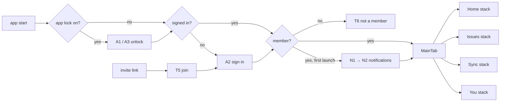

# Navigation map

<dl><dd>

- Where every screen lives, how it opens and which route reaches it. The rule behind it: [A19](00-overview.md#a19--feature-routes-and-a-coordinator-per-back-stack); screen ids and flows: [design page 04](https://github.com/DAMHONGDUC/site_log_swift_ui/blob/main/docs/design/html/4-flows.html) (46 flows, every screen in at least one) and the [screen inventory](https://github.com/DAMHONGDUC/site_log_swift_ui/blob/main/docs/design/00-design-plan.md#3-screen-inventory).
- Each tab owns one Navigation 3 back stack (`NavDisplay`) and one `NavigationCoordinator`; each feature owns its route type in `presentation/<feature>/<Feature>Route.kt` with `<feature>Entries()`.

</dd></dl>

## Contents

<dl><dd>

1. [Shape](#1-shape)
2. [Root states](#2-root-states)
3. [Tabs](#3-tabs)
4. [Routes](#4-routes)
5. [Sheets, covers, dialogs](#5-sheets-covers-dialogs)
6. [Deep links](#6-deep-links)
7. [Rules](#7-rules)

</dd></dl>

## 1. Shape

<dl><dd>

</dd></dl>

## 2. Root states

<dl><dd>

- The root view model picks one state; each replaces the whole UI, so there is no back between them.

| State | Screens | Leaves when |
|---|---|---|
| `Locked` | A1, A3, A3l | Face ID / fingerprint or the passcode succeeds |
| `SignedOut` | A2 | Sign-in or Continue offline |
| `Joining(token)` | T5, T5x | The invite is accepted after sign-in, or the user leaves |
| `NotMember` | T6 | Sign out |
| `AskNotifications` | N1, then the system prompt N2 | Turn on or Not now; asked once, on first launch |
| `FirstSync` | E3 | The first pull finishes |
| `Main` | MainTab: Home · Issues · Sync · You | Lock, sign-out, removal from the company |

</dd></dl>

## 3. Tabs

<dl><dd>

| Tab | Root screen | Same screen, other states | Badge |
|---|---|---|---|
| Home | P1 Home of the current project; sub-tabs Sessions · Locations (P8) · Plans (P9) | P1s, P1f, P8s, P9s, P9f, P9e (scrolled, filtered, no match); E1 no projects; E2 offline; E4 sync paused; T7 Viewer | — |
| Issues | C5 Issues of the current project | C5f filtered, C5e no match, E5 nothing open | Open issues |
| Sync | U1 every project on this device | — | — |
| You | S1 account and settings | — | — |

- Switching tabs keeps each stack; tapping the current tab pops it to its root.
- Home and Issues follow the current project; W1 changes it and resets both stacks to their roots.

</dd></dl>

## 4. Routes

<dl><dd>

- Pushed screens only; every case carries ids, never models.

| Route | Case | Screen | Pushed on | From |
|---|---|---|---|---|
| `ProjectsRoute` | `Archived` | W2 Archived projects | Home | W1 (the bottom sheet closes first) |
| | `Walkthrough(sessionId)` | P5 Walkthrough | Home | P4 Start, Resume on P1 |
| | `GenerateLocations(projectId)` | P6 Generate locations | Home | P8 `+` |
| | `Room(locationId)` | P7 Room | Home | P5, P8 |
| | `Members(projectId)` | T4 Project members | Home | P1 `⋯` → Members |
| `PlansRoute` | `Viewer(sheetId)` | M4 Plan viewer | Home | P9, P5 Plan |
| `IssuesRoute` | `Detail(issueId)` | C6 Issue detail (T8 for a Viewer; T8n shows the 403 toast) | Issues, Home | C5, E6, M5, P7, push N3 |
| | `Search` | E6 Search | Issues, Home | Search in the app bar |
| `ChecklistsRoute` | `Run(runId)` | K2 Checklist run | Home | K1 (closes first) |
| | `Done(runId)` | K4 Checklist done | Home | K2, replaces it |
| `ReportsRoute` | `Finished(sessionId)` | R1 Walkthrough finished | Home | End on P5 |
| | `Options(reportId)` | R2 Report options | Home | R1 Make the report |
| | `Signatures(reportId)` | R4 Signatures | Home | R2 |
| | `Preview(reportId)` | R5 PDF preview | Home | R2 Create PDF, R4 Done |
| | `Branding` | R3 Report letterhead | Home, You | R2, S1 |
| `SyncRoute` | `ProjectFiles(projectId)` | U2 Project files | Sync, Home | U1, the sync line on P1 |
| `SettingsRoute` | `LaserMeter` | S2 Laser meter | You | S1 |
| | `AppLock` | S4 App lock | You | S1 |
| | `Notifications` | N4 Notifications (N4o when off) | You | S1 |
| | `Diagnostics` | U3 Diagnostics | You | S1 |
| `TeamRoute` | `Team` | T1 Team (T1o offline) | You | S1 |
| | `Invite` | T2 Invite | You | T1 `+` |
| | `Member(uid)` | T3 Member | You | T1 |
| | `Activity` | T9 Team activity | You | T1 Activity |

</dd></dl>

## 5. Sheets, covers, dialogs

<dl><dd>

- Local UI state of the screen that opens them, never routes. A bottom sheet that leads to a full screen closes itself, then the tab's coordinator pushes.

| Screen | Kind | Opened from | Then |
|---|---|---|---|
| W1 Switch project | bottom sheet | Project switch on P1 | Changes the current project; New project → P2, Archived → push W2 |
| P2 New project | bottom sheet (large) | W1, E1 Create a project | Saves and switches to it |
| P4 Start session | bottom sheet | P1 `⋯`, P7 | Push P5 |
| P5J Jump to a unit | bottom sheet | P5 | Scrolls P5 |
| HF1 · HF2 · HF3 Filters | bottom sheet | Filter button on each Home sub-tab | Back to the sub-tab, filtered |
| F1 · F1s Issue filters | bottom sheet | Main filter chip, a group chip on C5 | Back to C5, filtered |
| M4L Show on plan | bottom sheet | M4 | Back to M4 |
| M5 Pin preview | bottom sheet (medium) | A pin on M4 | Open → push C6 |
| C1 Camera | full-screen destination | P5, P7, Resume | Close returns to the screen below |
| C2 Log issue | bottom sheet over C1 | Issue on C1 | Save returns to C1 |
| C3 Re-check camera | full-screen destination | Re-check now on C6 | C4 |
| C4 Re-check outcome | bottom sheet over C3 | Shutter on C3 | Save returns to C6 |
| M1 Markup | full-screen destination | Mark up on C6, a photo in C1 review | M2 |
| M2 Share stamped photo | full-screen destination step, then the system share sheet (Sharesheet) | Done on M1 | Back to C6 |
| K1 Pick a checklist | bottom sheet | Checklist on P7 | Push K2 |
| K3 Fail → issue | bottom sheet | Fail on K2 | Back to K2 |
| S3 Delete account | dialog | S1 | Signs out to A2 |
| S5 Set passcode | full-screen destination | S4 | Back to S4 |
| N2 Notification permission | system prompt | N1 | Main |
| T8n Not allowed | toast (snackbar) | Any action the server refuses (`403`) | Disappears after 4 s; the role is reloaded |

</dd></dl>

## 6. Deep links

<dl><dd>

- One parser, one router ([18](05-platform.md#18-push-notifications-and-deep-links)); the router holds the link until the root state is `Main` (after unlock and sign-in), then switches the current project if needed, selects the tab and pushes.

| Link | Tab | Pushes |
|---|---|---|
| `sitelog://session/<id>` | Home | P5 if the walkthrough is live, R1 if it has ended |
| `sitelog://issue/<id>` | Issues | C6 |
| `sitelog://project/<id>` | Home (push kind `dueSoon`: Issues with Due = tomorrow) | Nothing: the project's root |
| `https://app.<domain>/invite/<token>` | — | Root state `Joining(token)`: T5 |

- An unknown id lands on the tab's root with a sentence ("This issue was deleted"); a project the member no longer reaches lands on Home of the current project.

</dd></dl>

## 7. Rules

<dl><dd>

- One coordinator per tab, created by `CoordinatedStack`; views call `coordinator.push(<Feature>Route…)`, never build another feature's screen.
- Root states, tabs, routes, local sheets: a screen is in exactly one of these tables. A new screen gets its row here and a flow on design page 04 in the same change.
- Camera, re-check and markup are covers over the current tab, so closing them returns to where the user was.
- Role gates (Viewer, Inspector) change what a screen shows, not where it is: T7 and T8 are P1 and C6 in Viewer mode.

</dd></dl>
