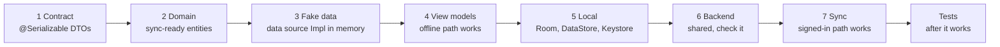

# Feature guides (Android)

<dl><dd>

- Step-by-step guides, grouped by sprint: one folder per sprint, one guide per feature — same numbers as the [iOS guides](https://github.com/DAMHONGDUC/site_log_swift_ui/blob/main/docs/feature-guide/README.md).
- 1 developer · 2-week sprints · 10 sprints · ~464h. Progress is ticked in [ROADMAP.md](../ROADMAP.md).
- Specs live in [feature-docs/](../feature-docs/); a guide links the spec section it builds.

</dd></dl>

## Contents

<dl><dd>

1. [Sprint board](#sprint-board)
2. [How every feature runs](#how-every-feature-runs)
3. [Overview first](#overview-first)
4. [Rules](#rules)
5. [How to read a guide](#how-to-read-a-guide)

</dd></dl>

## Sprint board

```mermaid
flowchart LR
    S0["S0<br/>Foundation, access"] --> S1["S1<br/>Auth, projects"]
    S1 --> S2["S2<br/>Sync engine"]
    S2 --> S3["S3<br/>Capture, upload"]
    S3 --> S4["S4<br/>Resumable upload<br/>internal testing #1"]
    S4 --> S5["S5<br/>Issues, markup"]
    S5 --> S6["S6<br/>Reports, plans"]
    S6 --> S7["S7<br/>Checklists, DeviceLink,<br/>diagnostics · internal #2"]
    S7 --> S8["S8<br/>Realtime, push,<br/>accessibility"]
    S8 --> S9["S9<br/>UI finish<br/>Google Play"]
    S9 --> S10["S10<br/>Team and roles"]

    classDef ship fill:#EEEDFE,stroke:#534AB7,color:#3C3489
    class S4,S7,S9 ship
```

<dl><dd>

| Sprint | Features | Hours | Ships |
|---|---|---|---|
| [S0](S0-foundation-access/README.md) | F00 Foundation · F01 Access and app lock | 58 | |
| [S1](S1-auth-projects/README.md) | F02 Auth · F03 Projects, sessions, locations | 50 | |
| [S2](S2-sync-engine/README.md) | F04 Sync engine | 37 | |
| [S3](S3-capture-upload/README.md) | F05 Capture · F06 Upload | 50 | |
| [S4](S4-resumable-upload/README.md) | F07 Resumable upload | 39 | Internal testing #1 |
| [S5](S5-issues-markup/README.md) | F08 Issues and before/after · F09 Markup and stamps | 45 | |
| [S6](S6-reports-plans/README.md) | F10 Reports and audit log · F11 Floor plans and pins | 52 | |
| [S7](S7-checklists-devices-diagnostics/README.md) | F12 Checklists · F13 DeviceLink · F14 Diagnostics | 47 | Internal testing #2 |
| [S8](S8-realtime-push-quality/README.md) | F15 Realtime · F16 Push and deep links · F17 Accessibility and performance | 38 | |
| [S9](S9-release/README.md) | F18 UI finish and Google Play | 48 | Google Play |
| [S10](S10-team-roles/README.md) | F19 Team and roles | 30 + 16 backend | App update |

- Every sprint ends with a build that runs **offline** (Continue offline) and **signed in** (from S1 on).
- The backend is shared: Android sprints check it; no Android-only backend work.
- "Second device" in a demo can be an iPhone running the iOS app or another Android phone.

</dd></dl>

## How every feature runs

<dl><dd>

| Step | Builds | Done when |
|---|---|---|
| 1 Contract | `@Serializable` DTOs that match the backend fields | DTO field names match [site-log-be 01-api](https://github.com/DAMHONGDUC/site-log-be/blob/main/docs/feature-docs/01-api.md) |
| 2 Domain | Entities (`UUID` id, `updatedAt`, `deletedAt`, `syncState`), repository interface, use cases in `:domain` | `./gradlew :domain:build`; nothing uses them yet |
| 3 Fake data | Real `<Feature>RepositoryImpl` over data source `Impl`s holding in-memory values | Repository maps, catches, logs; dev menu seeds and resets |
| 4 View models | One `@HiltViewModel` per screen, wired into the skeleton | The feature runs end to end with **Continue offline** |
| 5 Local | Data source `Impl` insides → Room, DataStore, Keystore, files, PlatformKit | Process death and relaunch keep everything; nothing above the data source changed |
| 6 Backend | Shared with iOS in site-log-be | Staging (or local via `10.0.2.2`) answers the calls this feature makes |
| 7 Sync | The local data source implements `SyncableLocalDataSource` and writes outbox rows; its table is added in `di/SyncTablesModule.kt` | Signed in: a second device sees the change |
| Tests | Tests listed in the guide | `./gradlew testDebugUnitTest` green |

- A step that does not apply is `—` in the guide's step table.
- From S2 on, a feature's sync step only makes its table syncable; the engine is F04.

</dd></dl>

## Overview first

<dl><dd>

- Every sprint and every step opens with an **overview**: a table, bullets and a Mermaid diagram — enough to build the step alone.
- Code comes after the overview, collapsed in **Code** blocks; open them only when stuck.

| Overview of | Holds |
|---|---|
| Sprint (`S<n>/README.md`) | Goal · demo offline and signed in · features and hours · diagram · tasks · done · self-check |
| Step (`#### Overview` in a guide) | Goal · files table · diagram · check |

</dd></dl>

## Rules

<dl><dd>

1. **Offline first, inside every feature.**
2. **No fake repositories:** fake data lives only in data source `Impl`s; step 5 and step 7 replace only their insides.
3. **Continue offline is a product mode:** test it every sprint.
4. **Task size 2–6h.**
5. **Tests after the feature works.**
6. **Visual finish waits for F18.**
7. **Tick the box** in [ROADMAP.md](../ROADMAP.md) in the commit that finishes the step.

</dd></dl>

## How to read a guide

<dl><dd>

- **File tags:** <b class="tag-new">New</b> create the file · <b class="tag-edit">Edit</b> change only the part shown · <b class="tag-replace">Replace</b> overwrite the whole file.
- Per file: <b>File</b> (path + purpose in ≤ 2 lines) → <b>Explain</b> → <b>Hint</b> → <b>Code</b> (collapsed).
- Guide code is written for a Kotlin beginner: one idea per line, explicit `if` / `when`, named arguments, no clever one-liners.
- F00 and F01 carry full code; F02–F18 are skeleton guides (overview, files, steps, tests); their code is added when the feature starts.
- Kotlin basics used everywhere: [Kotlin tour](https://kotlinlang.org/docs/kotlin-tour-welcome.html), [Compose basics](https://developer.android.com/develop/ui/compose/tutorial), [coroutines guide](https://kotlinlang.org/docs/coroutines-guide.html).

</dd></dl>
