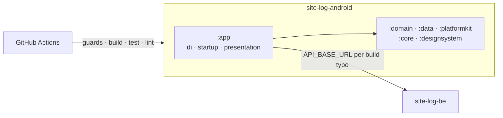
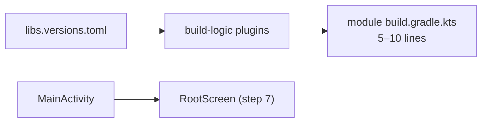
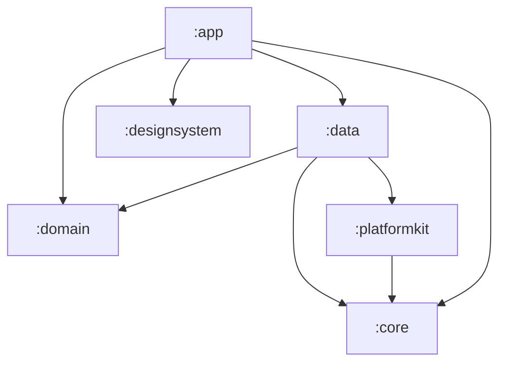
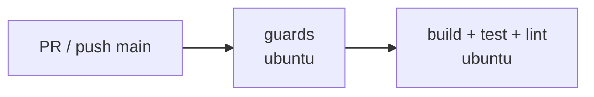
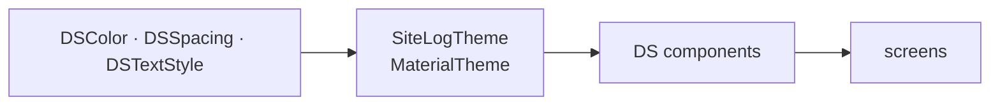
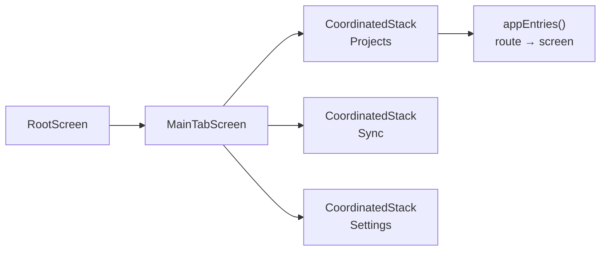

# F00 — Foundation

<dl><dd>

- Sprint [S0](README.md) · 41h · foundation guide for `site-log-android`. Config and code in steps 0–7 were checked on 2026-11-13 with a trial build (AGP 9.5.1, Gradle 9.6, Kotlin 2.4.21, JDK 21 target): `assembleDebug`, unit tests, Lint, detekt and Spotless all green, app run on an API 36 emulator. Bump versions only in a planned task.
- iOS twin: [iOS F00](https://github.com/DAMHONGDUC/site_log_swift_ui/blob/main/docs/feature-guide/S0-foundation-access/F00-foundation.md).

</dd></dl>

## Contents

<dl><dd>

1. [Overview](#overview)
2. [Target structure](#target-structure)
3. [0. Gradle project and entry point](#0-gradle-project-and-entry-point)
4. [1. Modules, Hilt, AppClock, AppLogger, Outcome](#1-modules-hilt-appclock-applogger-outcome)
5. [2. PR checks](#2-pr-checks)
6. [3. CI guards](#3-ci-guards)
7. [4. Design system](#4-design-system)
8. [5. Backend — shared](#5-backend--shared)
9. [6. Backend URL per build type](#6-backend-url-per-build-type)
10. [7. Skeleton screens and navigation](#7-skeleton-screens-and-navigation)
11. [User-facing text](#user-facing-text)
12. [Feature done](#feature-done)

</dd></dl>

## Overview

<dl><dd>

- **Goal:** what every feature builds on — Gradle modules with one-way dependencies, Hilt, CI, the design system, every screen as a skeleton, and the backend URL per build type.
- **Demo:** `./gradlew assembleDebug` with zero warnings; CI green; the app opens on the splash, then the skeleton tabs; `DSGallery` shows every token in light and dark.
- **Specs:** [00-overview](../../feature-docs/00-overview.md), [05-platform](../../feature-docs/05-platform.md), [03-backend](../../feature-docs/03-backend.md).
- **How to use:** per file, read **Explain**, write the file, open **Hint** only when stuck, compare with **Code**.
- **File tags:** <b class="tag-new">New</b> create the file · <b class="tag-edit">Edit</b> change only the part shown · <b class="tag-replace">Replace</b> overwrite the whole file.

| Step | Layer | Hours | Status | What |
|---|---|---|---|---|
| [0](#0-gradle-project-and-entry-point) | Tooling | 8h | not start | Gradle project, version catalog, `build-logic`, Spotless, detekt, entry point |
| [1](#1-modules-hilt-appclock-applogger-outcome) | Architecture | 6h | not start | Modules, Hilt, `AppClock`, `AppLogger`, `Outcome`, startup |
| [2](#2-pr-checks) | CI | 4h | not start | GitHub Actions PR checks |
| [3](#3-ci-guards) | CI | 4h | not start | No `println`, layer imports, secret scan, zero warnings |
| [4](#4-design-system) | Design system | 6h | not start | Tokens, theme, gallery, hex test |
| [5](#5-backend--shared) | Backend | 0h | not start | Shared site-log-be; check `/health` |
| [6](#6-backend-url-per-build-type) | Config | 1h | not start | `API_BASE_URL`, debug cleartext to the Mac |
| [7](#7-skeleton-screens-and-navigation) | UI | 12h | not start | Tabs, coordinators, skeleton screens, `FakeData`, dev menu |

- Order: 0 → 1 first (every feature needs them); F01 can start after step 1; 2–7 any time in S0.



</dd></dl>

## Target structure

<dl><dd>

```text
site-log-android/
├── settings.gradle.kts                       # 0: modules, build-logic
├── build.gradle.kts                          # 0: plugins (apply false), Spotless, detekt
├── gradle/libs.versions.toml                 # 0: every library and version
├── build-logic/convention/                   # 0: sitelog.* convention plugins
├── .editorconfig  config/detekt/detekt.yml   # 0
├── .github/workflows/pr-checks.yml           # 2 + 3
├── tools/ci/                                 # 3: check-no-println.sh, check-imports.sh
├── core/                                     # 1: clock/, logger/
├── domain/                                   # 1: Outcome.kt; folders filled from F01
├── data/  platformkit/                       # 1: empty packages
├── designsystem/                             # 4: tokens/, theme/, components/, gallery/
└── app/src/
    ├── main/java/com/dd/sitelog/
    │   ├── SiteLogApplication.kt  MainActivity.kt          # 0
    │   ├── di/CoreModule.kt  di/StartupModule.kt           # 1
    │   ├── startup/                                        # 1
    │   ├── fakes/FakeData.kt                               # 7
    │   └── presentation/navigation/ root/ maintab/ …       # 7
    ├── main/res/values/strings.xml                         # 7
    └── debug/                                              # 6: network_security_config · 7: devmenu/
```

</dd></dl>

## 0. Gradle project and entry point

<dl><dd>

#### Overview

<dl><dd>

- **Goal:** an empty Compose app that builds from the command line, with every version in one catalog and shared build settings in convention plugins.

| File | Holds |
|---|---|
| `settings.gradle.kts` | Repositories, `includeBuild("build-logic")`, the six modules |
| `gradle/libs.versions.toml` | Versions, libraries, plugins |
| `build-logic/convention/` | `sitelog.android.application`, `.android.library`, `.jvm.library`, `.compose`, `.hilt`, `.room` |
| `.editorconfig`, `config/detekt/detekt.yml` | Format and lint rules |
| `SiteLogApplication.kt`, `MainActivity.kt` | Entry point |



- **Check:** `./gradlew assembleDebug` succeeds; the app shows "SiteLog" on the emulator; `./gradlew spotlessCheck detekt` pass.

</dd></dl>

#### Start from the Android Studio template

<dl><dd>

| Template file | Action | Why |
|---|---|---|
| `MainActivity.kt`, `ui/theme/` in `app/src/main/java/com/dd/sitelog/` | Delete; the package `com.dd.sitelog` stays | `MainActivity` is rewritten in step 0; theme comes from `:designsystem` |
| `app/src/main/res/values/colors.xml` | Delete | Lint `UnusedResources` (errors with `warningsAsErrors`) |
| `app/src/main/res/mipmap-anydpi-v26/` | Rename to `mipmap-anydpi/` | Lint `ObsoleteSdkInt` with `minSdk` 29 |
| `android:label` on `<activity>` | Remove (keep it on `<application>`) | Lint `RedundantLabel` |
| `ExampleUnitTest`, `ExampleInstrumentedTest` | Delete | Real tests come with each feature |
| `gradle/gradle-daemon-jvm.properties` | Keep | Gradle itself runs on JDK 25 (downloaded once); the code still targets Java 21 |
| `<application android:name=".SiteLogApplication">` | Add | Hilt needs the application class |

</dd></dl>

#### Build

<dl><dd>

<b>File</b> · <b class="tag-new">New</b> · `gradle/libs.versions.toml`
Every library and version the project uses; modules refer to them as `libs.<name>`.

<b>Explain</b> · One place to bump versions. Add a library here first, then use it in a module.

<details>
<summary><b>Hint</b></summary>

- Three tables: `[versions]`, `[libraries]` (`module = "group:name"`, `version.ref`), `[plugins]` (`id`, `version.ref`).
- Compose libraries take their version from the BOM, so they have no `version.ref`.

</details>

<details>
<summary><b>Code</b></summary>

```toml
[versions]
agp = "9.5.1"
kotlin = "2.4.21"
ksp = "2.3.13"
composeBom = "2026.09.00"
activityCompose = "1.13.0"
fragment = "1.9.1"
lifecycle = "2.11.0"
navigation3 = "1.2.1"
lifecycleNavigation3 = "2.11.0"
hilt = "2.60.1"
hiltLifecycleCompose = "1.4.0"
coroutines = "1.11.0"
serialization = "1.13.0"
room = "2.8.5"
datastore = "1.3.0"
biometric = "1.1.0"
junit = "4.13.2"
truth = "1.4.5"
turbine = "1.2.1"
robolectric = "4.17"
detekt = "1.23.8"
spotless = "8.11.0"
ktlint = "1.8.0"

[libraries]
androidx-activity-compose = { module = "androidx.activity:activity-compose", version.ref = "activityCompose" }
androidx-fragment = { module = "androidx.fragment:fragment-ktx", version.ref = "fragment" }
androidx-lifecycle-runtime-compose = { module = "androidx.lifecycle:lifecycle-runtime-compose", version.ref = "lifecycle" }
androidx-lifecycle-viewmodel-compose = { module = "androidx.lifecycle:lifecycle-viewmodel-compose", version.ref = "lifecycle" }
androidx-lifecycle-process = { module = "androidx.lifecycle:lifecycle-process", version.ref = "lifecycle" }
androidx-lifecycle-viewmodel-navigation3 = { module = "androidx.lifecycle:lifecycle-viewmodel-navigation3", version.ref = "lifecycleNavigation3" }
androidx-navigation3-runtime = { module = "androidx.navigation3:navigation3-runtime", version.ref = "navigation3" }
androidx-navigation3-ui = { module = "androidx.navigation3:navigation3-ui", version.ref = "navigation3" }
compose-bom = { module = "androidx.compose:compose-bom", version.ref = "composeBom" }
compose-ui = { module = "androidx.compose.ui:ui" }
compose-ui-tooling = { module = "androidx.compose.ui:ui-tooling" }
compose-ui-tooling-preview = { module = "androidx.compose.ui:ui-tooling-preview" }
compose-material3 = { module = "androidx.compose.material3:material3" }
compose-material-icons-core = { module = "androidx.compose.material:material-icons-core" }
hilt-android = { module = "com.google.dagger:hilt-android", version.ref = "hilt" }
hilt-compiler = { module = "com.google.dagger:hilt-android-compiler", version.ref = "hilt" }
hilt-lifecycle-viewmodel-compose = { module = "androidx.hilt:hilt-lifecycle-viewmodel-compose", version.ref = "hiltLifecycleCompose" }
kotlinx-coroutines-core = { module = "org.jetbrains.kotlinx:kotlinx-coroutines-core", version.ref = "coroutines" }
kotlinx-coroutines-test = { module = "org.jetbrains.kotlinx:kotlinx-coroutines-test", version.ref = "coroutines" }
kotlinx-serialization-core = { module = "org.jetbrains.kotlinx:kotlinx-serialization-core", version.ref = "serialization" }
kotlinx-serialization-json = { module = "org.jetbrains.kotlinx:kotlinx-serialization-json", version.ref = "serialization" }
androidx-room-runtime = { module = "androidx.room:room-runtime", version.ref = "room" }
androidx-room-compiler = { module = "androidx.room:room-compiler", version.ref = "room" }
androidx-datastore-preferences = { module = "androidx.datastore:datastore-preferences", version.ref = "datastore" }
androidx-biometric = { module = "androidx.biometric:biometric", version.ref = "biometric" }
junit = { module = "junit:junit", version.ref = "junit" }
truth = { module = "com.google.truth:truth", version.ref = "truth" }
turbine = { module = "app.cash.turbine:turbine", version.ref = "turbine" }
robolectric = { module = "org.robolectric:robolectric", version.ref = "robolectric" }
# Used by build-logic only
android-gradle-plugin = { module = "com.android.tools.build:gradle", version.ref = "agp" }
kotlin-gradle-plugin = { module = "org.jetbrains.kotlin:kotlin-gradle-plugin", version.ref = "kotlin" }
compose-gradle-plugin = { module = "org.jetbrains.kotlin:compose-compiler-gradle-plugin", version.ref = "kotlin" }
ksp-gradle-plugin = { module = "com.google.devtools.ksp:com.google.devtools.ksp.gradle.plugin", version.ref = "ksp" }
room-gradle-plugin = { module = "androidx.room:room-gradle-plugin", version.ref = "room" }

[plugins]
android-application = { id = "com.android.application", version.ref = "agp" }
android-library = { id = "com.android.library", version.ref = "agp" }
kotlin-jvm = { id = "org.jetbrains.kotlin.jvm", version.ref = "kotlin" }
kotlin-compose = { id = "org.jetbrains.kotlin.plugin.compose", version.ref = "kotlin" }
kotlin-serialization = { id = "org.jetbrains.kotlin.plugin.serialization", version.ref = "kotlin" }
ksp = { id = "com.google.devtools.ksp", version.ref = "ksp" }
hilt = { id = "com.google.dagger.hilt.android", version.ref = "hilt" }
room = { id = "androidx.room", version.ref = "room" }
detekt = { id = "io.gitlab.arturbosch.detekt", version.ref = "detekt" }
spotless = { id = "com.diffplug.spotless", version.ref = "spotless" }
```

</details>

- Only what F00–F01 use. Each later feature adds its rows (OkHttp, Coil, WorkManager, Firebase BoM, Room is already here) in the step that first needs them, at the latest stable version of that day.

---

<b>File</b> · <b class="tag-new">New</b> · `settings.gradle.kts`
Lists the modules and where Gradle finds plugins and libraries.

<b>Explain</b> · `includeBuild("build-logic")` makes the convention plugins available by id; `include` adds each module.

<details>
<summary><b>Code</b></summary>

```kotlin
pluginManagement {
    includeBuild("build-logic")
    repositories {
        google()
        mavenCentral()
        gradlePluginPortal()
    }
}

dependencyResolutionManagement {
    repositoriesMode.set(RepositoriesMode.FAIL_ON_PROJECT_REPOS)
    repositories {
        google()
        mavenCentral()
    }
}

rootProject.name = "site-log-android"

include(":app")
include(":core")
include(":domain")
include(":data")
include(":platformkit")
include(":designsystem")
```

</details>

---

<b>File</b> · <b class="tag-new">New</b> · `build-logic/convention/src/main/kotlin/AndroidLibraryConventionPlugin.kt`
Shared settings for every Android library module: SDK levels, Java 21, warnings as errors.

<b>Explain</b> · Each module applies `id("sitelog.android.library")` instead of repeating 30 lines. The application plugin is the same plus `targetSdk`, `buildConfig = true` and R8 in release.

- **AGP 9 has Kotlin built in:** never apply `org.jetbrains.kotlin.android`; AGP 9 fails the build if you do. Kotlin options go through `KotlinCompile` tasks (`configureKotlin()`).
- `compileSdk` is 37: current Compose, Hilt and AndroidX releases refuse to build against 36.
- Lint is strict (`warningsAsErrors`), minus three checks that only say "a newer version exists" (they would break CI every release) and `ObsoleteLintCustomCheck` (a library's own outdated lint jar).

<details>
<summary><b>Hint</b></summary>

- A convention plugin is a class implementing `Plugin<Project>`; `apply` adds other plugins, then configures the `LibraryExtension`.
- Register it in `build-logic/convention/build.gradle.kts` under `gradlePlugin { plugins { register(...) } }`.

</details>

<details>
<summary><b>Code</b></summary>

```kotlin
plugins {
    `kotlin-dsl`
}

dependencies {
    compileOnly(libs.android.gradle.plugin)
    compileOnly(libs.kotlin.gradle.plugin)
    compileOnly(libs.compose.gradle.plugin)
    compileOnly(libs.ksp.gradle.plugin)
    compileOnly(libs.room.gradle.plugin)
}

gradlePlugin {
    plugins {
        register("androidApplication") {
            id = "sitelog.android.application"
            implementationClass = "AndroidApplicationConventionPlugin"
        }
        register("androidLibrary") {
            id = "sitelog.android.library"
            implementationClass = "AndroidLibraryConventionPlugin"
        }
        register("jvmLibrary") {
            id = "sitelog.jvm.library"
            implementationClass = "JvmLibraryConventionPlugin"
        }
        register("compose") {
            id = "sitelog.compose"
            implementationClass = "ComposeConventionPlugin"
        }
        register("hilt") {
            id = "sitelog.hilt"
            implementationClass = "HiltConventionPlugin"
        }
        register("room") {
            id = "sitelog.room"
            implementationClass = "RoomConventionPlugin"
        }
    }
}
```

```kotlin
import org.gradle.api.Project
import org.gradle.kotlin.dsl.withType
import org.jetbrains.kotlin.gradle.dsl.JvmTarget
import org.jetbrains.kotlin.gradle.tasks.KotlinCompile

internal fun Project.configureKotlin() {
    tasks.withType<KotlinCompile>().configureEach {
        compilerOptions {
            jvmTarget.set(JvmTarget.JVM_21)
            allWarningsAsErrors.set(true)
        }
    }
}
```

```kotlin
object SiteLogSdk {
    const val COMPILE_SDK: Int = 37
    const val TARGET_SDK: Int = 36
    const val MIN_SDK: Int = 29
}
```

</details>

---

<b>File</b> · <b class="tag-new">New</b> · `build-logic/convention/build.gradle.kts`
Builds the convention plugins and gives each one an id.

<details>
<summary><b>Code</b></summary>

```kotlin
plugins {
    `kotlin-dsl`
}

dependencies {
    compileOnly(libs.android.gradle.plugin)
    compileOnly(libs.kotlin.gradle.plugin)
    compileOnly(libs.compose.gradle.plugin)
}

gradlePlugin {
    plugins {
        register("androidApplication") {
            id = "sitelog.android.application"
            implementationClass = "AndroidApplicationConventionPlugin"
        }
        register("androidLibrary") {
            id = "sitelog.android.library"
            implementationClass = "AndroidLibraryConventionPlugin"
        }
        register("jvmLibrary") {
            id = "sitelog.jvm.library"
            implementationClass = "JvmLibraryConventionPlugin"
        }
        register("compose") {
            id = "sitelog.compose"
            implementationClass = "ComposeConventionPlugin"
        }
        register("hilt") {
            id = "sitelog.hilt"
            implementationClass = "HiltConventionPlugin"
        }
        register("room") {
            id = "sitelog.room"
            implementationClass = "RoomConventionPlugin"
        }
    }
}
```

- `build-logic/settings.gradle.kts` adds `google()` + `mavenCentral()` and `versionCatalogs { create("libs") { from(files("../gradle/libs.versions.toml")) } }` so `libs` works here too.
- `ComposeConventionPlugin` reads `CommonExtension` (no type parameters in AGP 9), sets `buildFeatures.compose = true` and adds the BOM, `ui`, `material3`, `ui-tooling-preview`, and `ui-tooling` for debug.
- `HiltConventionPlugin` applies `com.google.devtools.ksp` + `com.google.dagger.hilt.android` and adds `hilt-android` + `ksp(hilt-compiler)`.

</details>

---

<b>File</b> · <b class="tag-new">New</b> · `.editorconfig`
Formatting rules for Android Studio; Spotless gets the same ktlint rules from the root build file.

<details>
<summary><b>Code</b></summary>

```ini
root = true

[*]
charset = utf-8
end_of_line = lf
insert_final_newline = true
indent_style = space
indent_size = 4

[*.{kt,kts}]
max_line_length = 100
ktlint_code_style = android_studio
ij_kotlin_allow_trailing_comma = true
ij_kotlin_allow_trailing_comma_on_call_site = true
ktlint_function_signature_rule_force_multiline_when_parameter_count_greater_or_equal_than = 3
ktlint_function_naming_ignore_when_annotated_with = Composable
# Keep `class X @Inject constructor(` and explicit `return` (beginner-friendly guide code)
ktlint_standard_class-signature = disabled
ktlint_standard_function-expression-body = disabled

[*.{yml,yaml,toml,json}]
indent_size = 2
```

</details>

---

<b>File</b> · <b class="tag-new">New</b> · `build.gradle.kts` (root)
Declares plugins once (`apply false`) and runs Spotless and detekt over every module.

- Spotless does **not** take ktlint rules from `.editorconfig`: pass them with `editorConfigOverride`, or ktlint falls back to `ktlint_official`.
- `android_studio` style matches Android Studio's formatter, so Format on Save and CI agree.
- Two ktlint rules are off on purpose: `class-signature` would split `class X @Inject constructor(` over four lines and re-indent the class, and `function-expression-body` would turn every `return when` into `= when` — both against the beginner style of the guides.

<details>
<summary><b>Code</b></summary>

```kotlin
plugins {
    alias(libs.plugins.android.application) apply false
    alias(libs.plugins.android.library) apply false
    alias(libs.plugins.kotlin.jvm) apply false
    alias(libs.plugins.kotlin.compose) apply false
    alias(libs.plugins.kotlin.serialization) apply false
    alias(libs.plugins.ksp) apply false
    alias(libs.plugins.hilt) apply false
    alias(libs.plugins.room) apply false
    alias(libs.plugins.detekt)
    alias(libs.plugins.spotless)
}

val ktlintRules: Map<String, Any> = mapOf(
    "ktlint_code_style" to "android_studio",
    "max_line_length" to 100,
    "ktlint_function_naming_ignore_when_annotated_with" to "Composable",
    "ktlint_standard_class-signature" to "disabled",
    "ktlint_standard_function-expression-body" to "disabled",
)

spotless {
    kotlin {
        target("**/*.kt")
        targetExclude("**/build/**")
        ktlint(libs.versions.ktlint.get()).editorConfigOverride(ktlintRules)
    }
    kotlinGradle {
        target("**/*.kts")
        targetExclude("**/build/**")
        ktlint(libs.versions.ktlint.get()).editorConfigOverride(ktlintRules)
    }
}

detekt {
    buildUponDefaultConfig = true
    config.setFrom(files("config/detekt/detekt.yml"))
    source.setFrom(files(subprojects.map { "${it.projectDir}/src" }))
}
```

</details>

---

<b>File</b> · <b class="tag-new">New</b> · `config/detekt/detekt.yml`
The detekt rules this project changes; everything else is detekt's default.

<b>Explain</b> · Defaults clash with Compose and with the error rules: composables are `PascalCase`, repositories catch `Exception` on purpose ([00 §4.6](../../feature-docs/00-overview.md#46-error-handling)), tokens are numbers, previews look unused.

<details>
<summary><b>Code</b></summary>

```yaml
naming:
  FunctionNaming:
    ignoreAnnotated: ['Composable']
  TopLevelPropertyNaming:
    constantPattern: '[A-Z][A-Za-z0-9_]*'

complexity:
  LongParameterList:
    ignoreAnnotated: ['Composable']

style:
  # Repositories catch Exception on purpose and rethrow CancellationException (00-overview §4.6)
  ReturnCount:
    max: 4
    excludeGuardClauses: true
  MagicNumber:
    excludes: ['**/tokens/**', '**/test/**']
    ignorePropertyDeclaration: true
    ignoreCompanionObjectPropertyDeclaration: true
  UnusedPrivateMember:
    ignoreAnnotated: ['Preview']
  ForbiddenMethodCall:
    active: true
    methods:
      - 'kotlin.io.println'

exceptions:
  TooGenericExceptionCaught:
    active: false
  SwallowedException:
    ignoredExceptionTypes: ['KeyPermanentlyInvalidatedException', 'CancellationException']
```

</details>

- In tests use `error("…")`, not `throw IllegalStateException(…)` (`UseCheckOrError`).

---

<b>File</b> · <b class="tag-new">New</b> · `app/src/main/java/com/dd/sitelog/SiteLogApplication.kt`
The process entry point; Hilt starts here. Crashlytics and the logger are the first startup steps (step 1 fills them in).

<details>
<summary><b>Code</b></summary>

```kotlin
package com.dd.sitelog

import android.app.Application
import dagger.hilt.android.HiltAndroidApp

@HiltAndroidApp
class SiteLogApplication : Application()
```

</details>

---

<b>File</b> · <b class="tag-new">New</b> · `app/src/main/java/com/dd/sitelog/MainActivity.kt`
The only activity: draws edge to edge and hands the screen to Compose. A `FragmentActivity` (needs `androidx.fragment`) because `BiometricPrompt` (F01) only works with one.

<details>
<summary><b>Code</b></summary>

```kotlin
package com.dd.sitelog

import android.os.Bundle
import androidx.activity.compose.setContent
import androidx.activity.enableEdgeToEdge
import androidx.fragment.app.FragmentActivity
import com.dd.sitelog.designsystem.theme.SiteLogTheme
import com.dd.sitelog.presentation.root.RootScreen
import dagger.hilt.android.AndroidEntryPoint

@AndroidEntryPoint
class MainActivity : FragmentActivity() {
    override fun onCreate(savedInstanceState: Bundle?) {
        super.onCreate(savedInstanceState)
        enableEdgeToEdge()
        setContent {
            SiteLogTheme {
                RootScreen()
            }
        }
    }
}
```

- Until step 4 and step 7 exist, put `Text("SiteLog")` inside `setContent` instead.

</details>

</dd></dl>

</dd></dl>

## 1. Modules, Hilt, AppClock, AppLogger, Outcome

<dl><dd>

#### Overview

<dl><dd>

- **Goal:** five modules with one-way dependencies, one composition root, a clock tests can fix, a logger, and the `Outcome` type every repository returns.

| Module | Plugin | Holds | Depends on |
|---|---|---|---|
| `:domain` | `sitelog.jvm.library` | Entities, repository interfaces, use cases, `Outcome` | coroutines-core, serialization-core |
| `:data` | `sitelog.android.library` (+ `room` later) | Repository and data source `Impl`s, models, mappers | `:domain`, `:platformkit`, `:core` |
| `:platformkit` | `sitelog.android.library` | System services, engines | `:core` |
| `:core` | `sitelog.android.library` | `AppClock`, `AppLogger`, crypto | nothing |
| `:designsystem` | `sitelog.android.library` + `compose` | Tokens, theme, components | nothing |
| `:app` | `sitelog.android.application` + `compose` + `hilt` | `di/`, `startup/`, `presentation/` | every module |



- **Check:** `./gradlew assembleDebug` is clean; adding `implementation(project(":data"))` to `:domain` fails (`:domain` is JVM and `:data` is Android); the `DeviceClock` test passes.
- **Why:** [A01](../../feature-docs/00-overview.md#a01--hilt-for-dependency-injection), [A09](../../feature-docs/00-overview.md#a09--layers-as-gradle-modules), [A21](../../feature-docs/00-overview.md#a21--own-outcome-type).

</dd></dl>

#### Build

<dl><dd>

<b>File</b> · <b class="tag-new">New</b> · `domain/build.gradle.kts`
A plain Kotlin module: the compiler itself stops Domain from touching Android.

<details>
<summary><b>Code</b></summary>

```kotlin
plugins {
    id("sitelog.jvm.library")
    alias(libs.plugins.kotlin.serialization)
}

dependencies {
    api(libs.kotlinx.coroutines.core)
    api(libs.kotlinx.serialization.core)

    testImplementation(libs.junit)
    testImplementation(libs.truth)
    testImplementation(libs.kotlinx.coroutines.test)
}
```

</details>

---

<b>File</b> · <b class="tag-new">New</b> · `data/build.gradle.kts`
The data layer: sees Domain, PlatformKit and Core, never the app.

<details>
<summary><b>Code</b></summary>

```kotlin
plugins {
    id("sitelog.android.library")
    alias(libs.plugins.kotlin.serialization)
}

android {
    namespace = "com.dd.sitelog.data"
}

dependencies {
    implementation(project(":domain"))
    implementation(project(":platformkit"))
    implementation(project(":core"))
    implementation(libs.kotlinx.serialization.json)

    testImplementation(libs.junit)
    testImplementation(libs.truth)
    testImplementation(libs.kotlinx.coroutines.test)
    testImplementation(libs.robolectric)
}
```

- `:platformkit`, `:core` and `:designsystem` look the same with their own `namespace` and dependencies (from the table above).

</details>

---

<b>File</b> · <b class="tag-new">New</b> · `app/build.gradle.kts`
The app: links every module; only `di/` and `startup/` may use `:data` and `:platformkit`.

<details>
<summary><b>Code</b></summary>

```kotlin
plugins {
    id("sitelog.android.application")
    id("sitelog.compose")
    id("sitelog.hilt")
    alias(libs.plugins.kotlin.serialization)
}

android {
    namespace = "com.dd.sitelog"
    defaultConfig {
        applicationId = "com.dd.sitelog"
        versionCode = 1
        versionName = "0.1.0"
    }
}

dependencies {
    implementation(project(":core"))
    implementation(project(":domain"))
    implementation(project(":data"))
    implementation(project(":platformkit"))
    implementation(project(":designsystem"))

    implementation(libs.androidx.activity.compose)
    implementation(libs.androidx.fragment)
    implementation(libs.compose.material.icons.core)
    implementation(libs.androidx.lifecycle.runtime.compose)
    implementation(libs.androidx.lifecycle.viewmodel.compose)
    implementation(libs.androidx.lifecycle.process)
    implementation(libs.androidx.lifecycle.viewmodel.navigation3)
    implementation(libs.androidx.navigation3.runtime)
    implementation(libs.androidx.navigation3.ui)
    implementation(libs.hilt.lifecycle.viewmodel.compose)
    implementation(libs.kotlinx.serialization.json)

    testImplementation(libs.junit)
    testImplementation(libs.truth)
    testImplementation(libs.turbine)
    testImplementation(libs.kotlinx.coroutines.test)
}
```

</details>

---

<b>File</b> · <b class="tag-new">New</b> · `core/src/main/kotlin/com/dd/sitelog/core/clock/AppClock.kt`
The clock every layer asks for the time, so tests can fix it.

<b>Explain</b> · Two times: wall time (`now`, can be changed in Settings) and elapsed time since boot (`elapsedRealtimeMs`, never jumps). App lock and trusted time need the second.

<details>
<summary><b>Code</b></summary>

```kotlin
package com.dd.sitelog.core.clock

import java.time.Instant

interface AppClock {
    fun now(): Instant

    fun elapsedRealtimeMs(): Long
}
```

</details>

---

<b>File</b> · <b class="tag-new">New</b> · `core/src/main/kotlin/com/dd/sitelog/core/clock/DeviceClock.kt`
The real clock. Not named `SystemClock`, which is Android's own class.

<details>
<summary><b>Code</b></summary>

```kotlin
package com.dd.sitelog.core.clock

import android.os.SystemClock
import java.time.Instant

class DeviceClock : AppClock {
    override fun now(): Instant {
        return Instant.now()
    }

    override fun elapsedRealtimeMs(): Long {
        return SystemClock.elapsedRealtime()
    }
}
```

</details>

---

<b>File</b> · <b class="tag-new">New</b> · `core/src/main/kotlin/com/dd/sitelog/core/logger/AppLogger.kt`
The only way to log. One category per area; release builds drop `debug` lines.

<b>Explain</b> · An interface so tests can collect log lines; `LogcatAppLogger` writes to Logcat with the tag `SiteLog/<category>`.

<details>
<summary><b>Code</b></summary>

```kotlin
package com.dd.sitelog.core.logger

enum class LogCategory(val tag: String) {
    APP("app"),
    ACCESS("access"),
    CAPTURE("capture"),
    UPLOAD("upload"),
    SYNC("sync"),
    REPORT("report"),
    PLANS("plans"),
    DEVICE_LINK("devicelink"),
    SECURITY("security"),
}

interface AppLogger {
    fun debug(category: LogCategory, message: String)

    fun info(category: LogCategory, message: String)

    fun error(category: LogCategory, message: String, throwable: Throwable?)
}
```

```kotlin
package com.dd.sitelog.core.logger

import android.util.Log

class LogcatAppLogger(private val isDebugBuild: Boolean) : AppLogger {
    override fun debug(category: LogCategory, message: String) {
        if (isDebugBuild) {
            Log.d(tagFor(category), message)
        }
    }

    override fun info(category: LogCategory, message: String) {
        Log.i(tagFor(category), message)
    }

    override fun error(category: LogCategory, message: String, throwable: Throwable?) {
        Log.e(tagFor(category), message, throwable)
    }

    private fun tagFor(category: LogCategory): String {
        return "SiteLog/" + category.tag
    }
}
```

- This file is the one place allowed to call `Log.*` (the CI guard skips it).

</details>

---

<b>File</b> · <b class="tag-new">New</b> · `domain/src/main/kotlin/com/dd/sitelog/domain/Outcome.kt`
Success or a typed failure: what every repository and use case returns (Swift's `Result` on iOS).

<details>
<summary><b>Hint</b></summary>

- A `sealed interface` with two `data class`es; `out` on both type parameters lets a `Failure<AccessError>` be used where `Outcome<AccessSetting, AccessError>` is expected.
- `map` changes the success value; `flatMap` chains a second step that can also fail.

</details>

<details>
<summary><b>Code</b></summary>

```kotlin
package com.dd.sitelog.domain

sealed interface Outcome<out T, out E> {
    data class Success<out T>(val value: T) : Outcome<T, Nothing>

    data class Failure<out E>(val error: E) : Outcome<Nothing, E>
}

inline fun <T, E, R> Outcome<T, E>.map(transform: (T) -> R): Outcome<R, E> {
    return when (this) {
        is Outcome.Success -> Outcome.Success(transform(value))
        is Outcome.Failure -> this
    }
}

inline fun <T, E, R> Outcome<T, E>.flatMap(transform: (T) -> Outcome<R, E>): Outcome<R, E> {
    return when (this) {
        is Outcome.Success -> transform(value)
        is Outcome.Failure -> this
    }
}
```

</details>

---

<b>File</b> · <b class="tag-new">New</b> · `app/src/main/java/com/dd/sitelog/startup/StartupSequence.kt`
Runs the startup steps one by one, each guarded and logged; a blocking step that fails stops launch.

<details>
<summary><b>Code</b></summary>

```kotlin
package com.dd.sitelog.startup

import com.dd.sitelog.core.logger.AppLogger
import com.dd.sitelog.core.logger.LogCategory
import kotlin.coroutines.cancellation.CancellationException

interface StartupStep {
    val name: String
    val blocksLaunch: Boolean

    suspend fun run()
}

class StartupSequence(
    private val steps: List<StartupStep>,
    private val logger: AppLogger,
) {
    suspend fun run(): Boolean {
        for (step in steps) {
            try {
                step.run()
                logger.info(LogCategory.APP, "Startup step done — {step: ${step.name}}")
            } catch (exception: CancellationException) {
                throw exception
            } catch (exception: Exception) {
                logger.error(LogCategory.APP, "Startup step failed — {step: ${step.name}}", exception)
                if (step.blocksLaunch) {
                    return false
                }
            }
        }
        return true
    }
}
```

</details>

---

<b>File</b> · <b class="tag-new">New</b> · `app/src/main/java/com/dd/sitelog/di/CoreModule.kt`
Binds the `:core` helpers once for the whole app.

<b>Explain</b> · `@Provides` functions live in `:app`, so `:core` never imports Hilt. `@Singleton` keeps one instance.

<details>
<summary><b>Code</b></summary>

```kotlin
package com.dd.sitelog.di

import com.dd.sitelog.BuildConfig
import com.dd.sitelog.core.clock.AppClock
import com.dd.sitelog.core.clock.DeviceClock
import com.dd.sitelog.core.logger.AppLogger
import com.dd.sitelog.core.logger.LogcatAppLogger
import dagger.Module
import dagger.Provides
import dagger.hilt.InstallIn
import dagger.hilt.components.SingletonComponent
import javax.inject.Singleton

@Module
@InstallIn(SingletonComponent::class)
object CoreModule {
    @Provides
    @Singleton
    fun appClock(): AppClock {
        return DeviceClock()
    }

    @Provides
    @Singleton
    fun appLogger(): AppLogger {
        return LogcatAppLogger(isDebugBuild = BuildConfig.DEBUG)
    }
}
```

</details>

---

<b>File</b> · <b class="tag-new">New</b> · `app/src/main/java/com/dd/sitelog/di/StartupModule.kt`
Builds the startup sequence from its steps; later features add steps here (database, upload reconcile, audit verify).

<details>
<summary><b>Code</b></summary>

```kotlin
package com.dd.sitelog.di

import com.dd.sitelog.core.logger.AppLogger
import com.dd.sitelog.startup.StartupSequence
import com.dd.sitelog.startup.StartupStep
import dagger.Module
import dagger.Provides
import dagger.hilt.InstallIn
import dagger.hilt.components.SingletonComponent

@Module
@InstallIn(SingletonComponent::class)
object StartupModule {
    @Provides
    fun startupSequence(logger: AppLogger): StartupSequence {
        val steps: List<StartupStep> = emptyList()
        return StartupSequence(steps = steps, logger = logger)
    }
}
```

</details>

---

<b>File</b> · <b class="tag-new">New</b> · `core/src/test/kotlin/com/dd/sitelog/core/clock/FixedClock.kt` + `app/src/test/.../startup/StartupSequenceTest.kt`
A clock tests control, and the first test: a failing blocking step stops launch.

<details>
<summary><b>Code</b></summary>

```kotlin
class FixedClock(
    var nowValue: Instant,
    var elapsedValueMs: Long,
) : AppClock {
    override fun now(): Instant {
        return nowValue
    }

    override fun elapsedRealtimeMs(): Long {
        return elapsedValueMs
    }
}
```

```kotlin
class StartupSequenceTest {
    @Test
    fun blockingStepFailureStopsLaunch() = runTest {
        val failing = object : StartupStep {
            override val name: String = "database"
            override val blocksLaunch: Boolean = true

            override suspend fun run() {
                throw IllegalStateException("cannot open")
            }
        }
        val sequence = StartupSequence(steps = listOf(failing), logger = RecordingLogger())

        val ready: Boolean = sequence.run()

        assertThat(ready).isFalse()
    }
}
```

</details>

</dd></dl>

</dd></dl>

## 2. PR checks

<dl><dd>

#### Overview

<dl><dd>

- **Goal:** every PR and push to `main` builds, tests and lints on GitHub's Linux runners.

| File | Holds |
|---|---|
| `.github/workflows/pr-checks.yml` | Job `guards` (scripts, Gitleaks, Spotless, detekt) → job `build` (assemble, unit tests, lint) |



- **Check:** open a PR with a `println(` → `guards` fails; remove it → green.

</dd></dl>

#### Build

<dl><dd>

<b>File</b> · <b class="tag-new">New</b> · `.github/workflows/pr-checks.yml`
Runs on every PR and every push to `main`; cancels older runs of the same branch.

<details>
<summary><b>Code</b></summary>

```yaml
name: PR checks

on:
  pull_request:
  push:
    branches: [main]

concurrency:
  group: pr-checks-${{ github.ref }}
  cancel-in-progress: true

jobs:
  guards:
    runs-on: ubuntu-latest
    steps:
      - uses: actions/checkout@v4
        with:
          fetch-depth: 0
      - name: No println
        run: tools/ci/check-no-println.sh
      - name: Layer imports
        run: tools/ci/check-imports.sh
      - name: Secret scan
        uses: gitleaks/gitleaks-action@v2
        env:
          GITHUB_TOKEN: ${{ secrets.GITHUB_TOKEN }}
      - uses: actions/setup-java@v4
        with:
          distribution: temurin
          java-version: 25
      - uses: gradle/actions/setup-gradle@v4
      - name: Format and detekt
        run: ./gradlew spotlessCheck detekt

  build:
    needs: guards
    runs-on: ubuntu-latest
    steps:
      - uses: actions/checkout@v4
      - uses: actions/setup-java@v4
        with:
          distribution: temurin
          java-version: 25
      - uses: gradle/actions/setup-gradle@v4
      - name: Build, test, lint
        run: ./gradlew assembleDebug testDebugUnitTest lintDebug
```

- JDK 25 because `gradle/gradle-daemon-jvm.properties` asks for it; the code still compiles for Java 21.
- F02 adds a step that copies `google-services.json.example` (a valid dummy config) before the build; real files are written from secrets only in the release lane (F07).

</details>

</dd></dl>

</dd></dl>

## 3. CI guards

<dl><dd>

#### Overview

<dl><dd>

- **Goal:** the rules the compiler cannot check fail CI.

| Script | Fails when |
|---|---|
| `tools/ci/check-no-println.sh` | Any `println(` or `Log.` call outside `LogcatAppLogger.kt` |
| `tools/ci/check-imports.sh` | Presentation imports `com.dd.sitelog.data` / `.platformkit`, or Room, DataStore, OkHttp, WorkManager; `:platformkit` imports `.domain` / `.data` |
| Gitleaks | A key or token in the diff |
| `allWarningsAsErrors`, Lint `warningsAsErrors` | Any compiler or Lint warning |

- **Check:** add `import com.dd.sitelog.data.X` in a screen → `check-imports.sh` fails with the file name.

</dd></dl>

#### Build

<dl><dd>

<b>File</b> · <b class="tag-new">New</b> · `tools/ci/check-no-println.sh`
Fails when Kotlin code prints or logs outside `AppLogger`.

<details>
<summary><b>Code</b></summary>

```bash
#!/usr/bin/env bash
set -euo pipefail

matches=$(grep -rnE '\bprintln\(|\bLog\.(v|d|i|w|e|wtf)\(' --include='*.kt' \
  app core domain data platformkit designsystem \
  | grep -v 'core/src/main/kotlin/com/dd/sitelog/core/logger/LogcatAppLogger.kt' || true)

if [ -n "$matches" ]; then
  echo "Use AppLogger, never println or Log.*:"
  echo "$matches"
  exit 1
fi
```

</details>

---

<b>File</b> · <b class="tag-new">New</b> · `tools/ci/check-imports.sh`
Enforces the layer rules of [00 §4.2](../../feature-docs/00-overview.md#42-layers-and-dependency-rules) that modules alone cannot.

<details>
<summary><b>Code</b></summary>

```bash
#!/usr/bin/env bash
set -euo pipefail

failed=0
presentation="app/src/main/java/com/dd/sitelog/presentation"

# Rule 1: Presentation never imports Data or PlatformKit
if grep -rnE '^import com\.dd\.sitelog\.(data|platformkit)\.' "$presentation"; then
  echo "Presentation must not import :data or :platformkit"
  failed=1
fi

# Rule 2: Presentation never touches storage, network or background work directly
if grep -rnE '^import (androidx\.room|androidx\.datastore|okhttp3|androidx\.work)\.' "$presentation"; then
  echo "Presentation must not use Room, DataStore, OkHttp or WorkManager"
  failed=1
fi

# Rule 3: PlatformKit is a library: no Domain, no Data
if grep -rnE '^import com\.dd\.sitelog\.(domain|data)\.' platformkit/src; then
  echo ":platformkit must not import :domain or :data"
  failed=1
fi

exit "$failed"
```

</details>

</dd></dl>

</dd></dl>

## 4. Design system

<dl><dd>

#### Overview

<dl><dd>

- **Goal:** the same tokens as iOS (`DSColor`, `DSSpacing`, `DSTextStyle`) for Compose, a `SiteLogTheme` that maps them onto Material 3, and a gallery screen.

| File | Holds |
|---|---|
| `tokens/DSHex.kt` | `0xRRGGBB` → ARGB `Int` (tested) |
| `tokens/DSColor.kt` | Light and dark palettes from `docs/design/mockups/index.html` `COLOR_TOKENS` |
| `tokens/DSSpacing.kt` | `spacing0` … `spacing52` in `dp` (same names as iOS) |
| `tokens/DSTextStyle.kt` | The 11 text styles in `sp` ([compose rules §5](../../compose-rules.md#5-design-system)) |
| `theme/SiteLogTheme.kt` | Picks the palette, provides it, builds the Material `ColorScheme` and `Typography` |
| `components/` | `DSButton`, `DSListRow`, `DSChip`, `DSEmptyState`, `DSSectionHeader`, `DSStatusMarker`, `DSTextField`, `DSConfirmDialog` (skeleton look; F18 finishes them) |
| `gallery/DSGallery.kt` | Every token and component, previewed light and dark |



- **Check:** `DSGallery` preview in light and dark; `DSHexTest` passes.

</dd></dl>

#### Build

<dl><dd>

<b>File</b> · <b class="tag-new">New</b> · `designsystem/src/main/kotlin/com/dd/sitelog/designsystem/tokens/DSColor.kt`
The colour tokens, in a light and a dark palette; screens read them through `DSColor`.

<b>Explain</b> · Compose has no dynamic `UIColor`: the theme provides the palette for the current mode through a `CompositionLocal`, and `DSColor.textPrimary` reads it.

<details>
<summary><b>Hint</b></summary>

- `data class DSPalette(...)` with one `Color` per token; two instances (`LightPalette`, `DarkPalette`).
- `staticCompositionLocalOf { LightPalette }` + getters annotated `@Composable @ReadOnlyComposable`.

</details>

<details>
<summary><b>Code</b></summary>

```kotlin
package com.dd.sitelog.designsystem.tokens

import androidx.compose.runtime.Composable
import androidx.compose.runtime.Immutable
import androidx.compose.runtime.ReadOnlyComposable
import androidx.compose.runtime.staticCompositionLocalOf
import androidx.compose.ui.graphics.Color

@Immutable
data class DSPalette(
    val canvas: Color,
    val raised: Color,
    val fill: Color,
    val plan: Color,
    val hairline: Color,
    val lineStrong: Color,
    val textPrimary: Color,
    val textSecondary: Color,
    val textTertiary: Color,
    val onPrimary: Color,
    val hiVis: Color,
    val onHiVis: Color,
    val critical: Color,
    val major: Color,
    val minor: Color,
    val success: Color,
    val waiting: Color,
)

val LightPalette: DSPalette = DSPalette(
    canvas = Color(DSHex.argb(0xFFFFFF)),
    raised = Color(DSHex.argb(0xFFFFFF)),
    fill = Color(DSHex.argb(0xF3F2EF)),
    plan = Color(DSHex.argb(0xFBFAF7)),
    hairline = Color(DSHex.argb(0xE8E5E0)),
    lineStrong = Color(DSHex.argb(0xCFCAC1)),
    textPrimary = Color(DSHex.argb(0x16181B)),
    textSecondary = Color(DSHex.argb(0x63676E)),
    textTertiary = Color(DSHex.argb(0xA0A3A9)),
    onPrimary = Color(DSHex.argb(0xFFFFFF)),
    hiVis = Color(DSHex.argb(0xFFD400)),
    onHiVis = Color(DSHex.argb(0x1B1700)),
    critical = Color(DSHex.argb(0xD8342A)),
    major = Color(DSHex.argb(0xDD7A06)),
    minor = Color(DSHex.argb(0x3E6FA8)),
    success = Color(DSHex.argb(0x1D8454)),
    waiting = Color(DSHex.argb(0x7E838B)),
)

val DarkPalette: DSPalette = DSPalette(
    canvas = Color(DSHex.argb(0x0F1011)),
    raised = Color(DSHex.argb(0x18191B)),
    fill = Color(DSHex.argb(0x232427)),
    plan = Color(DSHex.argb(0x1B1C1E)),
    hairline = Color(DSHex.argb(0x2C2D31)),
    lineStrong = Color(DSHex.argb(0x3F4045)),
    textPrimary = Color(DSHex.argb(0xF2F0EC)),
    textSecondary = Color(DSHex.argb(0xA4A7AD)),
    textTertiary = Color(DSHex.argb(0x6E7278)),
    onPrimary = Color(DSHex.argb(0x16181B)),
    hiVis = Color(DSHex.argb(0xFFD400)),
    onHiVis = Color(DSHex.argb(0x1B1700)),
    critical = Color(DSHex.argb(0xFF5B4F)),
    major = Color(DSHex.argb(0xFFA43D)),
    minor = Color(DSHex.argb(0x80A9DC)),
    success = Color(DSHex.argb(0x43C287)),
    waiting = Color(DSHex.argb(0x8E939B)),
)

val LocalDSPalette = staticCompositionLocalOf { LightPalette }

object DSColor {
    val mediaBackdrop: Color = Color.Black
    val onMedia: Color = Color.White
    val markup: Color = Color.Red

    val canvas: Color
        @Composable @ReadOnlyComposable get() = LocalDSPalette.current.canvas
    val raised: Color
        @Composable @ReadOnlyComposable get() = LocalDSPalette.current.raised
    val textPrimary: Color
        @Composable @ReadOnlyComposable get() = LocalDSPalette.current.textPrimary
    val textSecondary: Color
        @Composable @ReadOnlyComposable get() = LocalDSPalette.current.textSecondary
    val critical: Color
        @Composable @ReadOnlyComposable get() = LocalDSPalette.current.critical
    // Waiting is never red
    val waiting: Color
        @Composable @ReadOnlyComposable get() = LocalDSPalette.current.waiting
    // … one getter per palette field
}
```

</details>

---

<b>File</b> · <b class="tag-new">New</b> · `designsystem/src/main/kotlin/com/dd/sitelog/designsystem/tokens/DSHex.kt` + test
Turns a `0xRRGGBB` token into an opaque ARGB `Int`.

<details>
<summary><b>Code</b></summary>

```kotlin
package com.dd.sitelog.designsystem.tokens

object DSHex {
    private const val OPAQUE_ALPHA: Long = 0xFF000000

    fun argb(rgb: Long): Int {
        val withAlpha: Long = OPAQUE_ALPHA or (rgb and 0xFFFFFF)
        return withAlpha.toInt()
    }
}
```

```kotlin
class DSHexTest {
    @Test
    fun addsOpaqueAlpha() {
        val value: Int = DSHex.argb(0x16181B)

        assertThat(value).isEqualTo(0xFF16181B.toInt())
    }
}
```

</details>

---

<b>File</b> · <b class="tag-new">New</b> · `designsystem/src/main/kotlin/com/dd/sitelog/designsystem/tokens/DSSpacing.kt`
Spacing, radii and control sizes in `dp`; names carry the value, like iOS.

<details>
<summary><b>Code</b></summary>

```kotlin
package com.dd.sitelog.designsystem.tokens

import androidx.compose.ui.unit.Dp
import androidx.compose.ui.unit.dp

object DSSpacing {
    val spacing0: Dp = 0.dp
    val spacing1: Dp = 1.dp
    val spacing2: Dp = 2.dp
    val spacing4: Dp = 4.dp
    val spacing8: Dp = 8.dp
    val spacing12: Dp = 12.dp
    val spacing16: Dp = 16.dp
    val spacing20: Dp = 20.dp
    val spacing24: Dp = 24.dp
    val spacing32: Dp = 32.dp
    // Minimum touch target on Android
    val spacing48: Dp = 48.dp
    val spacing52: Dp = 52.dp
    // … copy every value from the iOS DSSpacing
}
```

</details>

---

<b>File</b> · <b class="tag-new">New</b> · `designsystem/src/main/kotlin/com/dd/sitelog/designsystem/tokens/DSTextStyle.kt`
The 11 text styles in `sp` (they grow with the user's font size).

<details>
<summary><b>Code</b></summary>

```kotlin
package com.dd.sitelog.designsystem.tokens

import androidx.compose.ui.text.TextStyle
import androidx.compose.ui.text.font.FontFamily
import androidx.compose.ui.text.font.FontWeight
import androidx.compose.ui.unit.sp

object DSTextStyle {
    val largeTitle: TextStyle = TextStyle(
        fontFamily = DSFont.sans,
        fontSize = 34.sp,
        fontWeight = FontWeight.Bold,
        lineHeight = 41.sp,
    )

    val body: TextStyle = TextStyle(
        fontFamily = DSFont.sans,
        fontSize = 17.sp,
        fontWeight = FontWeight.Normal,
        lineHeight = 22.sp,
    )

    val code: TextStyle = TextStyle(
        fontFamily = FontFamily.Monospace,
        fontSize = 13.sp,
        fontWeight = FontWeight.Normal,
        lineHeight = 18.sp,
    )

    // pageTitle, title, section, headline, subhead, footnote, caption, figure:
    // the same shape, values from the table in compose-rules.md §5
}
```

- `DSFont.sans` is Inter from `designsystem/src/main/res/font/` (`FontFamily(Font(R.font.inter_regular), …)`). Until the font files are added, `val sans: FontFamily = FontFamily.Default` keeps it building.

</details>

---

<b>File</b> · <b class="tag-new">New</b> · `designsystem/src/main/kotlin/com/dd/sitelog/designsystem/theme/SiteLogTheme.kt`
Wraps the app: chooses the light or dark palette and maps tokens onto Material 3 so stock components look right.

<details>
<summary><b>Code</b></summary>

```kotlin
package com.dd.sitelog.designsystem.theme

import androidx.compose.foundation.isSystemInDarkTheme
import androidx.compose.material3.MaterialTheme
import androidx.compose.material3.Typography
import androidx.compose.material3.darkColorScheme
import androidx.compose.material3.lightColorScheme
import androidx.compose.runtime.Composable
import androidx.compose.runtime.CompositionLocalProvider
import com.dd.sitelog.designsystem.tokens.DSPalette
import com.dd.sitelog.designsystem.tokens.DSTextStyle
import com.dd.sitelog.designsystem.tokens.DarkPalette
import com.dd.sitelog.designsystem.tokens.LightPalette
import com.dd.sitelog.designsystem.tokens.LocalDSPalette

@Composable
fun SiteLogTheme(
    isDark: Boolean = isSystemInDarkTheme(),
    content: @Composable () -> Unit,
) {
    val palette: DSPalette
    if (isDark) {
        palette = DarkPalette
    } else {
        palette = LightPalette
    }

    val colorScheme = if (isDark) {
        darkColorScheme(
            primary = palette.textPrimary,
            onPrimary = palette.onPrimary,
            background = palette.canvas,
            surface = palette.raised,
            onSurface = palette.textPrimary,
            error = palette.critical,
        )
    } else {
        lightColorScheme(
            primary = palette.textPrimary,
            onPrimary = palette.onPrimary,
            background = palette.canvas,
            surface = palette.raised,
            onSurface = palette.textPrimary,
            error = palette.critical,
        )
    }

    val typography = Typography(
        headlineLarge = DSTextStyle.largeTitle,
        titleLarge = DSTextStyle.title,
        titleMedium = DSTextStyle.headline,
        bodyLarge = DSTextStyle.body,
        bodyMedium = DSTextStyle.subhead,
        bodySmall = DSTextStyle.footnote,
        labelSmall = DSTextStyle.caption,
    )

    CompositionLocalProvider(LocalDSPalette provides palette) {
        MaterialTheme(
            colorScheme = colorScheme,
            typography = typography,
            content = content,
        )
    }
}
```

- Dynamic color (Material You) stays off: the brand looks the same on every phone.

</details>

</dd></dl>

</dd></dl>

## 5. Backend — shared

<dl><dd>

#### Overview

<dl><dd>

- **Goal:** know the backend the app will call; nothing to build here.
- **Built in:** [site-log-be S0](https://github.com/DAMHONGDUC/site-log-be/blob/main/docs/feature-guide/S0-foundation/README.md) (by the iOS track or the same sprint).

| Backend piece | The Android app | Check |
|---|---|---|
| `GET /health` on staging | Nothing calls it yet | `adb shell` → `curl` is not on the phone; open `https://api-staging.<domain>/health` in Chrome on the emulator |
| Local backend on the Mac | Debug builds reach it at `http://10.0.2.2:3000` | Chrome on the emulator → `http://10.0.2.2:3000/health` |

</dd></dl>

</dd></dl>

## 6. Backend URL per build type

<dl><dd>

#### Overview

<dl><dd>

- **Goal:** each build type knows its backend; debug builds may use plain HTTP to the Mac, release builds never.

| File | Holds |
|---|---|
| `app/build.gradle.kts` `buildTypes` | `buildConfigField("String", "API_BASE_URL", …)` for `debug`, `staging`, `release` |
| `app/src/debug/res/xml/network_security_config.xml` | Cleartext allowed to `10.0.2.2`, `localhost` and the Mac's LAN name only |
| `app/src/debug/AndroidManifest.xml` | `android:networkSecurityConfig="@xml/network_security_config"` (merged into debug only) |

- **Check:** a debug build logs `API_BASE_URL` at startup; the release APK's manifest has no network security config.

</dd></dl>

#### Steps

<dl><dd>

1. `buildConfig` is already on (application convention plugin); add `buildConfigField("String", "API_BASE_URL", …)` per build type: `debug` → `http://10.0.2.2:3000`, `staging` (`initWith(getByName("release"))`, debug signing) → staging URL, `release` → production URL.
2. Only `di/` reads `BuildConfig.API_BASE_URL` and passes it to `HttpClient` (F02); no other class reads `BuildConfig`.
3. Debug network config:

    ```xml
    <network-security-config>
        <domain-config cleartextTrafficPermitted="true">
            <domain includeSubdomains="false">10.0.2.2</domain>
            <domain includeSubdomains="false">localhost</domain>
        </domain-config>
    </network-security-config>
    ```

</dd></dl>

</dd></dl>

## 7. Skeleton screens and navigation

<dl><dd>

#### Overview

<dl><dd>

- **Goal:** every screen of the mockups exists at ~30% (layout, tokens, sample data), reachable through tabs and routes, so each feature only wires a view model later.

| File | Holds |
|---|---|
| `presentation/navigation/NavigationCoordinator.kt` | Owns one back stack: `push`, `pop`, `popToRoot` |
| `presentation/navigation/CoordinatedStack.kt` | Creates a back stack + coordinator, provides `LocalNavigationCoordinator`, renders `NavDisplay` |
| `presentation/navigation/AppEntries.kt` | `appEntries()`: every feature's `<feature>Entries()` |
| `presentation/maintab/MainTabScreen.kt` | `NavigationBar` with Projects · Capture · Sync · Settings; one `CoordinatedStack` per tab |
| `presentation/<feature>/<Feature>Route.kt` | `@Serializable` routes + `<feature>Entries()` |
| `presentation/<feature>/<screen>/<Name>Screen.kt` | Skeleton composable reading `FakeData` |
| `fakes/FakeData.kt` | Sample projects, rooms, issues; shrinks as features land |
| `debug/…/devmenu/DevMenuScreen.kt` | Seed data · Delete all data · Reset app (wired in F01) |



- **Check:** every mockup screen opens from the tabs; back works per tab; switching tabs keeps each stack.
- **Why:** [A17](../../feature-docs/00-overview.md#a17--navigation-3), [A19](../../feature-docs/00-overview.md#a19--feature-routes-and-a-coordinator-per-back-stack).

</dd></dl>

#### Build

<dl><dd>

<b>File</b> · <b class="tag-new">New</b> · `app/src/main/java/com/dd/sitelog/presentation/navigation/NavigationCoordinator.kt`
Owns one tab's back stack; screens push routes through it, never other screens.

<details>
<summary><b>Code</b></summary>

```kotlin
package com.dd.sitelog.presentation.navigation

import androidx.compose.runtime.staticCompositionLocalOf
import androidx.navigation3.runtime.NavBackStack
import androidx.navigation3.runtime.NavKey

class NavigationCoordinator(val backStack: NavBackStack<NavKey>) {
    fun push(route: NavKey) {
        backStack.add(route)
    }

    fun pop() {
        if (backStack.size > 1) {
            backStack.removeAt(backStack.lastIndex)
        }
    }

    fun popToRoot() {
        while (backStack.size > 1) {
            backStack.removeAt(backStack.lastIndex)
        }
    }
}

val LocalNavigationCoordinator = staticCompositionLocalOf<NavigationCoordinator> {
    error("No NavigationCoordinator: wrap the screen in CoordinatedStack")
}
```

</details>

---

<b>File</b> · <b class="tag-new">New</b> · `app/src/main/java/com/dd/sitelog/presentation/navigation/CoordinatedStack.kt`
One tab's stack: remembers its back stack across process death and gives each entry its own view model store.

<details>
<summary><b>Code</b></summary>

```kotlin
package com.dd.sitelog.presentation.navigation

import androidx.compose.runtime.Composable
import androidx.compose.runtime.CompositionLocalProvider
import androidx.compose.runtime.remember
import androidx.compose.ui.Modifier
import androidx.lifecycle.viewmodel.navigation3.rememberViewModelStoreNavEntryDecorator
import androidx.navigation3.runtime.NavKey
import androidx.navigation3.runtime.entryProvider
import androidx.navigation3.runtime.rememberNavBackStack
import androidx.navigation3.runtime.rememberSaveableStateHolderNavEntryDecorator
import androidx.navigation3.ui.NavDisplay

@Composable
fun CoordinatedStack(
    root: NavKey,
    modifier: Modifier = Modifier,
) {
    val backStack = rememberNavBackStack(root)
    val coordinator = remember(backStack) {
        NavigationCoordinator(backStack)
    }

    CompositionLocalProvider(LocalNavigationCoordinator provides coordinator) {
        NavDisplay(
            backStack = backStack,
            modifier = modifier,
            onBack = { coordinator.pop() },
            entryDecorators = listOf(
                rememberSaveableStateHolderNavEntryDecorator(),
                rememberViewModelStoreNavEntryDecorator(),
            ),
            entryProvider = entryProvider {
                appEntries()
            },
        )
    }
}
```

- Checked against Navigation 3 1.2.1 and `lifecycle-viewmodel-navigation3` 2.11.0: these names compile as written.

</details>

---

<b>File</b> · <b class="tag-new">New</b> · `app/src/main/java/com/dd/sitelog/presentation/projects/ProjectsRoute.kt`
The Projects feature's routes (ids only) and the screen each one shows.

<details>
<summary><b>Code</b></summary>

```kotlin
package com.dd.sitelog.presentation.projects

import androidx.navigation3.runtime.EntryProviderScope
import androidx.navigation3.runtime.NavKey
import com.dd.sitelog.presentation.projects.projectdetail.ProjectDetailScreen
import com.dd.sitelog.presentation.projects.projectlist.ProjectListScreen
import kotlinx.serialization.Serializable

sealed interface ProjectsRoute : NavKey {
    @Serializable
    data object List : ProjectsRoute

    @Serializable
    data class Detail(val projectId: String) : ProjectsRoute
}

fun EntryProviderScope<NavKey>.projectsEntries() {
    entry<ProjectsRoute.List> {
        ProjectListScreen()
    }
    entry<ProjectsRoute.Detail> { route ->
        ProjectDetailScreen(projectId = route.projectId)
    }
}
```

- A screen pushes with `LocalNavigationCoordinator.current.push(ProjectsRoute.Detail(projectId = id))`.

</details>

</dd></dl>

#### Steps

<dl><dd>

1. Edge to edge is on (`enableEdgeToEdge()`): a screen not inside a `Scaffold` must add `Modifier.safeDrawingPadding()` or its title sits under the status bar.
2. Icons: `material3` no longer brings icons; `material-icons-core` (frozen at 1.7.8, still in the BOM) covers tab icons. For anything else, add Material Symbols as vector drawables (**File → New → Vector Asset**) and use `painterResource`.
3. One folder per screen under `presentation/<feature>/` (memory rule: 2+ screens → one folder each); each skeleton is a `<Name>Screen` + `<Name>Content` with previews.
4. Screens read `FakeData` directly for now; F01–F18 replace it screen by screen with a view model.
5. Dev menu lives in `app/src/debug/`; Settings shows its row only when `BuildConfig.DEBUG`.

</dd></dl>

</dd></dl>

## User-facing text

<dl><dd>

- Every UI string is a key in `app/src/main/res/values/strings.xml`, Vietnamese in `values-vi/strings.xml`.
- Keys: `snake_case`, by UI role, feature first: `access_sign_in_title`, `projects_list_empty_title`.
- Placeholders `%1$s`, plurals in `<plurals>`; never concatenate.
- Same keys as iOS with `.` → `_` (`access.sign_in.title` → `access_sign_in_title`) so copy can be shared.

```xml
<resources>
    <string name="access_splash_error">SiteLog could not start.</string>
    <string name="access_splash_try_again">Try again</string>
    <string name="tab_projects">Projects</string>
    <plurals name="issues_open_count">
        <item quantity="one">%1$d open issue</item>
        <item quantity="other">%1$d open issues</item>
    </plurals>
</resources>
```

</dd></dl>

## Feature done

<dl><dd>

| Check | How |
|---|---|
| Build | `./gradlew assembleDebug testDebugUnitTest lintDebug spotlessCheck detekt` green, zero warnings |
| CI | A PR is green; a `println(` makes it red |
| Skeleton | Every mockup screen reachable; light and dark |
| Roadmap | F00 steps ticked |

</dd></dl>
