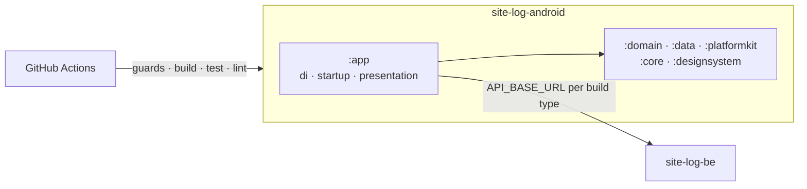
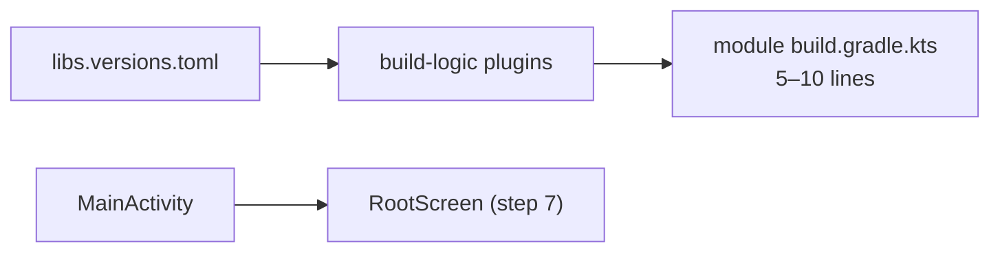
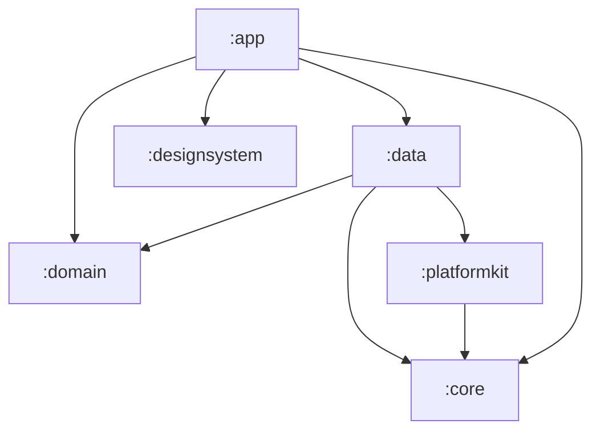

# F00 — Foundation

<dl><dd>

- Sprint [S0](README.md) · 41h · foundation guide for `site-log-android`. Config and code in steps 0–7 were checked on 2026-11-13 with a trial build (AGP 9.5.1, Gradle 9.6, Kotlin 2.4.21, JDK 21 target): `assembleDebug`, unit tests, Lint, detekt and Spotless all green, app run on an API 36 emulator. Bump versions only in a planned task.
- iOS twin: [iOS F00](https://github.com/DAMHONGDUC/site_log_swift_ui/blob/main/docs/feature-guide/S0-foundation-access/F00-foundation.md).

</dd></dl>

## Contents

<dl><dd>

1. [Overview](#overview)
2. [Target structure](#target-structure)
3. [0. Gradle project and entry point](#0-gradle-project-and-entry-point)
4. [1. Modules, Hilt, AppClock, AppLogger, Outcome](#1-modules-hilt-appclock-applogger-outcome)
5. [2. PR checks](#2-pr-checks)
6. [3. CI guards](#3-ci-guards)
7. [4. Design system](#4-design-system)
8. [5. Backend — shared](#5-backend--shared)
9. [6. Backend URL per build type](#6-backend-url-per-build-type)
10. [7. Skeleton screens and navigation](#7-skeleton-screens-and-navigation)
11. [User-facing text](#user-facing-text)
12. [Feature done](#feature-done)

</dd></dl>

## Overview

<dl><dd>

- **Goal:** what every feature builds on — Gradle modules with one-way dependencies, Hilt, CI, the design system, every screen as a skeleton, and the backend URL per build type.
- **Demo:** `./gradlew assembleDebug` with zero warnings; CI green; the app opens on the splash, then the skeleton tabs; `DSGallery` shows every token in light and dark.
- **Specs:** [00-overview](../../feature-docs/00-overview.md), [05-platform](../../feature-docs/05-platform.md), [03-backend](../../feature-docs/03-backend.md).
- **How to use:** per file, read **Explain**, write the file, open **Hint** only when stuck, compare with **Code**.
- **File tags:** <b class="tag-new">New</b> create the file · <b class="tag-edit">Edit</b> change only the part shown · <b class="tag-replace">Replace</b> overwrite the whole file.

| Step | Layer | Hours | Status | What |
|---|---|---|---|---|
| [0](#0-gradle-project-and-entry-point) | Tooling | 8h | not start | Gradle project, version catalog, `build-logic`, Spotless, detekt, entry point |
| [1](#1-modules-hilt-appclock-applogger-outcome) | Architecture | 6h | not start | Modules, Hilt, `AppClock`, `AppLogger`, `Outcome`, startup |
| [2](#2-pr-checks) | CI | 4h | not start | GitHub Actions PR checks |
| [3](#3-ci-guards) | CI | 4h | not start | No `println`, layer imports, secret scan, zero warnings |
| [4](#4-design-system) | Design system | 6h | not start | Tokens, theme, gallery, hex test |
| [5](#5-backend--shared) | Backend | 0h | not start | Shared site-log-be; check `/health` |
| [6](#6-backend-url-per-build-type) | Config | 1h | not start | `API_BASE_URL`, debug cleartext to the Mac |
| [7](#7-skeleton-screens-and-navigation) | UI | 12h | not start | Tabs, coordinators, skeleton screens, `FakeData`, dev menu |

- Order: 0 → 1 first (every feature needs them); F01 can start after step 1; 2–7 any time in S0.



</dd></dl>

## Target structure

<dl><dd>

```text
site-log-android/
├── settings.gradle.kts                       # 0: modules, build-logic
├── build.gradle.kts                          # 0: plugins (apply false), Spotless, detekt
├── gradle/libs.versions.toml                 # 0: every library and version
├── build-logic/convention/                   # 0: sitelog.* convention plugins
├── .editorconfig  config/detekt/detekt.yml   # 0
├── .github/workflows/pr-checks.yml           # 2 + 3
├── tools/ci/                                 # 3: check-no-println.sh, check-imports.sh
├── core/                                     # 1: clock/, logger/
├── domain/                                   # 1: Outcome.kt; folders filled from F01
├── data/  platformkit/                       # 1: empty packages
├── designsystem/                             # 4: tokens/, theme/, components/, gallery/
└── app/src/
    ├── main/java/com/dd/sitelog/
    │   ├── SiteLogApplication.kt  MainActivity.kt          # 0
    │   ├── di/CoreModule.kt  di/StartupModule.kt           # 1
    │   ├── startup/                                        # 1
    │   ├── fakes/FakeData.kt                               # 7
    │   └── presentation/navigation/ root/ maintab/ …       # 7
    ├── main/res/values/strings.xml                         # 7
    └── debug/                                              # 6: network_security_config · 7: devmenu/
```

</dd></dl>

## 0. Gradle project and entry point

<dl><dd>

#### Overview

<dl><dd>

- **Goal:** an empty Compose app that builds from the command line, with every version in one catalog and shared build settings in convention plugins.

| File | Holds |
|---|---|
| `settings.gradle.kts` | Repositories, `includeBuild("build-logic")`, the six modules |
| `gradle/libs.versions.toml` | Versions, libraries, plugins |
| `build-logic/convention/` | `sitelog.android.application`, `.android.library`, `.jvm.library`, `.compose`, `.hilt`, `.room` |
| `.editorconfig`, `config/detekt/detekt.yml` | Format and lint rules |
| `SiteLogApplication.kt`, `MainActivity.kt` | Entry point |



- **Check:** `./gradlew assembleDebug` succeeds; the app shows "SiteLog" on the emulator; `./gradlew spotlessCheck detekt` pass.

</dd></dl>

#### Start from the Android Studio template

<dl><dd>

| Template file | Action | Why |
|---|---|---|
| `MainActivity.kt`, `ui/theme/` in `app/src/main/java/com/dd/sitelog/` | Delete; the package `com.dd.sitelog` stays | `MainActivity` is rewritten in step 0; theme comes from `:designsystem` |
| `app/src/main/res/values/colors.xml` | Delete | Lint `UnusedResources` (errors with `warningsAsErrors`) |
| `app/src/main/res/mipmap-anydpi-v26/` | Rename to `mipmap-anydpi/` | Lint `ObsoleteSdkInt` with `minSdk` 29 |
| `android:label` on `<activity>` | Remove (keep it on `<application>`) | Lint `RedundantLabel` |
| `ExampleUnitTest`, `ExampleInstrumentedTest` | Delete | Real tests come with each feature |
| `gradle/gradle-daemon-jvm.properties` | Keep | Gradle itself runs on JDK 25 (downloaded once); the code still targets Java 21 |
| `<application android:name=".SiteLogApplication">` | Add | Hilt needs the application class |

</dd></dl>

#### Build

<dl><dd>

<b>File</b> · <b class="tag-new">New</b> · `gradle/libs.versions.toml`
Every library and version the project uses; modules refer to them as `libs.<name>`.

<b>Explain</b> · One place to bump versions. Add a library here first, then use it in a module.

<details>
<summary><b>Hint</b></summary>

- Three tables: `[versions]`, `[libraries]` (`module = "group:name"`, `version.ref`), `[plugins]` (`id`, `version.ref`).
- Compose libraries take their version from the BOM, so they have no `version.ref`.

</details>

<details>
<summary><b>Code</b></summary>

```toml
[versions]
agp = "9.5.1"
kotlin = "2.4.21"
ksp = "2.3.13"
composeBom = "2026.09.00"
activityCompose = "1.13.0"
fragment = "1.9.1"
lifecycle = "2.11.0"
navigation3 = "1.2.1"
lifecycleNavigation3 = "2.11.0"
hilt = "2.60.1"
hiltLifecycleCompose = "1.4.0"
coroutines = "1.11.0"
serialization = "1.13.0"
room = "2.8.5"
datastore = "1.3.0"
biometric = "1.1.0"
junit = "4.13.2"
truth = "1.4.5"
turbine = "1.2.1"
robolectric = "4.17"
detekt = "1.23.8"
spotless = "8.11.0"
ktlint = "1.8.0"

[libraries]
androidx-activity-compose = { module = "androidx.activity:activity-compose", version.ref = "activityCompose" }
androidx-fragment = { module = "androidx.fragment:fragment-ktx", version.ref = "fragment" }
androidx-lifecycle-runtime-compose = { module = "androidx.lifecycle:lifecycle-runtime-compose", version.ref = "lifecycle" }
androidx-lifecycle-viewmodel-compose = { module = "androidx.lifecycle:lifecycle-viewmodel-compose", version.ref = "lifecycle" }
androidx-lifecycle-process = { module = "androidx.lifecycle:lifecycle-process", version.ref = "lifecycle" }
androidx-lifecycle-viewmodel-navigation3 = { module = "androidx.lifecycle:lifecycle-viewmodel-navigation3", version.ref = "lifecycleNavigation3" }
androidx-navigation3-runtime = { module = "androidx.navigation3:navigation3-runtime", version.ref = "navigation3" }
androidx-navigation3-ui = { module = "androidx.navigation3:navigation3-ui", version.ref = "navigation3" }
compose-bom = { module = "androidx.compose:compose-bom", version.ref = "composeBom" }
compose-ui = { module = "androidx.compose.ui:ui" }
compose-ui-tooling = { module = "androidx.compose.ui:ui-tooling" }
compose-ui-tooling-preview = { module = "androidx.compose.ui:ui-tooling-preview" }
compose-material3 = { module = "androidx.compose.material3:material3" }
compose-material-icons-core = { module = "androidx.compose.material:material-icons-core" }
hilt-android = { module = "com.google.dagger:hilt-android", version.ref = "hilt" }
hilt-compiler = { module = "com.google.dagger:hilt-android-compiler", version.ref = "hilt" }
hilt-lifecycle-viewmodel-compose = { module = "androidx.hilt:hilt-lifecycle-viewmodel-compose", version.ref = "hiltLifecycleCompose" }
kotlinx-coroutines-core = { module = "org.jetbrains.kotlinx:kotlinx-coroutines-core", version.ref = "coroutines" }
kotlinx-coroutines-test = { module = "org.jetbrains.kotlinx:kotlinx-coroutines-test", version.ref = "coroutines" }
kotlinx-serialization-core = { module = "org.jetbrains.kotlinx:kotlinx-serialization-core", version.ref = "serialization" }
kotlinx-serialization-json = { module = "org.jetbrains.kotlinx:kotlinx-serialization-json", version.ref = "serialization" }
androidx-room-runtime = { module = "androidx.room:room-runtime", version.ref = "room" }
androidx-room-compiler = { module = "androidx.room:room-compiler", version.ref = "room" }
androidx-datastore-preferences = { module = "androidx.datastore:datastore-preferences", version.ref = "datastore" }
androidx-biometric = { module = "androidx.biometric:biometric", version.ref = "biometric" }
junit = { module = "junit:junit", version.ref = "junit" }
truth = { module = "com.google.truth:truth", version.ref = "truth" }
turbine = { module = "app.cash.turbine:turbine", version.ref = "turbine" }
robolectric = { module = "org.robolectric:robolectric", version.ref = "robolectric" }
# Used by build-logic only
android-gradle-plugin = { module = "com.android.tools.build:gradle", version.ref = "agp" }
kotlin-gradle-plugin = { module = "org.jetbrains.kotlin:kotlin-gradle-plugin", version.ref = "kotlin" }
compose-gradle-plugin = { module = "org.jetbrains.kotlin:compose-compiler-gradle-plugin", version.ref = "kotlin" }
ksp-gradle-plugin = { module = "com.google.devtools.ksp:com.google.devtools.ksp.gradle.plugin", version.ref = "ksp" }
room-gradle-plugin = { module = "androidx.room:room-gradle-plugin", version.ref = "room" }

[plugins]
android-application = { id = "com.android.application", version.ref = "agp" }
android-library = { id = "com.android.library", version.ref = "agp" }
kotlin-jvm = { id = "org.jetbrains.kotlin.jvm", version.ref = "kotlin" }
kotlin-compose = { id = "org.jetbrains.kotlin.plugin.compose", version.ref = "kotlin" }
kotlin-serialization = { id = "org.jetbrains.kotlin.plugin.serialization", version.ref = "kotlin" }
ksp = { id = "com.google.devtools.ksp", version.ref = "ksp" }
hilt = { id = "com.google.dagger.hilt.android", version.ref = "hilt" }
room = { id = "androidx.room", version.ref = "room" }
detekt = { id = "io.gitlab.arturbosch.detekt", version.ref = "detekt" }
spotless = { id = "com.diffplug.spotless", version.ref = "spotless" }
```

</details>

- Only what F00–F01 use. Each later feature adds its rows (OkHttp, Coil, WorkManager, Firebase BoM, Room is already here) in the step that first needs them, at the latest stable version of that day.

---

<b>File</b> · <b class="tag-new">New</b> · `settings.gradle.kts`
Lists the modules and where Gradle finds plugins and libraries.

<b>Explain</b> · `includeBuild("build-logic")` makes the convention plugins available by id; `include` adds each module.

<details>
<summary><b>Code</b></summary>

```kotlin
pluginManagement {
    includeBuild("build-logic")
    repositories {
        google()
        mavenCentral()
        gradlePluginPortal()
    }
}

dependencyResolutionManagement {
    repositoriesMode.set(RepositoriesMode.FAIL_ON_PROJECT_REPOS)
    repositories {
        google()
        mavenCentral()
    }
}

rootProject.name = "site-log-android"

include(":app")
include(":core")
include(":domain")
include(":data")
include(":platformkit")
include(":designsystem")
```

</details>

---

<b>File</b> · <b class="tag-new">New</b> · `build-logic/convention/src/main/kotlin/AndroidLibraryConventionPlugin.kt`
Shared settings for every Android library module: SDK levels, Java 21, warnings as errors.

<b>Explain</b> · Each module applies `id("sitelog.android.library")` instead of repeating 30 lines. The application plugin is the same plus `targetSdk`, `buildConfig = true` and R8 in release.

- **AGP 9 has Kotlin built in:** never apply `org.jetbrains.kotlin.android`; AGP 9 fails the build if you do. Kotlin options go through `KotlinCompile` tasks (`configureKotlin()`).
- `compileSdk` is 37: current Compose, Hilt and AndroidX releases refuse to build against 36.
- Lint is strict (`warningsAsErrors`), minus three checks that only say "a newer version exists" (they would break CI every release) and `ObsoleteLintCustomCheck` (a library's own outdated lint jar).

<details>
<summary><b>Hint</b></summary>

- A convention plugin is a class implementing `Plugin<Project>`; `apply` adds other plugins, then configures the `LibraryExtension`.
- Register it in `build-logic/convention/build.gradle.kts` under `gradlePlugin { plugins { register(...) } }`.

</details>

<details>
<summary><b>Code</b></summary>

```kotlin
plugins {
    `kotlin-dsl`
}

dependencies {
    compileOnly(libs.android.gradle.plugin)
    compileOnly(libs.kotlin.gradle.plugin)
    compileOnly(libs.compose.gradle.plugin)
    compileOnly(libs.ksp.gradle.plugin)
    compileOnly(libs.room.gradle.plugin)
}

gradlePlugin {
    plugins {
        register("androidApplication") {
            id = "sitelog.android.application"
            implementationClass = "AndroidApplicationConventionPlugin"
        }
        register("androidLibrary") {
            id = "sitelog.android.library"
            implementationClass = "AndroidLibraryConventionPlugin"
        }
        register("jvmLibrary") {
            id = "sitelog.jvm.library"
            implementationClass = "JvmLibraryConventionPlugin"
        }
        register("compose") {
            id = "sitelog.compose"
            implementationClass = "ComposeConventionPlugin"
        }
        register("hilt") {
            id = "sitelog.hilt"
            implementationClass = "HiltConventionPlugin"
        }
        register("room") {
            id = "sitelog.room"
            implementationClass = "RoomConventionPlugin"
        }
    }
}
```

```kotlin
import org.gradle.api.Project
import org.gradle.kotlin.dsl.withType
import org.jetbrains.kotlin.gradle.dsl.JvmTarget
import org.jetbrains.kotlin.gradle.tasks.KotlinCompile

internal fun Project.configureKotlin() {
    tasks.withType<KotlinCompile>().configureEach {
        compilerOptions {
            jvmTarget.set(JvmTarget.JVM_21)
            allWarningsAsErrors.set(true)
        }
    }
}
```

```kotlin
object SiteLogSdk {
    const val COMPILE_SDK: Int = 37
    const val TARGET_SDK: Int = 36
    const val MIN_SDK: Int = 29
}
```

</details>

---

<b>File</b> · <b class="tag-new">New</b> · `build-logic/convention/build.gradle.kts`
Builds the convention plugins and gives each one an id.

<details>
<summary><b>Code</b></summary>

```kotlin
plugins {
    `kotlin-dsl`
}

dependencies {
    compileOnly(libs.android.gradle.plugin)
    compileOnly(libs.kotlin.gradle.plugin)
    compileOnly(libs.compose.gradle.plugin)
}

gradlePlugin {
    plugins {
        register("androidApplication") {
            id = "sitelog.android.application"
            implementationClass = "AndroidApplicationConventionPlugin"
        }
        register("androidLibrary") {
            id = "sitelog.android.library"
            implementationClass = "AndroidLibraryConventionPlugin"
        }
        register("jvmLibrary") {
            id = "sitelog.jvm.library"
            implementationClass = "JvmLibraryConventionPlugin"
        }
        register("compose") {
            id = "sitelog.compose"
            implementationClass = "ComposeConventionPlugin"
        }
        register("hilt") {
            id = "sitelog.hilt"
            implementationClass = "HiltConventionPlugin"
        }
        register("room") {
            id = "sitelog.room"
            implementationClass = "RoomConventionPlugin"
        }
    }
}
```

- `build-logic/settings.gradle.kts` adds `google()` + `mavenCentral()` and `versionCatalogs { create("libs") { from(files("../gradle/libs.versions.toml")) } }` so `libs` works here too.
- `ComposeConventionPlugin` reads `CommonExtension` (no type parameters in AGP 9), sets `buildFeatures.compose = true` and adds the BOM, `ui`, `material3`, `ui-tooling-preview`, and `ui-tooling` for debug.
- `HiltConventionPlugin` applies `com.google.devtools.ksp` + `com.google.dagger.hilt.android` and adds `hilt-android` + `ksp(hilt-compiler)`.

</details>

---

<b>File</b> · <b class="tag-new">New</b> · `.editorconfig`
Formatting rules for Android Studio; Spotless gets the same ktlint rules from the root build file.

<details>
<summary><b>Code</b></summary>

```ini
root = true

[*]
charset = utf-8
end_of_line = lf
insert_final_newline = true
indent_style = space
indent_size = 4

[*.{kt,kts}]
max_line_length = 100
ktlint_code_style = android_studio
ij_kotlin_allow_trailing_comma = true
ij_kotlin_allow_trailing_comma_on_call_site = true
ktlint_function_signature_rule_force_multiline_when_parameter_count_greater_or_equal_than = 3
ktlint_function_naming_ignore_when_annotated_with = Composable
# Keep `class X @Inject constructor(` and explicit `return` (beginner-friendly guide code)
ktlint_standard_class-signature = disabled
ktlint_standard_function-expression-body = disabled

[*.{yml,yaml,toml,json}]
indent_size = 2
```

</details>

---

<b>File</b> · <b class="tag-new">New</b> · `build.gradle.kts` (root)
Declares plugins once (`apply false`) and runs Spotless and detekt over every module.

- Spotless does **not** take ktlint rules from `.editorconfig`: pass them with `editorConfigOverride`, or ktlint falls back to `ktlint_official`.
- `android_studio` style matches Android Studio's formatter, so Format on Save and CI agree.
- Two ktlint rules are off on purpose: `class-signature` would split `class X @Inject constructor(` over four lines and re-indent the class, and `function-expression-body` would turn every `return when` into `= when` — both against the beginner style of the guides.

<details>
<summary><b>Code</b></summary>

```kotlin
plugins {
    alias(libs.plugins.android.application) apply false
    alias(libs.plugins.android.library) apply false
    alias(libs.plugins.kotlin.jvm) apply false
    alias(libs.plugins.kotlin.compose) apply false
    alias(libs.plugins.kotlin.serialization) apply false
    alias(libs.plugins.ksp) apply false
    alias(libs.plugins.hilt) apply false
    alias(libs.plugins.room) apply false
    alias(libs.plugins.detekt)
    alias(libs.plugins.spotless)
}

val ktlintRules: Map<String, Any> = mapOf(
    "ktlint_code_style" to "android_studio",
    "max_line_length" to 100,
    "ktlint_function_naming_ignore_when_annotated_with" to "Composable",
    "ktlint_standard_class-signature" to "disabled",
    "ktlint_standard_function-expression-body" to "disabled",
)

spotless {
    kotlin {
        target("**/*.kt")
        targetExclude("**/build/**")
        ktlint(libs.versions.ktlint.get()).editorConfigOverride(ktlintRules)
    }
    kotlinGradle {
        target("**/*.kts")
        targetExclude("**/build/**")
        ktlint(libs.versions.ktlint.get()).editorConfigOverride(ktlintRules)
    }
}

detekt {
    buildUponDefaultConfig = true
    config.setFrom(files("config/detekt/detekt.yml"))
    source.setFrom(files(subprojects.map { "${it.projectDir}/src" }))
}
```

</details>

---

<b>File</b> · <b class="tag-new">New</b> · `config/detekt/detekt.yml`
The detekt rules this project changes; everything else is detekt's default.

<b>Explain</b> · Defaults clash with Compose and with the error rules: composables are `PascalCase`, repositories catch `Exception` on purpose ([00 §4.6](../../feature-docs/00-overview.md#46-error-handling)), tokens are numbers, previews look unused.

<details>
<summary><b>Code</b></summary>

```yaml
naming:
  FunctionNaming:
    ignoreAnnotated: ['Composable']
  TopLevelPropertyNaming:
    constantPattern: '[A-Z][A-Za-z0-9_]*'

complexity:
  LongParameterList:
    ignoreAnnotated: ['Composable']

style:
  # Repositories catch Exception on purpose and rethrow CancellationException (00-overview §4.6)
  ReturnCount:
    max: 4
    excludeGuardClauses: true
  MagicNumber:
    excludes: ['**/tokens/**', '**/test/**']
    ignorePropertyDeclaration: true
    ignoreCompanionObjectPropertyDeclaration: true
  UnusedPrivateMember:
    ignoreAnnotated: ['Preview']
  ForbiddenMethodCall:
    active: true
    methods:
      - 'kotlin.io.println'

exceptions:
  TooGenericExceptionCaught:
    active: false
  SwallowedException:
    ignoredExceptionTypes: ['KeyPermanentlyInvalidatedException', 'CancellationException']
```

</details>

- In tests use `error("…")`, not `throw IllegalStateException(…)` (`UseCheckOrError`).

---

<b>File</b> · <b class="tag-new">New</b> · `app/src/main/java/com/dd/sitelog/SiteLogApplication.kt`
The process entry point; Hilt starts here. Crashlytics and the logger are the first startup steps (step 1 fills them in).

<details>
<summary><b>Code</b></summary>

```kotlin
package com.dd.sitelog

import android.app.Application
import dagger.hilt.android.HiltAndroidApp

@HiltAndroidApp
class SiteLogApplication : Application()
```

</details>

---

<b>File</b> · <b class="tag-new">New</b> · `app/src/main/java/com/dd/sitelog/MainActivity.kt`
The only activity: draws edge to edge and hands the screen to Compose. A `FragmentActivity` (needs `androidx.fragment`) because `BiometricPrompt` (F01) only works with one.

<details>
<summary><b>Code</b></summary>

```kotlin
package com.dd.sitelog

import android.os.Bundle
import androidx.activity.compose.setContent
import androidx.activity.enableEdgeToEdge
import androidx.fragment.app.FragmentActivity
import com.dd.sitelog.designsystem.theme.SiteLogTheme
import com.dd.sitelog.presentation.root.RootScreen
import dagger.hilt.android.AndroidEntryPoint

@AndroidEntryPoint
class MainActivity : FragmentActivity() {
    override fun onCreate(savedInstanceState: Bundle?) {
        super.onCreate(savedInstanceState)
        enableEdgeToEdge()
        setContent {
            SiteLogTheme {
                RootScreen()
            }
        }
    }
}
```

- Until step 4 and step 7 exist, put `Text("SiteLog")` inside `setContent` instead.

</details>

</dd></dl>

</dd></dl>

## 1. Modules, Hilt, AppClock, AppLogger, Outcome

<dl><dd>

#### Overview

<dl><dd>

- **Goal:** five modules with one-way dependencies, one composition root, a clock tests can fix, a logger, and the `Outcome` type every repository returns.

| Module | Plugin | Holds | Depends on |
|---|---|---|---|
| `:domain` | `sitelog.jvm.library` | Entities, repository interfaces, use cases, `Outcome` | coroutines-core, serialization-core |
| `:data` | `sitelog.android.library` (+ `room` later) | Repository and data source `Impl`s, models, mappers | `:domain`, `:platformkit`, `:core` |
| `:platformkit` | `sitelog.android.library` | System services, engines | `:core` |
| `:core` | `sitelog.android.library` | `AppClock`, `AppLogger`, crypto | nothing |
| `:designsystem` | `sitelog.android.library` + `compose` | Tokens, theme, components | nothing |
| `:app` | `sitelog.android.application` + `compose` + `hilt` | `di/`, `startup/`, `presentation/` | every module |



- **Check:** `./gradlew assembleDebug` is clean; adding `implementation(project(":data"))` to `:domain` fails (`:domain` is JVM and `:data` is Android); the `DeviceClock` test passes.
- **Why:** [A01](../../feature-docs/00-overview.md#a01--hilt-for-dependency-injection), [A09](../../feature-docs/00-overview.md#a09--layers-as-gradle-modules), [A21](../../feature-docs/00-overview.md#a21--own-outcome-type).

</dd></dl>

