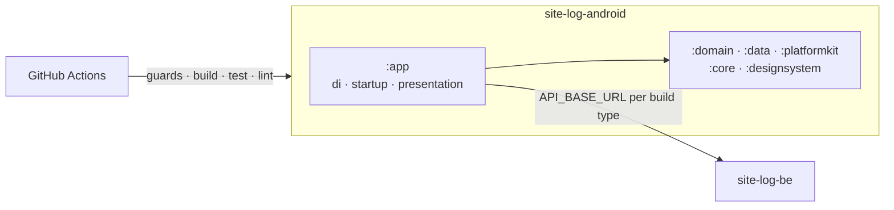
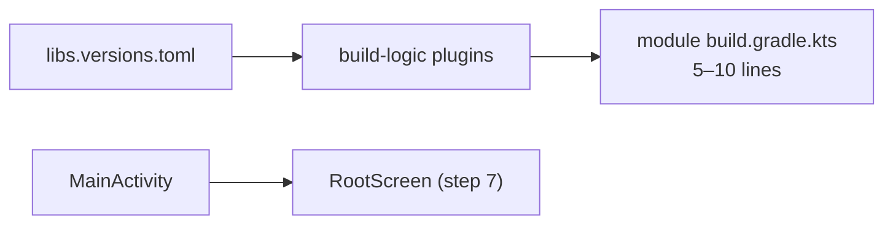

# F00 — Foundation

<dl><dd>

- Sprint [S0](README.md) · 41h · foundation guide for `site-log-android`. Config and code in steps 0–7 were checked on 2026-11-13 with a trial build (AGP 9.5.1, Gradle 9.6, Kotlin 2.4.21, JDK 21 target): `assembleDebug`, unit tests, Lint, detekt and Spotless all green, app run on an API 36 emulator. Bump versions only in a planned task.
- iOS twin: [iOS F00](https://github.com/DAMHONGDUC/site_log_swift_ui/blob/main/docs/feature-guide/S0-foundation-access/F00-foundation.md).

</dd></dl>

## Contents

<dl><dd>

1. [Overview](#overview)
2. [Target structure](#target-structure)
3. [0. Gradle project and entry point](#0-gradle-project-and-entry-point)
4. [1. Modules, Hilt, AppClock, AppLogger, Outcome](#1-modules-hilt-appclock-applogger-outcome)
5. [2. PR checks](#2-pr-checks)
6. [3. CI guards](#3-ci-guards)
7. [4. Design system](#4-design-system)
8. [5. Backend — shared](#5-backend--shared)
9. [6. Backend URL per build type](#6-backend-url-per-build-type)
10. [7. Skeleton screens and navigation](#7-skeleton-screens-and-navigation)
11. [User-facing text](#user-facing-text)
12. [Feature done](#feature-done)

</dd></dl>

## Overview

<dl><dd>

- **Goal:** what every feature builds on — Gradle modules with one-way dependencies, Hilt, CI, the design system, every screen as a skeleton, and the backend URL per build type.
- **Demo:** `./gradlew assembleDebug` with zero warnings; CI green; the app opens on the splash, then the skeleton tabs; `DSGallery` shows every token in light and dark.
- **Specs:** [00-overview](../../feature-docs/00-overview.md), [05-platform](../../feature-docs/05-platform.md), [03-backend](../../feature-docs/03-backend.md).
- **How to use:** per file, read **Explain**, write the file, open **Hint** only when stuck, compare with **Code**.
- **File tags:** <b class="tag-new">New</b> create the file · <b class="tag-edit">Edit</b> change only the part shown · <b class="tag-replace">Replace</b> overwrite the whole file.

| Step | Layer | Hours | Status | What |
|---|---|---|---|---|
| [0](#0-gradle-project-and-entry-point) | Tooling | 8h | not start | Gradle project, version catalog, `build-logic`, Spotless, detekt, entry point |
| [1](#1-modules-hilt-appclock-applogger-outcome) | Architecture | 6h | not start | Modules, Hilt, `AppClock`, `AppLogger`, `Outcome`, startup |
| [2](#2-pr-checks) | CI | 4h | not start | GitHub Actions PR checks |
| [3](#3-ci-guards) | CI | 4h | not start | No `println`, layer imports, secret scan, zero warnings |
| [4](#4-design-system) | Design system | 6h | not start | Tokens, theme, gallery, hex test |
| [5](#5-backend--shared) | Backend | 0h | not start | Shared site-log-be; check `/health` |
| [6](#6-backend-url-per-build-type) | Config | 1h | not start | `API_BASE_URL`, debug cleartext to the Mac |
| [7](#7-skeleton-screens-and-navigation) | UI | 12h | not start | Tabs, coordinators, skeleton screens, `FakeData`, dev menu |

- Order: 0 → 1 first (every feature needs them); F01 can start after step 1; 2–7 any time in S0.



</dd></dl>

## Target structure

<dl><dd>

```text
site-log-android/
├── settings.gradle.kts                       # 0: modules, build-logic
├── build.gradle.kts                          # 0: plugins (apply false), Spotless, detekt
├── gradle/libs.versions.toml                 # 0: every library and version
├── build-logic/convention/                   # 0: sitelog.* convention plugins
├── .editorconfig  config/detekt/detekt.yml   # 0
├── .github/workflows/pr-checks.yml           # 2 + 3
├── tools/ci/                                 # 3: check-no-println.sh, check-imports.sh
├── core/                                     # 1: clock/, logger/
├── domain/                                   # 1: Outcome.kt; folders filled from F01
├── data/  platformkit/                       # 1: empty packages
├── designsystem/                             # 4: tokens/, theme/, components/, gallery/
└── app/src/
    ├── main/java/com/dd/sitelog/
    │   ├── SiteLogApplication.kt  MainActivity.kt          # 0
    │   ├── di/CoreModule.kt  di/StartupModule.kt           # 1
    │   ├── startup/                                        # 1
    │   ├── fakes/FakeData.kt                               # 7
    │   └── presentation/navigation/ root/ maintab/ …       # 7
    ├── main/res/values/strings.xml                         # 7
    └── debug/                                              # 6: network_security_config · 7: devmenu/
```

</dd></dl>

## 0. Gradle project and entry point

<dl><dd>

#### Overview

<dl><dd>

- **Goal:** an empty Compose app that builds from the command line, with every version in one catalog and shared build settings in convention plugins.

| File | Holds |
|---|---|
| `settings.gradle.kts` | Repositories, `includeBuild("build-logic")`, the six modules |
| `gradle/libs.versions.toml` | Versions, libraries, plugins |
| `build-logic/convention/` | `sitelog.android.application`, `.android.library`, `.jvm.library`, `.compose`, `.hilt`, `.room` |
| `.editorconfig`, `config/detekt/detekt.yml` | Format and lint rules |
| `SiteLogApplication.kt`, `MainActivity.kt` | Entry point |



- **Check:** `./gradlew assembleDebug` succeeds; the app shows "SiteLog" on the emulator; `./gradlew spotlessCheck detekt` pass.

</dd></dl>

#### Start from the Android Studio template

<dl><dd>

| Template file | Action | Why |
|---|---|---|
| `MainActivity.kt`, `ui/theme/` in `app/src/main/java/com/dd/sitelog/` | Delete; the package `com.dd.sitelog` stays | `MainActivity` is rewritten in step 0; theme comes from `:designsystem` |
| `app/src/main/res/values/colors.xml` | Delete | Lint `UnusedResources` (errors with `warningsAsErrors`) |
| `app/src/main/res/mipmap-anydpi-v26/` | Rename to `mipmap-anydpi/` | Lint `ObsoleteSdkInt` with `minSdk` 29 |
| `android:label` on `<activity>` | Remove (keep it on `<application>`) | Lint `RedundantLabel` |
| `ExampleUnitTest`, `ExampleInstrumentedTest` | Delete | Real tests come with each feature |
| `gradle/gradle-daemon-jvm.properties` | Keep | Gradle itself runs on JDK 25 (downloaded once); the code still targets Java 21 |
| `<application android:name=".SiteLogApplication">` | Add | Hilt needs the application class |

</dd></dl>

#### Build

<dl><dd>

<b>File</b> · <b class="tag-new">New</b> · `gradle/libs.versions.toml`
Every library and version the project uses; modules refer to them as `libs.<name>`.

<b>Explain</b> · One place to bump versions. Add a library here first, then use it in a module.

<details>
<summary><b>Hint</b></summary>

- Three tables: `[versions]`, `[libraries]` (`module = "group:name"`, `version.ref`), `[plugins]` (`id`, `version.ref`).
- Compose libraries take their version from the BOM, so they have no `version.ref`.

</details>

<details>
<summary><b>Code</b></summary>

```toml
[versions]
agp = "9.5.1"
kotlin = "2.4.21"
ksp = "2.3.13"
composeBom = "2026.09.00"
activityCompose = "1.13.0"
fragment = "1.9.1"
lifecycle = "2.11.0"
navigation3 = "1.2.1"
lifecycleNavigation3 = "2.11.0"
hilt = "2.60.1"
hiltLifecycleCompose = "1.4.0"
coroutines = "1.11.0"
serialization = "1.13.0"
room = "2.8.5"
datastore = "1.3.0"
biometric = "1.1.0"
junit = "4.13.2"
truth = "1.4.5"
turbine = "1.2.1"
robolectric = "4.17"
detekt = "1.23.8"
spotless = "8.11.0"
ktlint = "1.8.0"

[libraries]
androidx-activity-compose = { module = "androidx.activity:activity-compose", version.ref = "activityCompose" }
androidx-fragment = { module = "androidx.fragment:fragment-ktx", version.ref = "fragment" }
androidx-lifecycle-runtime-compose = { module = "androidx.lifecycle:lifecycle-runtime-compose", version.ref = "lifecycle" }
androidx-lifecycle-viewmodel-compose = { module = "androidx.lifecycle:lifecycle-viewmodel-compose", version.ref = "lifecycle" }
androidx-lifecycle-process = { module = "androidx.lifecycle:lifecycle-process", version.ref = "lifecycle" }
androidx-lifecycle-viewmodel-navigation3 = { module = "androidx.lifecycle:lifecycle-viewmodel-navigation3", version.ref = "lifecycleNavigation3" }
androidx-navigation3-runtime = { module = "androidx.navigation3:navigation3-runtime", version.ref = "navigation3" }
androidx-navigation3-ui = { module = "androidx.navigation3:navigation3-ui", version.ref = "navigation3" }
compose-bom = { module = "androidx.compose:compose-bom", version.ref = "composeBom" }
compose-ui = { module = "androidx.compose.ui:ui" }
compose-ui-tooling = { module = "androidx.compose.ui:ui-tooling" }
compose-ui-tooling-preview = { module = "androidx.compose.ui:ui-tooling-preview" }
compose-material3 = { module = "androidx.compose.material3:material3" }
compose-material-icons-core = { module = "androidx.compose.material:material-icons-core" }
hilt-android = { module = "com.google.dagger:hilt-android", version.ref = "hilt" }
hilt-compiler = { module = "com.google.dagger:hilt-android-compiler", version.ref = "hilt" }
hilt-lifecycle-viewmodel-compose = { module = "androidx.hilt:hilt-lifecycle-viewmodel-compose", version.ref = "hiltLifecycleCompose" }
kotlinx-coroutines-core = { module = "org.jetbrains.kotlinx:kotlinx-coroutines-core", version.ref = "coroutines" }
kotlinx-coroutines-test = { module = "org.jetbrains.kotlinx:kotlinx-coroutines-test", version.ref = "coroutines" }
kotlinx-serialization-core = { module = "org.jetbrains.kotlinx:kotlinx-serialization-core", version.ref = "serialization" }
kotlinx-serialization-json = { module = "org.jetbrains.kotlinx:kotlinx-serialization-json", version.ref = "serialization" }
androidx-room-runtime = { module = "androidx.room:room-runtime", version.ref = "room" }
androidx-room-compiler = { module = "androidx.room:room-compiler", version.ref = "room" }
androidx-datastore-preferences = { module = "androidx.datastore:datastore-preferences", version.ref = "datastore" }
androidx-biometric = { module = "androidx.biometric:biometric", version.ref = "biometric" }
junit = { module = "junit:junit", version.ref = "junit" }
truth = { module = "com.google.truth:truth", version.ref = "truth" }
turbine = { module = "app.cash.turbine:turbine", version.ref = "turbine" }
robolectric = { module = "org.robolectric:robolectric", version.ref = "robolectric" }
