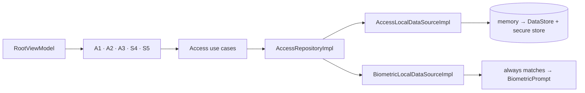
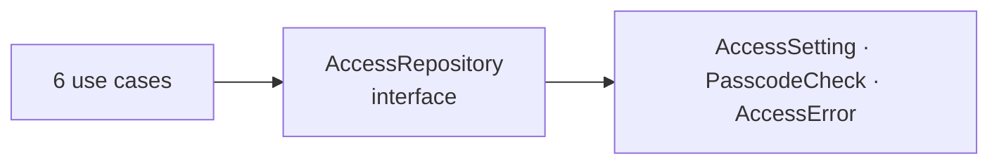
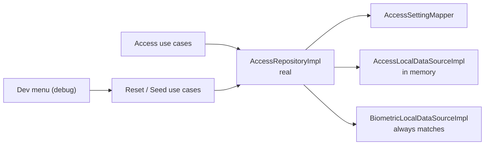
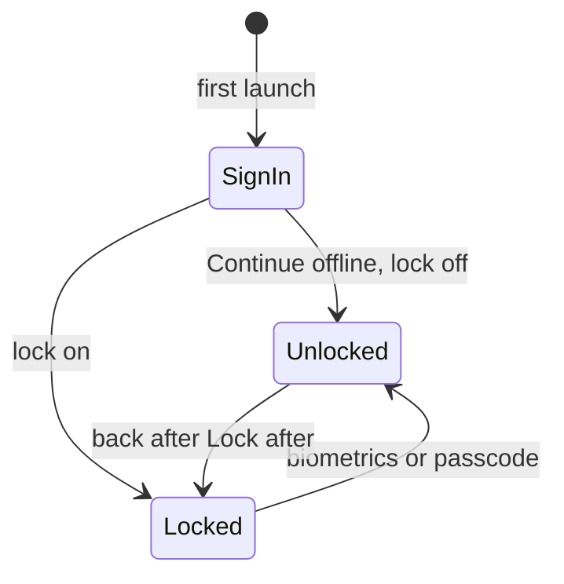
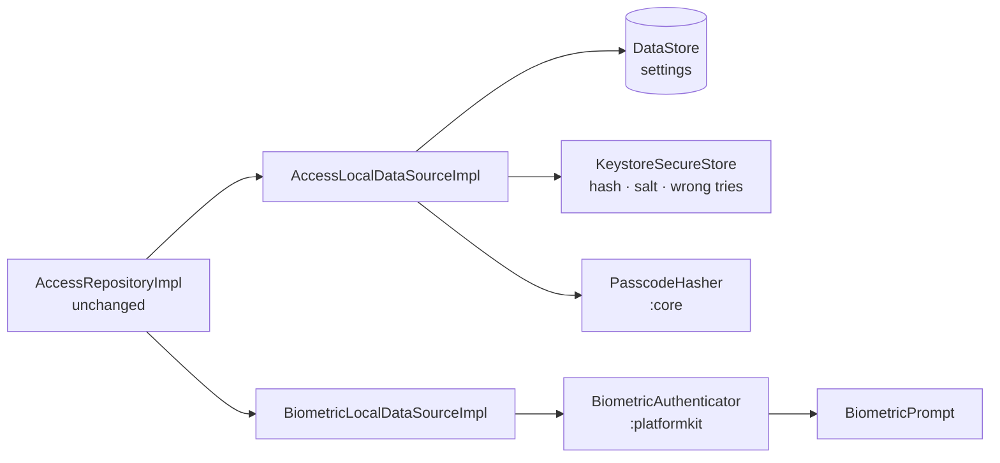

# F01 — Access and app lock

<dl><dd>

- Sprint [S0](README.md) · 17h · mirrors the iOS access code (`AccessRepository`, `AccessRepositoryImpl`, `AccessLocalDataSource`) so both apps behave the same.
- iOS twin: [iOS F01](https://github.com/DAMHONGDUC/site_log_swift_ui/blob/main/docs/feature-guide/S0-foundation-access/F01-access.md). Text rules: [F00 § User-facing text](F00-foundation.md#user-facing-text).

</dd></dl>

## Contents

<dl><dd>

1. [Overview](#overview)
2. [Target structure](#target-structure)
3. [1. Domain — access types and use cases](#1-domain--access-types-and-use-cases)
4. [2. Fake data — access data sources in memory](#2-fake-data--access-data-sources-in-memory)
5. [3. View models — wire the access screens](#3-view-models--wire-the-access-screens)
6. [4. Local — DataStore, Keystore and BiometricPrompt](#4-local--datastore-keystore-and-biometricprompt)
7. [Tests (after the feature works)](#tests-after-the-feature-works)
8. [Feature done](#feature-done)

</dd></dl>

## Overview

<dl><dd>

- **Goal:** A2 sign in (Continue offline), A1 biometric lock, A3 passcode, privacy (`FLAG_SECURE`), re-lock after *Lock after*, S4 app lock and S5 set passcode — on the real `AccessRepositoryImpl` from the start; data sources hold in-memory values first, DataStore + Keystore + `BiometricPrompt` in step 4.
- **Demo:** first launch → Continue offline → tabs; lock on → fingerprint/face or passcode; back after *Lock after* → locked again.
- **Spec:** [07.2 App lock](../../feature-docs/04-reporting-security.md#072-app-lock).
- **Device only:** Contract, Backend and Sync are `—`.

| Step | Layer | Hours | Status | What |
|---|---|---|---|---|
| [1](#1-domain--access-types-and-use-cases) | Domain | 1h | not start | `AccessSetting`, `PasscodeCheck`, `AccessError`, `AccessRepository`, use cases |
| [2](#2-fake-data--access-data-sources-in-memory) | Fake data | 2h | not start | Real `AccessRepositoryImpl` over in-memory data sources, bindings, dev menu |
| [3](#3-view-models--wire-the-access-screens) | View models | 6h | not start | `RootViewModel` + one view model per screen |
| [4](#4-local--datastore-keystore-and-biometricprompt) | Local | 8h | not start | DataStore, Keystore secure store, `BiometricPrompt` |
| — | Contract · Backend · Sync | — | — | Device only |



<details open>
<summary><strong>Flow</strong></summary>
<dl><dd>

| When | Screen |
|---|---|
| Startup ready, first launch | A2 Sign in → **Continue offline** |
| Lock off | Main tabs |
| Lock on + biometrics | A1 → match → main tabs · **Use app passcode** → A3 |
| Lock on, no biometrics | A3 → correct passcode → main tabs |
| Lock on, app in Recents | Blank thumbnail (`FLAG_SECURE`) |
| Back after ≥ *Lock after* | A1 or A3 again (measured with `AppClock.elapsedRealtimeMs`) |

</dd></dl>
</details>

</dd></dl>

## Target structure

<dl><dd>

```text
domain/src/main/kotlin/com/dd/sitelog/domain/
├── entities/access/AccessSetting.kt, PasscodeCheck.kt, AccessError.kt     # 1
├── repositories/AccessRepository.kt                                       # 1
└── usecases/access/ (6 files), usecases/devdata/ (2 files)                # 1 · 2
data/src/main/kotlin/com/dd/sitelog/data/
├── repositories/AccessRepositoryImpl.kt                                   # 2: real, never changes after
├── datasources/local/access/AccessLocalDataSource.kt + Impl               # 2: memory · 4: DataStore + secure store
├── datasources/local/biometrics/BiometricLocalDataSource.kt + Impl        # 2: always matches · 4: PlatformKit
├── models/local/AccessSettingModel.kt                                     # 2
└── mappers/AccessSettingMapper.kt                                         # 2
platformkit/src/main/kotlin/com/dd/sitelog/platformkit/
├── biometrics/BiometricAuthenticating.kt + BiometricAuthenticator.kt      # 4
├── activity/CurrentActivityProvider.kt                                    # 4
└── securestore/SecureStore.kt + KeystoreSecureStore.kt                    # 4
core/src/main/kotlin/com/dd/sitelog/core/crypto/PasscodeHasher.kt          # 4
app/src/main/java/com/dd/sitelog/
├── di/DataSourcesModule.kt, RepositoriesModule.kt, UseCasesModule.kt      # 2 · 4: PlatformModule.kt
├── presentation/root/RootScreen.kt, RootViewModel.kt                      # 3
├── presentation/access/signin/, biometriclock/, passcodeunlock/           # 3
└── presentation/settings/applock/, setpasscode/                           # 3
app/src/debug/java/com/dd/sitelog/
├── di/DevDataModule.kt                                                    # 2
└── devmenu/DevMenuViewModel.kt                                            # 2
```

</dd></dl>

## 1. Domain — access types and use cases

<dl><dd>

#### Overview

<dl><dd>

- **Goal:** the access vocabulary in `:domain`: settings, passcode answer, errors, one repository interface, one use case per action.

| File | Holds |
|---|---|
| `entities/access/AccessSetting.kt` | Welcome shown, lock on, biometrics on, *Lock after* |
| `entities/access/PasscodeCheck.kt` | `Correct` · `Wrong(triesLeft)` · `LockedOut(waitMs)` |
| `entities/access/AccessError.kt` | `StorageUnavailable` · `BiometricsUnavailable` |
| `repositories/AccessRepository.kt` | Interface; every method returns `Outcome<…, AccessError>` |
| `usecases/access/` | Load, save, mark welcome, check passcode, set passcode, unlock with biometrics |



- **Check:** `./gradlew :domain:build`; `:domain` has no Android import.

</dd></dl>

#### Build

<dl><dd>

<b>File</b> · <b class="tag-new">New</b> · `domain/src/main/kotlin/com/dd/sitelog/domain/entities/access/AccessSetting.kt`
The user's app-lock choices, as Domain sees them.

<details>
<summary><b>Code</b></summary>

```kotlin
package com.dd.sitelog.domain.entities.access

data class AccessSetting(
    val isShowWelcomeScreen: Boolean,
    val isLockOn: Boolean,
    val isBiometricOn: Boolean,
    val lockAfterMs: Long,
)
```

</details>

---

<b>File</b> · <b class="tag-new">New</b> · `domain/src/main/kotlin/com/dd/sitelog/domain/entities/access/PasscodeCheck.kt`
The answer to "is this passcode right?" — a business answer, not an error.

<details>
<summary><b>Code</b></summary>

```kotlin
package com.dd.sitelog.domain.entities.access

sealed interface PasscodeCheck {
    data object Correct : PasscodeCheck

    data class Wrong(val triesLeft: Int) : PasscodeCheck

    data class LockedOut(val waitMs: Long) : PasscodeCheck
}
```

</details>

---

<b>File</b> · <b class="tag-new">New</b> · `domain/src/main/kotlin/com/dd/sitelog/domain/entities/access/AccessError.kt`
What can go wrong in the access feature, in Domain words.

<details>
<summary><b>Code</b></summary>

```kotlin
package com.dd.sitelog.domain.entities.access

sealed interface AccessError {
    data object StorageUnavailable : AccessError

    data object BiometricsUnavailable : AccessError
}
```

</details>

---

<b>File</b> · <b class="tag-new">New</b> · `domain/src/main/kotlin/com/dd/sitelog/domain/repositories/AccessRepository.kt`
The boundary between access use cases and storage; `:data` implements it.

<details>
<summary><b>Code</b></summary>

```kotlin
package com.dd.sitelog.domain.repositories

import com.dd.sitelog.domain.Outcome
import com.dd.sitelog.domain.entities.access.AccessError
import com.dd.sitelog.domain.entities.access.AccessSetting
import com.dd.sitelog.domain.entities.access.PasscodeCheck

interface AccessRepository {
    suspend fun loadAccessSetting(): Outcome<AccessSetting, AccessError>

    suspend fun saveAccessSetting(newSetting: AccessSetting): Outcome<Unit, AccessError>

    suspend fun markWelcomeScreen(): Outcome<Unit, AccessError>

    suspend fun checkPasscode(inputPasscode: String): Outcome<PasscodeCheck, AccessError>

    suspend fun setPasscode(newPasscode: String): Outcome<Unit, AccessError>

    suspend fun unlockWithBiometrics(): Outcome<Boolean, AccessError>

    // Dev menu only: bound and called from the debug source set (A18)
    suspend fun resetAllData()

    suspend fun seedSampleData()
}
```

</details>

---

<b>File</b> · <b class="tag-new">New</b> · `domain/src/main/kotlin/com/dd/sitelog/domain/usecases/access/CheckPasscodeUseCase.kt`
One user action: check a typed passcode. The other five use cases have the same shape.

<b>Explain</b> · A use case is a class with one `invoke`, so a view model calls it like a function: `checkPasscodeUseCase(passcode)`.

<details>
<summary><b>Code</b></summary>

```kotlin
package com.dd.sitelog.domain.usecases.access

import com.dd.sitelog.domain.Outcome
import com.dd.sitelog.domain.entities.access.AccessError
import com.dd.sitelog.domain.entities.access.PasscodeCheck
import com.dd.sitelog.domain.repositories.AccessRepository

class CheckPasscodeUseCase(
    private val accessRepository: AccessRepository,
) {
    suspend operator fun invoke(inputPasscode: String): Outcome<PasscodeCheck, AccessError> {
        return accessRepository.checkPasscode(inputPasscode = inputPasscode)
    }
}
```

| File | Calls |
|---|---|
| `LoadAccessSettingUseCase.kt` | `loadAccessSetting()` |
| `SaveAccessSettingUseCase.kt` | `saveAccessSetting(newSetting)`; returns `Failure(BiometricsUnavailable)` when biometrics is on but the lock is off (business rule, D15) |
| `MarkWelcomeScreenUseCase.kt` | `markWelcomeScreen()` |
| `SetPasscodeUseCase.kt` | `setPasscode(newPasscode)` |
| `UnlockWithBiometricsUseCase.kt` | `unlockWithBiometrics()` |
| `devdata/ResetAllAccessDataUseCase.kt`, `SeedAccessDataUseCase.kt` | `resetAllData()`, `seedSampleData()` |

</details>

</dd></dl>

</dd></dl>

## 2. Fake data — access data sources in memory

<dl><dd>

#### Overview

<dl><dd>

- **Goal:** the real `AccessRepositoryImpl` — tries and lockout, mapping, `catch` → `Outcome`, logs — over two data sources holding in-memory values.
- **Rule:** fake data lives only in the data source `Impl`s; step 4 replaces their insides and nothing else.

| Layer | File | Job |
|---|---|---|
| Data · model | `models/local/AccessSettingModel.kt` | Stored shape (`@Serializable`, ready for DataStore) |
| Data · data source | `datasources/local/access/AccessLocalDataSource.kt` + `Impl` | Settings, passcode, wrong tries — in memory |
| Data · data source | `datasources/local/biometrics/BiometricLocalDataSource.kt` + `Impl` | Biometrics that always match after 0.5 s |
| Data · mapper | `mappers/AccessSettingMapper.kt` | Model ↔ entity |
| Data · repository | `repositories/AccessRepositoryImpl.kt` | Real: tries and lockout, mapping, errors, logs |
| App | `di/DataSourcesModule.kt`, `RepositoriesModule.kt`, `UseCasesModule.kt` | Bind each type once |
| App · debug | `debug/…/di/DevDataModule.kt`, `devmenu/` | Seed data, Delete all data |



- **Check:** `./gradlew assembleDebug`; dev menu → Delete all data brings back first launch.

</dd></dl>

#### Build

<dl><dd>

<b>File</b> · <b class="tag-new">New</b> · `data/src/main/kotlin/com/dd/sitelog/data/datasources/local/access/AccessLocalDataSource.kt`
Storage for the access flow; returns stored models, never entities; throws on failure.

<details>
<summary><b>Code</b></summary>

```kotlin
package com.dd.sitelog.data.datasources.local.access

import com.dd.sitelog.data.models.local.AccessSettingModel

interface AccessLocalDataSource {
    suspend fun loadSetting(): AccessSettingModel

    suspend fun saveSetting(model: AccessSettingModel)

    suspend fun verifyPasscode(inputPasscode: String): Boolean

    suspend fun savePasscode(newPasscode: String)

    suspend fun loadWrongTries(): Int

    suspend fun saveWrongTries(count: Int)

    suspend fun deleteAll()
}
```

</details>

---

<b>File</b> · <b class="tag-new">New</b> · `data/src/main/kotlin/com/dd/sitelog/data/datasources/local/access/AccessLocalDataSourceImpl.kt`
In-memory values until step 4; a `Mutex` keeps two coroutines from editing them at once.

<details>
<summary><b>Code</b></summary>

```kotlin
package com.dd.sitelog.data.datasources.local.access

import com.dd.sitelog.data.models.local.AccessSettingModel
import kotlinx.coroutines.sync.Mutex
import kotlinx.coroutines.sync.withLock

class AccessLocalDataSourceImpl : AccessLocalDataSource {
    private val mutex = Mutex()
    private var setting: AccessSettingModel = AccessSettingModel.firstLaunch()
    private var passcode: String? = null
    private var wrongTries: Int = 0

    override suspend fun loadSetting(): AccessSettingModel {
        return mutex.withLock { setting }
    }

    override suspend fun saveSetting(model: AccessSettingModel) {
        mutex.withLock {
            setting = model
        }
    }

    override suspend fun verifyPasscode(inputPasscode: String): Boolean {
        return mutex.withLock {
            val stored: String? = passcode
            if (stored == null) {
                false
            } else {
                stored == inputPasscode
            }
        }
    }

    override suspend fun savePasscode(newPasscode: String) {
        mutex.withLock {
            passcode = newPasscode
        }
    }

    override suspend fun loadWrongTries(): Int {
        return mutex.withLock { wrongTries }
    }

    override suspend fun saveWrongTries(count: Int) {
        mutex.withLock {
            wrongTries = count
        }
    }

    override suspend fun deleteAll() {
        mutex.withLock {
            setting = AccessSettingModel.firstLaunch()
            passcode = null
            wrongTries = 0
        }
    }
}
```

</details>

---

<b>File</b> · <b class="tag-new">New</b> · `data/src/main/kotlin/com/dd/sitelog/data/repositories/AccessRepositoryImpl.kt`
The real repository: counts wrong tries, maps models, turns every exception into `AccessError`, logs every action.

<b>Explain</b> · Same rules as iOS `AccessRepositoryImpl`. Each method: `try` the data source → `Outcome.Success`; `catch` → log → `Outcome.Failure`. `CancellationException` is rethrown so coroutines can cancel.

<details>
<summary><b>Hint</b></summary>

- Wrong tries: load, add 1, save; `triesLeft = FREE_TRIES - wrongTries`; above 0 → `Wrong`, else `LockedOut`.
- A helper `rethrowIfCancelled(exception)` keeps each `catch` short.
- A `logger` call that does not fit in 100 characters puts one argument per line.

</details>

<details>
<summary><b>Code</b></summary>

```kotlin
package com.dd.sitelog.data.repositories

import com.dd.sitelog.core.logger.AppLogger
import com.dd.sitelog.core.logger.LogCategory
import com.dd.sitelog.data.datasources.local.access.AccessLocalDataSource
import com.dd.sitelog.data.datasources.local.biometrics.BiometricLocalDataSource
import com.dd.sitelog.data.mappers.AccessSettingMapper
import com.dd.sitelog.domain.Outcome
import com.dd.sitelog.domain.entities.access.AccessError
import com.dd.sitelog.domain.entities.access.AccessSetting
import com.dd.sitelog.domain.entities.access.PasscodeCheck
import com.dd.sitelog.domain.repositories.AccessRepository
import kotlin.coroutines.cancellation.CancellationException

class AccessRepositoryImpl(
    private val accessLocalDataSource: AccessLocalDataSource,
    private val biometricLocalDataSource: BiometricLocalDataSource,
    private val logger: AppLogger,
) : AccessRepository {
    override suspend fun loadAccessSetting(): Outcome<AccessSetting, AccessError> {
        try {
            val model = accessLocalDataSource.loadSetting()
            val setting = AccessSettingMapper.toEntity(model)
            return Outcome.Success(setting)
        } catch (exception: Exception) {
            rethrowIfCancelled(exception)
            logger.error(
                LogCategory.ACCESS,
                "Load access setting failed → StorageUnavailable",
                exception,
            )
            return Outcome.Failure(AccessError.StorageUnavailable)
        }
    }

    override suspend fun saveAccessSetting(newSetting: AccessSetting): Outcome<Unit, AccessError> {
        try {
            val model = AccessSettingMapper.toModel(newSetting)
            accessLocalDataSource.saveSetting(model)
            logger.info(
                LogCategory.ACCESS,
                "Access setting saved — {lockOn: ${newSetting.isLockOn}}",
            )
            return Outcome.Success(Unit)
        } catch (exception: Exception) {
            rethrowIfCancelled(exception)
            logger.error(
                LogCategory.ACCESS,
                "Save access setting failed → StorageUnavailable",
                exception,
            )
            return Outcome.Failure(AccessError.StorageUnavailable)
        }
    }

    override suspend fun markWelcomeScreen(): Outcome<Unit, AccessError> {
        try {
            val model = accessLocalDataSource.loadSetting()
            accessLocalDataSource.saveSetting(model.copy(isShowWelcomeScreen = true))
            logger.info(LogCategory.ACCESS, "Welcome screen marked as shown")
            return Outcome.Success(Unit)
        } catch (exception: Exception) {
            rethrowIfCancelled(exception)
            logger.error(
                LogCategory.ACCESS,
                "Mark welcome screen failed → StorageUnavailable",
                exception,
            )
            return Outcome.Failure(AccessError.StorageUnavailable)
        }
    }

    override suspend fun checkPasscode(inputPasscode: String): Outcome<PasscodeCheck, AccessError> {
        try {
            val isCorrect: Boolean = accessLocalDataSource.verifyPasscode(inputPasscode)

            // correct
            if (isCorrect) {
                accessLocalDataSource.saveWrongTries(0)
                logger.info(LogCategory.ACCESS, "Passcode correct")
                return Outcome.Success(PasscodeCheck.Correct)
            }

            // wrong
            val wrongTries: Int = accessLocalDataSource.loadWrongTries() + 1
            accessLocalDataSource.saveWrongTries(wrongTries)
            val triesLeft: Int = FREE_TRIES - wrongTries
            if (triesLeft > 0) {
                logger.info(LogCategory.ACCESS, "Wrong passcode — {triesLeft: $triesLeft}")
                return Outcome.Success(PasscodeCheck.Wrong(triesLeft))
            }

            // lockout
            logger.info(LogCategory.ACCESS, "Passcode locked out — {waitMs: $LOCKOUT_WAIT_MS}")
            return Outcome.Success(PasscodeCheck.LockedOut(LOCKOUT_WAIT_MS))
        } catch (exception: Exception) {
            rethrowIfCancelled(exception)
            logger.error(
                LogCategory.ACCESS,
                "Check passcode failed → StorageUnavailable",
                exception,
            )
            return Outcome.Failure(AccessError.StorageUnavailable)
        }
    }

    override suspend fun setPasscode(newPasscode: String): Outcome<Unit, AccessError> {
        try {
            accessLocalDataSource.savePasscode(newPasscode)
            accessLocalDataSource.saveWrongTries(0)
            logger.info(LogCategory.ACCESS, "Passcode changed")
            return Outcome.Success(Unit)
        } catch (exception: Exception) {
            rethrowIfCancelled(exception)
            logger.error(LogCategory.ACCESS, "Set passcode failed → StorageUnavailable", exception)
            return Outcome.Failure(AccessError.StorageUnavailable)
        }
    }

    override suspend fun unlockWithBiometrics(): Outcome<Boolean, AccessError> {
        try {
            val isMatched: Boolean = biometricLocalDataSource.authenticate()
            logger.info(LogCategory.ACCESS, "Biometrics answered — {matched: $isMatched}")
            return Outcome.Success(isMatched)
        } catch (exception: Exception) {
            rethrowIfCancelled(exception)
            logger.error(LogCategory.ACCESS, "Biometrics failed → BiometricsUnavailable", exception)
            return Outcome.Failure(AccessError.BiometricsUnavailable)
        }
    }

    override suspend fun resetAllData() {
        try {
            accessLocalDataSource.deleteAll()
            logger.info(LogCategory.ACCESS, "Access data reset")
        } catch (exception: Exception) {
            rethrowIfCancelled(exception)
            logger.error(LogCategory.ACCESS, "Reset access data failed", exception)
        }
    }

    override suspend fun seedSampleData() {
        try {
            val model = accessLocalDataSource.loadSetting()
            accessLocalDataSource.saveSetting(model.copy(isShowWelcomeScreen = false))
            logger.info(LogCategory.ACCESS, "Access data seeded")
        } catch (exception: Exception) {
            rethrowIfCancelled(exception)
            logger.error(LogCategory.ACCESS, "Seed access data failed", exception)
        }
    }

    private fun rethrowIfCancelled(exception: Exception) {
        if (exception is CancellationException) {
            throw exception
        }
    }

    private companion object {
        const val FREE_TRIES: Int = 5
        const val LOCKOUT_WAIT_MS: Long = 60_000
    }
}
```

</details>

---

<b>File</b> · <b class="tag-new">New</b> · `app/src/main/java/com/dd/sitelog/di/RepositoriesModule.kt` (+ `DataSourcesModule.kt`, `UseCasesModule.kt`)
The only place that knows `AccessRepositoryImpl` and its data sources exist.

<details>
<summary><b>Code</b></summary>

```kotlin
@Module
@InstallIn(SingletonComponent::class)
object DataSourcesModule {
    @Provides
    @Singleton
    fun accessLocalDataSource(): AccessLocalDataSource {
        return AccessLocalDataSourceImpl()
    }

    @Provides
    @Singleton
    fun biometricLocalDataSource(): BiometricLocalDataSource {
        return BiometricLocalDataSourceImpl()
    }
}

@Module
@InstallIn(SingletonComponent::class)
object RepositoriesModule {
    @Provides
    @Singleton
    fun accessRepository(
        accessLocalDataSource: AccessLocalDataSource,
        biometricLocalDataSource: BiometricLocalDataSource,
        logger: AppLogger,
    ): AccessRepository {
        return AccessRepositoryImpl(
            accessLocalDataSource = accessLocalDataSource,
            biometricLocalDataSource = biometricLocalDataSource,
            logger = logger,
        )
    }
}

@Module
@InstallIn(SingletonComponent::class)
object UseCasesModule {
    // region Access
    @Provides
    fun checkPasscodeUseCase(accessRepository: AccessRepository): CheckPasscodeUseCase {
        return CheckPasscodeUseCase(accessRepository = accessRepository)
    }
    // … one @Provides per access use case
    // endregion
}
```

- `app/src/debug/…/di/DevDataModule.kt` provides `ResetAllAccessDataUseCase` and `SeedAccessDataUseCase`; release builds never see them.

</details>

</dd></dl>

</dd></dl>

## 3. View models — wire the access screens

<dl><dd>

#### Overview

<dl><dd>

- **Goal:** each access screen gets a view model; `RootViewModel` alone decides which phase shows.

| Screen | View model | Job |
|---|---|---|
| Root | `RootViewModel` | Phase: splash → sign in → locked → unlocked; re-lock after *Lock after* |
| A2 Sign in | `SignInViewModel` | Continue offline; provider buttons log until F02 |
| A1 Biometric lock | `BiometricLockViewModel` | Prompt, fall back to A3 |
| A3 Passcode | `PasscodeUnlockViewModel` | Keypad, tries left, lockout |
| S4 App lock | `AppLockViewModel` | Lock on, biometrics, *Lock after* |
| S5 Set passcode | `SetPasscodeViewModel` | Enter twice, save |



- **Check:** the Flow table at the top runs top to bottom on a phone.

</dd></dl>

#### Build

<dl><dd>

- Screens never navigate between phases: they call a lambda (`onUnlocked`), and `RootViewModel` picks the next phase.
- Keep each skeleton's layout; only data and actions move to the view model.

<b>File</b> · <b class="tag-new">New</b> · `app/src/main/java/com/dd/sitelog/presentation/root/RootViewModel.kt`
Decides the top-level phase and re-locks when the app returns after *Lock after*.

<b>Explain</b> · Lifecycle events come from `ProcessLifecycleOwner` (whole app to background / foreground). The time away is measured with `elapsedRealtimeMs`, which the user cannot change in Settings.

<details>
<summary><b>Code</b></summary>

```kotlin
package com.dd.sitelog.presentation.root

import androidx.lifecycle.ViewModel
import androidx.lifecycle.viewModelScope
import com.dd.sitelog.core.clock.AppClock
import com.dd.sitelog.domain.Outcome
import com.dd.sitelog.domain.entities.access.AccessSetting
import com.dd.sitelog.domain.usecases.access.LoadAccessSettingUseCase
import dagger.hilt.android.lifecycle.HiltViewModel
import javax.inject.Inject
import kotlinx.coroutines.flow.MutableStateFlow
import kotlinx.coroutines.flow.StateFlow
import kotlinx.coroutines.flow.asStateFlow
import kotlinx.coroutines.launch

sealed interface RootPhase {
    data object Splash : RootPhase
    data object SignIn : RootPhase
    data object Locked : RootPhase
    data object Unlocked : RootPhase
}

@HiltViewModel
class RootViewModel @Inject constructor(
    private val loadAccessSettingUseCase: LoadAccessSettingUseCase,
    private val appClock: AppClock,
) : ViewModel() {

    private val _phase = MutableStateFlow<RootPhase>(RootPhase.Splash)
    val phase: StateFlow<RootPhase> = _phase.asStateFlow()

    private var backgroundedAtMs: Long? = null

    fun onStartupReady() {
        viewModelScope.launch {
            val outcome = loadAccessSettingUseCase()
            when (outcome) {
                is Outcome.Success -> _phase.value = firstPhaseFor(outcome.value)
                is Outcome.Failure -> _phase.value = RootPhase.SignIn
            }
        }
    }

    fun onAppBackgrounded() {
        backgroundedAtMs = appClock.elapsedRealtimeMs()
    }

    fun onAppForegrounded() {
        val leftAt: Long = backgroundedAtMs ?: return
        backgroundedAtMs = null
        viewModelScope.launch {
            val outcome = loadAccessSettingUseCase()
            if (outcome is Outcome.Success) {
                val setting: AccessSetting = outcome.value
                val awayMs: Long = appClock.elapsedRealtimeMs() - leftAt
                if (setting.isLockOn && awayMs >= setting.lockAfterMs) {
                    _phase.value = RootPhase.Locked
                }
            }
        }
    }

    fun onUnlocked() {
        _phase.value = RootPhase.Unlocked
    }

    private fun firstPhaseFor(setting: AccessSetting): RootPhase {
        if (!setting.isShowWelcomeScreen) {
            return RootPhase.SignIn
        }
        if (setting.isLockOn) {
            return RootPhase.Locked
        }
        return RootPhase.Unlocked
    }
}
```

- `RootScreen` observes `ProcessLifecycleOwner.get().lifecycle` in a `DisposableEffect` and calls `onAppBackgrounded` / `onAppForegrounded`; while the lock is on it sets `FLAG_SECURE` on the activity window.

</details>

---

<b>File</b> · <b class="tag-new">New</b> · `app/src/main/java/com/dd/sitelog/presentation/access/passcodeunlock/PasscodeUnlockViewModel.kt`
A3: collects six digits, asks the use case, shows tries left or the lockout.

<details>
<summary><b>Code</b></summary>

```kotlin
package com.dd.sitelog.presentation.access.passcodeunlock

import androidx.annotation.StringRes
import androidx.lifecycle.ViewModel
import androidx.lifecycle.viewModelScope
import com.dd.sitelog.R
import com.dd.sitelog.domain.Outcome
import com.dd.sitelog.domain.entities.access.PasscodeCheck
import com.dd.sitelog.domain.usecases.access.CheckPasscodeUseCase
import dagger.hilt.android.lifecycle.HiltViewModel
import javax.inject.Inject
import kotlinx.coroutines.flow.MutableStateFlow
import kotlinx.coroutines.flow.StateFlow
import kotlinx.coroutines.flow.asStateFlow
import kotlinx.coroutines.launch

data class PasscodeUnlockState(
    val entered: String = "",
    val triesLeft: Int? = null,
    val lockedOutMs: Long? = null,
    @param:StringRes val messageRes: Int? = null,
)

@HiltViewModel
class PasscodeUnlockViewModel @Inject constructor(
    private val checkPasscodeUseCase: CheckPasscodeUseCase,
) : ViewModel() {
    private val _state = MutableStateFlow(PasscodeUnlockState())
    val state: StateFlow<PasscodeUnlockState> = _state.asStateFlow()

    fun onDigit(digit: Int, onUnlocked: () -> Unit) {
        val current = _state.value
        if (current.entered.length >= PASSCODE_LENGTH) {
            return
        }
        val entered: String = current.entered + digit.toString()
        _state.value = current.copy(entered = entered, messageRes = null)
        if (entered.length == PASSCODE_LENGTH) {
            check(entered, onUnlocked)
        }
    }

    private fun check(entered: String, onUnlocked: () -> Unit) {
        viewModelScope.launch {
            val outcome = checkPasscodeUseCase(entered)
            when (outcome) {
                is Outcome.Failure -> showError()
                is Outcome.Success -> handle(outcome.value, onUnlocked)
            }
        }
    }

    private fun showError() {
        _state.value = PasscodeUnlockState(messageRes = R.string.access_passcode_error)
    }

    private fun handle(check: PasscodeCheck, onUnlocked: () -> Unit) {
        when (check) {
            is PasscodeCheck.Correct -> {
                onUnlocked()
            }

            is PasscodeCheck.Wrong -> {
                _state.value = PasscodeUnlockState(triesLeft = check.triesLeft)
            }

            is PasscodeCheck.LockedOut -> {
                _state.value = PasscodeUnlockState(lockedOutMs = check.waitMs)
            }
        }
    }

    private companion object {
        const val PASSCODE_LENGTH: Int = 6
    }
}
```

- The screen shows dots for `entered.length`, never the digits; tries left use `pluralStringResource`.
- `@param:StringRes`: Kotlin 2.4 warns on a bare `@StringRes` in a constructor, and warnings fail the build.
- `showError()` is its own function so no line passes 100 characters.

</details>

</dd></dl>

</dd></dl>

## 4. Local — DataStore, Keystore and BiometricPrompt

<dl><dd>

#### Overview

<dl><dd>

- **Goal:** the two data source `Impl`s keep their type and methods; inside they move to DataStore, a Keystore-sealed secure store and `BiometricPrompt`. Repository, use cases, view models and screens do not change.
- **Spec:** [07.2](../../feature-docs/04-reporting-security.md#072-app-lock).

| Action | File | Holds |
|---|---|---|
| <b class="tag-new">New</b> | `core/crypto/PasscodeHasher.kt` | PBKDF2-HMAC-SHA256, 16-byte random salt, constant-time compare |
| <b class="tag-new">New</b> | `platformkit/securestore/SecureStore.kt` + `KeystoreSecureStore.kt` | `put/get/remove(key)` of small strings; AES-GCM key in the Android Keystore; values in a DataStore file |
| <b class="tag-new">New</b> | `platformkit/activity/CurrentActivityProvider.kt` | Tracks the resumed `FragmentActivity` (registered in `SiteLogApplication`) |
| <b class="tag-new">New</b> | `platformkit/biometrics/BiometricAuthenticating.kt` + `BiometricAuthenticator.kt` | `canAuthenticate()`, `authenticate(title, cancelLabel)`; detects a changed enrollment |
| <b class="tag-replace">Replace</b> | `datasources/local/access/AccessLocalDataSourceImpl.kt` | Settings JSON in DataStore Preferences; passcode hash + salt + wrong tries in the secure store |
| <b class="tag-replace">Replace</b> | `datasources/local/biometrics/BiometricLocalDataSourceImpl.kt` | Calls `BiometricAuthenticating`; its exceptions go up to the repository |
| <b class="tag-edit">Edit</b> | `di/PlatformModule.kt`, `DataSourcesModule.kt` | Bind the new services; the bound data source types stay |
| — | `MainActivity.kt` | Already a `FragmentActivity` since F00 (`BiometricPrompt` needs it) |
| — | `repositories/AccessRepositoryImpl.kt` | Unchanged |



- **Check:** process death (`adb shell am kill`) and relaunch keep passcode, settings and lockout; `git diff` shows no change under `repositories/` or `presentation/`.

</dd></dl>

#### Build

<dl><dd>

<b>File</b> · <b class="tag-new">New</b> · `core/src/main/kotlin/com/dd/sitelog/core/crypto/PasscodeHasher.kt`
Turns a passcode into a slow salted hash; the passcode itself is never stored.

<details>
<summary><b>Code</b></summary>

```kotlin
package com.dd.sitelog.core.crypto

import java.security.MessageDigest
import java.security.SecureRandom
import javax.crypto.SecretKeyFactory
import javax.crypto.spec.PBEKeySpec

class PasscodeHasher(
    private val rounds: Int = 210_000,
    private val saltBytes: Int = 16,
) {
    fun newSalt(): ByteArray {
        val salt = ByteArray(saltBytes)
        SecureRandom().nextBytes(salt)
        return salt
    }

    fun hash(passcode: String, salt: ByteArray): ByteArray {
        val spec = PBEKeySpec(passcode.toCharArray(), salt, rounds, KEY_LENGTH_BITS)
        val factory = SecretKeyFactory.getInstance("PBKDF2WithHmacSHA256")
        val hash: ByteArray = factory.generateSecret(spec).encoded
        spec.clearPassword()
        return hash
    }

    fun matches(passcode: String, salt: ByteArray, expectedHash: ByteArray): Boolean {
        val actual: ByteArray = hash(passcode, salt)
        return MessageDigest.isEqual(actual, expectedHash)
    }

    private companion object {
        const val KEY_LENGTH_BITS: Int = 256
    }
}
```

</details>

---

<b>File</b> · <b class="tag-new">New</b> · `platformkit/src/main/kotlin/com/dd/sitelog/platformkit/biometrics/BiometricAuthenticator.kt`
Shows the system biometric prompt and suspends until the user answers; generic, knows nothing about passcodes.

<b>Explain</b> · `BiometricPrompt` reports through callbacks on the main thread; `suspendCancellableCoroutine` turns that into one `suspend fun`. A `CryptoObject` over a Keystore key invalidated by new enrollments tells us when fingerprints changed.

<details>
<summary><b>Hint</b></summary>

- `BiometricManager.from(context).canAuthenticate(BIOMETRIC_STRONG) == BIOMETRIC_SUCCESS` → available.
- `onAuthenticationSucceeded` → `true`; `onAuthenticationError` with `ERROR_NEGATIVE_BUTTON` or `ERROR_USER_CANCELED` → `false`; other errors → throw `BiometricException`.
- `onAuthenticationFailed` is one bad finger, not the end: ignore it.

</details>

<details>
<summary><b>Code</b></summary>

```kotlin
package com.dd.sitelog.platformkit.biometrics

import android.content.Context
import android.security.keystore.KeyGenParameterSpec
import android.security.keystore.KeyPermanentlyInvalidatedException
import android.security.keystore.KeyProperties
import androidx.biometric.BiometricManager
import androidx.biometric.BiometricPrompt
import androidx.fragment.app.FragmentActivity
import com.dd.sitelog.platformkit.activity.CurrentActivityProvider
import java.security.KeyStore
import javax.crypto.Cipher
import javax.crypto.KeyGenerator
import javax.crypto.SecretKey
import kotlin.coroutines.resume
import kotlin.coroutines.resumeWithException
import kotlinx.coroutines.CancellableContinuation
import kotlinx.coroutines.Dispatchers
import kotlinx.coroutines.suspendCancellableCoroutine
import kotlinx.coroutines.withContext

class BiometricAuthenticator(
    private val context: Context,
    private val currentActivityProvider: CurrentActivityProvider,
    private val keyAlias: String,
) : BiometricAuthenticating {
    override fun canAuthenticate(): Boolean {
        val result: Int =
            BiometricManager
                .from(context)
                .canAuthenticate(BiometricManager.Authenticators.BIOMETRIC_STRONG)
        return result == BiometricManager.BIOMETRIC_SUCCESS
    }

    override suspend fun authenticate(title: String, cancelLabel: String): Boolean {
        val activity: FragmentActivity =
            currentActivityProvider.current()
                ?: throw BiometricException.NoActivity

        val cipher: Cipher =
            try {
                initCipher()
            } catch (exception: KeyPermanentlyInvalidatedException) {
                deleteKey()
                throw BiometricException.EnrollmentChanged
            }

        val info =
            BiometricPrompt.PromptInfo
                .Builder()
                .setTitle(title)
                .setNegativeButtonText(cancelLabel)
                .setAllowedAuthenticators(BiometricManager.Authenticators.BIOMETRIC_STRONG)
                .build()

        return withContext(Dispatchers.Main) {
            suspendCancellableCoroutine { continuation ->
                val prompt = BiometricPrompt(activity, callbackFor(continuation))
                prompt.authenticate(info, BiometricPrompt.CryptoObject(cipher))
                continuation.invokeOnCancellation {
                    prompt.cancelAuthentication()
                }
            }
        }
    }

    // Turns the prompt's callbacks into one answer: true, false (user chose), or an error
    private fun callbackFor(
        continuation: CancellableContinuation<Boolean>,
    ): BiometricPrompt.AuthenticationCallback = object : BiometricPrompt.AuthenticationCallback() {
        override fun onAuthenticationSucceeded(result: BiometricPrompt.AuthenticationResult) {
            continuation.resume(true)
        }

        override fun onAuthenticationError(errorCode: Int, errString: CharSequence) {
            val isUserChoice: Boolean =
                errorCode == BiometricPrompt.ERROR_NEGATIVE_BUTTON ||
                    errorCode == BiometricPrompt.ERROR_USER_CANCELED
            if (isUserChoice) {
                continuation.resume(false)
            } else {
                continuation.resumeWithException(BiometricException.System(errorCode))
            }
        }
    }

    private fun initCipher(): Cipher {
        val cipher: Cipher = Cipher.getInstance(TRANSFORMATION)
        cipher.init(Cipher.ENCRYPT_MODE, getOrCreateKey())
        return cipher
    }

    private fun getOrCreateKey(): SecretKey {
        val keyStore: KeyStore = KeyStore.getInstance(KEYSTORE)
        keyStore.load(null)
        val existing = keyStore.getKey(keyAlias, null)
        if (existing is SecretKey) {
            return existing
        }
        val spec =
            KeyGenParameterSpec
                .Builder(
                    keyAlias,
                    KeyProperties.PURPOSE_ENCRYPT or KeyProperties.PURPOSE_DECRYPT,
                ).setBlockModes(KeyProperties.BLOCK_MODE_GCM)
                .setEncryptionPaddings(KeyProperties.ENCRYPTION_PADDING_NONE)
                .setUserAuthenticationRequired(true)
                .setInvalidatedByBiometricEnrollment(true)
                .build()
        val generator: KeyGenerator =
            KeyGenerator.getInstance(KeyProperties.KEY_ALGORITHM_AES, KEYSTORE)
        generator.init(spec)
        return generator.generateKey()
    }

    private fun deleteKey() {
        val keyStore: KeyStore = KeyStore.getInstance(KEYSTORE)
        keyStore.load(null)
        keyStore.deleteEntry(keyAlias)
    }

    private companion object {
        const val KEYSTORE: String = "AndroidKeyStore"
        const val TRANSFORMATION: String = "AES/GCM/NoPadding"
    }
}
```

- The callback lives in its own `callbackFor(continuation)` function: nested inside `suspendCancellableCoroutine` its lines pass 100 characters.
- The prompt's title and button text come from `strings.xml`: `BiometricLocalDataSourceImpl` receives them already resolved through its constructor (from `di/`), because `:platformkit` has no app strings.

</details>

</dd></dl>

#### Steps

<dl><dd>

1. `KeystoreSecureStore`: create (once) an AES-256-GCM key in `AndroidKeyStore` under `SecurityConstants.SECRETS_KEY_ALIAS`; each value is encrypted with a fresh IV and stored as Base64 `iv:ciphertext` in a Preferences DataStore named `secrets` (`filesDir/datastore/secrets.preferences_pb`).
2. `AccessLocalDataSourceImpl`: `savePasscode` → new salt + hash → secure store; `verifyPasscode` → `PasscodeHasher.matches`; wrong tries in the secure store, so killing the app does not reset them.
3. Settings as JSON (`AccessSettingModel`, kotlinx.serialization) in a Preferences DataStore under one key.
4. Enrollment change: the authenticator throws `EnrollmentChanged`, the data source lets it go up, the repository's existing `catch` returns `BiometricsUnavailable`, A1 falls back to A3; S4 turns biometrics off on next load.
5. Forgot passcode: device-credential check (`BiometricPrompt` with `DEVICE_CREDENTIAL` on API 30+, `KeyguardManager.createConfirmDeviceCredentialIntent` on 29), then S5 — a new method through every layer, not a swap.
6. `data_extraction_rules.xml` excludes `datastore/` from backup: a restored phone starts with the lock off, never with a passcode it cannot check.

</dd></dl>

#### Done when

<dl><dd>

- Process death and relaunch keep the passcode, settings and lockout
- A new fingerprint enrolled in Settings turns biometrics off and asks for the passcode
- No file outside `datasources/`, `core/crypto/`, `platformkit/` and `di/` changed (forgot passcode aside)

</dd></dl>

</dd></dl>

## Tests (after the feature works)

<dl><dd>

**1. Domain**

- `SaveAccessSettingUseCase` rejects biometrics on with the lock off

**2. Repository** (`data/src/test`, test doubles of both data sources)

- Correct passcode resets wrong tries
- 4 wrong → `Wrong(1)`; 5th wrong → `LockedOut(60_000)`
- Data source throws → `Failure(StorageUnavailable)`; biometric throws → `Failure(BiometricsUnavailable)`
- A thrown `CancellationException` is not turned into a failure

**3. View models** (`app/src/test`, Turbine, `Dispatchers.setMain`)

- `RootViewModel`: first launch → `SignIn`; lock on → `Locked`; away just under *Lock after* stays `Unlocked`, at the value → `Locked` (`FixedClock`)
- `PasscodeUnlockViewModel`: sixth digit triggers the check; wrong shows tries left

**4. Local** (Robolectric)

- `PasscodeHasher` round-trip; wrong passcode rejected; same passcode, two salts → two hashes
- Wrong tries survive a new data source instance over the same files

</dd></dl>

## Feature done

<dl><dd>

| Check | How |
|---|---|
| Demo | Flow table top to bottom on a real phone; Recents shows a blank card while locked |
| Tests | `./gradlew testDebugUnitTest` green |
| Roadmap | F01 steps ticked |

</dd></dl>
