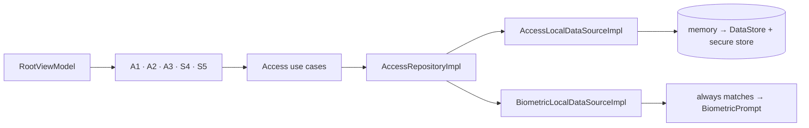
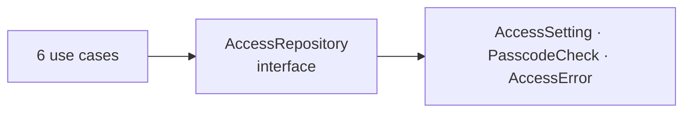

# F01 — Access and app lock

<dl><dd>

- Sprint [S0](README.md) · 17h · mirrors the iOS access code (`AccessRepository`, `AccessRepositoryImpl`, `AccessLocalDataSource`) so both apps behave the same.
- iOS twin: [iOS F01](https://github.com/DAMHONGDUC/site_log_swift_ui/blob/main/docs/feature-guide/S0-foundation-access/F01-access.md). Text rules: [F00 § User-facing text](F00-foundation.md#user-facing-text).

</dd></dl>

## Contents

<dl><dd>

1. [Overview](#overview)
2. [Target structure](#target-structure)
3. [1. Domain — access types and use cases](#1-domain--access-types-and-use-cases)
4. [2. Fake data — access data sources in memory](#2-fake-data--access-data-sources-in-memory)
5. [3. View models — wire the access screens](#3-view-models--wire-the-access-screens)
6. [4. Local — DataStore, Keystore and BiometricPrompt](#4-local--datastore-keystore-and-biometricprompt)
7. [Tests (after the feature works)](#tests-after-the-feature-works)
8. [Feature done](#feature-done)

</dd></dl>

## Overview

<dl><dd>

- **Goal:** A2 sign in (Continue offline), A1 biometric lock, A3 passcode, privacy (`FLAG_SECURE`), re-lock after *Lock after*, S4 app lock and S5 set passcode — on the real `AccessRepositoryImpl` from the start; data sources hold in-memory values first, DataStore + Keystore + `BiometricPrompt` in step 4.
- **Demo:** first launch → Continue offline → tabs; lock on → fingerprint/face or passcode; back after *Lock after* → locked again.
- **Spec:** [07.2 App lock](../../feature-docs/04-reporting-security.md#072-app-lock).
- **Device only:** Contract, Backend and Sync are `—`.

| Step | Layer | Hours | Status | What |
|---|---|---|---|---|
| [1](#1-domain--access-types-and-use-cases) | Domain | 1h | not start | `AccessSetting`, `PasscodeCheck`, `AccessError`, `AccessRepository`, use cases |
| [2](#2-fake-data--access-data-sources-in-memory) | Fake data | 2h | not start | Real `AccessRepositoryImpl` over in-memory data sources, bindings, dev menu |
| [3](#3-view-models--wire-the-access-screens) | View models | 6h | not start | `RootViewModel` + one view model per screen |
| [4](#4-local--datastore-keystore-and-biometricprompt) | Local | 8h | not start | DataStore, Keystore secure store, `BiometricPrompt` |
| — | Contract · Backend · Sync | — | — | Device only |



<details open>
<summary><strong>Flow</strong></summary>
<dl><dd>

| When | Screen |
|---|---|
| Startup ready, first launch | A2 Sign in → **Continue offline** |
| Lock off | Main tabs |
| Lock on + biometrics | A1 → match → main tabs · **Use app passcode** → A3 |
| Lock on, no biometrics | A3 → correct passcode → main tabs |
| Lock on, app in Recents | Blank thumbnail (`FLAG_SECURE`) |
| Back after ≥ *Lock after* | A1 or A3 again (measured with `AppClock.elapsedRealtimeMs`) |

</dd></dl>
</details>

</dd></dl>

## Target structure

<dl><dd>

```text
domain/src/main/kotlin/com/dd/sitelog/domain/
├── entities/access/AccessSetting.kt, PasscodeCheck.kt, AccessError.kt     # 1
├── repositories/AccessRepository.kt                                       # 1
└── usecases/access/ (6 files), usecases/devdata/ (2 files)                # 1 · 2
data/src/main/kotlin/com/dd/sitelog/data/
├── repositories/AccessRepositoryImpl.kt                                   # 2: real, never changes after
├── datasources/local/access/AccessLocalDataSource.kt + Impl               # 2: memory · 4: DataStore + secure store
├── datasources/local/biometrics/BiometricLocalDataSource.kt + Impl        # 2: always matches · 4: PlatformKit
├── models/local/AccessSettingModel.kt                                     # 2
└── mappers/AccessSettingMapper.kt                                         # 2
platformkit/src/main/kotlin/com/dd/sitelog/platformkit/
├── biometrics/BiometricAuthenticating.kt + BiometricAuthenticator.kt      # 4
├── activity/CurrentActivityProvider.kt                                    # 4
└── securestore/SecureStore.kt + KeystoreSecureStore.kt                    # 4
core/src/main/kotlin/com/dd/sitelog/core/crypto/PasscodeHasher.kt          # 4
app/src/main/java/com/dd/sitelog/
├── di/DataSourcesModule.kt, RepositoriesModule.kt, UseCasesModule.kt      # 2 · 4: PlatformModule.kt
├── presentation/root/RootScreen.kt, RootViewModel.kt                      # 3
├── presentation/access/signin/, biometriclock/, passcodeunlock/           # 3
└── presentation/settings/applock/, setpasscode/                           # 3
app/src/debug/java/com/dd/sitelog/
├── di/DevDataModule.kt                                                    # 2
└── devmenu/DevMenuViewModel.kt                                            # 2
```

</dd></dl>

## 1. Domain — access types and use cases

<dl><dd>

#### Overview

<dl><dd>

- **Goal:** the access vocabulary in `:domain`: settings, passcode answer, errors, one repository interface, one use case per action.

| File | Holds |
|---|---|
| `entities/access/AccessSetting.kt` | Welcome shown, lock on, biometrics on, *Lock after* |
| `entities/access/PasscodeCheck.kt` | `Correct` · `Wrong(triesLeft)` · `LockedOut(waitMs)` |
| `entities/access/AccessError.kt` | `StorageUnavailable` · `BiometricsUnavailable` |
| `repositories/AccessRepository.kt` | Interface; every method returns `Outcome<…, AccessError>` |
| `usecases/access/` | Load, save, mark welcome, check passcode, set passcode, unlock with biometrics |



- **Check:** `./gradlew :domain:build`; `:domain` has no Android import.

</dd></dl>

