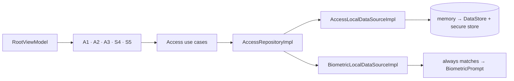
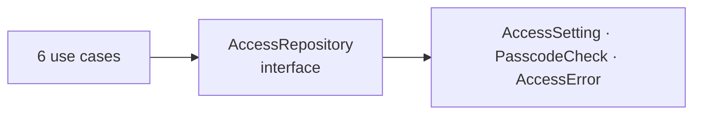
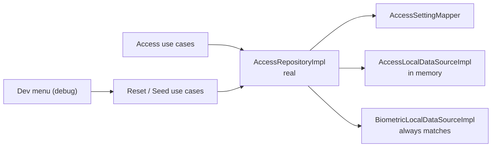

# F01 — Access and app lock

<dl><dd>

- Sprint [S0](README.md) · 17h · mirrors the iOS access code (`AccessRepository`, `AccessRepositoryImpl`, `AccessLocalDataSource`) so both apps behave the same.
- iOS twin: [iOS F01](https://github.com/DAMHONGDUC/site_log_swift_ui/blob/main/docs/feature-guide/S0-foundation-access/F01-access.md). Text rules: [F00 § User-facing text](F00-foundation.md#user-facing-text).

</dd></dl>

## Contents

<dl><dd>

1. [Overview](#overview)
2. [Target structure](#target-structure)
3. [1. Domain — access types and use cases](#1-domain--access-types-and-use-cases)
4. [2. Fake data — access data sources in memory](#2-fake-data--access-data-sources-in-memory)
5. [3. View models — wire the access screens](#3-view-models--wire-the-access-screens)
6. [4. Local — DataStore, Keystore and BiometricPrompt](#4-local--datastore-keystore-and-biometricprompt)
7. [Tests (after the feature works)](#tests-after-the-feature-works)
8. [Feature done](#feature-done)

</dd></dl>

## Overview

<dl><dd>

- **Goal:** A2 sign in (Continue offline), A1 biometric lock, A3 passcode, privacy (`FLAG_SECURE`), re-lock after *Lock after*, S4 app lock and S5 set passcode — on the real `AccessRepositoryImpl` from the start; data sources hold in-memory values first, DataStore + Keystore + `BiometricPrompt` in step 4.
- **Demo:** first launch → Continue offline → tabs; lock on → fingerprint/face or passcode; back after *Lock after* → locked again.
- **Spec:** [07.2 App lock](../../feature-docs/04-reporting-security.md#072-app-lock).
- **Device only:** Contract, Backend and Sync are `—`.

| Step | Layer | Hours | Status | What |
|---|---|---|---|---|
| [1](#1-domain--access-types-and-use-cases) | Domain | 1h | not start | `AccessSetting`, `PasscodeCheck`, `AccessError`, `AccessRepository`, use cases |
| [2](#2-fake-data--access-data-sources-in-memory) | Fake data | 2h | not start | Real `AccessRepositoryImpl` over in-memory data sources, bindings, dev menu |
| [3](#3-view-models--wire-the-access-screens) | View models | 6h | not start | `RootViewModel` + one view model per screen |
| [4](#4-local--datastore-keystore-and-biometricprompt) | Local | 8h | not start | DataStore, Keystore secure store, `BiometricPrompt` |
| — | Contract · Backend · Sync | — | — | Device only |



<details open>
<summary><strong>Flow</strong></summary>
<dl><dd>

| When | Screen |
|---|---|
| Startup ready, first launch | A2 Sign in → **Continue offline** |
| Lock off | Main tabs |
| Lock on + biometrics | A1 → match → main tabs · **Use app passcode** → A3 |
| Lock on, no biometrics | A3 → correct passcode → main tabs |
| Lock on, app in Recents | Blank thumbnail (`FLAG_SECURE`) |
| Back after ≥ *Lock after* | A1 or A3 again (measured with `AppClock.elapsedRealtimeMs`) |

</dd></dl>
</details>

</dd></dl>

## Target structure

<dl><dd>

```text
domain/src/main/kotlin/com/dd/sitelog/domain/
├── entities/access/AccessSetting.kt, PasscodeCheck.kt, AccessError.kt     # 1
├── repositories/AccessRepository.kt                                       # 1
└── usecases/access/ (6 files), usecases/devdata/ (2 files)                # 1 · 2
data/src/main/kotlin/com/dd/sitelog/data/
├── repositories/AccessRepositoryImpl.kt                                   # 2: real, never changes after
├── datasources/local/access/AccessLocalDataSource.kt + Impl               # 2: memory · 4: DataStore + secure store
├── datasources/local/biometrics/BiometricLocalDataSource.kt + Impl        # 2: always matches · 4: PlatformKit
├── models/local/AccessSettingModel.kt                                     # 2
└── mappers/AccessSettingMapper.kt                                         # 2
platformkit/src/main/kotlin/com/dd/sitelog/platformkit/
├── biometrics/BiometricAuthenticating.kt + BiometricAuthenticator.kt      # 4
├── activity/CurrentActivityProvider.kt                                    # 4
└── securestore/SecureStore.kt + KeystoreSecureStore.kt                    # 4
core/src/main/kotlin/com/dd/sitelog/core/crypto/PasscodeHasher.kt          # 4
app/src/main/java/com/dd/sitelog/
├── di/DataSourcesModule.kt, RepositoriesModule.kt, UseCasesModule.kt      # 2 · 4: PlatformModule.kt
├── presentation/root/RootScreen.kt, RootViewModel.kt                      # 3
├── presentation/access/signin/, biometriclock/, passcodeunlock/           # 3
└── presentation/settings/applock/, setpasscode/                           # 3
app/src/debug/java/com/dd/sitelog/
├── di/DevDataModule.kt                                                    # 2
└── devmenu/DevMenuViewModel.kt                                            # 2
```

</dd></dl>

## 1. Domain — access types and use cases

<dl><dd>

#### Overview

<dl><dd>

- **Goal:** the access vocabulary in `:domain`: settings, passcode answer, errors, one repository interface, one use case per action.

| File | Holds |
|---|---|
| `entities/access/AccessSetting.kt` | Welcome shown, lock on, biometrics on, *Lock after* |
| `entities/access/PasscodeCheck.kt` | `Correct` · `Wrong(triesLeft)` · `LockedOut(waitMs)` |
| `entities/access/AccessError.kt` | `StorageUnavailable` · `BiometricsUnavailable` |
| `repositories/AccessRepository.kt` | Interface; every method returns `Outcome<…, AccessError>` |
| `usecases/access/` | Load, save, mark welcome, check passcode, set passcode, unlock with biometrics |



- **Check:** `./gradlew :domain:build`; `:domain` has no Android import.

</dd></dl>

#### Build

<dl><dd>

<b>File</b> · <b class="tag-new">New</b> · `domain/src/main/kotlin/com/dd/sitelog/domain/entities/access/AccessSetting.kt`
The user's app-lock choices, as Domain sees them.

<details>
<summary><b>Code</b></summary>

```kotlin
package com.dd.sitelog.domain.entities.access

data class AccessSetting(
    val isShowWelcomeScreen: Boolean,
    val isLockOn: Boolean,
    val isBiometricOn: Boolean,
    val lockAfterMs: Long,
)
```

</details>

---

<b>File</b> · <b class="tag-new">New</b> · `domain/src/main/kotlin/com/dd/sitelog/domain/entities/access/PasscodeCheck.kt`
The answer to "is this passcode right?" — a business answer, not an error.

<details>
<summary><b>Code</b></summary>

```kotlin
package com.dd.sitelog.domain.entities.access

sealed interface PasscodeCheck {
    data object Correct : PasscodeCheck

    data class Wrong(val triesLeft: Int) : PasscodeCheck

    data class LockedOut(val waitMs: Long) : PasscodeCheck
}
```

</details>

---

<b>File</b> · <b class="tag-new">New</b> · `domain/src/main/kotlin/com/dd/sitelog/domain/entities/access/AccessError.kt`
What can go wrong in the access feature, in Domain words.

<details>
<summary><b>Code</b></summary>

```kotlin
package com.dd.sitelog.domain.entities.access

sealed interface AccessError {
    data object StorageUnavailable : AccessError

    data object BiometricsUnavailable : AccessError
}
```

</details>

---

<b>File</b> · <b class="tag-new">New</b> · `domain/src/main/kotlin/com/dd/sitelog/domain/repositories/AccessRepository.kt`
The boundary between access use cases and storage; `:data` implements it.

<details>
<summary><b>Code</b></summary>

```kotlin
package com.dd.sitelog.domain.repositories

import com.dd.sitelog.domain.Outcome
import com.dd.sitelog.domain.entities.access.AccessError
import com.dd.sitelog.domain.entities.access.AccessSetting
import com.dd.sitelog.domain.entities.access.PasscodeCheck

interface AccessRepository {
    suspend fun loadAccessSetting(): Outcome<AccessSetting, AccessError>

    suspend fun saveAccessSetting(newSetting: AccessSetting): Outcome<Unit, AccessError>

    suspend fun markWelcomeScreen(): Outcome<Unit, AccessError>

    suspend fun checkPasscode(inputPasscode: String): Outcome<PasscodeCheck, AccessError>

    suspend fun setPasscode(newPasscode: String): Outcome<Unit, AccessError>

    suspend fun unlockWithBiometrics(): Outcome<Boolean, AccessError>

    // Dev menu only: bound and called from the debug source set (A18)
    suspend fun resetAllData()

    suspend fun seedSampleData()
}
```

</details>

---

<b>File</b> · <b class="tag-new">New</b> · `domain/src/main/kotlin/com/dd/sitelog/domain/usecases/access/CheckPasscodeUseCase.kt`
One user action: check a typed passcode. The other five use cases have the same shape.

<b>Explain</b> · A use case is a class with one `invoke`, so a view model calls it like a function: `checkPasscodeUseCase(passcode)`.

<details>
<summary><b>Code</b></summary>

```kotlin
package com.dd.sitelog.domain.usecases.access

import com.dd.sitelog.domain.Outcome
import com.dd.sitelog.domain.entities.access.AccessError
import com.dd.sitelog.domain.entities.access.PasscodeCheck
import com.dd.sitelog.domain.repositories.AccessRepository

class CheckPasscodeUseCase(
    private val accessRepository: AccessRepository,
) {
    suspend operator fun invoke(inputPasscode: String): Outcome<PasscodeCheck, AccessError> {
        return accessRepository.checkPasscode(inputPasscode = inputPasscode)
    }
}
```

| File | Calls |
|---|---|
| `LoadAccessSettingUseCase.kt` | `loadAccessSetting()` |
| `SaveAccessSettingUseCase.kt` | `saveAccessSetting(newSetting)`; returns `Failure(BiometricsUnavailable)` when biometrics is on but the lock is off (business rule, D15) |
| `MarkWelcomeScreenUseCase.kt` | `markWelcomeScreen()` |
| `SetPasscodeUseCase.kt` | `setPasscode(newPasscode)` |
| `UnlockWithBiometricsUseCase.kt` | `unlockWithBiometrics()` |
| `devdata/ResetAllAccessDataUseCase.kt`, `SeedAccessDataUseCase.kt` | `resetAllData()`, `seedSampleData()` |

</details>

</dd></dl>

</dd></dl>

## 2. Fake data — access data sources in memory

<dl><dd>

#### Overview

<dl><dd>

- **Goal:** the real `AccessRepositoryImpl` — tries and lockout, mapping, `catch` → `Outcome`, logs — over two data sources holding in-memory values.
- **Rule:** fake data lives only in the data source `Impl`s; step 4 replaces their insides and nothing else.

| Layer | File | Job |
|---|---|---|
| Data · model | `models/local/AccessSettingModel.kt` | Stored shape (`@Serializable`, ready for DataStore) |
| Data · data source | `datasources/local/access/AccessLocalDataSource.kt` + `Impl` | Settings, passcode, wrong tries — in memory |
| Data · data source | `datasources/local/biometrics/BiometricLocalDataSource.kt` + `Impl` | Biometrics that always match after 0.5 s |
| Data · mapper | `mappers/AccessSettingMapper.kt` | Model ↔ entity |
| Data · repository | `repositories/AccessRepositoryImpl.kt` | Real: tries and lockout, mapping, errors, logs |
| App | `di/DataSourcesModule.kt`, `RepositoriesModule.kt`, `UseCasesModule.kt` | Bind each type once |
| App · debug | `debug/…/di/DevDataModule.kt`, `devmenu/` | Seed data, Delete all data |



- **Check:** `./gradlew assembleDebug`; dev menu → Delete all data brings back first launch.

</dd></dl>

#### Build

<dl><dd>

<b>File</b> · <b class="tag-new">New</b> · `data/src/main/kotlin/com/dd/sitelog/data/datasources/local/access/AccessLocalDataSource.kt`
Storage for the access flow; returns stored models, never entities; throws on failure.

<details>
<summary><b>Code</b></summary>

```kotlin
package com.dd.sitelog.data.datasources.local.access

import com.dd.sitelog.data.models.local.AccessSettingModel

interface AccessLocalDataSource {
    suspend fun loadSetting(): AccessSettingModel

    suspend fun saveSetting(model: AccessSettingModel)

    suspend fun verifyPasscode(inputPasscode: String): Boolean

    suspend fun savePasscode(newPasscode: String)

    suspend fun loadWrongTries(): Int

    suspend fun saveWrongTries(count: Int)

    suspend fun deleteAll()
}
```

</details>

---

<b>File</b> · <b class="tag-new">New</b> · `data/src/main/kotlin/com/dd/sitelog/data/datasources/local/access/AccessLocalDataSourceImpl.kt`
In-memory values until step 4; a `Mutex` keeps two coroutines from editing them at once.

<details>
<summary><b>Code</b></summary>

```kotlin
package com.dd.sitelog.data.datasources.local.access

import com.dd.sitelog.data.models.local.AccessSettingModel
import kotlinx.coroutines.sync.Mutex
import kotlinx.coroutines.sync.withLock

class AccessLocalDataSourceImpl : AccessLocalDataSource {
    private val mutex = Mutex()
    private var setting: AccessSettingModel = AccessSettingModel.firstLaunch()
    private var passcode: String? = null
    private var wrongTries: Int = 0

    override suspend fun loadSetting(): AccessSettingModel {
        return mutex.withLock { setting }
    }

    override suspend fun saveSetting(model: AccessSettingModel) {
        mutex.withLock {
            setting = model
        }
    }

    override suspend fun verifyPasscode(inputPasscode: String): Boolean {
        return mutex.withLock {
            val stored: String? = passcode
            if (stored == null) {
                false
            } else {
                stored == inputPasscode
            }
        }
    }

    override suspend fun savePasscode(newPasscode: String) {
        mutex.withLock {
            passcode = newPasscode
        }
    }

    override suspend fun loadWrongTries(): Int {
        return mutex.withLock { wrongTries }
    }

    override suspend fun saveWrongTries(count: Int) {
        mutex.withLock {
            wrongTries = count
        }
    }

    override suspend fun deleteAll() {
        mutex.withLock {
            setting = AccessSettingModel.firstLaunch()
            passcode = null
            wrongTries = 0
        }
    }
}
```

</details>

---

<b>File</b> · <b class="tag-new">New</b> · `data/src/main/kotlin/com/dd/sitelog/data/repositories/AccessRepositoryImpl.kt`
The real repository: counts wrong tries, maps models, turns every exception into `AccessError`, logs every action.

<b>Explain</b> · Same rules as iOS `AccessRepositoryImpl`. Each method: `try` the data source → `Outcome.Success`; `catch` → log → `Outcome.Failure`. `CancellationException` is rethrown so coroutines can cancel.

<details>
<summary><b>Hint</b></summary>

- Wrong tries: load, add 1, save; `triesLeft = FREE_TRIES - wrongTries`; above 0 → `Wrong`, else `LockedOut`.
- A helper `rethrowIfCancelled(exception)` keeps each `catch` short.
- A `logger` call that does not fit in 100 characters puts one argument per line.

</details>

<details>
<summary><b>Code</b></summary>

```kotlin
package com.dd.sitelog.data.repositories

import com.dd.sitelog.core.logger.AppLogger
import com.dd.sitelog.core.logger.LogCategory
import com.dd.sitelog.data.datasources.local.access.AccessLocalDataSource
import com.dd.sitelog.data.datasources.local.biometrics.BiometricLocalDataSource
import com.dd.sitelog.data.mappers.AccessSettingMapper
import com.dd.sitelog.domain.Outcome
import com.dd.sitelog.domain.entities.access.AccessError
import com.dd.sitelog.domain.entities.access.AccessSetting
import com.dd.sitelog.domain.entities.access.PasscodeCheck
import com.dd.sitelog.domain.repositories.AccessRepository
import kotlin.coroutines.cancellation.CancellationException

class AccessRepositoryImpl(
    private val accessLocalDataSource: AccessLocalDataSource,
    private val biometricLocalDataSource: BiometricLocalDataSource,
    private val logger: AppLogger,
) : AccessRepository {
    override suspend fun loadAccessSetting(): Outcome<AccessSetting, AccessError> {
        try {
            val model = accessLocalDataSource.loadSetting()
            val setting = AccessSettingMapper.toEntity(model)
            return Outcome.Success(setting)
        } catch (exception: Exception) {
            rethrowIfCancelled(exception)
            logger.error(
                LogCategory.ACCESS,
                "Load access setting failed → StorageUnavailable",
                exception,
            )
            return Outcome.Failure(AccessError.StorageUnavailable)
        }
    }

    override suspend fun saveAccessSetting(newSetting: AccessSetting): Outcome<Unit, AccessError> {
        try {
            val model = AccessSettingMapper.toModel(newSetting)
            accessLocalDataSource.saveSetting(model)
            logger.info(
                LogCategory.ACCESS,
                "Access setting saved — {lockOn: ${newSetting.isLockOn}}",
            )
            return Outcome.Success(Unit)
        } catch (exception: Exception) {
            rethrowIfCancelled(exception)
            logger.error(
                LogCategory.ACCESS,
                "Save access setting failed → StorageUnavailable",
                exception,
            )
            return Outcome.Failure(AccessError.StorageUnavailable)
        }
    }

    override suspend fun markWelcomeScreen(): Outcome<Unit, AccessError> {
        try {
            val model = accessLocalDataSource.loadSetting()
            accessLocalDataSource.saveSetting(model.copy(isShowWelcomeScreen = true))
            logger.info(LogCategory.ACCESS, "Welcome screen marked as shown")
            return Outcome.Success(Unit)
        } catch (exception: Exception) {
            rethrowIfCancelled(exception)
            logger.error(
                LogCategory.ACCESS,
                "Mark welcome screen failed → StorageUnavailable",
                exception,
            )
            return Outcome.Failure(AccessError.StorageUnavailable)
        }
    }

    override suspend fun checkPasscode(inputPasscode: String): Outcome<PasscodeCheck, AccessError> {
        try {
            val isCorrect: Boolean = accessLocalDataSource.verifyPasscode(inputPasscode)

            // correct
            if (isCorrect) {
                accessLocalDataSource.saveWrongTries(0)
                logger.info(LogCategory.ACCESS, "Passcode correct")
                return Outcome.Success(PasscodeCheck.Correct)
            }

            // wrong
            val wrongTries: Int = accessLocalDataSource.loadWrongTries() + 1
            accessLocalDataSource.saveWrongTries(wrongTries)
            val triesLeft: Int = FREE_TRIES - wrongTries
            if (triesLeft > 0) {
                logger.info(LogCategory.ACCESS, "Wrong passcode — {triesLeft: $triesLeft}")
                return Outcome.Success(PasscodeCheck.Wrong(triesLeft))
            }

            // lockout
            logger.info(LogCategory.ACCESS, "Passcode locked out — {waitMs: $LOCKOUT_WAIT_MS}")
            return Outcome.Success(PasscodeCheck.LockedOut(LOCKOUT_WAIT_MS))
        } catch (exception: Exception) {
            rethrowIfCancelled(exception)
            logger.error(
                LogCategory.ACCESS,
                "Check passcode failed → StorageUnavailable",
                exception,
            )
            return Outcome.Failure(AccessError.StorageUnavailable)
        }
    }

    override suspend fun setPasscode(newPasscode: String): Outcome<Unit, AccessError> {
        try {
            accessLocalDataSource.savePasscode(newPasscode)
            accessLocalDataSource.saveWrongTries(0)
            logger.info(LogCategory.ACCESS, "Passcode changed")
            return Outcome.Success(Unit)
        } catch (exception: Exception) {
            rethrowIfCancelled(exception)
            logger.error(LogCategory.ACCESS, "Set passcode failed → StorageUnavailable", exception)
            return Outcome.Failure(AccessError.StorageUnavailable)
        }
    }

    override suspend fun unlockWithBiometrics(): Outcome<Boolean, AccessError> {
        try {
            val isMatched: Boolean = biometricLocalDataSource.authenticate()
            logger.info(LogCategory.ACCESS, "Biometrics answered — {matched: $isMatched}")
            return Outcome.Success(isMatched)
        } catch (exception: Exception) {
            rethrowIfCancelled(exception)
            logger.error(LogCategory.ACCESS, "Biometrics failed → BiometricsUnavailable", exception)
            return Outcome.Failure(AccessError.BiometricsUnavailable)
        }
    }

    override suspend fun resetAllData() {
        try {
            accessLocalDataSource.deleteAll()
            logger.info(LogCategory.ACCESS, "Access data reset")
        } catch (exception: Exception) {
            rethrowIfCancelled(exception)
            logger.error(LogCategory.ACCESS, "Reset access data failed", exception)
        }
    }

