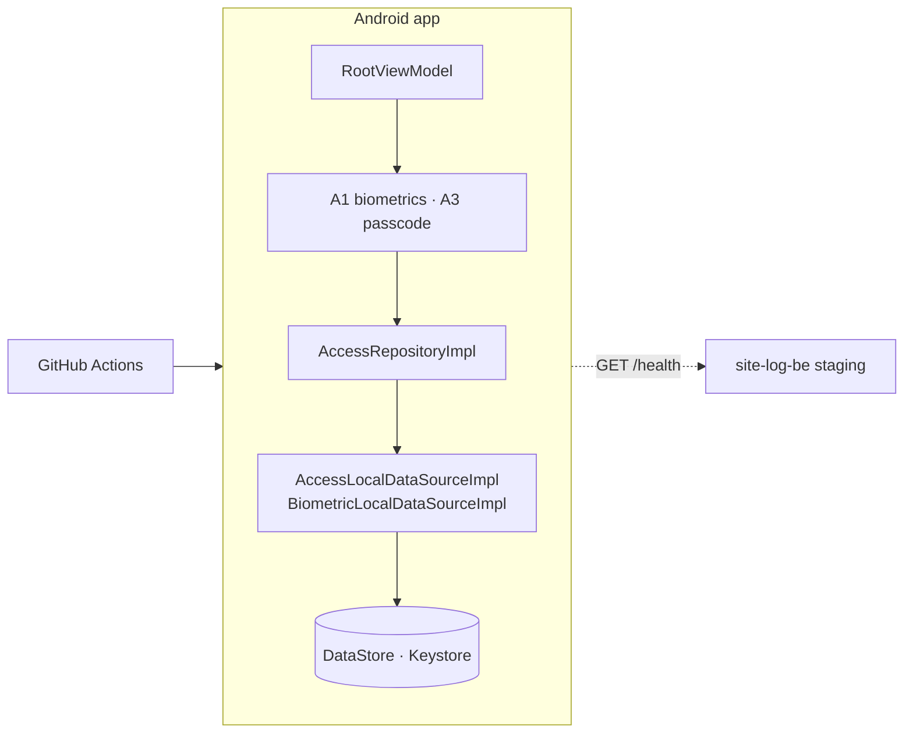

# S0 — Foundation and access

<dl><dd>

- Sprint 0 · 2 weeks · 58h · [all sprints](../README.md)

</dd></dl>

## Contents

<dl><dd>

1. [Overview](#overview)
2. [Tasks](#tasks)
3. [Done](#done)
4. [Self-check](#self-check)

</dd></dl>

## Overview

<dl><dd>

- **Goal:** the Android app builds, lints and tests in CI; every screen exists as a skeleton; the app opens behind biometrics or a passcode.
- **Demo — offline:** first launch → A2 → Continue offline → tabs; lock on → fingerprint/face or passcode; back after *Lock after* → locked again.
- **Demo — signed in:** not yet (auth is S1); the emulator reaches `GET /health` on staging.

| F | Feature | Guide | Hours |
|---|---|---|---|
| F00 | Foundation: modules, Hilt, CI, design system, skeleton | [F00-foundation.md](F00-foundation.md) | 41 |
| F01 | Access and app lock | [F01-access.md](F01-access.md) | 17 |

</dd></dl>

## Tasks

<dl><dd>

| Task | Step | Layer | Hours | Status |
|---|---|---|---|---|
| F00.0 | Gradle project, version catalog, `build-logic`, Spotless, detekt, entry point | Tooling | 8 | not start |
| F00.1 | Modules, Hilt, `AppClock`, `AppLogger`, `Outcome` | Architecture | 6 | not start |
| F00.2 | GitHub Actions PR checks | CI | 4 | not start |
| F00.3 | CI guards | CI | 4 | not start |
| F00.4 | Design system tokens, theme, gallery, tests | Design system | 6 | not start |
| F00.5 | Shared backend: check `/health` | Backend | 0 | not start |
| F00.6 | `API_BASE_URL` per build type, debug network security config | Config | 1 | not start |
| F00.7 | Skeleton screens, `FakeData`, tabs + coordinators, dev menu | UI | 12 | not start |
| F01.1 | Access types and use cases | Domain | 1 | not start |
| F01.2 | Repository + data sources in memory | Fake data | 2 | not start |
| F01.3 | Access view models (split: root · A1–A3 · S4–S5) | View models | 6 | not start |
| F01.4 | DataStore, Keystore, `BiometricPrompt` (split: storage · biometrics) | Local | 8 | not start |

</dd></dl>

## Done

<dl><dd>

- [ ] `./gradlew assembleDebug testDebugUnitTest lint detekt spotlessCheck` green with zero warnings; CI green on a PR
- [ ] Offline demo on a real phone; process death and relaunch keep the passcode, settings and lockout
- [ ] F00 and F01 tests written and green

</dd></dl>

## Self-check

<dl><dd>

- Draw the modules (`:app` → `:domain` ← `:data` → `:platformkit` → `:core`) and where `AccessRepositoryImpl` sits.
- Which file is the only one allowed to know `AccessLocalDataSourceImpl` exists?
- What changes between F01.2 and F01.4, and what must stay exactly the same?
- Why is `:domain` a plain Kotlin module and not an Android library?

</dd></dl>
