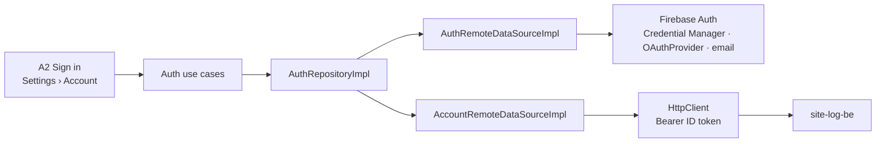
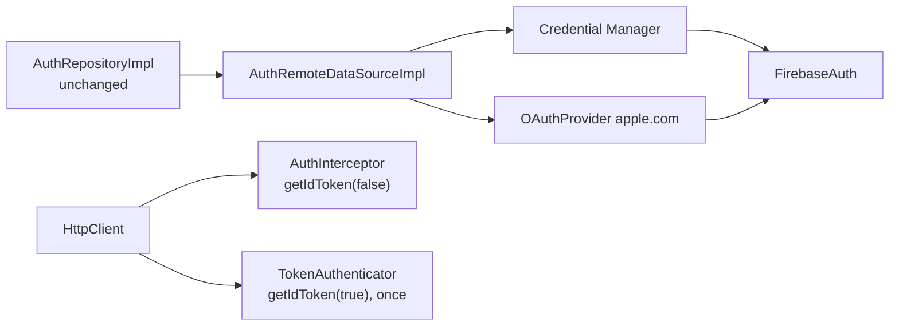

# F02 — Auth

<dl><dd>

- Sprint [S1](README.md) · 18h · skeleton guide — full code is added when this feature starts.
- iOS twin: [iOS F02](https://github.com/DAMHONGDUC/site_log_swift_ui/blob/main/docs/feature-guide/S1-auth-projects/F02-auth.md).

</dd></dl>

## Contents

<dl><dd>

1. [Overview](#overview)
2. [Target structure](#target-structure)
3. [1. Contract — token and account](#1-contract--token-and-account)
4. [2. Domain — auth types and use cases](#2-domain--auth-types-and-use-cases)
5. [3. Fake data — auth data sources in memory](#3-fake-data--auth-data-sources-in-memory)
6. [4. View models — sign in, account, sign out](#4-view-models--sign-in-account-sign-out)
7. [5. Local — Firebase Auth and HttpClient](#5-local--firebase-auth-and-httpclient)
8. [6. Backend — Firebase console and shared API](#6-backend--firebase-console-and-shared-api)
9. [Tests (after the feature works)](#tests-after-the-feature-works)
10. [Feature done](#feature-done)

</dd></dl>

## Overview

<dl><dd>

- **Goal:** sign in with Google, Apple or email next to Continue offline; every backend call carries a fresh ID token; the account can be deleted.
- **Demo — offline:** Continue offline still works; Settings › Account offers sign-in.
- **Demo — signed in:** A2 → Google → tabs; relaunch in airplane mode goes straight in; the same Apple ID signs in on the iPhone too.
- **Spec:** [08.1](../../feature-docs/02-upload-sync.md#081-offline-first-and-auth), [03-backend §5](../../feature-docs/03-backend.md#5-auth-and-account).
- **Starts from:** F01 (`SignInViewModel` with logging stubs) and the skeleton `settings/account/`.

| Step | Layer | Hours | Status | What |
|---|---|---|---|---|
| [1](#1-contract--token-and-account) | Contract | 1h | not start | Bearer token, `DeleteAccountDTO` |
| [2](#2-domain--auth-types-and-use-cases) | Domain | 1h | not start | `AuthUser`, `AuthProvider`, `AuthError`, `AuthRepository`, use cases |
| [3](#3-fake-data--auth-data-sources-in-memory) | Fake data | 1h | not start | Real `AuthRepositoryImpl` over in-memory data sources |
| [4](#4-view-models--sign-in-account-sign-out) | View models | 4h | not start | A2 sign-in, Account, sign out, delete account |
| [5](#5-local--firebase-auth-and-httpclient) | Local | 10h | not start | Firebase Auth, Credential Manager, `HttpClient` with token and 401 refresh |
| [6](#6-backend--firebase-console-and-shared-api) | Backend | 1h | not start | Android app in Firebase, SHA fingerprints |
| — | Sync | — | — | No synced table |



</dd></dl>

## Target structure

<dl><dd>

```text
domain/…/entities/auth/  repositories/AuthRepository.kt  usecases/auth/        # 2
data/…/models/remote/DeleteAccountDTO.kt                                       # 1
data/…/datasources/remote/auth/AuthRemoteDataSource.kt + Impl                  # 3: memory · 5: Firebase
data/…/datasources/remote/account/AccountRemoteDataSource.kt + Impl            # 3: memory · 5: HttpClient
data/…/repositories/AuthRepositoryImpl.kt                                      # 3
platformkit/…/networking/HttpClient.kt, TokenProviding.kt, HttpException.kt    # 5
app/…/presentation/access/signin/, settings/account/                           # 4
app/src/debug/google-services.json, app/src/release/google-services.json       # 5 (git-ignored)
```

</dd></dl>

## 1. Contract — token and account

<dl><dd>

#### Overview

<dl><dd>

- **Goal:** the shapes the app sends and receives for auth.

| Shape | Fields |
|---|---|
| Header | `Authorization: Bearer <Firebase ID token>` |
| `DeleteAccountDTO` | `deletedObjects`, `abortedUploads`, `deletedRows` |
| Error body | `{ error: { code, message } }` → `ErrorBodyDTO` |

- **Check:** DTOs decode the samples in [site-log-be 01-api §5](https://github.com/DAMHONGDUC/site-log-be/blob/main/docs/feature-docs/01-api.md).

</dd></dl>

</dd></dl>

## 2. Domain — auth types and use cases

<dl><dd>

#### Overview

<dl><dd>

| File | Holds |
|---|---|
| `entities/auth/AuthUser.kt` | `uid`, `displayName?`, `email?`, `provider` |
| `entities/auth/AuthProvider.kt` | `GOOGLE`, `APPLE`, `EMAIL` |
| `entities/auth/AuthError.kt` | `Cancelled`, `InvalidCredentials`, `Network`, `RecentLoginRequired`, `Unknown` |
| `repositories/AuthRepository.kt` | `currentUser()`, `observeUser(): Flow<AuthUser?>`, `signIn(provider)`, `signInWithEmail(email, password)`, `signOut()`, `deleteAccount()` |
| `usecases/auth/` | One use case per method |

- **Check:** `:domain` builds; no Firebase type anywhere in Domain.

</dd></dl>

</dd></dl>

## 3. Fake data — auth data sources in memory

<dl><dd>

#### Overview

<dl><dd>

- **Goal:** the real repository (mapping, `catch` → `Outcome`, logs) over data sources that pretend to sign in.

| File | Holds |
|---|---|
| `AuthRemoteDataSourceImpl` | Returns a fixed `AuthUserRecord` after 0.5 s; `Cancelled` when asked |
| `AccountRemoteDataSourceImpl` | Returns fixed deletion numbers |
| `AuthRepositoryImpl` | Real from now on |

- **Check:** A2 → Google (fake) → tabs; Account shows the fake user.

</dd></dl>

</dd></dl>

## 4. View models — sign in, account, sign out

<dl><dd>

#### Overview

<dl><dd>

| Screen | View model | Job |
|---|---|---|
| A2 Sign in | `SignInViewModel` | Google, Apple, email, Continue offline; errors as sentences |
| Settings › Account | `AccountViewModel` | User, sign out, delete account (numbers first, then reauthenticate) |
| Email sign-in | `EmailSignInViewModel` | Email + password form, validation |

- Google needs an `Activity` context for Credential Manager: the screen passes `LocalContext.current` as an `Activity` to a lambda the view model calls; the view model never stores it.
- **Check:** both paths reach the tabs; sign out returns to A2.

</dd></dl>

</dd></dl>

## 5. Local — Firebase Auth and HttpClient

<dl><dd>

#### Overview

<dl><dd>

- **Goal:** the data sources' insides become real Firebase Auth and HTTP; nothing above them changes.

| Action | File | Holds |
|---|---|---|
| <b class="tag-replace">Replace</b> | `AuthRemoteDataSourceImpl` | Google: Credential Manager `GetGoogleIdOption` → `GoogleAuthProvider.getCredential` → `signInWithCredential`; Apple: `OAuthProvider.newBuilder("apple.com")` → `startActivityForSignInWithProvider`; email: `signInWithEmailAndPassword` |
| <b class="tag-new">New</b> | `platformkit/networking/HttpClient.kt` | OkHttp; base URL and `TokenProviding` through the constructor; JSON with kotlinx.serialization; maps errors to `HttpException` |
| <b class="tag-new">New</b> | `platformkit/networking/AuthInterceptor.kt`, `TokenAuthenticator.kt` | Adds the bearer token; one shared refresh on 401 |
| <b class="tag-replace">Replace</b> | `AccountRemoteDataSourceImpl` | `DELETE /account` through `HttpClient` |
| <b class="tag-edit">Edit</b> | `SiteLogApplication.kt` | Firebase is initialised by the `google-services` plugin; Crashlytics step from F00 now real |
| <b class="tag-edit">Edit</b> | `gradle/libs.versions.toml`, `app/build.gradle.kts` | Firebase BoM, `firebase-auth`, Credential Manager; plugins `com.google.gms.google-services` and `com.google.firebase.crashlytics` (latest stable that day) |
| <b class="tag-new">New</b> | `app/src/debug/google-services.json.example`, `.github/workflows/pr-checks.yml` step | Dummy config committed; CI copies it to `google-services.json` before the build; the real files stay git-ignored |
| <b class="tag-edit">Edit</b> | `di/PlatformModule.kt` | `HttpClient(baseUrl = BuildConfig.API_BASE_URL, tokenProvider = …)` |



- **Check:** relaunch offline after sign-in goes straight in; a call with a revoked token refreshes once.

</dd></dl>

#### Steps

<dl><dd>

1. Token: `FirebaseAuth.currentUser?.getIdToken(false)?.await()` inside the interceptor; never stored by the app.
2. 401: the `Authenticator` refreshes with `getIdToken(true)` under a `Mutex`; ten parallel 401s cause one refresh.
3. Account deletion: reauthenticate with the same provider first (`RecentLoginRequired` otherwise), call `DELETE /account`, then wipe local data (later features add their wipes to `DeleteAccountUseCase`).
4. Sign out also clears the Coil cache (F06) and cancels upload work (F06).

</dd></dl>

</dd></dl>

## 6. Backend — Firebase console and shared API

<dl><dd>

#### Overview

<dl><dd>

| Piece | Action | Check |
|---|---|---|
| Firebase `sitelog-dev`, `sitelog-prod` | Add Android app `com.dd.sitelog`; download `google-services.json` | Build picks it up |
| SHA fingerprints | Add each developer's debug SHA-1/SHA-256 (`./gradlew signingReport`), the CI upload key, and Play App Signing's key (F07) | Google sign-in works on every machine |
| Apple provider | Already enabled for iOS; add the Android package to the Apple Services ID return URL if Firebase asks | Apple sign-in completes |
| `requireUser` on site-log-be | Shared, built by [site-log-be F02](https://github.com/DAMHONGDUC/site-log-be/blob/main/docs/feature-guide/S1-auth-projects/F02-auth.md) | A call without a token → `401` |

</dd></dl>

</dd></dl>

## Tests (after the feature works)

<dl><dd>

- Repository maps each Firebase failure to the right `AuthError` (data source double)
- `TokenAuthenticator`: 10 concurrent 401s → one refresh (`MockWebServer`)
- `AccountViewModel`: delete shows numbers before calling the use case
- Offline relaunch after sign-in → tabs

</dd></dl>

## Feature done

<dl><dd>

| Check | How |
|---|---|
| Demo | Google, Apple, email; Continue offline; offline relaunch after sign-in |
| Cross-platform | Same Apple ID on iPhone and Android → same `uid` |
| Roadmap | F02 steps ticked |

</dd></dl>
