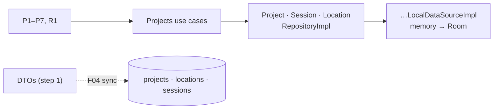
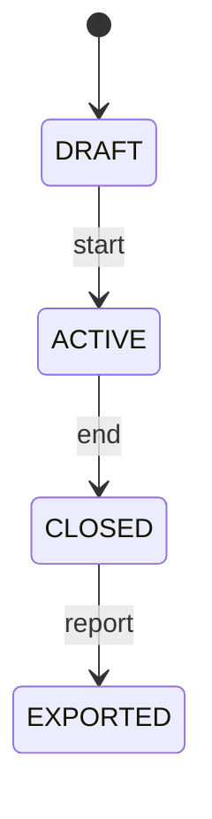
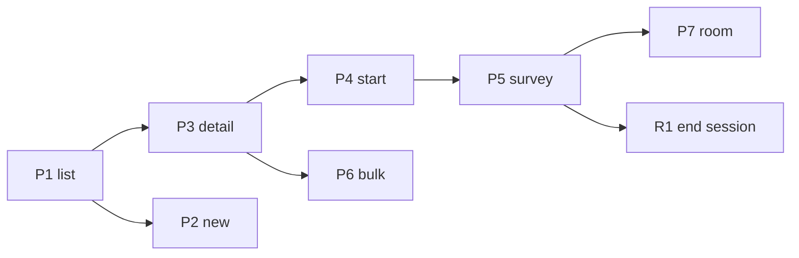
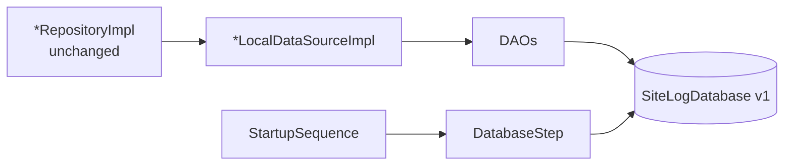

# F03 — Projects, sessions, locations

<dl><dd>

- Sprint [S1](README.md) · 32h · skeleton guide — full code is added when this feature starts.
- iOS twin: [iOS F03](https://github.com/DAMHONGDUC/site_log_swift_ui/blob/main/docs/feature-guide/S1-auth-projects/F03-projects.md).

</dd></dl>

## Contents

<dl><dd>

1. [Overview](#overview)
2. [Target structure](#target-structure)
3. [1. Contract — project, session, location DTOs](#1-contract--project-session-location-dtos)
4. [2. Domain — sync-ready entities, interfaces, use cases](#2-domain--sync-ready-entities-interfaces-use-cases)
5. [3. Fake data — data sources in memory](#3-fake-data--data-sources-in-memory)
6. [4. View models — wire the Projects screens](#4-view-models--wire-the-projects-screens)
7. [5. Local — Room](#5-local--room)
8. [6. Backend — shared](#6-backend--shared)
9. [Tests (after the feature works)](#tests-after-the-feature-works)
10. [Feature done](#feature-done)

</dd></dl>

## Overview

<dl><dd>

- **Goal:** projects, sessions and locations end to end on the phone, with every field the sync engine (F04) needs.
- **Demo — offline:** project → 80 generated locations → walkthrough, in airplane mode, kept after process death.
- **Demo — signed in:** the same flow; data moves between devices in F04.
- **Spec:** [01](../../feature-docs/01-field-work.md#01-projects-sessions-locations), [00 §3](../../feature-docs/00-overview.md#3-data-model), [03-backend §6.3](../../feature-docs/03-backend.md#63-synced-tables).

| Step | Layer | Hours | Status | What |
|---|---|---|---|---|
| [1](#1-contract--project-session-location-dtos) | Contract | 1h | not start | `@Serializable` DTOs |
| [2](#2-domain--sync-ready-entities-interfaces-use-cases) | Domain | 4h | not start | Entities, interfaces, use cases |
| [3](#3-fake-data--data-sources-in-memory) | Fake data | 2h | not start | Real repositories over in-memory data sources |
| [4](#4-view-models--wire-the-projects-screens) | View models | 10h | not start | Projects screens |
| [5](#5-local--room) | Local | 15h | not start | Room entities, DAOs, database v1, exported schema |
| [6](#6-backend--shared) | Backend | 0h | not start | Shared tables on staging |
| — | Sync | — | — | Done in F04 |



</dd></dl>

## Target structure

<dl><dd>

```text
domain/…/entities/projects/  repositories/  usecases/projects/            # 2
data/…/models/remote/ProjectDTO.kt, LocationDTO.kt, SessionDTO.kt         # 1
data/…/repositories/*RepositoryImpl.kt                                    # 3
data/…/mappers/                                                           # 1 · 3 · 5
data/…/datasources/local/persistence/*LocalDataSource.kt + Impl           # 3: memory · 5: Room DAOs
data/…/models/local/ProjectModel.kt, …Dao.kt, schema/SiteLogDatabase.kt   # 5
data/schemas/com.dd.sitelog.data.models.local.schema.SiteLogDatabase/1.json  # 5 (generated, committed)
app/…/presentation/projects/ projectlist/ newproject/ projectdetail/ startsession/
                             survey/ room/ bulklocations/ clonetree/ endsession/   # 4
```

</dd></dl>

## 1. Contract — project, session, location DTOs

<dl><dd>

#### Overview

<dl><dd>

| Row | Business fields | Sync fields (every row) |
|---|---|---|
| Project | `name`, `address`, `clientName`, `createdAt` | `id` (UUID string), `rev`, `clientUpdatedAt`, `deletedAt` |
| Location | `projectId`, `parentId`, `code`, `kind`, `sortIndex` | same |
| Session | `projectId`, `startedAt`, `endedAt`, `surveyorName`, `note`, `state` | same |

- `Instant` fields use the shared `IsoInstantSerializer` (milliseconds, `Z`); enums lowercase with `@SerialName`.
- **Check:** a DTO round-trips the JSON sample from site-log-be byte for byte (field order aside).

</dd></dl>

</dd></dl>

## 2. Domain — sync-ready entities, interfaces, use cases

<dl><dd>

#### Overview

<dl><dd>

| File | Holds |
|---|---|
| `entities/projects/` | `Project`, `Session` (state machine), `Location` (depth ≤ 3), `SyncState`; each with `id: UUID`, `updatedAt`, `deletedAt`, `syncState` |
| `repositories/` | `ProjectRepository`, `SessionRepository`, `LocationRepository` |
| `usecases/projects/` | `CreateProjectUseCase`, `StartSessionUseCase`, `EndSessionUseCase`, `GenerateLocationsUseCase`, `CloneLocationTreeUseCase`, `LoadSurveyRowsUseCase`, … |



</dd></dl>

#### Steps

<dl><dd>

1. `GenerateLocationsUseCase` is pure: `"{floor}-{unit:02}"` → preview (first 5, last 3, total); cap 2000; depth 3; duplicates rejected.
2. Survey rows come from one call that returns counts for all locations (`LocationRow`).
3. Repositories expose `Flow` reads (`observeProjects(): Flow<List<Project>>`) so lists update after a write without reloading.

</dd></dl>

</dd></dl>

## 3. Fake data — data sources in memory

<dl><dd>

#### Overview

<dl><dd>

| File | Holds |
|---|---|
| `datasources/local/persistence/<Noun>LocalDataSource.kt` + `Impl` | `MutableStateFlow<List<<Noun>Model>>` per aggregate until step 5 |
| `repositories/*RepositoryImpl.kt` | Real: rules, mapping, `catch` → `Outcome`, logs |
| `debug/di/DevDataModule.kt` | Seed: “Riverside Tower B”, 37 of 82 rooms, 4 sessions |

- **Check:** dev menu seeds and deletes; the walkthrough runs on seeded data.

</dd></dl>

</dd></dl>

## 4. View models — wire the Projects screens

<dl><dd>

#### Overview

<dl><dd>

| Folder | View model work |
|---|---|
| `projectlist/` | P1: projects + walkthrough in progress |
| `newproject/` | P2: create through `CreateProjectUseCase` |
| `projectdetail/` | P3: Sessions · Locations tabs, sentence summary (`@AssistedInject` with `projectId`) |
| `startsession/` | P4: start through `StartSessionUseCase` |
| `survey/` | P5: rooms per unit, filter chips, badge counts |
| `room/` | P7: room detail, photos, checklist row |
| `bulklocations/` | P6: template form + preview |
| `clonetree/` | Copy a location tree |
| `endsession/` | R1: session summary |



</dd></dl>

#### Steps

<dl><dd>

1. Each screen: `@HiltViewModel` with use cases in the constructor; a route id arrives through `@AssistedInject` + `hiltViewModel<VM, VM.Factory> { it.create(route.projectId) }`.
2. Pushes go through `LocalNavigationCoordinator.current.push(ProjectsRoute…)`.
3. Collect repository `Flow`s with `stateIn(viewModelScope, SharingStarted.WhileSubscribed(5_000), Loading)`.
4. Remove this feature's types from `fakes/FakeData.kt` once nothing uses them.
5. A 500-row survey `LazyColumn` uses `key` and stable rows; check with Layout Inspector recomposition counts.

</dd></dl>

</dd></dl>

## 5. Local — Room

<dl><dd>

#### Overview

<dl><dd>

- **Goal:** the data source `Impl`s keep their types and methods; inside they use Room DAOs.
- **Spec:** [00 §3.4](../../feature-docs/00-overview.md#34-schema-versioning).

| Action | File | Holds |
|---|---|---|
| <b class="tag-new">New</b> | `models/local/ProjectModel.kt`, `LocationModel.kt`, `SessionModel.kt` | `@Entity` with foreign keys `CASCADE`, unique `(projectId, code)` on locations |
| <b class="tag-new">New</b> | `models/local/ProjectDao.kt`, … | Suspend writes, `Flow` reads, one grouped count query |
| <b class="tag-new">New</b> | `models/local/schema/SiteLogDatabase.kt` | `@Database(version = 1, exportSchema = true)`, `TypeConverters` for `Instant`, `UUID`, enums |
| <b class="tag-replace">Replace</b> | `datasources/local/persistence/*LocalDataSourceImpl.kt` | Same types, now over DAOs; bulk generation in `withTransaction` |
| <b class="tag-new">New</b> | `app/…/startup/steps/DatabaseStep.kt` | Opens the database; blocks launch on failure |
| <b class="tag-edit">Edit</b> | `data/build.gradle.kts` | `id("sitelog.room")` |



- **Check:** process death keeps everything; `git diff` shows no change under `repositories/` or `presentation/`; `data/schemas/…/1.json` committed.

</dd></dl>

</dd></dl>

## 6. Backend — shared

<dl><dd>

| Backend piece | The app | Check |
|---|---|---|
| Tables `projects`, `locations`, `sessions` ([site-log-be F03](https://github.com/DAMHONGDUC/site-log-be/blob/main/docs/feature-guide/S1-auth-projects/F03-projects.md)) | DTO fields match | Nothing to call until F04 |

</dd></dl>

## Tests (after the feature works)

<dl><dd>

- Domain: `CLOSED` rejects `addCapture`; depth 4 rejected; generate: 1 floor, 1 unit, collisions, cap
- View models: bulk preview first 5 / last 3 / total (Turbine)
- Room (Robolectric, in-memory DB): cascade delete leaves no orphans; unique code per project
- Migration test harness ready (`MigrationTestHelper`), first real use at version 2

</dd></dl>

## Feature done

<dl><dd>

| Check | How |
|---|---|
| Demo | Airplane mode: project → 80 locations → walkthrough; `adb shell am kill` keeps everything |
| Tests | `./gradlew testDebugUnitTest` green |
| Roadmap | F03 steps ticked |

</dd></dl>
