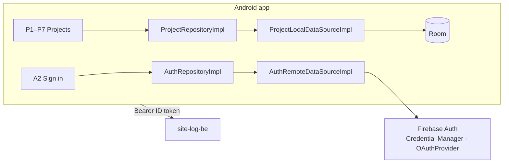

# S1 — Auth and projects

<dl><dd>

- Sprint 1 · 2 weeks · 50h · [all sprints](../README.md)

</dd></dl>

## Contents

<dl><dd>

1. [Overview](#overview)
2. [Tasks](#tasks)
3. [Done](#done)
4. [Self-check](#self-check)

</dd></dl>

## Overview

<dl><dd>

- **Goal:** real sign-in next to Continue offline; projects, sessions and locations stored in Room with sync-ready fields.
- **Demo — offline:** Continue offline → project → 80 generated locations → walkthrough; process death keeps everything.
- **Demo — signed in:** Sign in with Google, Apple or email → same flow; the same account works on the iOS app.

| F | Feature | Guide | Hours |
|---|---|---|---|
| F02 | Auth | [F02-auth.md](F02-auth.md) | 18 |
| F03 | Projects, sessions, locations | [F03-projects.md](F03-projects.md) | 32 |

</dd></dl>

## Tasks

<dl><dd>

| Task | Step | Layer | Hours | Status |
|---|---|---|---|---|
| F02.1 | Auth contract: token, account deletion | Contract | 1 | not start |
| F02.2 | Auth types and use cases | Domain | 1 | not start |
| F02.3 | Auth data sources in memory | Fake data | 1 | not start |
| F02.4 | Sign in, account, sign out view models | View models | 4 | not start |
| F02.5 | Firebase Auth inside the data source (split: Google · Apple · email · token) | Local | 10 | not start |
| F02.6 | Firebase console: Android app, SHA fingerprints | Backend | 1 | not start |
| F03.1 | Project, session, location DTOs | Contract | 1 | not start |
| F03.2 | Sync-ready entities, interfaces, use cases | Domain | 4 | not start |
| F03.3 | Repositories + data sources in memory | Fake data | 2 | not start |
| F03.4 | Projects view models (split: list · detail · survey · bulk) | View models | 10 | not start |
| F03.5 | Room entities, DAOs, database v1 (split: entities · DAOs · data sources) | Local | 15 | not start |
| F03.6 | Shared backend: project tables on staging | Backend | 0 | not start |

</dd></dl>

## Done

<dl><dd>

- [ ] Offline demo on a real phone in airplane mode
- [ ] Signed-in demo: Google, Apple and email; relaunch offline after sign-in goes straight in
- [ ] One account signs in on Android and iOS
- [ ] F02 and F03 tests written and green

</dd></dl>

## Self-check

<dl><dd>

- Why does every entity get a client-made `UUID` instead of a server id?
- Why does Google sign-in fail on a new laptop until you add its SHA-1?
- Projects are not synced yet in S1. Which fields already prepare them for S2?

</dd></dl>
