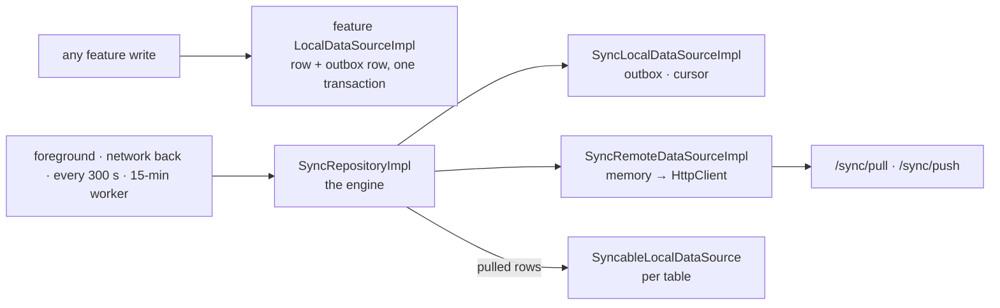

# F04 — Sync engine

<dl><dd>

- Sprint [S2](README.md) · 37h · skeleton guide — full code is added when this feature starts.
- iOS twin: [iOS F04](https://github.com/DAMHONGDUC/site_log_swift_ui/blob/main/docs/feature-guide/S2-sync-engine/F04-sync-engine.md).

</dd></dl>

## Contents

<dl><dd>

1. [Overview](#overview)
2. [Target structure](#target-structure)
3. [1. Contract — pull and push DTOs](#1-contract--pull-and-push-dtos)
4. [2. Domain — sync status and use cases](#2-domain--sync-status-and-use-cases)
5. [3. Fake data — engine over in-memory data sources](#3-fake-data--engine-over-in-memory-data-sources)
6. [4. View models — sync status and account](#4-view-models--sync-status-and-account)
7. [5. Local — outbox and cursor in Room](#5-local--outbox-and-cursor-in-room)
8. [6. Backend — shared](#6-backend--shared)
9. [7. Sync — real server, triggers, two devices](#7-sync--real-server-triggers-two-devices)
10. [Tests (after the feature works)](#tests-after-the-feature-works)
11. [Feature done](#feature-done)

</dd></dl>

## Overview

<dl><dd>

- **Goal:** one engine that moves every synced table between devices (Android and iOS); projects, sessions and locations go first.
- **Demo — offline:** edits queue in the outbox; the Sync tab says how many are waiting; process death keeps them.
- **Demo — signed in:** an Android phone and an iPhone on one account converge within one interval; deletes propagate; an exported session never reopens.
- **Spec:** [08.2](../../feature-docs/02-upload-sync.md#082-protocol), [08.3](../../feature-docs/02-upload-sync.md#083-client-engine), [03-backend §6](../../feature-docs/03-backend.md#6-sync).

| Step | Layer | Hours | Status | What |
|---|---|---|---|---|
| [1](#1-contract--pull-and-push-dtos) | Contract | 2h | not start | `/sync/pull`, `/sync/push` DTOs |
| [2](#2-domain--sync-status-and-use-cases) | Domain | 1h | not start | `SyncStatus`, `SyncRepository`, use cases |
| [3](#3-fake-data--engine-over-in-memory-data-sources) | Fake data | 18h | not start | Real engine over an in-memory outbox and server |
| [4](#4-view-models--sync-status-and-account) | View models | 3h | not start | Sync tab status, account |
| [5](#5-local--outbox-and-cursor-in-room) | Local | 6h | not start | Outbox and cursor tables; F03 data sources write outbox rows |
| [6](#6-backend--shared) | Backend | 0h | not start | Shared `/sync/*` |
| [7](#7-sync--real-server-triggers-two-devices) | Sync | 7h | not start | `HttpClient`, triggers, periodic work, convergence |



</dd></dl>

## Target structure

<dl><dd>

```text
domain/…/entities/sync/  repositories/SyncRepository.kt  usecases/sync/         # 2
data/…/models/remote/SyncPullRequestDTO.kt, SyncPullResponseDTO.kt, …          # 1
data/…/datasources/local/persistence/SyncLocalDataSource.kt + Impl             # 3 · 5
data/…/datasources/local/persistence/SyncableLocalDataSource.kt                # 3: interface every synced table implements
data/…/datasources/remote/sync/SyncRemoteDataSource.kt + Impl                  # 3: memory server · 7: HttpClient
data/…/repositories/SyncRepositoryImpl.kt                                      # 3: the engine
data/…/models/local/OutboxModel.kt, SyncCursorModel.kt                         # 5
app/…/di/SyncTablesModule.kt                                                   # 3: map table name → data source
app/…/sync/SyncWorker.kt, SyncTriggers.kt                                      # 7
```

</dd></dl>

## 1. Contract — pull and push DTOs

<dl><dd>

| DTO | Fields |
|---|---|
| `SyncPullRequestDTO` | `since`, `limit` |
| `SyncPullResponseDTO` | `changes: Map<String, List<JsonObject>>`, `nextRev`, `hasMore`, `resyncRequired?` |
| `SyncMutationDTO` | `table`, `id`, `op` (`upsert`/`delete`), `clientUpdatedAt`, `fields: JsonObject` |
| `SyncPushResponseDTO` | `results[] {id, status, serverRow?, reason?}`, `serverRev` |

</dd></dl>

## 2. Domain — sync status and use cases

<dl><dd>

| File | Holds |
|---|---|
| `entities/sync/SyncStatus.kt` | `waitingCount`, `lastSyncedAt?`, `state` (`IDLE/SYNCING/OFFLINE/FAILED`) |
| `entities/sync/SyncError.kt` | `Offline`, `Unauthorized`, `Server`, `ResyncRequired` |
| `usecases/sync/` | `SyncNowUseCase`, `ObserveSyncStatusUseCase`, `FullResyncUseCase` |

</dd></dl>

## 3. Fake data — engine over in-memory data sources

<dl><dd>

#### Overview

<dl><dd>

- **Goal:** the whole engine — ordering, batching, LWW adoption, tombstones, monotonic session state — written and debugged against an in-memory server, before any network.

| Piece | Holds |
|---|---|
| `SyncableLocalDataSource` | `tableName`, `applyPulled(rows: List<JsonObject>)`, `rowFor(id): JsonObject?`, `adoptServerRow(row)` |
| `SyncLocalDataSourceImpl` (memory) | Outbox list ordered by table dependency then `clientUpdatedAt`; cursor |
| `SyncRemoteDataSourceImpl` (memory) | A fake server: `rev` counter, LWW, tombstones, monotonic `sessions.state` |
| `SyncRepositoryImpl` | `Mutex`; pull → push → pull again if `serverRev` advanced; logs every cycle |

</dd></dl>

#### Steps (split into tasks)

<dl><dd>

1. Queue: dependency order `projects → locations → plan_sheets → sessions → captures → issues → issue_captures → annotations → checklist_*`.
2. Push: batches of 200; `applied` removes outbox rows; `superseded` adopts `serverRow`; `rejected` drops and logs.
3. Pull: pages of 500; apply each page and save `nextRev` in one transaction; `hasMore` → pull again.
4. Conflicts: LWW on `clientUpdatedAt`, tie by `id`; `sessions.state` never goes back.
5. Deletes: tombstones delete locally; `resyncRequired` → wipe synced rows, pull from 0.

</dd></dl>

</dd></dl>

## 4. View models — sync status and account

<dl><dd>

- Sync tab header: “12 changes waiting”, last sync time as a sentence; a **Sync now** button; offline is grey, never red.
- Account: “Signed in as …”, last sync, Full resync (debug only).

</dd></dl>

## 5. Local — outbox and cursor in Room

<dl><dd>

| Action | File | Holds |
|---|---|---|
| <b class="tag-new">New</b> | `models/local/OutboxModel.kt` | `id`, `table`, `rowId`, `op`, `clientUpdatedAt`, `order` |
| <b class="tag-new">New</b> | `models/local/SyncCursorModel.kt` | `nextRev` (one row) |
| <b class="tag-edit">Edit</b> | `SiteLogDatabase` | Version 2 + `AutoMigration(from = 1, to = 2)`; migration test |
| <b class="tag-edit">Edit</b> | F03 data source `Impl`s | Implement `SyncableLocalDataSource`; every write adds an outbox row in the same `withTransaction` |

- **Check:** outbox survives `adb shell am kill` and a reboot.

</dd></dl>

## 6. Backend — shared

<dl><dd>

| Backend piece | Check from Android |
|---|---|
| `sync_state`, `/sync/pull`, `/sync/push` ([site-log-be F04](https://github.com/DAMHONGDUC/site-log-be/blob/main/docs/feature-guide/S2-sync-engine/F04-sync.md)) | `MockWebServer` replay of real responses; staging pull returns `nextRev` |

</dd></dl>

## 7. Sync — real server, triggers, two devices

<dl><dd>

| Action | File | Holds |
|---|---|---|
| <b class="tag-replace">Replace</b> | `SyncRemoteDataSourceImpl` | `HttpClient.post("/sync/pull")`, `post("/sync/push")` |
| <b class="tag-new">New</b> | `app/…/sync/SyncTriggers.kt` | `ProcessLifecycleOwner` `ON_START`, `ConnectivityManager.NetworkCallback`, a 300 s ticker while started, outbox ≥ 200 |
| <b class="tag-new">New</b> | `app/…/sync/SyncWorker.kt` | `PeriodicWorkRequest` every 15 min, `CONNECTED`, unique `sync-periodic` |

- Never per write; a running cycle makes extra triggers no-ops (`Mutex.tryLock`).
- **Check:** create a project offline on Android → appears on the iPhone within one interval; delete on iPhone → gone on Android.

</dd></dl>

## Tests (after the feature works)

<dl><dd>

- Monotonic state across 16 pairs; LWW tie-break; tombstones never resurrect
- Stale cursor → resync; outbox order survives a new database instance
- `superseded` adoption; 200 mutations = one request; 201 = two
- `SyncRepositoryImpl` against the in-memory server and against `MockWebServer`

</dd></dl>

## Feature done

<dl><dd>

| Check | How |
|---|---|
| Demo | Android ↔ iOS convergence; delete propagation; exported session stays exported |
| Tests | `./gradlew testDebugUnitTest` green; coverage of the engine ≥ 85% |
| Roadmap | F04 steps ticked |

</dd></dl>
