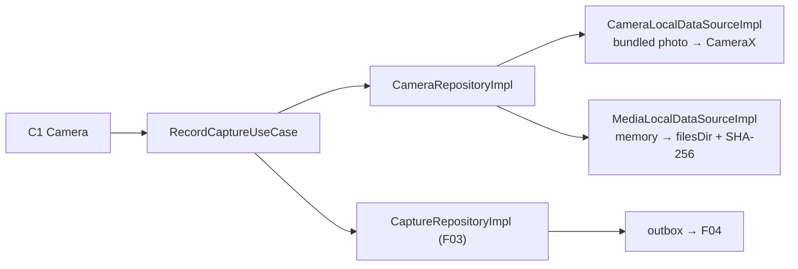
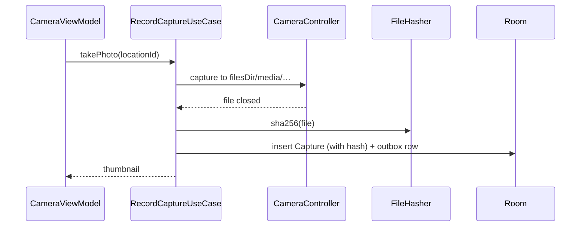

# F05 — Capture

<dl><dd>

- Sprint [S3](README.md) · 22h · skeleton guide — full code is added when this feature starts.
- iOS twin: [iOS F05](https://github.com/DAMHONGDUC/site_log_swift_ui/blob/main/docs/feature-guide/S3-capture-upload/F05-capture.md).

</dd></dl>

## Contents

<dl><dd>

1. [Overview](#overview)
2. [Target structure](#target-structure)
3. [1. Contract — capture DTO](#1-contract--capture-dto)
4. [2. Domain — record a capture](#2-domain--record-a-capture)
5. [3. Fake data — camera and media in memory](#3-fake-data--camera-and-media-in-memory)
6. [4. View models — wire the camera](#4-view-models--wire-the-camera)
7. [5. Local — CameraX, disk, SHA-256](#5-local--camerax-disk-sha-256)
8. [6. Backend — shared](#6-backend--shared)
9. [7. Sync — captures join the engine](#7-sync--captures-join-the-engine)
10. [Tests (after the feature works)](#tests-after-the-feature-works)
11. [Feature done](#feature-done)

</dd></dl>

## Overview

<dl><dd>

- **Goal:** a photo is captured, written, hashed and linked to a location — offline, before any upload exists.
- **Demo — offline:** airplane mode → project → location → photo with its hash; relaunch shows it.
- **Demo — signed in:** the capture row (not the bytes) appears on the second device; bytes come with F06.
- **Spec:** [02 Capture pipeline](../../feature-docs/01-field-work.md#02-capture-pipeline).
- **Starts from:** F03 (`Capture` entity, `CaptureRepository`) and F04.

| Step | Layer | Hours | Status | What |
|---|---|---|---|---|
| [1](#1-contract--capture-dto) | Contract | 1h | not start | `CaptureDTO` |
| [2](#2-domain--record-a-capture) | Domain | 1h | not start | `CameraRepository`, `RecordCaptureUseCase` |
| [3](#3-fake-data--camera-and-media-in-memory) | Fake data | 2h | not start | Real `CameraRepositoryImpl` over a bundled photo |
| [4](#4-view-models--wire-the-camera) | View models | 3h | not start | Camera and review screens |
| [5](#5-local--camerax-disk-sha-256) | Local | 14h | not start | CameraX, files, streamed SHA-256, location |
| [6](#6-backend--shared) | Backend | 0h | not start | Shared captures table |
| [7](#7-sync--captures-join-the-engine) | Sync | 1h | not start | Insert-only syncable table |



</dd></dl>

## Target structure

<dl><dd>

```text
domain/…/repositories/CameraRepository.kt, CaptureSource.kt              # 2
domain/…/usecases/capture/RecordCaptureUseCase.kt                        # 2
data/…/datasources/local/camera/CameraLocalDataSource.kt + Impl          # 3 · 5
data/…/datasources/local/filestorage/MediaLocalDataSource.kt + Impl      # 3 · 5
platformkit/…/camera/CameraController.kt, CaptureSessionControlling.kt   # 5
platformkit/…/location/LocationProviding.kt + FusedLocationProvider.kt   # 5
platformkit/…/permissions/PermissionChecking.kt                          # 5
core/…/crypto/FileHasher.kt                                              # 5
app/…/presentation/capture/camera/, capturereview/                       # 4
```

</dd></dl>

## 1. Contract — capture DTO

<dl><dd>

- Fields per [03-backend §6.3](../../feature-docs/03-backend.md#63-synced-tables): `id`, `sessionId`, `locationId`, `kind`, `objectKey?`, `sha256`, `byteSize`, `capturedAt`, `trustedTime` (JSON), `latitude?`, `longitude?`, `horizontalAccuracy?`, `deviceModel`, `durationMs?`, `isExcludedFromReport`, sync fields.
- Extensions from Android: `.jpg`, `.mp4`, `.m4a`.

</dd></dl>

## 2. Domain — record a capture

<dl><dd>

| File | Holds |
|---|---|
| `repositories/CameraRepository.kt` | `takePhoto(locationId): Outcome<CapturedFile, CaptureError>`, `startVideo`, `stopVideo` |
| `usecases/capture/RecordCaptureUseCase.kt` | Takes the file, builds the `Capture` (frozen fields), saves through `CaptureRepository`; rejects a `CLOSED` session |
| `entities/capture/CaptureError.kt` | `PermissionDenied`, `DiskFull`, `CameraUnavailable`, `WriteFailed` |

</dd></dl>

## 3. Fake data — camera and media in memory

<dl><dd>

- `CameraLocalDataSourceImpl` copies a bundled `res/raw/sample_photo.jpg` instead of opening the camera.
- `MediaLocalDataSourceImpl` keeps bytes in a map and returns a fixed hash.
- **Check:** the whole flow runs on the emulator with no camera permission.

</dd></dl>

## 4. View models — wire the camera

<dl><dd>

| Screen | View model | Job |
|---|---|---|
| C1 Camera | `CameraViewModel` | Mode (photo/video/audio), torch, zoom, flip, thumbnail strip, record timer |
| Capture review | `CaptureReviewViewModel` | Full image, metadata, exclude from report |

- The preview is a composable in `presentation/capture/camera/CameraPreview.kt` (`AndroidView { PreviewView }` or `CameraXViewfinder`); the view model never touches CameraX: it calls use cases, and the data source binds to the lifecycle passed in from the screen.

</dd></dl>

## 5. Local — CameraX, disk, SHA-256

<dl><dd>

#### Overview

<dl><dd>

| Action | File | Holds |
|---|---|---|
| <b class="tag-new">New</b> | `platformkit/camera/CameraController.kt` | Binds `Preview + ImageCapture + VideoCapture<Recorder>` once to a `LifecycleOwner`; state machine idle → ready → capturing/recording → finalizing |
| <b class="tag-new">New</b> | `platformkit/location/FusedLocationProvider.kt` | `getCurrentLocation` with a timeout; stale → `null` |
| <b class="tag-new">New</b> | `core/crypto/FileHasher.kt` | Streamed SHA-256, 1 MiB chunks |
| <b class="tag-replace">Replace</b> | `CameraLocalDataSourceImpl` | Writes to `filesDir/media/<project>/<session>/<capture>.jpg` through `ImageCapture.OutputFileOptions` |
| <b class="tag-replace">Replace</b> | `MediaLocalDataSourceImpl` | Hashes the closed file on `Dispatchers.IO`, returns relative path + size + hash |
| <b class="tag-edit">Edit</b> | `AndroidManifest.xml` | `CAMERA`, `RECORD_AUDIO`, `ACCESS_FINE_LOCATION`; `<uses-feature android:name="android.hardware.camera" android:required="false"/>` |



</dd></dl>

#### Steps

<dl><dd>

1. Permissions with `rememberLauncherForActivityResult(RequestPermission())`, one at a time, only when first needed.
2. Check free space (`StatFs(filesDir).availableBytes`) before video.
3. Interruption: on `ON_STOP` while recording, `recording.stop()` → finalize → hash → save.
4. Rotation: `OrientationEventListener` sets `targetRotation` on `ImageCapture` and `VideoCapture`.
5. Pre-record buffer ([02.3](../../feature-docs/01-field-work.md#023-pre-record-buffer)) is off by default: build it last in this step, after photo and video work.

</dd></dl>

</dd></dl>

## 6. Backend — shared

<dl><dd>

- `captures` table: [site-log-be F05](https://github.com/DAMHONGDUC/site-log-be/blob/main/docs/feature-guide/S3-capture-upload/F05-captures.md).

</dd></dl>

## 7. Sync — captures join the engine

<dl><dd>

- `CaptureLocalDataSourceImpl` implements `SyncableLocalDataSource`; insert-only (no `upsert` after the first push for frozen fields); added to `SyncTablesModule`.

</dd></dl>

## Tests (after the feature works)

<dl><dd>

- `FileHasher` against known vectors and a 200 MB file vs `sha256sum`
- State machine rejects recording during photo; interruption finalizes once
- Stale GPS → `null`; `CLOSED` session rejects
- All without a camera via `CaptureSessionControlling`

</dd></dl>

## Feature done

<dl><dd>

| Check | How |
|---|---|
| Demo | Airplane mode: photo with hash; relaunch shows it; denied location still captures |
| Tests | Green |
| Roadmap | F05 steps ticked |

</dd></dl>
