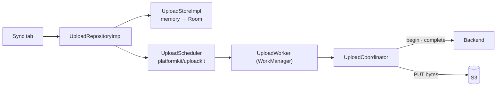
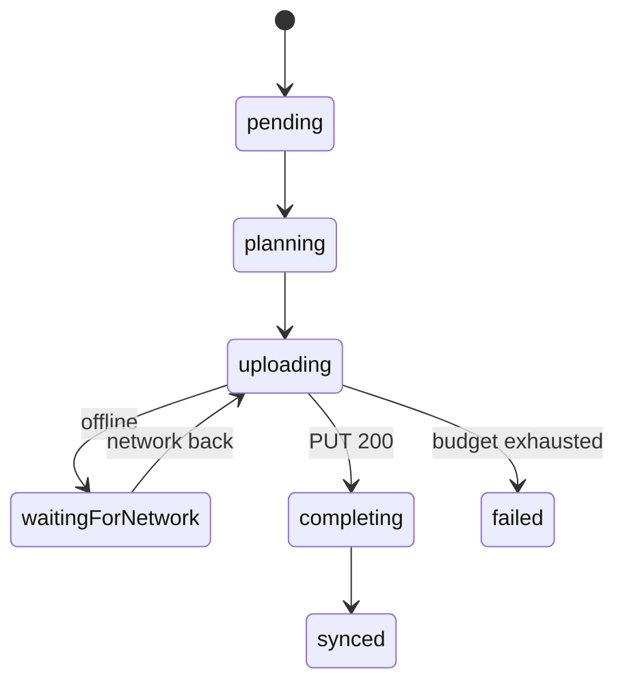

# F06 — Upload (single PUT)

<dl><dd>

- Sprint [S3](README.md) · 28h · skeleton guide — full code is added when this feature starts.
- iOS twin: [iOS F06](https://github.com/DAMHONGDUC/site_log_swift_ui/blob/main/docs/feature-guide/S3-capture-upload/F06-upload.md).

</dd></dl>

## Contents

<dl><dd>

1. [Overview](#overview)
2. [Target structure](#target-structure)
3. [1. Contract — begin and complete](#1-contract--begin-and-complete)
4. [2. Domain — uploadkit API and job types](#2-domain--uploadkit-api-and-job-types)
5. [3. Fake data — upload store in memory](#3-fake-data--upload-store-in-memory)
6. [4. View models — wire the Sync tab](#4-view-models--wire-the-sync-tab)
7. [5. Local — upload store on Room](#5-local--upload-store-on-room)
8. [6. Backend — shared](#6-backend--shared)
9. [7. Sync — WorkManager single PUT](#7-sync--workmanager-single-put)
10. [Tests (after the feature works)](#tests-after-the-feature-works)
11. [Feature done](#feature-done)

</dd></dl>

## Overview

<dl><dd>

- **Goal:** files under 5 MiB reach S3 through a WorkManager-driven upload that survives process death, and get a server-confirmed hash. Large files and resume are F07.
- **Demo — offline:** airplane mode → captures wait on the Sync tab with a plain reason; nothing is red.
- **Demo — signed in:** network back → photos upload with a progress notification; `adb shell am kill` mid-way → they still finish after WorkManager restarts the worker; the server's hash matches.
- **Spec:** [04 Upload engine](../../feature-docs/02-upload-sync.md#04-upload-engine), [03-backend §7](../../feature-docs/03-backend.md#7-uploads).

| Step | Layer | Hours | Status | What |
|---|---|---|---|---|
| [1](#1-contract--begin-and-complete) | Contract | 1h | not start | `BeginUploadDTO`, `CompleteUploadDTO` |
| [2](#2-domain--uploadkit-api-and-job-types) | Domain | 1h | not start | `uploadkit` records, states, `UploadStore` interface |
| [3](#3-fake-data--upload-store-in-memory) | Fake data | 2h | not start | `UploadStoreImpl` in memory; real `UploadRepositoryImpl` |
| [4](#4-view-models--wire-the-sync-tab) | View models | 6h | not start | Sync tab, today's files |
| [5](#5-local--upload-store-on-room) | Local | 4h | not start | Upload jobs and parts in Room |
| [6](#6-backend--shared) | Backend | 0h | not start | Shared upload endpoints |
| [7](#7-sync--workmanager-single-put) | Sync | 14h | not start | Worker, foreground info, state machine, backoff |



</dd></dl>

## Target structure

<dl><dd>

```text
platformkit/…/uploadkit/
├── UploadStore.kt  UploadJobRecord.kt  UploadPartRecord.kt  UploadJobState.kt   # 2
├── UploadStateMachine.kt  UploadCoordinator.kt  UploadTransport.kt               # 7
├── UploadWorker.kt  UploadScheduler.kt  UploadNotifications.kt                   # 7
data/…/models/remote/BeginUploadDTO.kt, CompleteUploadDTO.kt                      # 1
data/…/datasources/local/persistence/UploadStoreImpl.kt                           # 3 · 5
data/…/repositories/UploadRepositoryImpl.kt                                       # 3
app/…/presentation/sync/synctab/, todayfiles/                                     # 4
app/src/main/AndroidManifest.xml                                                  # 7: FGS dataSync, POST_NOTIFICATIONS
```

</dd></dl>

## 1. Contract — begin and complete

<dl><dd>

- `POST /uploads {key, byteSize, contentType, sha256}` → `{mode, uploadId, url, expiresAt}`; `POST /uploads/:id/complete {}` → `{remoteKey, sha256, verificationCode, verified, receivedAt}`; `409` with the same body is success.

</dd></dl>

## 2. Domain — uploadkit API and job types

<dl><dd>

- `uploadkit` lives in `:platformkit` and does not import `:domain`; its records (`UploadJobRecord`, `UploadPartRecord`, `UploadJobState`, `FailureReason`) are its own.
- Domain gets `UploadRepository` + `ObserveUploadSummaryUseCase` (counts, bytes, waiting reasons as enums) for the Sync tab.

</dd></dl>

## 3. Fake data — upload store in memory

<dl><dd>

- `UploadStoreImpl` keeps jobs in a `MutableStateFlow<Map<…>>`; the repository maps records to `UploadSummary` and reasons to Domain enums.
- **Check:** dev menu seeds 243 jobs in mixed states; the Sync tab shows "187/243 · 4 waiting · 2 failed".

</dd></dl>

## 4. View models — wire the Sync tab

<dl><dd>

| Screen | Job |
|---|---|
| U1 Sync tab | Progress per session, waiting reasons in plain words, Retry on failed, never red for waiting |
| Today's files | List with state chips; tap opens capture review |

- Reasons map: `WAITING_FOR_NETWORK` → “Waiting for Wi-Fi”, `WAITING_FOR_URL` → “Waiting for a new upload link”, deferred by WorkManager → “Will upload when the phone wakes up”.

</dd></dl>

## 5. Local — upload store on Room

<dl><dd>

- Tables `upload_jobs` (`id`, `captureId`, `filePath`, `byteSize`, `contentType`, `sha256`, `priority`, `state`, `attempt`, `uploadId?`, `remoteKey?`, `nextAttemptAt?`) and `upload_parts` (`jobId`, `number`, `url`, `expiresAt`, `etag?`, `state`).
- Database version bump + migration test.

</dd></dl>

## 6. Backend — shared

<dl><dd>

- Begin, idempotent `complete`, abort, media URLs: [site-log-be F06](https://github.com/DAMHONGDUC/site-log-be/blob/main/docs/feature-guide/S3-capture-upload/F06-upload.md).

</dd></dl>

## 7. Sync — WorkManager single PUT

<dl><dd>

#### Overview

<dl><dd>

| Action | File | Holds |
|---|---|---|
| <b class="tag-new">New</b> | `uploadkit/UploadStateMachine.kt` | Pure `reduce(state, event)` → new state + effects ([04.4](../../feature-docs/02-upload-sync.md#044-state-machine)) |
| <b class="tag-new">New</b> | `uploadkit/UploadTransport.kt` | OkHttp: begin/complete through the API client, PUT through a separate client with no auth header; exact `Content-Length` |
| <b class="tag-new">New</b> | `uploadkit/UploadCoordinator.kt` | Picks jobs by priority, `Semaphore(3)`, runs effects, persists every transition |
| <b class="tag-new">New</b> | `uploadkit/UploadWorker.kt` | `CoroutineWorker`: `setForeground(ForegroundInfo(…, FOREGROUND_SERVICE_TYPE_DATA_SYNC))`, runs the coordinator until the queue is empty or stopped |
| <b class="tag-new">New</b> | `uploadkit/UploadScheduler.kt` | `enqueueUniqueWork("upload-queue", KEEP, …)` with `CONNECTED` (Wi-Fi only: `UNMETERED`, F07) |
| <b class="tag-edit">Edit</b> | `AndroidManifest.xml` | `FOREGROUND_SERVICE`, `FOREGROUND_SERVICE_DATA_SYNC`, `POST_NOTIFICATIONS`; `SystemForegroundService` `foregroundServiceType="dataSync"` |
| <b class="tag-edit">Edit</b> | `SiteLogApplication` | Hilt `HiltWorkerFactory` through `Configuration.Provider`; remove WorkManager's default initializer in the manifest |



</dd></dl>

#### Steps

<dl><dd>

1. Capture saved → `UploadRepository.enqueue(captureId, priority)` → store row → `UploadScheduler.kick()`.
2. Worker: `isStopped` checked between steps; on stop, persist and return `Result.retry()`.
3. Backoff `min(2 s × 2^n, 300 s) × jitter(0.8…1.2)` with the injected `Random`; `nextAttemptAt` stored, the worker re-enqueues itself with `setInitialDelay`.
4. Notification channel `uploads`, low importance, progress “12 of 40 files”.
5. Log `{jobId, bytes, elapsedMs, attempt, status, reason}`; never the URL.

</dd></dl>

</dd></dl>

## Tests (after the feature works)

<dl><dd>

- State machine: full (state × event) matrix for single PUT; budget rules
- Coordinator with `InMemoryUploadStore` + fake transport: 503 then success; 403 → waiting for URL, no budget
- `TestListenableWorkerBuilder` runs `UploadWorker` with fakes
- `MockWebServer`: `complete` twice → same answer

</dd></dl>

## Feature done

<dl><dd>

| Check | How |
|---|---|
| Demo | Airplane mode → waiting; network back → uploaded; kill mid-way → finishes |
| Tests | Green |
| Roadmap | F06 steps ticked |

</dd></dl>
