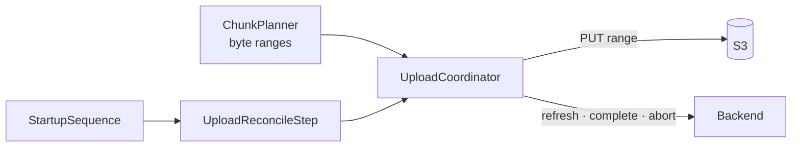

# F07 — Resumable upload · internal testing #1

<dl><dd>

- Sprint [S4](README.md) · 39h · skeleton guide — full code is added when this feature starts.
- iOS twin: [iOS F07](https://github.com/DAMHONGDUC/site_log_swift_ui/blob/main/docs/feature-guide/S4-resumable-upload/F07-resumable-upload.md).

</dd></dl>

## Contents

<dl><dd>

1. [Overview](#overview)
2. [Target structure](#target-structure)
3. [1. Contract — multipart, refresh, abort](#1-contract--multipart-refresh-abort)
4. [2. Backend — shared](#2-backend--shared)
5. [3. Sync — multipart and resume](#3-sync--multipart-and-resume)
6. [4. Sync — launch reconciliation](#4-sync--launch-reconciliation)
7. [5. Sync — Wi-Fi only, dedupe, URL refresh](#5-sync--wi-fi-only-dedupe-url-refresh)
8. [6. Sync — 200-file demo](#6-sync--200-file-demo)
9. [7. Release — signing and internal testing #1](#7-release--signing-and-internal-testing-1)
10. [Tests (after the feature works)](#tests-after-the-feature-works)
11. [Feature done](#feature-done)

</dd></dl>

## Overview

<dl><dd>

- **Goal:** files over 5 MiB upload in 8 MiB parts and resume part by part after process death, reboot, an expired URL or airplane mode; the first Play internal testing build ships.
- **Demo — offline:** 200 files queued in airplane mode, retry budget untouched; Wi-Fi only on mobile data sends zero bytes.
- **Demo — signed in:** 200 files / 2 GB finish with a kill and a reboot in the middle; internal testing installs from the Play Store.
- **Spec:** [04.2](../../feature-docs/02-upload-sync.md#042-protocol), [04.3](../../feature-docs/02-upload-sync.md#043-android-background-constraints), [04.5](../../feature-docs/02-upload-sync.md#045-policy), [17](../../feature-docs/05-platform.md#17-cicd-and-play-internal-testing).
- **Starts from:** F06 (store, worker, state machine, Sync tab).

| Step | Layer | Hours | Status | What |
|---|---|---|---|---|
| [1](#1-contract--multipart-refresh-abort) | Contract | 1h | not start | Multipart begin answer, refresh, abort |
| [2](#2-backend--shared) | Backend | 0h | not start | Shared multipart endpoints |
| [3](#3-sync--multipart-and-resume) | Sync | 14h | not start | `ChunkPlanner`, ranged PUT, complete with every ETag |
| [4](#4-sync--launch-reconciliation) | Sync | 8h | not start | WorkManager ↔ store at startup |
| [5](#5-sync--wi-fi-only-dedupe-url-refresh) | Sync | 5h | not start | Policy, proactive refresh |
| [6](#6-sync--200-file-demo) | Sync | 3h | not start | Real coordinator behind the screens |
| [7](#7-release--signing-and-internal-testing-1) | Release | 8h | not start | Upload key, Play App Signing, Fastlane lane |



</dd></dl>

## Target structure

<dl><dd>

```text
platformkit/…/uploadkit/ChunkPlanner.kt, FileRangeRequestBody.kt, UploadReconciler.kt   # 3 · 4
data/…/models/remote/MultipartPartDTO.kt, RefreshPartsDTO.kt                            # 1
app/…/startup/steps/UploadReconcileStep.kt                                              # 4
fastlane/Fastfile (android internal), Appfile                                           # 7
.github/workflows/release.yml                                                           # 7
```

</dd></dl>

## 1. Contract — multipart, refresh, abort

<dl><dd>

- Multipart begin: `partSizeBytes`, `parts[{number, url}]`, `expiresAt`; refresh: `{numbers}` → `parts[]`; abort: `DELETE /uploads/:id`.

</dd></dl>

## 2. Backend — shared

<dl><dd>

- [site-log-be F07](https://github.com/DAMHONGDUC/site-log-be/blob/main/docs/feature-guide/S4-resumable-upload/F07-multipart.md).

</dd></dl>

## 3. Sync — multipart and resume

<dl><dd>

#### Overview

<dl><dd>

| Piece | Holds |
|---|---|
| `ChunkPlanner` | `partSizeBytes` + file size → `[(number, offset, length)]`; last part shorter |
| `FileRangeRequestBody` | OkHttp `RequestBody`: `contentLength() = length`, `writeTo` seeks with `FileChannel.position(offset)` and copies `length` bytes |
| Coordinator | Up to `maxConnectionsPerHost` parts in flight per job; each 200 stores the part's ETag immediately |
| Complete | Only when every part has an ETag; a failed last part never calls `complete` |

- No temp part files: the range is streamed from the original file.
- **Check:** kill during part 7 of 30 → after restart, parts 1–6 are not re-sent (server logs, `MockWebServer` counts).

</dd></dl>

</dd></dl>

## 4. Sync — launch reconciliation

<dl><dd>

| WorkManager | Store | Action |
|---|---|---|
| Unique work enqueued/running | Jobs `UPLOADING`/`PENDING` | Keep |
| Work tagged with an unknown job | Missing | `cancelAllWorkByTag`, log |
| No work | Job `UPLOADING` | Reset to `PENDING`, `kick()` |

- Runs as `UploadReconcileStep` (non-blocking) in `StartupSequence`; also after `BOOT_COMPLETED` is not needed (WorkManager reschedules itself).
- A part URL past `expiresAt` → `refreshUrls` effect before any PUT.

</dd></dl>

## 5. Sync — Wi-Fi only, dedupe, URL refresh

<dl><dd>

- Wi-Fi only (default on): constraint `UNMETERED` + a check before each part; turning it off re-enqueues with `CONNECTED`.
- Dedupe: same `sha256` in a project with a `remoteKey` → mark `SYNCED`, no bytes.
- Proactive refresh 5 minutes before `expiresAt`; S3 `403` → `WAITING_FOR_URL`, no budget.
- Account switch: cancel unique work, `DELETE /uploads/:id` for open jobs, clear the store.

</dd></dl>

## 6. Sync — 200-file demo

<dl><dd>

- Debug dev menu: “Queue 200 sample files (2 GB)” copies a bundled clip; the Sync tab shows real numbers.

</dd></dl>

## 7. Release — signing and internal testing #1

<dl><dd>

| Piece | How |
|---|---|
| Upload key | `keytool -genkeypair` once; stored only as CI secrets (`ANDROID_KEYSTORE_BASE64`, `ANDROID_KEYSTORE_PASSWORD`, `ANDROID_KEY_ALIAS`, `ANDROID_KEY_PASSWORD`) and in the owner's password manager |
| Play App Signing | Enrolled when creating the app in Play Console; add its SHA-1/256 to Firebase (Google sign-in) |
| Service account | Play Console → API access → JSON key as secret `PLAY_SERVICE_ACCOUNT_JSON` |
| Lane | `fastlane android internal`: `gradle(task: "bundleRelease")`, `upload_to_play_store(track: "internal", aab: …)` |
| Workflow | Tag `v*` → `release.yml` (environment `play` with required reviewer) |

- **Check:** a tagged build appears in Play Console › Internal testing; testers install from the opt-in link; no keystore or JSON in git (`git log --all -- '*.jks' '*.json'`).

</dd></dl>

## Tests (after the feature works)

<dl><dd>

- `ChunkPlanner` sizes (0 B guard, exactly 8 MiB, 8 MiB + 1, 2 GB)
- `FileRangeRequestBody` writes exactly the range
- Full state × event matrix with multipart events; final part failure never calls `complete`
- All three reconciliation cases (`WorkManagerTestInitHelper`)
- Dedupe; priority order; `MockWebServer` 503 at part 3
- Device: kill and reboot during a 2 GB upload

</dd></dl>

## Feature done

<dl><dd>

| Check | How |
|---|---|
| Demo | 200 files / 2 GB with a kill and a reboot |
| Release | Internal testing #1 installed from the Play Store |
| Roadmap | F07 steps ticked |

</dd></dl>
