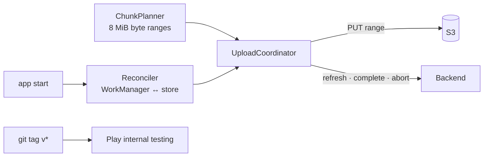

# S4 — Resumable upload · internal testing #1

<dl><dd>

- Sprint 4 · 2 weeks · 39h · [all sprints](../README.md)

</dd></dl>

## Contents

<dl><dd>

1. [Overview](#overview)
2. [Tasks](#tasks)
3. [Done](#done)
4. [Self-check](#self-check)

</dd></dl>

## Overview

<dl><dd>

- **Goal:** large files upload in 8 MiB parts and resume part by part after process death, reboot, expired URLs and airplane mode; first Play internal testing build.
- **Demo — offline:** 200 files queued in airplane mode; retry budget untouched.
- **Demo — signed in:** network back → 200 files / 2 GB finish with a kill and a reboot in the middle; the build installs from the Play Store internal track.

| F | Feature | Guide | Hours |
|---|---|---|---|
| F07 | Resumable upload · internal testing #1 | [F07-resumable-upload.md](F07-resumable-upload.md) | 39 |

</dd></dl>

## Tasks

<dl><dd>

| Task | Step | Layer | Hours | Status |
|---|---|---|---|---|
| F07.1 | Multipart plan, refresh, abort DTOs | Contract | 1 | not start |
| F07.2 | Shared backend: multipart endpoints | Backend | 0 | not start |
| F07.3 | Multipart and resume (split: planner · ranged upload · complete) | Sync | 14 | not start |
| F07.4 | Launch reconciliation | Sync | 8 | not start |
| F07.5 | Wi-Fi only, dedupe by hash, URL refresh | Sync | 5 | not start |
| F07.6 | 200-file demo behind the screens | Sync | 3 | not start |
| F07.7 | Signing and internal testing #1 (split: keys · lane) | Release | 8 | not start |

</dd></dl>

## Done

<dl><dd>

- [ ] 200 files / 2 GB complete with matching server hashes, with a kill and a reboot in the middle
- [ ] Airplane mode → waiting, budget intact; Wi-Fi only on mobile data sends zero bytes
- [ ] Internal testing #1 installed from the Play Store; the repo holds no keystore or service-account file
- [ ] F07 tests written and green

</dd></dl>

## Self-check

<dl><dd>

- Why does Android not need temp part files, while iOS does?
- After a kill, which three WorkManager/store combinations can exist, and what does each need?
- What happens to the queue when the user taps **Force stop**?

</dd></dl>
