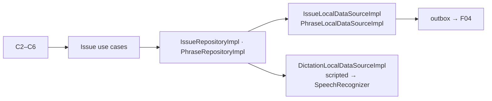

# F08 — Issues and before/after

<dl><dd>

- Sprint [S5](README.md) · 24h · skeleton guide — full code is added when this feature starts.
- iOS twin: [iOS F08](https://github.com/DAMHONGDUC/site_log_swift_ui/blob/main/docs/feature-guide/S5-issues-markup/F08-issues.md).

</dd></dl>

## Contents

<dl><dd>

1. [Overview](#overview)
2. [Target structure](#target-structure)
3. [1. Contract — issue DTOs](#1-contract--issue-dtos)
4. [2. Domain — issues, pairing, carry-over](#2-domain--issues-pairing-carry-over)
5. [3. Fake data — data sources in memory](#3-fake-data--data-sources-in-memory)
6. [4. View models — wire the issues screens](#4-view-models--wire-the-issues-screens)
7. [5. Local — Room and dictation](#5-local--room-and-dictation)
8. [6. Backend — shared](#6-backend--shared)
9. [7. Sync — issues join the engine](#7-sync--issues-join-the-engine)
10. [Tests (after the feature works)](#tests-after-the-feature-works)
11. [Feature done](#feature-done)

</dd></dl>

## Overview

<dl><dd>

- **Goal:** log an issue from the camera, surface it next session, close it by a verification photo as a before/after pair.
- **Demo — offline:** issue logged by voice → re-checked next session → closed; the pair shows on the issue.
- **Demo — signed in:** the issue and its pair appear on the second device.
- **Spec:** [03](../../feature-docs/01-field-work.md#03-issues-and-before-after-pairing), [12.3](../../feature-docs/01-field-work.md#123-dictation-and-voice-notes).

| Step | Layer | Hours | Status | What |
|---|---|---|---|---|
| [1](#1-contract--issue-dtos) | Contract | 1h | not start | `IssueDTO`, `IssueCaptureDTO`, `PhraseDTO` |
| [2](#2-domain--issues-pairing-carry-over) | Domain | 3h | not start | Entities, pure pairing, close, carry-over |
| [3](#3-fake-data--data-sources-in-memory) | Fake data | 3h | not start | Real repositories over in-memory data sources |
| [4](#4-view-models--wire-the-issues-screens) | View models | 7h | not start | Sheet, list, detail, verification camera, outcome |
| [5](#5-local--room-and-dictation) | Local | 8h | not start | Room, on-device `SpeechRecognizer` |
| [6](#6-backend--shared) | Backend | 0h | not start | Shared issues tables |
| [7](#7-sync--issues-join-the-engine) | Sync | 2h | not start | Three tables syncable |



</dd></dl>

## Target structure

<dl><dd>

```text
domain/…/entities/issues/  repositories/IssueRepository.kt, PhraseRepository.kt, DictationRepository.kt
domain/…/usecases/issues/  LogIssueUseCase, PairIssuesUseCase, CloseIssueByVerificationUseCase, CarryOverIssuesUseCase, …
data/…/models/remote/IssueDTO.kt, IssueCaptureDTO.kt, PhraseDTO.kt
data/…/datasources/local/persistence/IssueLocalDataSource.kt + Impl, PhraseLocalDataSource.kt + Impl
data/…/datasources/local/speech/DictationLocalDataSource.kt + Impl
platformkit/…/speech/SpeechRecognizing.kt + OnDeviceSpeechRecognizer.kt
app/…/presentation/issues/ issuesheet/ issuelist/ issuedetail/ verificationcamera/ outcome/
```

</dd></dl>

## 1. Contract — issue DTOs

<dl><dd>

- `issues` (with pin columns `planSheetId`, `pinX`, `pinY`), `issue_captures` (insert-only), `phrases` (same text merges) per [03-backend §6.3](../../feature-docs/03-backend.md#63-synced-tables).

</dd></dl>

## 2. Domain — issues, pairing, carry-over

<dl><dd>

| File | Holds |
|---|---|
| `entities/issues/Issue.kt`, `IssueSeverity.kt`, `IssueStatus.kt`, `IssuePairing.kt`, `PairingOutcome.kt` | Data classes and enums |
| `usecases/issues/PairIssuesUseCase.kt` | Pure: previous issues at a location + new verification → pairs |
| `usecases/issues/CloseIssueByVerificationUseCase.kt` | New issue `VERIFIED`; old `RESOLVED` with `resolvedByIssueId`; captures untouched |
| `usecases/issues/CarryOverIssuesUseCase.kt` | Open issues at a location from earlier sessions |
| `usecases/issues/UploadPriorityUseCase.kt` | critical 100 · major 50 · minor 10 · none 5 · video −20 |

</dd></dl>

## 3. Fake data — data sources in memory

<dl><dd>

- In-memory issues and ~30 seeded phrases; `DictationLocalDataSourceImpl` returns a scripted sentence after 1 s.

</dd></dl>

## 4. View models — wire the issues screens

<dl><dd>

| Screen | Job |
|---|---|
| Issue sheet (`ModalBottomSheet` over the camera) | Title, severity default `MAJOR`, assignee autocomplete, due date (+7 days), 🎤 dictate, 🔊 voice note, 📍 pin later (F11); Save returns to the camera |
| Issue list | By location or assignee; stale issues highlighted |
| Issue detail | Captures, pair, history |
| Verification camera | Prior photo at 30% alpha over the preview; outcome Resolved / Still open / Worse |

- Camera stays bound while the sheet is open (no rebind).

</dd></dl>

## 5. Local — Room and dictation

<dl><dd>

| Action | File | Holds |
|---|---|---|
| <b class="tag-new">New</b> | `IssueModel`, `IssueCaptureModel`, `PhraseModel` + DAOs | Version bump + migration |
| <b class="tag-replace">Replace</b> | `IssueLocalDataSourceImpl`, `PhraseLocalDataSourceImpl` | Room |
| <b class="tag-new">New</b> | `platformkit/speech/OnDeviceSpeechRecognizer.kt` | API 31+: `SpeechRecognizer.createOnDeviceSpeechRecognizer`; `EXTRA_LANGUAGE` `vi-VN`/`en-US`; partial results as a `Flow` |
| <b class="tag-replace">Replace</b> | `DictationLocalDataSourceImpl` | Uses the recognizer when `isOnDeviceRecognitionAvailable`, else throws `Unavailable` → the sheet shows the phrase library |

- `RECORD_AUDIO` permission requested on the first 🎤 tap.

</dd></dl>

## 6. Backend — shared

<dl><dd>

- [site-log-be F08](https://github.com/DAMHONGDUC/site-log-be/blob/main/docs/feature-guide/S5-issues-markup/F08-issues.md).

</dd></dl>

## 7. Sync — issues join the engine

<dl><dd>

- Three data sources implement `SyncableLocalDataSource`; added to `SyncTablesModule` in dependency order.

</dd></dl>

## Tests (after the feature works)

<dl><dd>

- Pairing with 0/1/n open issues; skips `VERIFIED`
- Closing never mutates prior captures
- Priority across severity × kind
- Delete-with-open-issues rejected; phrase ordering tie-break
- Dictation unavailable → phrase library state

</dd></dl>

## Feature done

<dl><dd>

| Check | How |
|---|---|
| Demo | Issue in under 20 s; carry-over offline; pair closes |
| Roadmap | F08 steps ticked |

</dd></dl>
