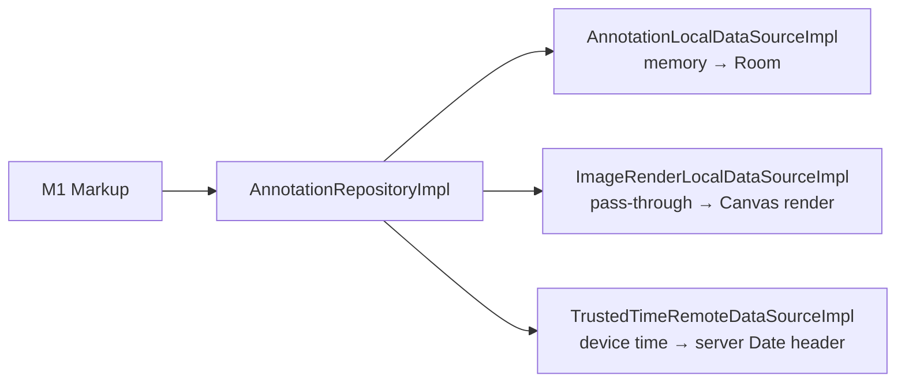

# F09 — Markup and stamps

<dl><dd>

- Sprint [S5](README.md) · 21h · skeleton guide — full code is added when this feature starts.
- iOS twin: [iOS F09](https://github.com/DAMHONGDUC/site_log_swift_ui/blob/main/docs/feature-guide/S5-issues-markup/F09-markup.md).

</dd></dl>

## Contents

<dl><dd>

1. [Overview](#overview)
2. [Target structure](#target-structure)
3. [1. Contract — annotation DTO](#1-contract--annotation-dto)
4. [2. Domain — annotation types](#2-domain--annotation-types)
5. [3. Fake data — data sources in memory](#3-fake-data--data-sources-in-memory)
6. [4. View models — markup and stamp](#4-view-models--markup-and-stamp)
7. [5. Local — vector rendering](#5-local--vector-rendering)
8. [6. Backend — shared](#6-backend--shared)
9. [7. Sync — annotations and trusted time](#7-sync--annotations-and-trusted-time)
10. [Tests (after the feature works)](#tests-after-the-feature-works)
11. [Feature done](#feature-done)

</dd></dl>

## Overview

<dl><dd>

- **Goal:** markup is a vector layer over the original photo; a stamped copy carries trusted time. The original is never touched.
- **Demo — offline:** mark up a photo; the original hash is unchanged; share a stamped copy with “device time” confidence.
- **Demo — signed in:** markup made on an iPhone renders the same on Android (and back); the stamp uses the server clock offset.
- **Spec:** [12](../../feature-docs/01-field-work.md#12-annotation-and-verifiable-stamps).

| Step | Layer | Hours | Status | What |
|---|---|---|---|---|
| [1](#1-contract--annotation-dto) | Contract | 1h | not start | `AnnotationDTO` |
| [2](#2-domain--annotation-types) | Domain | 1h | not start | `AnnotationShape`, `NormalizedPoint`, `TrustedTimestamp` |
| [3](#3-fake-data--data-sources-in-memory) | Fake data | 1h | not start | Real `AnnotationRepositoryImpl` |
| [4](#4-view-models--markup-and-stamp) | View models | 4h | not start | Markup editor, stamp preview |
| [5](#5-local--vector-rendering) | Local | 7h | not start | Compose canvas layer, stamped derivative |
| [6](#6-backend--shared) | Backend | 0h | not start | Shared annotations table |
| [7](#7-sync--annotations-and-trusted-time) | Sync | 7h | not start | Annotations syncable; clock offset |



</dd></dl>

## Target structure

<dl><dd>

```text
domain/…/entities/annotation/  AnnotationShape.kt, NormalizedPoint.kt, AnnotationStyle.kt, TrustedTimestamp.kt
domain/…/usecases/annotation/  SaveAnnotationUseCase, MakeStampedCopyUseCase, ComputeTimeConfidenceUseCase
data/…/models/remote/AnnotationDTO.kt
data/…/datasources/local/persistence/AnnotationLocalDataSource.kt + Impl
data/…/datasources/local/rendering/ImageRenderLocalDataSource.kt + Impl
data/…/datasources/remote/time/TrustedTimeRemoteDataSource.kt + Impl
platformkit/…/rendering/StampRenderer.kt, AnnotationRenderer.kt
app/…/presentation/annotation/markup/, stamp/
```

</dd></dl>

## 1. Contract — annotation DTO

<dl><dd>

- `id` = capture id; `shapes` = JSON array, the **same JSON as iOS**. Put one sample file (`annotation-sample.json`) in both repositories' tests.

</dd></dl>

## 2. Domain — annotation types

<dl><dd>

- `AnnotationShape` as a `@Serializable sealed interface` with `@SerialName` discriminators matching the iOS `Codable` output ([12.1](../../feature-docs/01-field-work.md#121-annotation-layer)).
- `ComputeTimeConfidenceUseCase` is pure: offset age, size, clock jump, boot count → `TimeConfidence`.

</dd></dl>

## 3. Fake data — data sources in memory

<dl><dd>

- Annotations in a map; the render data source returns the original file path; trusted time returns device time only.

</dd></dl>

## 4. View models — markup and stamp

<dl><dd>

| Screen | Job |
|---|---|
| M1 Markup | Tools Arrow (default), Box, Circle, Pen, Text; colour; undo (max 20); commit on exit |
| M2 Stamp preview | Stamped copy with time, GPS, project, location code, logo; Share |

- Editor state holds shapes in normalized coordinates; the composable converts with the image's displayed size.

</dd></dl>

## 5. Local — vector rendering

<dl><dd>

| Action | File | Holds |
|---|---|---|
| <b class="tag-new">New</b> | `presentation/annotation/markup/MarkupCanvas.kt` | Compose `Canvas` + `pointerInput(detectDragGestures)`; draws shapes scaled by `STROKE_WIDTH_RATIO` |
| <b class="tag-new">New</b> | `platformkit/rendering/AnnotationRenderer.kt` | Same drawing on `android.graphics.Canvas` for the stamp and the PDF |
| <b class="tag-new">New</b> | `platformkit/rendering/StampRenderer.kt` | Decodes the original at ≤ 2000 px (`ImageDecoder`), draws markup + stamp bar, writes JPEG to `filesDir/derived/` |
| <b class="tag-replace">Replace</b> | `AnnotationLocalDataSourceImpl` | Room `annotations` table (shapes as JSON text) |

- One renderer used twice (screen preview through Compose, files through `android.graphics`) must agree: a test renders both to bitmaps and compares a few pixels.

</dd></dl>

## 6. Backend — shared

<dl><dd>

- [site-log-be F09](https://github.com/DAMHONGDUC/site-log-be/blob/main/docs/feature-guide/S5-issues-markup/F09-annotations.md).

</dd></dl>

## 7. Sync — annotations and trusted time

<dl><dd>

- Annotations implement `SyncableLocalDataSource` (LWW).
- `HttpClient` reports each response's `Date` header; `TrustedTimeRemoteDataSourceImpl` stores `serverOffsetMs`, `offsetMeasuredAt`, `elapsedRealtime` and `Settings.Global.BOOT_COUNT` in DataStore.

</dd></dl>

## Tests (after the feature works)

<dl><dd>

- `AnnotationShape` JSON round-trip against the shared iOS sample
- Same render at two sizes; original file hash unchanged after markup and stamp
- Undo bounds
- Confidence: fresh/stale offset, clock jump, reboot, oversized offset
- Stamp position in three orientations

</dd></dl>

## Feature done

<dl><dd>

| Check | How |
|---|---|
| Demo | Markup + stamp offline; iOS markup on Android |
| Roadmap | F09 steps ticked |

</dd></dl>
