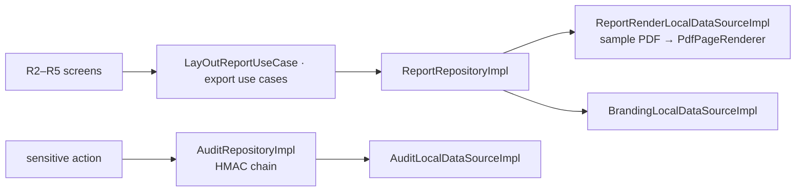
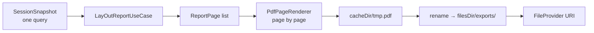

# F10 — Reports and audit log

<dl><dd>

- Sprint [S6](README.md) · 33h · skeleton guide — full code is added when this feature starts.
- iOS twin: [iOS F10](https://github.com/DAMHONGDUC/site_log_swift_ui/blob/main/docs/feature-guide/S6-reports-plans/F10-reports.md).

</dd></dl>

## Contents

<dl><dd>

1. [Overview](#overview)
2. [Target structure](#target-structure)
3. [1. Contract — verify and branding](#1-contract--verify-and-branding)
4. [2. Domain — report types, audit, pagination](#2-domain--report-types-audit-pagination)
5. [3. Fake data — data sources in memory](#3-fake-data--data-sources-in-memory)
6. [4. View models — the report flow](#4-view-models--the-report-flow)
7. [5. Local — CSV, PDF, audit chain](#5-local--csv-pdf-audit-chain)
8. [6. Backend — shared](#6-backend--shared)
9. [7. Sync — branding](#7-sync--branding)
10. [Tests (after the feature works)](#tests-after-the-feature-works)
11. [Feature done](#feature-done)

</dd></dl>

## Overview

<dl><dd>

- **Goal:** a signed, branded PDF and a CSV from one session snapshot; every sensitive action written to an HMAC-chained audit log.
- **Demo — offline:** session → report builder → branding → two signatures → PDF + CSV shared in airplane mode; the audit chain verifies at launch.
- **Demo — signed in:** branding appears on the second device; a code printed in the PDF resolves at `GET /verify/:code`.
- **Spec:** [05](../../feature-docs/04-reporting-security.md#05-pdf-and-spreadsheet-export), [07.3](../../feature-docs/04-reporting-security.md#073-audit-log), [03-backend §8](../../feature-docs/03-backend.md#8-verify).

| Step | Layer | Hours | Status | What |
|---|---|---|---|---|
| [1](#1-contract--verify-and-branding) | Contract | 1h | not start | `VerifyDTO`, `ReportBrandingDTO` |
| [2](#2-domain--report-types-audit-pagination) | Domain | 3h | not start | `ReportPage`, `AuditEntry`, `LayOutReportUseCase` |
| [3](#3-fake-data--data-sources-in-memory) | Fake data | 2h | not start | Sample PDF, in-memory branding and audit |
| [4](#4-view-models--the-report-flow) | View models | 4h | not start | Builder, branding, signatures, preview |
| [5](#5-local--csv-pdf-audit-chain) | Local | 21h | not start | CSV writer, `PdfDocument` renderer, audit storage and Keystore key |
| [6](#6-backend--shared) | Backend | 0h | not start | Shared branding table, verify |
| [7](#7-sync--branding) | Sync | 2h | not start | Branding syncable |



</dd></dl>

## Target structure

<dl><dd>

```text
domain/…/entities/reports/  ReportPage.kt, ReportBranding.kt, SessionSnapshot.kt, AuditEntry.kt, AuditAction.kt
domain/…/usecases/reports/  LayOutReportUseCase, ExportReportUseCase, SignReportUseCase, VerifyAuditChainUseCase
data/…/datasources/local/rendering/ReportRenderLocalDataSource.kt + Impl
data/…/datasources/local/persistence/BrandingLocalDataSource.kt + Impl, AuditLocalDataSource.kt + Impl
platformkit/…/rendering/pdf/PdfPageRenderer.kt, csv/CsvWriter.kt, xlsx/XlsxWriter.kt
platformkit/…/securestore/KeystoreHmac.kt
app/…/presentation/reports/ builder/ branding/ signatures/ preview/
app/src/main/res/xml/file_paths.xml                                  # FileProvider for sharing
```

</dd></dl>

## 1. Contract — verify and branding

<dl><dd>

- `VerifyDTO`: `code`, `sha256`, `byteSize`, `receivedAt`, `verifyState`, `verified`, `verifiedAt`, `projectRef`.
- `ReportBrandingDTO`: one row per user, `accentHex` `#RRGGBB`, logo key.

</dd></dl>

## 2. Domain — report types, audit, pagination

<dl><dd>

- `LayOutReportUseCase` is pure: `SessionSnapshot` + grouping → `List<ReportPage>`; it counts images, so the renderer cannot drop one.
- `AuditEntry` canonical form (fields joined in a fixed order, ISO times) is identical to iOS.

</dd></dl>

## 3. Fake data — data sources in memory

<dl><dd>

- The render data source returns a bundled `sample-report.pdf`; branding and audit entries live in memory.

</dd></dl>

## 4. View models — the report flow

<dl><dd>

| Screen | Job |
|---|---|
| R2 Builder | Sections on/off, grouping (location / assignee), estimated size |
| R3 Branding | Company, logo (photo picker for the logo only — it is not evidence), accent colour, footer |
| R4 Signatures | Two parties: name, role, pen pad (Compose `Canvas`) → PNG |
| R5 Preview & share | Progress while rendering; Share (`ACTION_SEND`) or Save to… (`CreateDocument`) |

- Signing sets the session `EXPORTED`; re-signing makes `-R2`.

</dd></dl>

## 5. Local — CSV, PDF, audit chain

<dl><dd>

#### Overview

<dl><dd>

| Task | Holds |
|---|---|
| CSV | `CsvWriter` streams rows with RFC 4180 escaping, UTF-8 BOM; XLSX above 5,000 rows as a minimal OOXML zip |
| Layout render | `PdfPageRenderer` draws one `ReportPage` per `PdfDocument.Page` on `Dispatchers.Default`; images decoded at ≤ 1400 px and recycled after the page |
| Integrity footer | Hash prefix, code + state, time confidence under each image; last page hash-of-hashes |
| Audit chain | `KeystoreHmac` (HMAC-SHA256 key in `AndroidKeyStore`, never exported); `audit_entries` Room table; `AuditVerifyStep` at startup (non-blocking) |



- Fonts: bundle Noto Sans (Vietnamese) in `:platformkit` `res/font/`; draw text with `StaticLayout`.
- **Check:** 200-image report under 200 MB peak on a 4 GB phone (Memory Profiler); opens in Drive and Acrobat.

</dd></dl>

</dd></dl>

## 6. Backend — shared

<dl><dd>

- Branding table and `GET /verify/:code`: [site-log-be F10](https://github.com/DAMHONGDUC/site-log-be/blob/main/docs/feature-guide/S6-reports-plans/F10-reports-verify.md).

</dd></dl>

## 7. Sync — branding

<dl><dd>

- `BrandingLocalDataSourceImpl` implements `SyncableLocalDataSource`; the logo uploads through the F06 queue.

</dd></dl>

## Tests (after the feature works)

<dl><dd>

- Image count; empty / 1 / 500 issues; 20-image issue paginates
- Missing file placeholder; hash-of-hashes order-stable
- Both groupings same total; CSV escaping; "not yet verified"
- 100-entry chain verifies; edit at 50 and deletion detected at the right index (Robolectric fake HMAC key)
- Instrumented: 200-image memory

</dd></dl>

## Feature done

<dl><dd>

| Check | How |
|---|---|
| Demo | Signed PDF + CSV shared offline; code resolves at `/verify` |
| Roadmap | F10 steps ticked |

</dd></dl>
