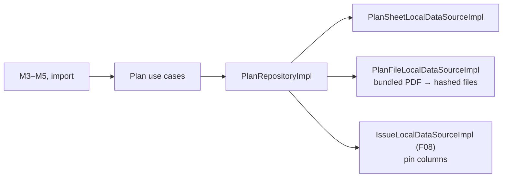

# F11 — Floor plans and pins

<dl><dd>

- Sprint [S6](README.md) · 19h · skeleton guide — full code is added when this feature starts.
- iOS twin: [iOS F11](https://github.com/DAMHONGDUC/site_log_swift_ui/blob/main/docs/feature-guide/S6-reports-plans/F11-plans.md).

</dd></dl>

## Contents

<dl><dd>

1. [Overview](#overview)
2. [Target structure](#target-structure)
3. [1. Contract — plan sheet DTO](#1-contract--plan-sheet-dto)
4. [2. Domain — plan types and pins](#2-domain--plan-types-and-pins)
5. [3. Fake data — data sources in memory](#3-fake-data--data-sources-in-memory)
6. [4. View models — the plans screens](#4-view-models--the-plans-screens)
7. [5. Local — import, tiles, pins](#5-local--import-tiles-pins)
8. [6. Backend — shared](#6-backend--shared)
9. [7. Sync — plan sheets and plan files](#7-sync--plan-sheets-and-plan-files)
10. [Tests (after the feature works)](#tests-after-the-feature-works)
11. [Feature done](#feature-done)

</dd></dl>

## Overview

<dl><dd>

- **Goal:** import PDF or image plans, view them tiled, pin each issue at one 0…1 point.
- **Demo — offline:** import a real PDF plan from Files, long-press to pin issues; pins survive relaunch.
- **Demo — signed in:** the sheet and its pins appear on the second device; the plan file uploads through F06.
- **Spec:** [11](../../feature-docs/01-field-work.md#11-floor-plans-and-issue-pins).

| Step | Layer | Hours | Status | What |
|---|---|---|---|---|
| [1](#1-contract--plan-sheet-dto) | Contract | 1h | not start | `PlanSheetDTO`, plan file key |
| [2](#2-domain--plan-types-and-pins) | Domain | 1h | not start | `PlanSheet`, `Pin`, import / pin / move use cases |
| [3](#3-fake-data--data-sources-in-memory) | Fake data | 1h | not start | Real `PlanRepositoryImpl` |
| [4](#4-view-models--the-plans-screens) | View models | 5h | not start | List, viewer, pin preview, import |
| [5](#5-local--import-tiles-pins) | Local | 9h | not start | SAF import, hashed files, `PdfRenderer` tiles, pins |
| [6](#6-backend--shared) | Backend | 0h | not start | Shared plan sheets table |
| [7](#7-sync--plan-sheets-and-plan-files) | Sync | 2h | not start | Sheets syncable; files through the upload queue |



</dd></dl>

## Target structure

<dl><dd>

```text
domain/…/entities/plans/  PlanSheet.kt, Pin.kt
domain/…/usecases/plans/  ImportPlanUseCase, PinIssueUseCase, MovePinUseCase, MigratePinsUseCase
data/…/datasources/local/persistence/PlanSheetLocalDataSource.kt + Impl
data/…/datasources/local/filestorage/PlanFileLocalDataSource.kt + Impl
platformkit/…/rendering/tiles/PlanTileRenderer.kt, TileCache.kt
app/…/presentation/plans/ planlist/ planviewer/ pinpreview/ planimport/
```

</dd></dl>

## 1. Contract — plan sheet DTO

<dl><dd>

- Fields per [03-backend §6.3](../../feature-docs/03-backend.md#63-synced-tables); key `{uid}/{projectId}/plans/{sheetId}.{pdf·jpg·png}`.

</dd></dl>

## 2. Domain — plan types and pins

<dl><dd>

- Pins live on the issue (`planSheetId`, `pinX`, `pinY` in 0…1); `MovePinUseCase` writes an audit entry; deleting a sheet with pins is rejected.

</dd></dl>

## 3. Fake data — data sources in memory

<dl><dd>

- A bundled `sample-plan.pdf` is “imported” on seed; pins in memory.

</dd></dl>

## 4. View models — the plans screens

<dl><dd>

| Screen | Job |
|---|---|
| M3 Plan list | Sheets per project, thumbnail, pin count |
| M4 Viewer | Pan/zoom, pins by severity, clusters below 2×, long-press to drop, tap to open |
| M5 Pin preview | Issue summary, move pin |
| Import | Pick file, choose PDF pages, name sheets |

</dd></dl>

## 5. Local — import, tiles, pins

<dl><dd>

| Task | Holds |
|---|---|
| Import | `ActivityResultContracts.OpenDocument(arrayOf("application/pdf", "image/*"))` → copy the stream into `filesDir/plans/` → hash → size cap 100 MB → `PdfRenderer` opens it (rejects encrypted with the reason) |
| Tiles | `PlanTileRenderer` renders a 512 px tile for (page, zoom level, x, y) with `Page.render(bitmap, null, matrix, RENDER_MODE_FOR_DISPLAY)`; `BitmapRegionDecoder` for images; `TileCache` in `cacheDir/plans/<sheet>/tiles/`, LRU in memory |
| Viewer | Compose `Canvas` draws the visible tiles for the current zoom; `transformable`/`detectTransformGestures` for pan/zoom; pins in an overlay `Layout` positioned from 0…1 |
| Pins | `pointerInput { detectTapGestures(onLongPress = …) }` → normalized point → `PinIssueUseCase` |

- `PdfRenderer` allows one open page at a time: tile rendering runs on one single-thread dispatcher.
- **Check:** A0 PDF peak memory under 150 MB; 50 pins scroll smoothly.

</dd></dl>

## 6. Backend — shared

<dl><dd>

- [site-log-be F11](https://github.com/DAMHONGDUC/site-log-be/blob/main/docs/feature-guide/S6-reports-plans/F11-plans.md).

</dd></dl>

## 7. Sync — plan sheets and plan files

<dl><dd>

- Sheets syncable; plan files enqueued in the upload queue at priority 1; a second device fetches the file through `POST /media/urls` and caches it in `filesDir/plans/`.

</dd></dl>

## Tests (after the feature works)

<dl><dd>

- Normalized point round-trip through zoom and pan; same point at two scales
- Clustering; oversized and encrypted imports rejected
- Pin migration; sheet delete blocked while pins exist

</dd></dl>

## Feature done

<dl><dd>

| Check | How |
|---|---|
| Demo | Real PDF plan, pins survive relaunch, second device sees them |
| Roadmap | F11 steps ticked |

</dd></dl>
