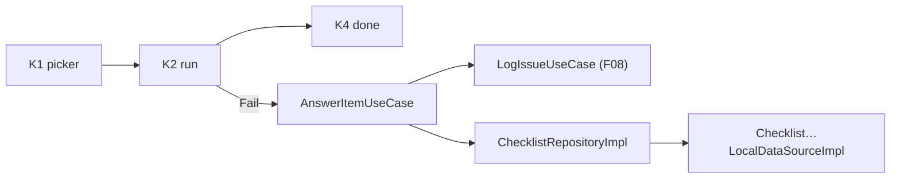

# F12 — Checklists

<dl><dd>

- Sprint [S7](README.md) · 12h · skeleton guide — full code is added when this feature starts.
- iOS twin: [iOS F12](https://github.com/DAMHONGDUC/site_log_swift_ui/blob/main/docs/feature-guide/S7-checklists-devices-diagnostics/F12-checklists.md).

</dd></dl>

## Contents

<dl><dd>

1. [Overview](#overview)
2. [Target structure](#target-structure)
3. [1. Contract — checklist DTOs](#1-contract--checklist-dtos)
4. [2. Domain — checklist types](#2-domain--checklist-types)
5. [3. Fake data — data sources in memory](#3-fake-data--data-sources-in-memory)
6. [4. View models — the checklists screens](#4-view-models--the-checklists-screens)
7. [5. Local — templates and results](#5-local--templates-and-results)
8. [6. Backend — shared](#6-backend--shared)
9. [7. Sync — checklists join the engine](#7-sync--checklists-join-the-engine)
10. [Tests (after the feature works)](#tests-after-the-feature-works)
11. [Feature done](#feature-done)

</dd></dl>

## Overview

<dl><dd>

- **Goal:** pick a template, answer one tap per item, and every Fail opens one prefilled issue.
- **Demo — offline:** “Finishing handover” in a room → “14 of 22” → a Fail creates one issue → done sentence.
- **Demo — signed in:** the run and its results appear on the second device.
- **Spec:** [13](../../feature-docs/01-field-work.md#13-checklist-templates).

| Step | Layer | Hours | Status | What |
|---|---|---|---|---|
| [1](#1-contract--checklist-dtos) | Contract | 1h | not start | Template, item, run, result DTOs |
| [2](#2-domain--checklist-types) | Domain | 1h | not start | Types; `AnswerItemUseCase` (Fail → issue) |
| [3](#3-fake-data--data-sources-in-memory) | Fake data | 1h | not start | Real `ChecklistRepositoryImpl` |
| [4](#4-view-models--the-checklists-screens) | View models | 4h | not start | Picker, run, done |
| [5](#5-local--templates-and-results) | Local | 4h | not start | Built-ins seeded in Room; results |
| [6](#6-backend--shared) | Backend | 0h | not start | Shared checklist tables |
| [7](#7-sync--checklists-join-the-engine) | Sync | 1h | not start | Four tables syncable |



</dd></dl>

## Target structure

<dl><dd>

```text
domain/…/entities/checklists/  usecases/checklists/  AnswerItemUseCase, StartRunUseCase, ForkTemplateUseCase, ImportTemplateUseCase
data/…/datasources/local/persistence/ChecklistTemplateLocalDataSource.kt + Impl, ChecklistRunLocalDataSource.kt + Impl
app/src/main/assets/checklists/builtin-*.json                 # built-in templates (same JSON as iOS)
app/…/presentation/checklists/ picker/ run/ done/ templateeditor/
```

</dd></dl>

## 1. Contract — checklist DTOs

<dl><dd>

- Four tables per [03-backend §6.3](../../feature-docs/03-backend.md#63-synced-tables); one live result per `(runId, templateItemId)`.

</dd></dl>

## 2. Domain — checklist types

<dl><dd>

- `AnswerItemUseCase`: Pass/Fail/N/A; Fail creates one issue (item text, default severity) through `LogIssueUseCase`; Fail → Pass resolves that issue.

</dd></dl>

## 3. Fake data — data sources in memory

<dl><dd>

- Built-in templates loaded from the bundled JSON into memory.

</dd></dl>

## 4. View models — the checklists screens

<dl><dd>

| Screen | Job |
|---|---|
| K1 Picker | Recent first, then built-ins; applies-to filter |
| K2 Run | One row per item with segmented `[✓ Pass] [✕ Fail] [– N/A]`; progress “14/22” in the top bar; Fail opens camera if required, then the issue sheet |
| K4 Done | A sentence summary; finish only at 100% answered |

</dd></dl>

## 5. Local — templates and results

<dl><dd>

- Room tables from [13](../../feature-docs/01-field-work.md#13-checklist-templates); built-ins copied from `assets/` on first database open (a `RoomDatabase.Callback`), flagged `isBuiltIn`; editing a built-in forks a copy.

</dd></dl>

## 6. Backend — shared

<dl><dd>

- [site-log-be F12](https://github.com/DAMHONGDUC/site-log-be/blob/main/docs/feature-guide/S7-checklists/F12-checklists.md).

</dd></dl>

## 7. Sync — checklists join the engine

<dl><dd>

- Four data sources implement `SyncableLocalDataSource`, in dependency order.

</dd></dl>

## Tests (after the feature works)

<dl><dd>

- Fail creates one issue with item text and severity; Fail → Pass resolves it
- Template edit does not alter runs; completion percentage
- JSON import validation; built-ins fork on edit

</dd></dl>

## Feature done

<dl><dd>

| Check | How |
|---|---|
| Demo | 22-item run offline, two fails → two issues; kill mid-run resumes |
| Roadmap | F12 steps ticked |

</dd></dl>
