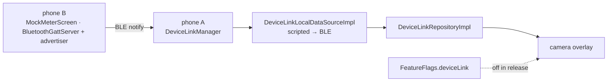

# F13 — DeviceLink (BLE meters)

<dl><dd>

- Sprint [S7](README.md) · 18h · skeleton guide — full code is added when this feature starts.
- iOS twin: [iOS F13](https://github.com/DAMHONGDUC/site_log_swift_ui/blob/main/docs/feature-guide/S7-checklists-devices-diagnostics/F13-devicelink.md).

</dd></dl>

## Contents

<dl><dd>

1. [Overview](#overview)
2. [Target structure](#target-structure)
3. [1. Contract — mock meter profile](#1-contract--mock-meter-profile)
4. [2. Domain — DeviceLink types](#2-domain--devicelink-types)
5. [3. Fake data — scripted readings](#3-fake-data--scripted-readings)
6. [4. View models — pairing and overlay](#4-view-models--pairing-and-overlay)
7. [5. Local — BLE central inside the data source](#5-local--ble-central-inside-the-data-source)
8. [6. Mock — the second phone as a meter](#6-mock--the-second-phone-as-a-meter)
9. [7. Release — feature flag](#7-release--feature-flag)
10. [Tests (after the feature works)](#tests-after-the-feature-works)
11. [Feature done](#feature-done)

</dd></dl>

## Overview

<dl><dd>

- **Goal:** scan → connect → read a laser or moisture meter → attach the reading to a capture; never block the camera.
- **Demo — offline:** phone B runs the debug mock meter; phone A pairs in Settings › Devices; B sends 3.42 m → A's camera shows it → the next photo carries it.
- **Demo — signed in:** the reading travels with the capture row; nothing else syncs.
- **Test hardware:** two Android phones with BLE peripheral support (`BluetoothAdapter.isMultipleAdvertisementSupported`). An iPhone running the iOS mock works as phone B too: the profile is the same.
- **Spec:** [06](../../feature-docs/01-field-work.md#06-devicelink-ble-measuring-tools).

| Step | Layer | Hours | Status | What |
|---|---|---|---|---|
| [1](#1-contract--mock-meter-profile) | Contract | 1h | not start | Service, characteristic, byte layout (same as iOS) |
| [2](#2-domain--devicelink-types) | Domain | 1h | not start | `DeviceReading`, `DeviceLinkRepository` |
| [3](#3-fake-data--scripted-readings) | Fake data | 1h | not start | Real repository over a scripted data source |
| [4](#4-view-models--pairing-and-overlay) | View models | 3h | not start | Settings › Devices, camera overlay |
| [5](#5-local--ble-central-inside-the-data-source) | Local | 8h | not start | `DeviceLinkManager`, profiles, data source |
| [6](#6-mock--the-second-phone-as-a-meter) | Mock | 3h | not start | Debug-only GATT server screen |
| [7](#7-release--feature-flag) | Release | 1h | not start | Off for users until a real meter passes |



</dd></dl>

## Target structure

<dl><dd>

```text
domain/…/entities/devicelink/  repositories/DeviceLinkRepository.kt  usecases/devicelink/
data/…/datasources/local/devicelink/DeviceLinkLocalDataSource.kt + Impl
platformkit/…/bluetooth/DeviceLinkManager.kt, DeviceProfile.kt, profiles/MockMeterProfile.kt, GenericRawProfile.kt
app/…/presentation/settings/devices/, capture/camera/ReadingOverlay.kt
app/src/debug/…/mockmeter/MockMeterScreen.kt
```

</dd></dl>

## 1. Contract — mock meter profile

<dl><dd>

- Reuse the iOS mock's service UUID, characteristic UUID and byte layout exactly ([iOS F13 step 1](https://github.com/DAMHONGDUC/site_log_swift_ui/blob/main/docs/feature-guide/S7-checklists-devices-diagnostics/F13-devicelink.md#1-contract--mock-meter-profile)).

</dd></dl>

## 2. Domain — DeviceLink types

<dl><dd>

- `DeviceReading` (value, unit, kind, measuredAt, deviceName); `DeviceLinkState` (off, scanning, connecting, ready, disconnected); `AttachReadingUseCase` refuses readings older than 30 s.

</dd></dl>

## 3. Fake data — scripted readings

<dl><dd>

- The data source emits 3.42 m every 5 s as a `Flow`; disconnects every 30 s.

</dd></dl>

## 4. View models — pairing and overlay

<dl><dd>

| Screen | Job |
|---|---|
| Settings › Devices | Scan list (name, RSSI ≥ −85), connect, forget |
| Camera overlay | Latest reading + coloured dot; never a dialog |

</dd></dl>

## 5. Local — BLE central inside the data source

<dl><dd>

| Piece | Holds |
|---|---|
| Permissions | `BLUETOOTH_SCAN` (`usesPermissionFlags="neverForLocation"`), `BLUETOOTH_CONNECT` (API 31+); `ACCESS_FINE_LOCATION` with `maxSdkVersion="30"` |
| `DeviceLinkManager` | One single-thread dispatcher; GATT operations queued, each waits for its callback; scan with `ScanFilter(serviceUuid)` and a 15 s timeout |
| Connect | `connectGatt(context, false, callback, TRANSPORT_LE)` → `discoverServices` → enable notify (write CCCD `0x2902`) |
| Reconnect | Known address, backoff 2 s → 60 s; `close()` the old `BluetoothGatt` first |
| Profiles | `MockMeterProfile`, `GenericRawProfile`; `parse(bytes)` pure |

- Background: disconnect after 5 minutes in the background; never scan in the background.

</dd></dl>

## 6. Mock — the second phone as a meter

<dl><dd>

- Debug screen: `BluetoothLeAdvertiser.startAdvertising` with the service UUID; `BluetoothGattServer` with the notify characteristic; buttons “Send 3.42 m”, “Send garbage”, “Disconnect”.

</dd></dl>

## 7. Release — feature flag

<dl><dd>

- `FeatureFlags.deviceLink = BuildConfig.DEBUG` until one real meter (Bosch GLM, Leica DISTO) passes; the Settings row and overlay are hidden when off.

</dd></dl>

## Tests (after the feature works)

<dl><dd>

- Profile `parse` on captured bytes; truncated and bad-checksum payloads throw
- Unit conversion; stale reading not attached
- Reconnect backoff capped
- Manager GATT queue: second operation waits for the first callback

</dd></dl>

## Feature done

<dl><dd>

| Check | How |
|---|---|
| Demo | Phone B → phone A reading on the camera; killing B greys the dot; relaunch reconnects within 10 s |
| Roadmap | F13 steps ticked |

</dd></dl>
