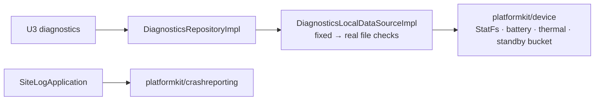

# F14 — Diagnostics · internal testing #2

<dl><dd>

- Sprint [S7](README.md) · 17h · skeleton guide — full code is added when this feature starts.
- iOS twin: [iOS F14](https://github.com/DAMHONGDUC/site_log_swift_ui/blob/main/docs/feature-guide/S7-checklists-devices-diagnostics/F14-diagnostics.md).

</dd></dl>

## Contents

<dl><dd>

1. [Overview](#overview)
2. [Target structure](#target-structure)
3. [1. Domain — diagnostics snapshot](#1-domain--diagnostics-snapshot)
4. [2. Fake data — fixed values](#2-fake-data--fixed-values)
5. [3. View models — diagnostics and cleanup](#3-view-models--diagnostics-and-cleanup)
6. [4. Local — storage, bundle, Crashlytics](#4-local--storage-bundle-crashlytics)
7. [5. Release — profiling pass and internal testing #2](#5-release--profiling-pass-and-internal-testing-2)
8. [Tests (after the feature works)](#tests-after-the-feature-works)
9. [Feature done](#feature-done)

</dd></dl>

## Overview

<dl><dd>

- **Goal:** integrity checks, synced-only cleanup, a redacted diagnostic bundle, background-restriction hints, crash reports; second internal testing build.
- **Demo — offline:** U3 says “All 1,284 photos check out”, shows storage, exports a redacted bundle; cleanup frees only synced files.
- **Demo — signed in:** a test non-fatal shows in Crashlytics; internal testing #2 installs.
- **Spec:** [09](../../feature-docs/05-platform.md#09-diagnostics-and-observability), [19](../../feature-docs/05-platform.md#19-performance-profiling).

| Step | Layer | Hours | Status | What |
|---|---|---|---|---|
| [1](#1-domain--diagnostics-snapshot) | Domain | 1h | not start | Integrity result, storage, device flags |
| [2](#2-fake-data--fixed-values) | Fake data | 1h | not start | Real `DiagnosticsRepositoryImpl` over fixed values |
| [3](#3-view-models--diagnostics-and-cleanup) | View models | 2h | not start | U3, storage cleanup |
| [4](#4-local--storage-bundle-crashlytics) | Local | 8h | not start | Real checks, cleanup, bundle, Crashlytics |
| [5](#5-release--profiling-pass-and-internal-testing-2) | Release | 5h | not start | Budgets, `v*` tag |
| — | Contract · Backend · Sync | — | — | Device only |



</dd></dl>

## Target structure

<dl><dd>

```text
domain/…/entities/diagnostics/  usecases/diagnostics/  RunIntegrityCheckUseCase, CleanUpSyncedFilesUseCase, ExportDiagnosticBundleUseCase
data/…/datasources/local/diagnostics/DiagnosticsLocalDataSource.kt + Impl
platformkit/…/device/DeviceStatusProviding.kt + DeviceStatusProvider.kt
platformkit/…/crashreporting/CrashReporting.kt + CrashlyticsReporter.kt
app/…/presentation/diagnostics/, settings/storagecleanup/
app/…/diagnostics/IntegrityCheckWorker.kt
```

</dd></dl>

## 1. Domain — diagnostics snapshot

<dl><dd>

- `IntegrityResult` (checked, missing files, orphans, hash mismatches, stuck jobs), `StorageBreakdown`, `DeviceFlags` (permission, disk, thermal, battery, background restricted, network, audit, sync).

</dd></dl>

## 2. Fake data — fixed values

<dl><dd>

- Fixed snapshot: 1,284 photos, 0 problems, 12 pending.

</dd></dl>

## 3. View models — diagnostics and cleanup

<dl><dd>

- U3: sentence summary, flags as cards with one action each (“Open battery settings” → `Settings.ACTION_APPLICATION_DETAILS_SETTINGS`).
- Cleanup: numbers first; only `SYNCED` originals; reclaimable caches on a separate line.

</dd></dl>

## 4. Local — storage, bundle, Crashlytics

<dl><dd>

| Task | Holds |
|---|---|
| Storage | Walk `filesDir/media`; compare with Room; re-hash a sample of 50; full check as `IntegrityCheckWorker` |
| Device | `StatFs`, `BatteryManager.BATTERY_PROPERTY_CAPACITY`, `PowerManager.currentThermalStatus`, `UsageStatsManager.appStandbyBucket`, `ConnectivityManager.restrictBackgroundStatus` |
| Bundle | `ZipOutputStream` with `device.json`, `permissions.json`, `upload-state.json`, `work.json`, `integrity.json`, `logs.ndjson` (24 h); redaction on write; shared through `FileProvider` |
| Crashlytics | `CrashlyticsReporter` behind `CrashReporting`; custom keys ids/enums only; `recordException` from repositories' `catch` for non-fatals worth tracking |

</dd></dl>

## 5. Release — profiling pass and internal testing #2

<dl><dd>

- Run [19](../../feature-docs/05-platform.md#19-performance-profiling) scenarios 1–5 on a mid-range phone, save Perfetto traces; tag `v*`.

</dd></dl>

## Tests (after the feature works)

<dl><dd>

- Detectors on a temp folder + in-memory Room
- Cleanup never touches `PENDING`/`FAILED`
- Redacted bundle equals the expected text
- Estimates never `NaN` or negative; flags at boundaries; `UPLOADING` without work resets

</dd></dl>

## Feature done

<dl><dd>

| Check | How |
|---|---|
| Demo | U3 numbers; redacted bundle; cleanup keeps pending files |
| Release | Internal testing #2 installed |
| Roadmap | F14 steps ticked |

</dd></dl>
