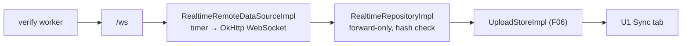

# F15 — Realtime progress and verification

<dl><dd>

- Sprint [S8](README.md) · 13h · skeleton guide — full code is added when this feature starts.
- iOS twin: [iOS F15](https://github.com/DAMHONGDUC/site_log_swift_ui/blob/main/docs/feature-guide/S8-realtime-push-quality/F15-realtime.md).

</dd></dl>

## Contents

<dl><dd>

1. [Overview](#overview)
2. [Target structure](#target-structure)
3. [1. Contract — WebSocket messages](#1-contract--websocket-messages)
4. [2. Domain — upload events](#2-domain--upload-events)
5. [3. Fake data — events on a timer](#3-fake-data--events-on-a-timer)
6. [4. View models — live state on the Sync tab](#4-view-models--live-state-on-the-sync-tab)
7. [5. Backend — shared](#5-backend--shared)
8. [6. Sync — OkHttp WebSocket](#6-sync--okhttp-websocket)
9. [Tests (after the feature works)](#tests-after-the-feature-works)
10. [Feature done](#feature-done)

</dd></dl>

## Overview

<dl><dd>

- **Goal:** an observation-only channel tells the app what the server has confirmed; uploads turn `verified` or `mismatch` live.
- **Demo — offline:** no channel: the Sync tab is only slower, never red.
- **Demo — signed in:** uploads turn “verified” as events arrive; a tampered object shows as a mismatch.
- **Spec:** [10](../../feature-docs/02-upload-sync.md#10-realtime-progress-channel), [03-backend §9](../../feature-docs/03-backend.md#9-realtime-channel).

| Step | Layer | Hours | Status | What |
|---|---|---|---|---|
| [1](#1-contract--websocket-messages) | Contract | 1h | not start | Sealed `RealtimeMessage` |
| [2](#2-domain--upload-events) | Domain | 1h | not start | `UploadEvent`, `RealtimeRepository` |
| [3](#3-fake-data--events-on-a-timer) | Fake data | 1h | not start | Timer data source |
| [4](#4-view-models--live-state-on-the-sync-tab) | View models | 2h | not start | Live state on U1 |
| [5](#5-backend--shared) | Backend | 0h | not start | Shared `/ws`, verify worker |
| [6](#6-sync--okhttp-websocket) | Sync | 8h | not start | Client and reconnect |
| — | Local | — | — | Events update the F06 upload store |



</dd></dl>

## Target structure

<dl><dd>

```text
platformkit/…/realtime/RealtimeChannel.kt, RealtimeMessage.kt, RealtimeBackoff.kt
data/…/datasources/remote/realtime/RealtimeRemoteDataSource.kt + Impl
data/…/repositories/RealtimeRepositoryImpl.kt
app/…/sync/RealtimeConnectionPolicy.kt     # foreground + unsynced jobs + network allowed
```

</dd></dl>

## 1. Contract — WebSocket messages

<dl><dd>

- `@Serializable sealed interface RealtimeMessage` with `classDiscriminator = "type"`: `Snapshot`, `JobCompleted`, `JobFailed`, `Pong`; outgoing `Auth`, `Subscribe`, `Ping`.

</dd></dl>

## 2. Domain — upload events

<dl><dd>

- `UploadEvent` (`Completed(jobId, remoteKey, sha256, verified)`, `Failed(jobId, reason)`); `RealtimeRepository.events(): Flow<UploadEvent>`.

</dd></dl>

## 3. Fake data — events on a timer

<dl><dd>

- Emits `Completed` for pending jobs every 2 s.

</dd></dl>

## 4. View models — live state on the Sync tab

<dl><dd>

- U1 shows “verified” chips as events land; a closed channel shows nothing extra (only slower).

</dd></dl>

## 5. Backend — shared

<dl><dd>

- [site-log-be F15](https://github.com/DAMHONGDUC/site-log-be/blob/main/docs/feature-guide/S8-realtime-push/F15-realtime.md).

</dd></dl>

## 6. Sync — OkHttp WebSocket

<dl><dd>

| Piece | Holds |
|---|---|
| `RealtimeChannel` | `OkHttpClient.newWebSocket(request, listener)`; listener callbacks pushed into a `Channel` and consumed under a `Mutex`; first message `auth`, 5 s timeout |
| Ping | App-level JSON `ping` every 30 s; missing `pong` in 10 s → close and reconnect |
| Reconnect | Backoff 1 s → 60 s with jitter, unlimited; `4001` → refresh token first |
| Size guard | Text over 64 KiB → close without parsing |
| Policy | Connect on `ProcessLifecycleOwner` `ON_START` when jobs are unsynced and the network is allowed; disconnect on `ON_STOP` |

- `jobCompleted` with a `sha256` different from the local hash → `INTEGRITY` failure, flag shown.

</dd></dl>

## Tests (after the feature works)

<dl><dd>

- Decode all types + malformed + oversized
- Missing `pong` → backoff; cap and jitter
- Hash mismatch; one event 10× = once; snapshot forward only; unknown `jobID`
- `MockWebServer` WebSocket flow

</dd></dl>

## Feature done

<dl><dd>

| Check | How |
|---|---|
| Demo | Live “verified”; mismatch flagged; channel off = slower only |
| Roadmap | F15 steps ticked |

</dd></dl>
