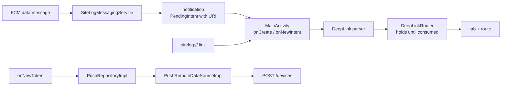

# F16 — Push and deep links

<dl><dd>

- Sprint [S8](README.md) · 11h · skeleton guide — full code is added when this feature starts.
- iOS twin: [iOS F16](https://github.com/DAMHONGDUC/site_log_swift_ui/blob/main/docs/feature-guide/S8-realtime-push-quality/F16-push-deeplinks.md).

</dd></dl>

## Contents

<dl><dd>

1. [Overview](#overview)
2. [Target structure](#target-structure)
3. [1. Contract — FCM payload and device token](#1-contract--fcm-payload-and-device-token)
4. [2. Domain — deep link parser](#2-domain--deep-link-parser)
5. [3. Fake data — token data source in memory](#3-fake-data--token-data-source-in-memory)
6. [4. View models — permission and settings](#4-view-models--permission-and-settings)
7. [5. Local — FCM service, intent filter, router](#5-local--fcm-service-intent-filter-router)
8. [6. Backend — FCM in site-log-be](#6-backend--fcm-in-site-log-be)
9. [7. Sync — token to the backend](#7-sync--token-to-the-backend)
10. [Tests (after the feature works)](#tests-after-the-feature-works)
11. [Feature done](#feature-done)

</dd></dl>

## Overview

<dl><dd>

- **Goal:** a push carries only a destination; `sitelog://<route>/<id>` is parsed once and routed, even after a cold start; the app works fully with notifications denied.
- **Demo — offline:** `adb shell am start -W -a android.intent.action.VIEW -d "sitelog://session/42" com.dd.sitelog` opens the session; denying notifications changes nothing else.
- **Demo — signed in:** a verified upload sends an FCM message; tapping the notification opens the session.
- **Spec:** [18](../../feature-docs/05-platform.md#18-push-notifications-and-deep-links), [03-backend §10](../../feature-docs/03-backend.md#10-push-registration).

| Step | Layer | Hours | Status | What |
|---|---|---|---|---|
| [1](#1-contract--fcm-payload-and-device-token) | Contract | 1h | not start | Data payload; `POST /devices` with `platform` |
| [2](#2-domain--deep-link-parser) | Domain | 1h | not start | Pure `DeepLink` parser |
| [3](#3-fake-data--token-data-source-in-memory) | Fake data | 1h | not start | Real `PushRepositoryImpl` |
| [4](#4-view-models--permission-and-settings) | View models | 2h | not start | Permission moment, settings row |
| [5](#5-local--fcm-service-intent-filter-router) | Local | 4h | not start | FCM service, channels, intent filter, router |
| [6](#6-backend--fcm-in-site-log-be) | Backend | 0h | not start | Shared FCM sender: check only |
| [7](#7-sync--token-to-the-backend) | Sync | 2h | not start | Token registered through `HttpClient` |



</dd></dl>

## Target structure

<dl><dd>

```text
domain/…/entities/deeplinks/DeepLink.kt  usecases/deeplinks/ParseDeepLinkUseCase.kt
domain/…/repositories/PushRepository.kt
data/…/datasources/remote/push/PushRemoteDataSource.kt + Impl
platformkit/…/push/SiteLogMessagingService.kt, NotificationChannels.kt, PushTokenProviding.kt
app/…/presentation/deeplinks/DeepLinkRouter.kt, notifications/NotificationPermissionCard.kt
app/src/main/AndroidManifest.xml          # intent-filter, service, channels
```

</dd></dl>

## 1. Contract — FCM payload and device token

<dl><dd>

- Data message: `deepLink`, `account` (uid hash), `title`, `body`.
- `POST /devices { token, platform: "android" }`; `DELETE /devices/:token`.

</dd></dl>

## 2. Domain — deep link parser

<dl><dd>

- `DeepLink` sealed: `Session(id)`, `Issue(id)`; `ParseDeepLinkUseCase(uri: String): DeepLink?` — wrong scheme, unknown route, missing or malformed id → `null` + log.

</dd></dl>

## 3. Fake data — token data source in memory

<dl><dd>

- Records registered tokens in a list.

</dd></dl>

## 4. View models — permission and settings

<dl><dd>

- Ask `POST_NOTIFICATIONS` (API 33+) after the first upload completes, with a card explaining why; Settings row shows the state and links to system settings.

</dd></dl>

## 5. Local — FCM service, intent filter, router

<dl><dd>

| Piece | Holds |
|---|---|
| Manifest | `MainActivity` `launchMode="singleTop"`, `<intent-filter>` `VIEW` + `DEFAULT` + `BROWSABLE` + `<data android:scheme="sitelog"/>`; `SiteLogMessagingService` `exported="false"` with `com.google.firebase.MESSAGING_EVENT` |
| Service | `onMessageReceived`: drop if `account` ≠ current user hash; build notification on channel `updates` with a `PendingIntent` (`FLAG_IMMUTABLE`) carrying the URI |
| Activity | Pass `intent.data` from `onCreate` and `onNewIntent` to `DeepLinkRouter` |
| Router | `MutableStateFlow<DeepLink?>`; `RootScreen` consumes it after unlock: switch tab, `coordinator.push(route)`, clear |

</dd></dl>

## 6. Backend — FCM in site-log-be

<dl><dd>

- Built once for both apps in [site-log-be F16](https://github.com/DAMHONGDUC/site-log-be/blob/main/docs/feature-guide/S8-realtime-push/F16-push.md): `devices.platform`, `firebase-admin/messaging`, tokens removed on `messaging/registration-token-not-registered`.
- **Check:** register an Android token; a verified session sends a data message that opens the session.

</dd></dl>

## 7. Sync — token to the backend

<dl><dd>

- `PushRemoteDataSourceImpl` over `HttpClient`; register after sign-in and on `onNewToken`; remove on sign-out.

</dd></dl>

## Tests (after the feature works)

<dl><dd>

- Parser routes and rejections
- Payload with/without `deepLink`; other account dropped
- Router holds until consumed
- Cold-start link survives (`ActivityScenario.launch(intent)` UI test)

</dd></dl>

## Feature done

<dl><dd>

| Check | How |
|---|---|
| Demo | `adb` link, Chrome link, push tap: killed, background, foreground |
| Roadmap | F16 steps ticked |

</dd></dl>
