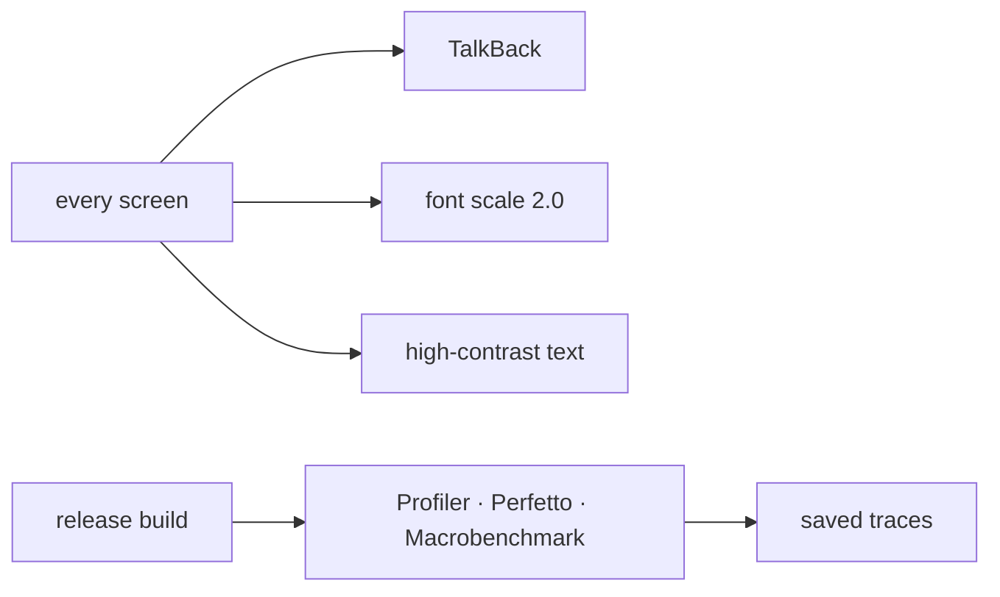

# F17 — Accessibility and performance

<dl><dd>

- Sprint [S8](README.md) · 14h · skeleton guide.
- iOS twin: [iOS F17](https://github.com/DAMHONGDUC/site_log_swift_ui/blob/main/docs/feature-guide/S8-realtime-push-quality/F17-accessibility-performance.md).

</dd></dl>

## Contents

<dl><dd>

1. [Overview](#overview)
2. [1. Polish — accessibility pass](#1-polish--accessibility-pass)
3. [2. Release — budgets, Baseline Profile, Data safety, feedback](#2-release--budgets-baseline-profile-data-safety-feedback)
4. [Feature done](#feature-done)

</dd></dl>

## Overview

<dl><dd>

- **Goal:** every screen works with TalkBack, font scale 200% and high-contrast text; every profiling budget is met with a saved trace; internal-testing feedback is closed. Submission is F18.
- **Demo — offline:** TalkBack walk unlock → projects → capture → report.
- **Demo — signed in:** the same walk with sync running; profiling scenarios on a release build.
- **Spec:** [19](../../feature-docs/05-platform.md#19-performance-profiling), [compose rules §7](../../compose-rules.md#7-quality).

| Step | Layer | Hours | Status | What |
|---|---|---|---|---|
| [1](#1-polish--accessibility-pass) | Polish | 8h | not start | Labels, semantics, focus order, 48 dp targets |
| [2](#2-release--budgets-baseline-profile-data-safety-feedback) | Release | 6h | not start | Traces, Baseline Profile, Data safety draft, feedback |

</dd></dl>

## 1. Polish — accessibility pass

<dl><dd>

| Check | How |
|---|---|
| Labels | `contentDescription` on every icon button; decorative images `null` |
| Grouping | `Modifier.semantics(mergeDescendants = true)` on list rows so TalkBack reads one sentence |
| Headings | `semantics { heading() }` on screen and section titles |
| State | `stateDescription` on toggles and status chips (“Waiting for Wi-Fi”) |
| Custom actions | Long-press actions (pin drop, delete) also as `customActions` |
| Targets | 48 dp minimum (`minimumInteractiveComponentSize`) |
| Text | Every style in `sp`; layouts survive `fontScale = 2f` (previews + device) |
| Colour | Severity never by colour alone: icon + text too |
| Tool | Accessibility Scanner on every screen; Compose UI test `assertHasClickAction`, `onNodeWithContentDescription` |

- Split by area: access + projects · capture + issues · reports + settings.

</dd></dl>

## 2. Release — budgets, Baseline Profile, Data safety, feedback

<dl><dd>

| Task | Holds |
|---|---|
| Budgets | Scenarios 1–6 of [19](../../feature-docs/05-platform.md#19-performance-profiling) on a mid-range phone; traces saved under `docs/perf/` with device and API level |
| Baseline Profile | `:benchmark` module with Macrobenchmark; `BaselineProfileRule` for cold start and the survey list; profile shipped in the AAB |
| Data safety | Draft in Play Console: location (optional, on device and synced), photos/videos (user content, synced), crash logs, device IDs; encryption in transit; deletion request link |
| Feedback | Close or ticket every internal-testing report |

</dd></dl>

## Feature done

<dl><dd>

| Check | How |
|---|---|
| TalkBack | Full walk without sight |
| Budgets | Every scenario within budget, trace saved |
| Roadmap | F17 steps ticked |

</dd></dl>
