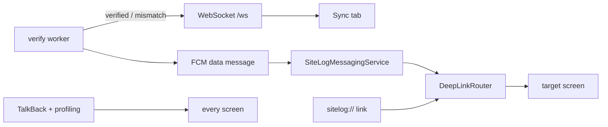

# S8 — Realtime, push, accessibility and performance

<dl><dd>

- Sprint 8 · 2 weeks · 41h · [all sprints](../README.md)

</dd></dl>

## Contents

<dl><dd>

1. [Overview](#overview)
2. [Tasks](#tasks)
3. [Done](#done)
4. [Self-check](#self-check)

</dd></dl>

## Overview

<dl><dd>

- **Goal:** the Sync tab shows server-confirmed state as it happens; FCM pushes and `sitelog://` links open the right screen; every screen passes TalkBack and every profiling budget.
- **Demo — offline:** no channel, no push — the app is only slower, never red; TalkBack walk unlock → projects → capture → report.
- **Demo — signed in:** an upload turns “verified” live; a push opens its session; a Chrome link opens after a cold start.

| F | Feature | Guide | Hours |
|---|---|---|---|
| F15 | Realtime progress and verification | [F15-realtime.md](F15-realtime.md) | 13 |
| F16 | Push and deep links | [F16-push-deeplinks.md](F16-push-deeplinks.md) | 14 |
| F17 | Accessibility and performance | [F17-accessibility-performance.md](F17-accessibility-performance.md) | 14 |

</dd></dl>

## Tasks

<dl><dd>

| Task | Step | Layer | Hours | Status |
|---|---|---|---|---|
| F15.1 | WebSocket messages | Contract | 1 | not start |
| F15.2 | Upload events, realtime repository | Domain | 1 | not start |
| F15.3 | Repository + data source on a timer | Fake data | 1 | not start |
| F15.4 | Live state on the Sync tab | View models | 2 | not start |
| F15.5 | Shared backend: `/ws`, verify worker | Backend | 0 | not start |
| F15.6 | OkHttp WebSocket inside the data source (split: client · reconnect) | Sync | 8 | not start |
| F16.1 | FCM payload, `POST /devices` with `platform` | Contract | 1 | not start |
| F16.2 | Deep link parser | Domain | 1 | not start |
| F16.3 | Repository + token data source in memory | Fake data | 1 | not start |
| F16.4 | Permission moment, notification settings | View models | 2 | not start |
| F16.5 | FCM service, channels, intent filter, router | Local | 4 | not start |
| F16.6 | site-log-be: FCM tokens and sending | Backend | 3 | not start |
| F16.7 | Token sent through `HttpClient` | Sync | 2 | not start |
| F17.1 | Accessibility pass (split: access + projects · capture + issues · reports + settings) | Polish | 8 | not start |
| F17.2 | Budgets with traces, Baseline Profile, Data safety draft, feedback | Release | 6 | not start |

</dd></dl>

## Done

<dl><dd>

- [ ] Offline: no red anywhere when the channel is closed or notifications are denied
- [ ] Signed in: live “verified”; mismatch flagged; push and cold-start link open their target
- [ ] TalkBack walk passes; every budget met with a saved trace
- [ ] F15, F16 and F17 tests written and green

</dd></dl>

## Self-check

<dl><dd>

- Why is the auth token sent in the first WebSocket message, never in the URL?
- Why does the server send an FCM **data** message, not a notification message?
- What does a push carry, and what must it never carry?

</dd></dl>
