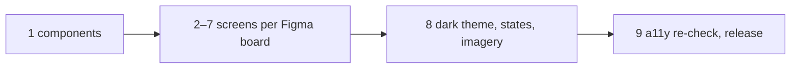

# F18 — UI finish and Google Play

<dl><dd>

- Sprint [S9](README.md) · 48h · skeleton guide — parts, files, order, tests. Filled in when this feature starts.
- iOS twin: [iOS F18](https://github.com/DAMHONGDUC/site_log_swift_ui/blob/main/docs/feature-guide/S9-release/F18-ui-finish.md).

</dd></dl>

## Contents

<dl><dd>

1. [Overview](#overview)
2. [1. Components to Figma](#1-components-to-figma)
3. [2–7. Screens to Figma](#27-screens-to-figma)
4. [8. Dark theme, states, imagery](#8-dark-theme-states-imagery)
5. [9. Accessibility re-check and release](#9-accessibility-re-check-and-release)
6. [10. Optional — screenshot tests](#10-optional--screenshot-tests)
7. [11. Backend — shared](#11-backend--shared)
8. [Feature done](#feature-done)

</dd></dl>

## Overview

<dl><dd>

- **Goal:** take every screen from the ~30% skeleton to Figma, on real logic, then release on Google Play.
- **Demo:** every screen matches Figma side by side in light and dark; the release is rolled out to production.
- **Specs:** [design plan](https://github.com/DAMHONGDUC/site_log_swift_ui/blob/main/docs/design/00-design-plan.md), [Android screens](https://github.com/DAMHONGDUC/site_log_swift_ui/blob/main/docs/design/html/3-android.html), [Figma file](https://www.figma.com/design/uJZcCP6lzw8QTSkcu8uqvV/Site-Log-iOS-Design) (page 03 Android), [compose rules §5](../../compose-rules.md#5-design-system).
- F18 changes how screens look, never what they do. Figma board ids (S1–S11) name design boards, not sprints.

| Step | Layer | Hours | Status | What |
|---|---|---|---|---|
| [1](#1-components-to-figma) | UI | 6h | not start | Components to Figma |
| [2–7](#27-screens-to-figma) | UI | 31h | not start | Figma S1–S11 screens |
| [8](#8-dark-theme-states-imagery) | UI | 5h | not start | Dark theme, empty / error / offline states, imagery |
| [9](#9-accessibility-re-check-and-release) | Release | 6h | not start | Accessibility re-check, listing, Data safety, rollout |
| [10](#10-optional--screenshot-tests) | Tests | 6h | optional | Roborazzi for `DSGallery` and every screen |
| [11](#11-backend--shared) | Backend | 0h | not start | Production already live |

</dd></dl>

## 1. Components to Figma

<dl><dd>

- `DSButton`, `DSListRow`, `DSChip`, `DSEmptyState`, `DSSectionHeader`, `DSStatusMarker`, `DSTextField`, `DSConfirmDialog`, top bar, bottom navigation: final look from Figma, built on Material 3 components themed by `SiteLogTheme`.
- Where Figma shows an iOS-only pattern (large title collapse, swipe actions), use the Material equivalent (`LargeTopAppBar` with scroll behaviour, `SwipeToDismissBox`) and note it on the board.

</dd></dl>

## 2–7. Screens to Figma

<dl><dd>

| Step | Board | Screens | Hours |
|---|---|---|---|
| 2 | S1 | Access: splash, sign in, biometric lock, passcode | 3 |
| 3 | S2–S3 | Projects, sessions, survey, rooms | 6 |
| 4 | S4–S5 | Camera, capture review, issues | 6 |
| 5 | S6–S7 | Markup, stamp, plans | 5 |
| 6 | S8–S9 | Checklists, reports | 6 |
| 7 | S10–S11 | Sync, diagnostics, settings | 5 |

- Android chrome: edge-to-edge with `WindowInsets` padding, predictive back on (`android:enableOnBackInvokedCallback="true"`), system bars contrast-checked.

</dd></dl>

## 8. Dark theme, states, imagery

<dl><dd>

- Every screen: loading, empty (`DSEmptyState`), error, offline; dark palette; adaptive launcher icon (foreground + monochrome layer for themed icons) from `docs/design/app-icon/`; splash via `core-splashscreen`.

</dd></dl>

## 9. Accessibility re-check and release

<dl><dd>

| Task | Holds |
|---|---|
| Re-check | F17 checklist on the finished UI |
| Listing | Title, short and full description (EN + VI), phone screenshots, feature graphic 1024 × 500 |
| Policy | Data safety, content rating, target audience, account-deletion URL, privacy policy URL |
| Release | Internal → production rollout (staged 20% → 100%) |

</dd></dl>

## 10. Optional — screenshot tests

<dl><dd>

- Roborazzi on Robolectric: `DSGallery` and each `Content` composable in light, dark, `fontScale = 2f`; references recorded on one pinned Robolectric device config and committed.

</dd></dl>

## 11. Backend — shared

<dl><dd>

- Production backend and operations are done in [site-log-be F18](https://github.com/DAMHONGDUC/site-log-be/blob/main/docs/feature-guide/S9-release/F18-production.md).

</dd></dl>

## Feature done

<dl><dd>

| Check | How |
|---|---|
| Visual | Every screen next to Figma, light and dark |
| Release | Production rollout at 100% |
| Roadmap | F18 steps ticked |

</dd></dl>
