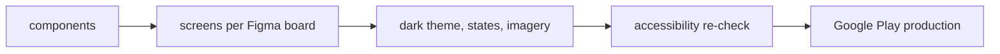

# S9 — UI finish and Google Play

<dl><dd>

- Sprint 9 · 2 weeks · 48h · [all sprints](../README.md)

</dd></dl>

## Contents

<dl><dd>

1. [Overview](#overview)
2. [Tasks](#tasks)
3. [Done](#done)
4. [Self-check](#self-check)

</dd></dl>

## Overview

<dl><dd>

- **Goal:** every screen goes from the ~30% skeleton to its Figma frame (Material 3 components, SiteLog tokens), on the logic built in S0–S8; the app is released on Google Play.
- **Demo — offline:** every screen next to its Figma frame, light and dark, small and large phone, font scale 200%, with Continue offline.
- **Demo — signed in:** the same on the production backend; the release is rolled out from internal → production.
- Figma board ids (S1–S11) name design boards, not sprints.

| F | Feature | Guide | Hours |
|---|---|---|---|
| F18 | UI finish and Google Play | [F18-ui-finish.md](F18-ui-finish.md) | 48 |

</dd></dl>

## Tasks

<dl><dd>

| Task | Step | Layer | Hours | Status |
|---|---|---|---|---|
| F18.1 | Components to Figma | UI | 6 | not start |
| F18.2 | Figma S1: access screens | UI | 3 | not start |
| F18.3 | Figma S2–S3: projects, sessions, rooms | UI | 6 | not start |
| F18.4 | Figma S4–S5: camera, capture review, issues | UI | 6 | not start |
| F18.5 | Figma S6–S7: markup, stamp, plans | UI | 5 | not start |
| F18.6 | Figma S8–S9: checklists, reports | UI | 6 | not start |
| F18.7 | Figma S10–S11: sync, diagnostics, settings | UI | 5 | not start |
| F18.8 | Dark theme, empty / error / offline states, imagery | UI | 5 | not start |
| F18.9 | Accessibility re-check, store listing, Data safety, rollout | Release | 6 | not start |
| F18.10 | Optional: Roborazzi screenshots (not counted) | Tests | 6 | optional |
| F18.11 | Shared backend: production already live | Backend | 0 | not start |

</dd></dl>

## Done

<dl><dd>

- [ ] Every screen matches Figma in light and dark
- [ ] Accessibility checks pass on the finished UI (TalkBack, Accessibility Scanner)
- [ ] Store listing, Data safety form, content rating and target API checks pass in Play Console
- [ ] Release rolled out to production

</dd></dl>

## Self-check

<dl><dd>

- F18 changes how screens look. Which kinds of change would mean a step went too far?
- Which Play Console checks block a release that the code alone cannot fix?

</dd></dl>
